This is Arduino based and 3D printed nano quadcopter which flies on DC brushed motors. The name nano comes from the fact that the project is based on Arduino nano, which I think is one of the most successful dev boards ever made. This project isn't just another *Hey - look what a cool thing I made*, it is instead aimed at analysing and understanding the design decisions which need to be made when designing a quadcopter, thus it will be a bit lengthy. However if you want to understand quadcopters from the bottom up - stay with me!

When I initially started working on the project (a shame to say - years ago...) I went along with Bluetooth 2.0 module as this was popular back then, however years passed by and many more Arduino modules got developed. Recently, I noticed that a couple more different nano modules such as BLE-Nano and RF-Nano (nRF24L01) are cheaply available on Aliexpress so I decided to revive this project and finally complete it. I will use BLE-Nano as the connections worked out very well and I will also want to control it using my smartphone.

One more bit, I specifically chose SMD parts available at [JLCPCB](https://jlcpcb.com/) Basic library and provided both Schematics and the PCB files available at [EasyEDA](https://easyeda.com/) for both, *Nano Quadcopter* and later improved *nRF52840 Quadcopter.* Some through-hole connectors and other quadcopter related essentials will still have to be sourced separately, otherwise one can preorder an already assembled PCB or order parts separately and solder them by hand.

P.S. The robot is dedicated for M.O.N.T.E. (*Mobile Omnidirectional Neutralization and Termination Eradicator*) killer robot from *The Big Bang Theory :D*

# **Step 1: Frame & Plastic**

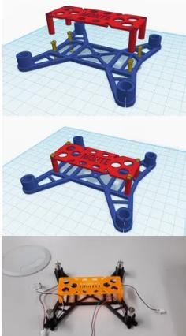

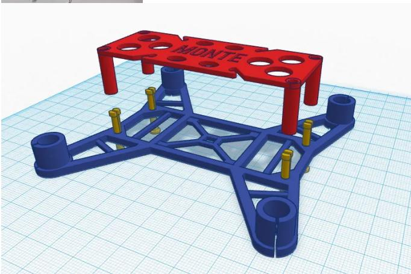

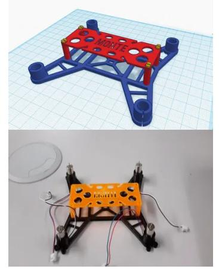

# **Material Choice**

When designing the frame there are a couple of considerations to make. The frame must be:

- Light obviously the lighter it is, the easier it will be to lift it up!
- Sturdy quadcopter tend to fall a lot and if it doesn't break after every fall is it a huge plus.
- Resistive to vibrations otherwise it might be unstable as the motors do vibrate a lot. This also helps to reduce accelerometer picked up noise.

In the past I saw quadcopters which frame was made from plastic, carbon fibre, some sort of metal, PCB or a combination of these. Because I wanted to learn about 3D printing too, I decided to design my own frame and then print it using ABS plastic, however PLA should also be good. I didn't do a PCB only based quadcopter as that would increase the overall price of the PCB printing plus if one part broke... the whole quadcopter would have to be thrown away.

Using 3D printer allowed me to design the quadcopter in any shape and form I wanted. The weight of the frame that I designed was around 10 - 15 g however it will vary slightly depending on the printer settings and the plastic used to print it. For the design I used a free web design tool TinkerCAD, which is super easy to use and I encourage using it for beginners or for smaller projects. For more professional designs you could also use AutoCAD (Paid) or Blender (Free), the latter being open source and free to use is a huge advantage in my perspective, however the learning curve is way more gradual when compared to TinkerCAD.

I added the design files here so that you could go and print it right away yourself. However if you want to look into the design from all angles then visit [Thingiverse.](http://www.thingiverse.com/thing:1084921) Likewise, you can visit [TinkerCAD](https://www.tinkercad.com/things/7cnsWwxXek4) to modify my previous design the way you like it.

For a single quadcopter you only need to print *Quadcopter\_bottom\_3.stl*. Other parts are optional as they do not add any value and are there more for the looks. Also note that the screws were printed very poorly and thus I could not fit them through the designated holes. I redesigned the bottom part so that you could stick in the top part and then could simply use some plastic ties, wire or even electrical wire if you intended to use it - note though that each part adds unnecessary weight.

## **[quadcopter\\_bottom\\_3.stl](https://content.instructables.com/ORIG/FE2/G7MW/IGL8J36N/FE2G7MWIGL8J36N.stl)**

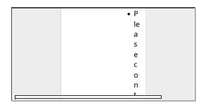

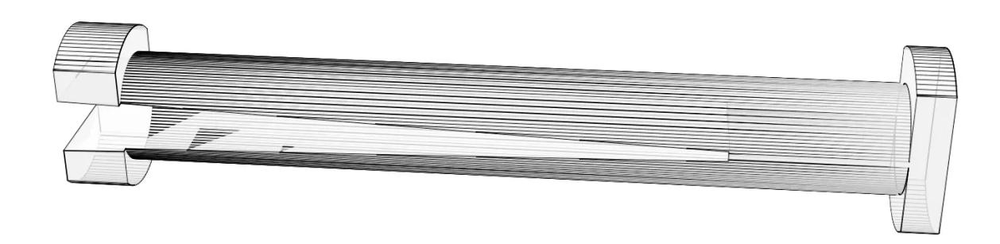

• [Quadcopter\\_screw\\_2.stl](https://content.instructables.com/ORIG/FV1/B63F/IGL8J3D1/FV1B63FIGL8J3D1.stl) View in 3D [Download](https://content.instructables.com/FV1/B63F/IGL8J3D1/FV1B63FIGL8J3D1.stl)

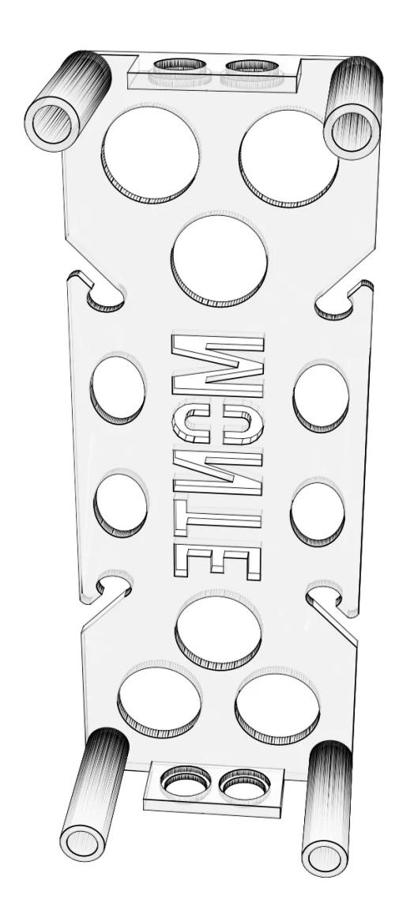

• [Quadcopter\\_top\\_2.stl](https://content.instructables.com/ORIG/FS6/UXEB/IGL8J36O/FS6UXEBIGL8J36O.stl) View in 3D [Download](https://content.instructables.com/FS6/UXEB/IGL8J36O/FS6UXEBIGL8J36O.stl)

# **Step 2: Electronics Components**

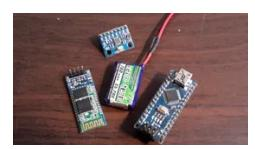

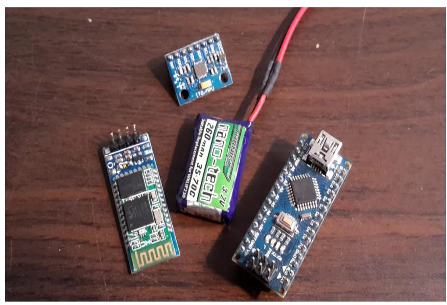

While researching some things I noticed some very similar or otherwise very interesting projects such as [this](http://www.electronoobs.com/eng_arduino_tut37.php) one based on MultiWii project, [Crazy](https://wiki.bitcraze.io/projects:crazyflie:index)flie 1.0 and [Cracy](https://wiki.bitcraze.io/projects:crazyflie2:index)flie 2.X or another [hobby project.](https://forum.arduino.cc/index.php?topic=624230.0) These are given here as a reference if you wanted to find other components which could be used for your projects or if you get stuck somewhere. When deciding each part for my quadcopter I will include its weight, if it is larger than 1g. Otherwise I will simply omit it as it's very insignificant.

# Microcontroller & Connectability

When I started this project initially I used a clone of [Arduino Nano,](https://store.arduino.cc/arduino-nano) which doesn't include any communication module, thus I wanted to use [HC-06](http://wiki.sunfounder.cc/index.php?title=Bluetooth_Transceiver_Module_HC-06) Bluetooth 2.0 slave module. However these days way better alternatives include such as:

- [Bluno Nano,](https://wiki.dfrobot.com/Bluno_Nano_SKU_DFR0296) which has. built in CC2540 BLE chip. The cost is around £27.
- [BLE-Nano,](https://github.com/keywish/keywish-nano-plus/tree/master/BLE-Nano) which is a Chinese clone of [Bluno Nano.](https://wiki.dfrobot.com/Bluno_Nano_SKU_DFR0296) On [Aliexpress](https://www.aliexpress.com/item/33006686263.html?spm=a2g0o.productlist.0.0.1c0539dbyzr2Yw&algo_pvid=89de0bca-a03b-498c-8ac6-fdad8b54cd8a&algo_expid=89de0bca-a03b-498c-8ac6-fdad8b54cd8a-6&btsid=0ab50f0815878912620001517e42ba&ws_ab_test=searchweb0_0,searchweb201602_,searchweb201603_) it's available for ~£4 including delivery!
- [RF-Nano,](https://github.com/keywish/keywish-nano-plus/tree/master/RF-Nano) which is available for ~£4 on [Aliexpress](https://www.aliexpress.com/item/32980796969.html?spm=a2g0o.detail.100009.1.16b3599eiTzTHz&gps-id=pcDetailLeftTopSell&scm=1007.13482.95643.0&scm_id=1007.13482.95643.0&scm-url=1007.13482.95643.0&pvid=a9507164-4677-4c7c-9dd0-8e6407bfb529&_t=gps-id:pcDetailLeftTopSell,scm-url:1007.13482.95643.0,pvid:a9507164-4677-4c7c-9dd0-8e6407bfb529,tpp_buckets:668%230%23131923%2310_668%23808%234094%23138_668%23888%233325%233_668%232717%237562%23476) including delivery.
- [Nano 33 BLE,](https://store.arduino.cc/arduino-nano-33-ble) which runs a lot faster than than the above processor nRF52840. The cost is around £17.
- [Nano 33 BLE Sense,](https://store.arduino.cc/arduino-nano-33-ble-sense) which is very similar to the Arduino Nano 33 BLE but it additionally includes some more sensors such as accelerometer and gyro, thus wouldn't need to add externally. The cost is around £27.

I thought that [Beetle BLE](https://wiki.dfrobot.com/Bluno_Beetle_SKU_DFR0339) was another interesting choice, however they only have 2xPWM output, thus controlling 4 motors isn't possible without extra circuitry, thus not worth the pain in this project. I went along with *BLE-Nano* for their low price and connectability to a smart phone using BLE. On top of that, these chips no longer have the CH340 chip which was typically inside the clone boards and was used as both USB-to-Serial converter and 5V to 3.3V LDO voltage regulator, which could supply up to 25mA of current without dropping the voltage. This means there is no need to install the CH340 drivers and the used new LDO SP6205 can now supply up 500mA. They also finally use micro-USB rather than the old fashioned Mini-USB (about time!).The weight of each chip varies barely. Also note, that *RF-Nano* utilises pins 9, 10, 11, 12 and 13 for talking to the RF module, thus utilising these pins for PWM is not possible - you will have to find a workaround such as using an external PWM chip or using Software based PWM.

If you do not care about the money, I would recommend going with their the Nano 33 BLE or the Nano 33 BLE Sense (you will have to modify my code a bit..), but I wanted this to be as cheap as possible. Plus if I ever wanted I can simply replace the Nano to a different one without needing to remodel the PCB - that's the beauty of using Nanos for Quadcopters!

I think if not choosing Nanos other great choices for microcontrollers (and I think in the future I will redesign the schematics and PCBs to work with these) would include:

- [Particle Xenon](https://store.particle.io/products/xenon)  based on nRF52840 with built-in BLE this is a great dev board which costs around £11.Sadly it's being discontinued and I think you should buy a couple of them as they're great.
- [Adafruit Feather nRF52840 Express](https://www.adafruit.com/product/4062)  this and Particle Xenon are rather interchangeable. Although the connection pin number vary, they will behave pretty much the same.. The price however closer to £22.
- ESP32 This is another great chip and it has many modules, most popular ones being Lolin32 variants. It has built in BLE, Bluetooth and WiFi thus making this a great choice.
- ESP8266 This chip does not support BLuetooth in any way, however it does support WiFi. It probably can be described as a younger brother os ESP32...

The good thing about the above modules is that they are slightly wider and due to this our IMU can be easily fitted underneath thus saving a lot of space. Not only that but they already pack a battery connector (would need to find out the connector current rating though), battery charger, voltage level detector and many more. On top of that they can alternatively be programmed using Microcpython (ESP), Circuitpython (nRF52840) and others, thus I think they might be a great choice for the future. Not only that but the BLE built inside most of these support something called HID mode, which would allow to connect them straight to pretty much all gaming controllers for phones or PS4 thus removing the need of the phone altogether. I think they are great choices of chips.

*Total weight ~5g*

## Motors

I got two sets of motors, one being from [Micro Motor Warehouse](http://micro-motor-warehouse.com/products/cl-0820-15-11t) (later called *MMW motors*) and another was a replacement for Hubsan X4 (later called *Hubsan motors*) from Ebay. Both them were 8.5mm x 20mm in size also known as configuration 8520. The MMW set was not cheap (~£25), however the motors are supposed to be a lot faster and have more thrust than the Hubsan ones. The weight of my quadcopter is a bit larger, thus I may need fast motors to lift up the weight, however I will test both motors to see if Hubsan is sufficient as their price is only around ~£4 per set. If faster motors are required, there is an option from the same place as MMW - [these,](https://micro-motor-warehouse.com/products/cl-0820-17) however note that thrust is the same thus you won't really see much difference. Another way is getting from [TinyWhoop shop,](https://www.tinywhoop.com/collections/motors) however the motors are smaller. When buying motor sets the most important things (from most to less important) which you need to take a look are:

- Type there are brushed DC and brushless AC motors. Nano quadcopters are usually based on brushed DC motors as they're smaller and easier to control without the need of extra AC controllers. However they have a lot less thrust and cannot be used for larger quadcopters.
- Can diameter the 3D design was made for motors with 8.5mm diameter. The design would have to be altered for a different diameter.
- Max Static Thrust or simply Thrust defines how much weight can the motors keep in the air or basically how heavy your quadcopter can be. Propeller type have to be defined and often *thrust vs current* curve (often called *performance* curve) is supplied e.g. for Hubsan you can find one [online.](https://www.rcgroups.com/forums/showthread.php?2009496-1s-micro-mini-brushed-quadcopter-specifications-and-performance-data) To compare, the MMW motors have 40g while Hubson have 34g of thrust per motor.
- Weight the weight of a motor, which will be added to the total weight of the quadcopter. Both MMW and Hubson motors weight around 5g per motor.
- Load current defines what current is being drawn by a motor when a specified voltage applied using specified propellers. Note that without the propellers attached this current would drop to really small values, thus when testing for brownout voltage (more of that later) always put on the propellers. To compare, MMW motors draw 2.75A while Hubsan 1.85A of current per motor.
- Recommended propeller size years ago I didn't care about this but then I noticed that the quadcopter doesn't get lifted anyhow and realised that the propellers I used were simply too small! Both motors should aim for 55mm propellers.
- Lifetime rating this defines how long should the motors run without failing. MMW specify this to be 5-6h, I am not sure about the Hubsan ones though. Thus always a good idea to buy two sets of motors.
- Speed fast speed will give you faster flights, however with increased currents, thus need better batteries. Plus they're likely more difficult to control due to their speed... Thus I wouldn't care about this one for as long as the motors are designed for quadcopters.
- The plug type this is to simply know which female type connectors to buy to match these. MMW motors use *JST-PH 2.0 2-pin* connectors and I would recommend you sticking to these. More about them later.

*Total weight for all motors ~20g*

Essentially IMU is used to calculate the angle between the quadcopters each axis and the ground. Normally IMU used inside quadcopters must have at least two elements - an accelerometer and a gyroscope. Not going too much into the details on how IMUs are made it is worth noting that:

- Accelerometer (later called accel) measures acceleration (duhh!). It has 3-axis sensor and thus can measure the acceleration component in 3 perpendicular axises. Earths gravity is actually an acceleration component pointing to the centre of the Earth and thus it can be measured too. By applying some basic maths we can calculate where with respect to the current quadcopters rotation the gravity vector is pointing to. However accels not only pick up the gravity but any other acceleration too, such as quadcopter accelerating up, down, to the sides. Not only that but the vibrations caused by the motors are essentially

- accelerations too! This type of introduced motor noise is often reduced by damping the sensor e.g. adding polystyrene in between the accel and the quadcopter itself. Overall, this sensor alone doesn't cannot be trusted well enough.
- Gyroscope (later called gyro) measures rate of rotation (wait whut?). It has 3-axis sensor and thus can measure the change or rate of rotation in 3 different axis. Mechanical gyros measure the actual angle, however chip based solution instead rely on other techniques thus allowing to minimise the sensors size and also add the third axis (along the surface of earth) which otherwise couldn't be measured. The drawback is that to evaluate the angle one must integrate the sensor value over time. This gives a very smooth output value, however if such sensor is used alone, the angle value is going to drift over time. This happens in two ways: Sensor bias or simply offset - gyros are not made perfect, thus every gyro that comes out of the manufacturing process will add some offset to their actual measurement value. This offset can be eliminated by calibrating the gyros, which is done by placing them motionless and then taking a sample of let's say 100 measurement and averaging them. Later this offset value can be subtracted from the actual measurement thus improving the result. Continuous vs discrete world dilemma - we live in continuous world, while the microcontrollers do not. When sensor performs measurement it samples them at a specified sampling rate e.g. 80Hz. If the some change occurs very rapidly in between the two sample measurements the measurement will not pick that change up. This problem is reduced by increasing the sampling rate, however over longer periods of times the drift will still become apparent.

This is why IMUs come equipped not with one but two sensors - some clever algorithms are being performed to merge the sensor values together to acquire a smooth and reliable angle values over even very long periods of time.

Another important factor is placement of the IMU sensor within the quadcopter surface. This is no simple maths but its analysis you can find [here.](https://blog.nxp.com/tech-insights/accelerometer-placement-where-and-why) In short though, accelerometer sensor must be place as close to the centre of mass as possible as otherwise due to [centripetal acceleration](https://www.khanacademy.org/science/physics/centripetal-force-and-gravitation/centripetal-acceleration-tutoria/a/what-is-centripetal-acceleration) the rotation of the quadcopter will be measured as acceleration even though the quadcopter will actually not be moving at all! Either this or additional maths would have to be used to remove this component from the final result. I will try to keep the accelerometer as close to the mass of centre as possible, however I believe that in out case this will not add that much of extra inaccuracies as the quadcopter by nature will try to keep it's rotation angle in alignment with the Earths surface while not in motion - otherwise it would fall. Well, unless you're performing some tricks I guess! Otherwise can always place it on the second layer of the PCB aka The Upside Down!

For the project I used a very popular and cheap [MPU6050](https://playground.arduino.cc/Main/MPU-6050/) IMU, which includes a 3-axis Gyroscope and a 3-axis Accelerometer. One might be interested. in using [MPU9250,](https://create.arduino.cc/projecthub/30503/using-the-mpu9250-to-get-real-time-motion-data-08f011) which additionally includes a 3-axis magnetometer (measures the magnetic field), however indoors these do not very well due to existing magnetic interference from the electrical wiring and construction, plus the running motors will induce extra magnetic field, thus I wonder if it worked. Anyway, within the circuit and PCB I added the MPU9250 board, which is backwards compatible with the MPU6050, thus any of these IMUs could be used.

#### *Total weight ~2g*

## Batteries

Choosing adequate batteries is very important as wrong batteries will not allow the motors to draw enough current to light up the quadcopter and on top of that there will be huge voltage drops, which will keep interfering with the electronics. There are a few important points to note when buying them:

- Type there are many battery types such as li-po, li-on and even these come in shades. Rather recently Graphene based batteries became available, which can withstand higher currents and have higher capacity density. Of course the downside is the price!
- Capacity (measured in mAh or Wh) will determine how much energy is stored inside the battery. The larger the capacity, the longer the quadcopter will run on a single charge. This will be proportional to the size and weight of the battery and will also determine how much current can be drawn from and into the battery.
- Max allowed discharge (burst) and average discharge (constant) rate (C) the first determines peak currents e.g. when quadcopter starts accelerating, while the latter determines normal operation current e.g. quadcopter is kept constant in the air. There is often a rule of thumb that multiplication of capacity and the discharge rate will give the current that the batteries can supply. To be on the safe side also need to add 20% of safety margin - we do not want the batteries to explode do we? Thus for example, if you had a battery with 200 mAh and 20 C of average/constant discharge, then 200mAh \* 25C \* 80% = 4A. Thus on average such a battery can supply 4A without issues. However, this is just a rule of thumb, when very high currents are involved, we want the discharge rate to be way higher, independently to the battery capacity. For example, I Previously tried [Turnigy nano-tech 650mAh 1S 15c](https://hobbyking.com/en_us/turnigy-nano-tech-650mah-1s-15c-round-cell.html) (thus according to our calculations 7.8A of current) with absolutely no luck. They only managed to fully power a single motor, which meant that the discharge rate was simply too small.
- Weight (g) larger capacity batteries weight more, thus need to find some which provide enough flying time but still provide good flying performance.

Let's calculate which batteries to choose and how long the batteries will last. In our case the motors draw hundreds of times less current than the electronics, thus when calculating the required discharge rate we only need to care about the motor currents. Total max load current = 2.75A \* 4 = 11A. Good battery capacity should range from 150-350mAh and I chose a battery somewhere in the middle - 260mAh (how? intuition..). To simplify calculations I will use 0.26Ah. This means I need 11A / 0.26Ah = 42.3C of max discharge rate. From this follows that on a single charge they should last at least for 0.26Ah \* 60min / 11A = 1.4 min. Doesn't seem a lot at all does it? I tested when I attached the quadcopter with the threads to the ground and it seems like the numbers are reasonable, I really couldn't hold the quadcopter in the air even 2min, however this assumes that the quadcopter is attached to the ground and thus not only has to win over the its own weight but also resist the threads. Real world numbers should be reading at least 3min of flight. I suggest buying batteries such as [Turnigy nano-tech 300mah 1S 45~90C \(9g\)](https://hobbyking.com/en_us/turnigy-nano-tech-300mah-1s-45-90c-lipo-pack-fits-nine-eagles-solo-pro-100.html?___store=en_us) or even [Turnigy Graphene 600mAh 1S 65C \(15g\)](https://hobbyking.com/en_us/graphene-600mah-1s-w-jst-syp.html) which seem to be very promising as their discharge rate really high, but I have't tested them. If you have extra cash, buy both Graphene and normal batteries the normal ones as the graphene are lighter when compared to alternative batteries with the same capacity and provide a lot higher discharge rates (at least on the paper). I didn't try them myself but would be really interesting to see how they compare in reality as I think the battery I got with 35C discharge rate is a bit smallish as well. When choosing the battery and propellers also take a look at [this video,](https://www.youtube.com/watch?v=VtKI4Pjx8Sk) where various battery and propeller tests are being performed! I will get back to this video when choosing the propellers..

## *Total weight ~12g*

## Connectors

The most used connectors for quadcopter are called [JST.](https://en.wikipedia.org/wiki/JST_connector) They're confusing because there are many types and everyone mixes them and sometimes advertises one as another, but the most popular connectors overall seem to be:

- JST PH 2.0 2-Pin, which PCB female connector are through-hole, and [JST PH 2.0 2-Pin SMT RA \(Right Angle\),](https://www.adafruit.com/product/1769) which are surface mounted (SMD). The first also come in a 90 degrees rotate form. These are the most popular ones by far IMO and I found them being used for both batteries and motors. The MMW motors come equipped with *JST-PH 2.0 2-pin male* connectors. Not only that but if you notice Wemos Lolin32, all particle boards and all battery supported Adafruit boards come equipped with the SMD variant of this. We will use there for motors and will also add one for battery. Both are available on [Farnell,](http://uk.farnell.com/jst-japan-solderless-terminals/b2b-ph-k-s-lf-sn/header-top-entry-2way-2mm/dp/9491856) [ebay](http://www.ebay.co.uk/itm/50-SETS-Mini-Micro-JST-2-0-PH-2-Pin-Connector-plug-with-Wires-Cables-120MM-/231586446206?hash=item35eba0bb7e:m:mLwnIcXk0gKjrtbFE7lusiQ) or Aliexpress. Make sure you buy the correct connectors as shown in the images as they're all called very similarly and some providers even name them the same...
- JST Micro-T MX 2.0 2-Pin, which PCB female connector comes in SMD package only (Haven't seen other). This is second most common battery connector, however I haven't seen them being used for motors before. The good thing about them is that even though the solder mask is slightly different, they can still be soldered on the same mask as JST PH 2-Pin SMT RA.
- JST connectors like [these.](https://es.aliexpress.com/item/32870858908.html?src=google&src=google&albch=shopping&acnt=494-037-6276&isdl=y&slnk=&plac=&mtctp=&albbt=Google_7_shopping&aff_platform=google&aff_short_key=UneMJZVf&&albagn=888888&albcp=8698529884&albag=87458843957&trgt=743612850874&crea=es32870858908&netw=u&device=c&albpg=743612850874&albpd=es32870858908&gclid=Cj0KCQjwka_1BRCPARIsAMlUmEq5oqp34AEXbUnq8ruTPCPgGogpJrSvO0xbhQt8xoRB2Hfc7H00ADgaAgqXEALw_wcB&gclsrc=aw.ds) They are annoying as no name is usually provided thus have to always inspect the images. Good thing is that their spacing is 0.1 inch (2.54cm), which is the same as that of breadboards, thus they're perfect when testing as can be plugged straight into the power line! On top of that, two 0.1 inch spacing holes can be added to the PCB to allow connecting these without buying any special connectors. They do slip out easier than other connectors, thus they're better for testing as they can be pulled out in case something goes wrong. The downside is that by accident you might plug the connector incorrectly the other way around... Thus please don't drink before plugging it in as you might fry the chips which were not protected by the special circuitry.
- BT 2.0 2-Pin these are used on large quadcopter due to their lower resistance and thus ability to carry larger currents. We do not need those.

Some batteries might even come with double connectors. For my quadcopter design I didn't want to go nuts and use different connector for everything. For the motors I used JST PH2.0 2-Pin through hole. Battery on the other hand could come with various connectors and that's harder to maintain. I used to cut the existing connectors and solder the preferred ones, but that's a bit annoying too. Therefore I will add two 0.1 inch holes to support JST connector, which will be best for testing, and then JST PH 2.0 2-Pin - the same on as for motors as I already another one of those connectors available. Of course it would be nice to be able to support all connectors, thus I will add the connector parts in the Optional Schematic fie if you decide to use different batteries.

Note that connectors will have to support large currents of up to 10A, thus always good to check if they're capable for that. Other considerations when designing the PCB will be making thicker tracks for motors with no jumper wires/vias to not affect the performance.

## Propellers

The propellers are differentiated by their:

- Length which is measured as the radius multiplied by 2.
- Number of the leaves this usually is 2, but others exist with 3 and more.
- Shape of the propeller -
- Angle of the twist the steeper the angle, the more thrust the propeller can provide.

The recommended propellers for MMW were 55mm ones, such as for Hubsan quadcopter. I struggled a lot with which correct propellers to get as the quadcopter didn't want to lift so I also ordered [Walkera LadyBird](http://www.ebay.co.uk/sch/i.html?_odkw=micro+quadcopter+propellers&_osacat=0&_from=R40&_trksid=p2045573.m570.l1313.TR0.TRC0.H0.XWalkera+ladybird+propellers.TRS0&_nkw=Walkera+ladybird+propellers&_sacat=0) props, which are also 55mm. I checked this the [previously mentioned video](https://www.youtube.com/watch?v=VtKI4Pjx8Sk) to find out that they actually give more thrust than the Hubsan and depending on the battery it can be somewhere around 3g per propeller thus in total giving additionally 12g of thrust! There are, however even better propellers such as KingKong ones, however I didn't want to use larger propellers because they provide a lot more thrust, thus being able to lift the quadcopter easier, however will draw more current, thus might overheat the motors, thus I wasn't sure...

We need 4xMOSFET transistors also known as switches. They will be used together with PWM to supply the current to the motors in peaks. Choosing them might be tricky and there are a couple of important points when when choosing one for out application:

- Maximum drain current it can supply (Id max), which in this case should be around 3A to support the motor which can draw around 2.75A.
- The Vgs threshold voltage, which has to be low, maybe somewhere around 1V as li-po batteries voltage might drop to 3.4V at some point. If too large threshold is chosen Arduino won't be able to turn the MOSFETs

- on enough to supply the required amount of current. It is always best to also check the drain current (Id) dependency on the threshold voltage (Vgs threshold) as each transistor will have a different response.
- Drain to sink resistance when MOSFET is fully turned on (Rds (on)). This is provided under certain gate to sink bias Vgs. Normally expect this to be around 0.032Ohm, however the smaller the better. If you choose some MOSFET with Rds (on) equal to 0.3Ohm or so, due to motors running at 3A the voltage drop over the MOSFET will be 0.9V, thus motors will not get sufficient voltage drop over them.

Note that MOSFETs always include a freewheel (also called flyback) diode in the package, it is needed there to work and if some schematic will not be including them, they probably still exist but are simply not shown. Also these diodes protect the MOSFET from the surge currents coming from the motor coil, which will protect the MOSFET from frying, so double plus.

On the initial board that I made I ordered [SQ2310ES](http://uk.farnell.com/vishay/sq2310es-t1-ge3/mosfet-n-ch-20v-6a-sot-23/dp/2364102) from Farnell as it has Vgs threshold voltage of 0.6V and could supply 6A! This might be a little over the board but hey - if I wanted I could power any possible brushed motor with them without any concerns! I also made a table with other good MOSFETs and their important characteristics. Some of these were picked from the similar quadcopters and some came from the same family of chips or I stumbled upon them on Aliexpress or JLCPCB. All these are 3-pin SOT-23 packaged, thus compatible with the later provided PCB:

- Name // Max Ids (A) // Vgs thr (min-max) (V) // Rds(on) (Vgs = 3V, T = 25C) (mOhm)
- [SI2302DS](https://www.vishay.com/docs/70628/70628.pdf) // 2.2 2.8 // 0.65 ??? // 80
- [SI2300DS](https://www.vishay.com/docs/65701/si2300ds.pdf) // 2.5 3.0 // 0.6 1.5 // 60
- [PMV31XN](https://assets.nexperia.com/documents/data-sheet/PMV31XN.pdf) // 3.75 5.9 // ??? 1.8 // 35
- [CJ2302](https://statics3.seeedstudio.com/images/opl/datasheet/0440200P1.pdf) // 2.1 // 0.65-1.2 // 40
- [CJ2304](https://datasheet.lcsc.com/szlcsc/Changjiang-Electronics-Tech-CJ-CJ2304_C44209.pdf) // 3.3 // 1-2.2 // 400???
- [AO3400A](http://aosmd.com/res/data_sheets/AO3400A.pdf) // 5.9 // 0.65 1.45 // 22
- [IRLML2502](https://datasheetspdf.com/pdf-file/513020/InternationalRectifier/IRLML2502/1) // 3.4 4.2 // 0.6 1.2 // 35
- [SI2314](http://www.nx-semi.com/UploadFile/Download/201509081030274535.pdf) // 5 // 0.6 1.1 // 50
- [SI2312CDS](https://www.vishay.com/docs/65900/si2312cd.pdf) // 4 5 // 0.45 1 // 28
- [SQ2310ES](http://uk.farnell.com/vishay/sq2310es-t1-ge3/mosfet-n-ch-20v-6a-sot-23/dp/2364102) // 3.5 6 // 0.4 1 // 32
- [IRLML0030TRPbF](https://www.infineon.com/dgdl/irlml0030pbf.pdf?fileId=5546d462533600a401535664773825df) // 4.3-5.3 // 1.3-2.3 // 150

Note that all of them had Vgs threshold very small and can supply enough current to power Hubsan motors. However to run the faster motors I would only recommend the ones that can provide currents of over 3A and has smallest Rds(on) as then less voltage drop will be over the MOSFET itself rather than the motor. JLCPCB basic library had AO3400A available thus I went with it. At the time of writing most popular MOSFETs on Aliexpress out of the suggested ones were SI2300DS, SI2314, IRLML2502 and AO3400A.

If through-hole components used you could use these:

- Name // Max Ids (A) // Vgs thr (min-max) (V) // Rds(on) (Vgs = 3V, T = 25C) (mOhm)
- [NDP6020](http://www.farnell.com/datasheets/59594.pdf) // 35 // 0.4 1 // 22
- [IRF3706](http://www.irf.com/product-info/datasheets/data/irf3706.pdf) // 54 77 // 0.6 2.0 // 10
- [IRF3708](http://www.irf.com/product-info/datasheets/data/irf3708.pdf) // 52 62 // 0.6 2.0 // 12
- [IRLB3034](http://images.100y.com.tw/pdf_file/32-IR-IRLB3034.pdf) // 195 // 1 2.5 // ???
- [IRLZ44](https://www.vishay.com/docs/91328/sihlz44.pdf) // 36 50 // 1 2 // ???
- [IRL540N](http://www.redrok.com/MOSFET_IRL540N_100V_36A_44mO_Vth2.0_TO-220.pdf) // 26 36 // 1 2 // ???

All these come in TO-220 package, thus it will be easy to solder them and they will withstand large amounts of currents. I would recommend the ones that have the lowest Rds(on) as then they will dissipate less power and the motors will be able to run at higher speeds.

# P-MOSFET **(JLCPCB Assembled)**

Because the used batteries can deliver tremendous amounts of currents we do not want to risk connecting the circuit the wrong way around, which does happen by accident, thus it's important to design some kind of reverse battery protection system. This can actually be done very easily using a single P-MOSFET transistor as discussed in [here.](https://hackaday.com/2011/12/06/reverse-voltage-protection-with-a-p-fet/) There are two ways to approach this though:

- Install such a P-MOSFET which can supply currents of over 12A. [NDP6020P](https://www.onsemi.com/pub/Collateral/NDP6020P-D.PDF) would fit for the purpose with its very good Vgs but if you notice it is a TO-220 package through-hole component.
- Only protect the expensive electronics such as Nano, IMU and pixels. In this case we can use pretty much any P-MOSFET available as it would only need to supply up to 300mA of current at max.

For now I though we could at least protect the main electronics, which will make life a bit easier. To achieve that we could separate the battery into two supplies, one unprotected, which will be used to run the motors, and the other protected, which will be used to power the rest of the electronics. N-MOSFETs and the used Zener diodes will probably die (Direct path for the electricity to flow through the diode and the zener diode) if you connect the battery the other way around but the other electronics and motors will live. I would also probably recommend installing a battery connector, which permits connection one way only...

If we go along with this design, some of good choices of P-MOSFETs would include [AO3401A,](https://datasheet.lcsc.com/szlcsc/Alpha-Omega-Semicon-AOS-AO3401A_C15127.pdf) [SI2301CDS,](https://datasheet.lcsc.com/szlcsc/Vishay-Intertech-SI2301CDS-T1-GE3_C10487.pdf) [SI2301DS,](https://www.vishay.com/docs/70627/70627.pdf) [CJ2301](https://belchip.by/sitedocs/00014582.pdf) or [IRLML6401](https://www.infineon.com/dgdl/irlml6401pbf.pdf?fileId=5546d462533600a401535668b96d2634) and many others as it needs to provide up to 300mA of current at max with optional components added. The AO3401A and SI2301DS were available at JLCPCB basic library thus I picked randomly between the two. What you can also do is check the N-MOSFETs list I suggested and find their P-MOSFET alternatives (most N-Type will be even numbered e.g. 2300 and P-Type alternative will be odd numbered, thus 2301) as all of them will have low Vgs threshold.

Through-hole alternative could be NDP6020P

# Resistors **(JLCPCB Assembled)**

Resistors regulate how much current can flow between two points in the circuit. The current flowing through them also gives a voltage drop proportional to the current flowing through them. There is a number of resistors we will need to use for this project for various reasons:

- 4x10kOhm pull-down resistors going from each MOSFETs gate to ground. To understand why we need these you need to know a little bit of a theory. A MOSFET has 3 pins named Drain, Source and Gate. N-type MOSFET is said to be switched on when high enough (at least higher than the Vgs threshold voltage) voltage is applied to the Gate. When the MOSFET is switched on, current flows from the Drain to Source and while there is some resistance in series between the two, it will be low for as long as the applied Gate voltage is a lot large than the Vgs threshold. Now the reason why the MOSFET gets switched on when the Gate voltage is applied in fact because Gate is not connected to the other two channels in any way - it is actually a capacitor! The other side of this capacitor is essentially an area between the Drain and Source (yep, that's why MOSFET is being drawn like this with the gate disconnected and large square area between drain and source). When Gate voltage is applied the other side of the capacitor plate attracts negative electrons and when a large enough amount is attracted a channel is created between drain and source allowing the current to flow. Getting back to the pull-down resistors - without them we would have two problems 1) when turning the transistors off due to gate being a capacitor it tends to store charge, thus if we turn the N-type MOSFET on by connecting high Gate voltage and then disconnect the power - the MOSFET will stay on for a very long time. Of course when we set Arduino pins to LOW, it will create a path for the current to flow, however to achieve the best possible result is to add an additional 10kOhm resistor going to ground thus providing an extra path for discharging the gate capacitor and consequently turning the transistor off. 2) Before Arduino sets each output pin to LOW the gate will have a floating point, meaning the voltage is unknown. It may as well be that the motors will turn on for just a brief moment! Thus providing a pull-down resistor will guarantee that each MOSFET is turned off at the start. To read more about this and see some interesting graphs see [this](https://www.baldengineer.com/7-mosfet-myths-and-misconceptions-addressed.html) article.
- 4x100Ohm resistors connecting from the output of Arduino PWM pin to the gate of each MOSFET. If we did not include these resistors, the current rushed into the Gate of the MOSFET when output pin state is HIGH would be very large and would thus turn the MOSFET instantaneously on. This would create a very large inrush current due to the nature of the motors inductor, which would drop the battery voltage significantly enough to even reset the Arduino or the electronics. We need to lower this inrush current by lowering the current flowing into the MOSFET Gate, thus a very small 100Ohm resistor is added which will charge the Gate capacitor.
- A combination of 33kOhm and 100kOhm will form a potential divider pair used to measure the battery voltage. Li-Po batteries do not like dropping below 3.2V nor do they like being charged over 4.2V. Every time they go over the limit there is a risk damaging them or even causing fire! Thus we need to know when to turn the quadcopter off before the voltage reaches critical levels. For this to work though we will need to utilise the chip built-in internal 1.1V reference. For this to work correctly we need to make sure we do not apply more than 1.1V to the analog pin (as 1.1V will measure 1023 or simply put 100%), which is being used to measure the battery voltage. I chose such resistor values so that when fully charged battery to 4.2V is measured it would give 33k / (33k + 100k) \* 4.2 = 1.04V. This is perfect, because the internal reference actually varies from chip-to-chip and can be in the range 1 - 1.2V. The chosen value would allow the quadcopter to work with any nano board no matter the reference variations while also providing the highest available resolution of close to 10bit. Also note that these resistor values are meant to be high in order to not waste the energy, however in our application this isn't much of a concern knowing that motors draw thousands of times more current.

# Capacitors **(JLCPCB Assembled)**

Capacitors (later called caps) in quadcopters are used to filter out the unwanted high frequency voltage spikes on the power supply, which would otherwise make Arduino and other chips unhappy. The voltage spikes are mainly caused by the motors, which on top of causing noise due to brushes also take in a lot of current (12A in total!). Thus if care is not taken, voltage would fluctuate significantly, sometimes in the order of hundreds of millivolts. This can affect video quality (if video transmission is used), communication between the base and the quadcopter (noise in the transmission signal), the MCU (the chips could constantly get reset) and the IMU readings (noise on the ADC inside the IMU for example).

Note that caps come in different types based on the dielectric material with most popular being ceramic, electrolytic and tantalum ones. I strongly recommend watching [this](https://www.youtube.com/watch?v=WytU5uj78-4&feature=youtu.be) and [this](https://www.youtube.com/watch?v=PaKXZSbnvWM) videos to see what a significant change can be achieved with the right placement of the caps. There is also [this](https://oscarliang.com/capacitors-mini-quad/) article which I recommend on checking out. From [this](https://electronics.stackexchange.com/questions/15422/dc-motor-and-hung-not-stable-pic) post, we will need to sort out the voltage spike issue in two ways:

- 1. Reduce the noise at the source of disturbance, thus the motors
- 2. Remove the voltage spikes from power supply close to the chips and other sensitive parts e.g. reset pin (regarding the latter on Arduino, reset pin seems to have auto-reset mechanism performed through another capacitor, thus to not mess with that I will avoid adding this capacitor for now)

On top of that, we need to choose low ESR (Equivalent Series Resistance) caps for the design as motors run on high PWM frequencies and capacitors will act as a very low value resistor for these type of spikes and effectively short them to ground. Note though that all capacitors have built-in parasitics such as resistance and conductance in series with the capacitance. Therefore in high frequencies even though the capacitance resistance (to be more precise - impedance) is low, due to the other parasitic components the resistance can never never go below a certain point and sometimes even starts rising with the increasing frequency - pretty crazy.

[Some articles](https://www.dataweek.co.za/news.aspx?pklnewsid=27008) recommend using ceramic caps whenever possible as they don't have polarity and have less parasitics, thus will have better efficiency and will also filter out the ripple better. However they usually come in lower values thus sometimes a tantalum cap could be used in parallel with a ceramic one. Electrolytic caps are used as a last resort. Also note that you cannot just blindly go for one type of capacitors all the time the right choice will depend on the application e.g. in music industry different types of caps are preferred, ones which may have less noise and ESR might not be such a huge concern.

Caps have to be placed physically as close to the target area as possible to be effective. In this project will need to add caps to these areas:

- 1 x 100nF ceramic cap between VCC of IMU and GND. Note though that in our case MPU6050 module already has these built in as shown in the [documentation.](https://components101.com/sensors/mpu6050-module) However an additional cap isn't going to hurt much.
- 1 x 22uF and 1 x 100nF ceramic caps in parallel between 5V of Arduino and GND. From the [BLE-Nano schematics](https://github.com/keywish/keywish-nano-plus/blob/master/BLE-Nano/BLE-Nano.pdf) we can see that 5V and 3.3V rails only have 0.1uF caps (located at the output of the two different voltage regulators) and no large caps. We will not use 3.3V rail at all, thus this one line is fine, however we would still need one caps between 5V and GND to provide stable voltage.
- 100-300uF tantalum cap in between the battery pins. JLCPCB largest available cap is 100uF Tantalum one, thus I will add that, however its price is rather large... On top of that I added holes for another throughhole cap if needed in the future.
- 1 x 100nF ceramic cap between analog input measuring the battery voltage and GND to give more stable battery readings.
- 4 x 22uF ceramic caps in between each positive motor pin and GND (or motor controllers for brushless motors).
- 4 x 10nF ceramic caps in between motor connectors to remove the brush noise as explained [here.](https://medium.com/jungletronics/dc-motors-against-back-emf-589d8ed174cc) They're using 100nF caps, however larger caps will impose extra load and might increase the noise, thus 10nF is safer. Note though that the cap is meant to go right in between the motor pins, however this is not possible for the motors we got, thus placing right next to the motor connectors will have to be sufficient. From this [link,](http://www.kerrywong.com/2012/01/26/a-short-guide-on-motor-electrical-noise-reduction/) you can see that without this cap a motor can cause power supply ripple of over 3V, while adding one it reduced to 0.5V!
- (for now no) 2 x 100nF ceramic cap between each Arduino RST (reset) pin and GND in case these will not be included in the used MCU.

Note that all caps have to be installed as close as possible to the desired places. They cannot simply be be all put somewhere in the corner as in many cases the chip might not be stable or might not work at all.

*Total weight 1g*

## Diodes (**JLCPCB Assembled**)

We will need to incorporate a freewheel (flyback) Schottky diodes in between the motor legs to provide with the current path when switching the motors off, this is also called *snubber diode configuration*. Check [this](https://www.youtube.com/watch?v=GtH8lAzQf2A) video if you do not know the difference between each diode type, but main difference from normal diodes is high switching frequency capability (which we will need if we want to drive motors at high higher frequency) and lower power dissipation due to lower voltage barrier.

Each of the motors have built-in coils, which induced electric field spins the motor. However the coils store energy, which opposes the current flow. When the current is switched off using the transistors, the opposing current needs a path to flow, otherwise huge voltage spikes will occur due to these high currents. You can read some more [here.](https://electronics.stackexchange.com/questions/93452/correct-use-of-flyback-or-snubber-diode-across-motor-or-transistor/93463) Normally a simple and for high frequency applications a Schottky diode is placed to provide this path and all of the quadcopter implementations I saw do specifically that. However there seem to exist better implementations in a form of *the zener snubber*, which would lower down the currents even quicker than a simple *snubber diode configuration*. You can read about it [here,](https://electronics.stackexchange.com/questions/245140/a-zener-with-series-diode) but for now this needs to be experimented on first to see if it was to give any better performance.

Choosing the right diode is a bit tricky and there are many discussions like this [online.](https://forum.allaboutcircuits.com/threads/flyback-diode-spec.64335/) It's best note down these characteristics from the datasheet:

- Average forward current in theory, the opposing current in the motor coil will be the same size as the current flowing in the motors (2.75A in our case) when the motor is on and when the motor is switched off that current will try to find a new path to flow - through the diode. Therefore the diode should be able to withstand 2.75A, however the averaged current will be lower as the current will quickly degrade. However this number will increase with increasing driving frequency as the current will have less time to degrade, therefore it's best when the diode average forward current is high enough to support full motor needs. You can usually always choose such a diode, which average current will be the same as of the motor, which will prevent from any kinds of risks just to be on a safe side.
- Maximum repetitive peak reverse voltage when the opposing current flows it will create a spike in voltage as the resistance of the motor is very small. This peak will be several times higher than the voltage used to drive the motor. In our case it's not a huge problem as most of the diodes can handle the rating easily.

I would recommend using *SS* family Schottky diodes [SS12-SS16](http://www.vishay.com/docs/88746/ss12.pdf) (riskier side), [SS22-SS210](https://datasheet.lcsc.com/szlcsc/1903041730_MDD-Jiangsu-Yutai-Elec-SS210_C14996.pdf) (adequate) or [SS32-SS3200](https://datasheet.lcsc.com/szlcsc/1903051003_MDD-Jiangsu-Yutai-Elec-SS34_C8678.pdf) (safe side), [SS52-SS5200](https://datasheet.lcsc.com/szlcsc/1903061001_MDD-Jiangsu-Yutai-Elec-SS54_C22452.pdf) (an overkill safe). Note that these more or less follow the format of naming **SS**XY, where number X refers to the maximum average forward current, and number Y multiplied by 10 is the maximum DC blocking voltage. Though if there are more than 2 numbers this no longer applies.. From these SS14, SS210, SS34, SS54 were available at JLCPCB, thus I just used SS34 as it was on the safe side without change in packaging size or price. There are some others available e.g. [1N5819](https://www.diodes.com/assets/Datasheets/ds23001.pdf) (riskier side), [1N5820-1N5822](http://www.vishay.com/docs/88526/1n5820.pdf) (safe side) which are available at both SMD and through-hole packaging.

## Charger

You might already have a good chargers, however in case you don't you can always get something like [this.](https://es.aliexpress.com/item/32910218850.html?spm=a2g0o.productlist.0.0.31516d4fATjUpI&algo_pvid=5545bda2-f451-428e-a37d-0f2f8a1480f7&algo_expid=5545bda2-f451-428e-a37d-0f2f8a1480f7-0&btsid=0ab6d59515880226652384219e5a76&ws_ab_test=searchweb0_0,searchweb201602_,searchweb201603_) It uses JST type connectors, thus you will have to get the connectors mentioned before. Alternatively you could get a [TP4056 chip based module](https://www.ebay.co.uk/itm/USB-C-TP4056-1A-Lithium-LiPo-18650-Battery-Charger-with-Discharge-Protection/274277609686?_trkparms=aid%3D1110001%26algo%3DSPLICE.SIM%26ao%3D1%26asc%3D225075%26meid%3D2dc35d3d64fe47f09ba9641ee78e3081%26pid%3D100623%26rk%3D2%26rkt%3D5%26sd%3D142131691436%26itm%3D274277609686%26pmt%3D0%26noa%3D1%26pg%3D2047675&_trksid=p2047675.c100623.m-1) and solder the connectors yourself. They even come with a USB-C connector nowadays! This might also come in handy in later projects as the chip can become part of the whole PCB in that case. Note that other popular chips are TP4054 and TP4057.

I really wanted to design an on-board charger using TP4057, so that the battery could be changed through the Arduino USB, however sadly Nano design is not very friendly with that.. As I mentioned before though Particle Xenon, Feather nRF52840 Express and ESP series modules already include battery chargers, thus they could be a better choice for this. The first two additionally include battery level measurement circuit which saves a bit of space too.

# **Step 3: Optional Components**

Note that you do not have to solder the following components for the quadcopter to function properly. These can be added though if you wanted to add some extra functionality such as being able to turn the quadcopter off using a slider switch or adding some Neopixel LEDs. The circuit schematic and the PCB was designed in such a way what would not prevent the quadcopter from functioning if these components were not installed, thus you can always leave the components unsoldered.

## **Neopixels (Optional Soldering)**

I thought it would be cool to fly this quadcopter during the night from time to time (or just make it look cooler), thus I also added a couple of Neopixels. These are tiny RGB (Red/Green/Blue) LED pixels with integrated PWM controller (thus can adjust the brightness) inside of them. The beauty is that they only need one or two pins connected to Arduino, depending on the used chip type, to control pretty much any shade and brightness of any number of pixels connected in series. The other advantage is after setting the desired combination of colours Arduino does not need to interact with them any longer, thus processing power can be used for something e.g. controlling the quadcopter. I thought a nice way would be to have 4 Neopixels in total - two at the bottom and two at the top, one on each direction. In the dark this would allow to always know where the quadcopter is facing, which would ease the control.

Many variants are available and rather largish table with their specifications can be found [here](https://hyperion-project.org/threads/which-led-is-the-best.35/) and a video about which ones are best is [here.](https://www.youtube.com/watch?v=QnvircC22hU) For this project I would recommend [WS2812B](https://cdn-shop.adafruit.com/datasheets/WS2812B.pdf) (RGB) or [SK6812](https://cdn-shop.adafruit.com/product-files/1138/SK6812+LED+datasheet+.pdf) (RGB + White) and size of 5050 (5cm x 5cm) LEDs. Size 3535 (3.5cm x 3.5cm) is also available, but is more difficult to solder (thus more easy to damage them while soldering) and is more difficult to find when buying. Note though that there are two types of this size, one with pins on the outside (Mini-HS) and one with the pins on the bottom (Mini). I do not recommend the latter if soldering by hand. The LEDs require one pin from Arduino to control all of them. From the datasheet it would need one external 100nF decoupling cap for each of the Neopixels. Remember from the **Capacitors** section that these are used to remove the power supply ripple. In this case I believe they are here due to pixels using a rather significant amount of current themselves - each pixel can draw up to 60mA of current when Red, Green and Blue LEDs are turned on at maximum brightness. In addition to that, from the [suggested guidelines](https://learn.adafruit.com/adafruit-neopixel-uberguide/best-practices) we also need to place a resistor of value 300 to 500 Ohm in between Arduino and the input of the first neopixel, it has to be placed close to the Neopixel. Finally, a large decoupling cap is placed next to the power supply, but we already included one and discussed before.

On Aliexpress these neopixels can be purchased for example from [here](https://es.aliexpress.com/item/32891331762.html?spm=a2g0o.productlist.0.0.4e6d389dvUcSUd&algo_pvid=3b95d354-372b-444d-9325-9280c5529693&algo_expid=3b95d354-372b-444d-9325-9280c5529693-28&btsid=0ab50f4915883267392473453e5c43&ws_ab_test=searchweb0_0,searchweb201602_,searchweb201603_) or [here](https://es.aliexpress.com/item/32641663497.html?spm=a2g0o.detail.1000014.2.6bf6556b65BrPW&gps-id=pcDetailBottomMoreOtherSeller&scm=1007.13338.142407.0&scm_id=1007.13338.142407.0&scm-url=1007.13338.142407.0&pvid=3571b721-ae49-4a69-af7d-598310245655&_t=gps-id:pcDetailBottomMoreOtherSeller,scm-url:1007.13338.142407.0,pvid:3571b721-ae49-4a69-af7d-598310245655,tpp_buckets:668%230%23131923%2310_668%23808%234094%23138_668%23888%233325%233_668%232846%238109%23249_668%232717%237562%23476) or many other places.

# **Power Software Control (nRF52840 Only)**

One problem with the pixels mentioned above is rather large quiescent (turned off) current of 1mA. This is fine without power switch, however otherwise when the power is off, we need a way of turning these off. This can be done through adding another P-MOSFET, which by default would be off but could be turned on using code through one of Arduino pins. This is easily achieved using pull-up configuration where gate is connected to source through lets say 10k Ohm resistor and is also connected to the Arduino through let's say 100 Ohms resistor (reduce surge-in currents). We could either use another P-MOSFET (one is used as reverse voltage protection) or use a chip with dual one P-MOSFETs such as [APM4953.](https://datasheet.lcsc.com/szlcsc/Anpec-Elec-APM4953KC-TRG_C20897.pdf) I will still use two chips instead as then there are more option to choose from. On top of that I will basically create two separate power sources, one powering the motors and the nRF52840 dev board and another programmable powering the rest of the sensors and the LEDs.

## **Altitude Sensor (Optional Soldering)**

When only using IMU to control the quadcopter two tricky problems appear:

- Being able to hover at a constant altitude. Usually the control of the Z axis (vertical) is done by increasing or decreasing the desired speed of all the motors, thus effectively adding offset. However due to the drained batteries throughout the flight even though the desired speed might not change, the voltage on the battery will drop, which will drop the speed.
- Automatic taking off and landing without the user interaction. This is useful both controlling the quadcopter as usual and when performing emergency landing in case of dying batteries. After the quadcopter reaches the land this can also be used to turn the motors completely off.

Both of these problems can be easily sorted using a so called altitude sensor. This, depending on the quadcopter size and type, will be of different type:

- Barometer pressure changes with changing altitude and through certain formulas the change in altitude can be easily calculated. However barometer are best used for drones which are used outside due to not being super accurate. On top of that pressure changes in time (weather), but this change is rather gradual, thus doesn't impose much issues unless long flights are used.
- Ultrasound sensor these are by far the most popular. in Arduino community, thus probably everyone already knows them very well. They utilise ultrasound waves together with TOF (Time-of-Flight) algorithm to effectively measure how long did the sound travel from the sensor to the object and after being reflected came back. I do not like these as they're bulky, suffer a lot from noise and thus have a lot of false positives, cannot measure longer distances than around 1m accurately and on top of that, the measurement accuracy is dependent on humidity in the air.

- Laser sensor I believe this is by far the best sensor to use for indoor quadcopter. It is also based on TOF algorithm, however instead of sound it uses light, which speed in the air is rather constant. A very cheap sensor that I already had is [VL53L0X,](https://www.st.com/resource/en/datasheet/vl53l0x.pdf) which modules on Aliexpress can be bought for under £1 and they are also available on [Adafruit.](https://www.adafruit.com/product/3317) They're small, light, measure the distance with great accuracy, do not suffer from the side reflexions and can measure range for up to 1m. It also states that 2m range can be measured when LONG\_RANGE mode is enabled, but it works best in the dark. One disadvantage is that they cannot tell the difference between 0 and 5cm, thus when this distance was reached we could program to land the quadcopter down. Another similar sensor is [VL6180X,](https://www.st.com/resource/en/datasheet/vl6180x.pdf) but it's used more for short distances of 0 - 20cm and it also supports gesture detection. This sensor would be more useful for landing/lifting operation. If we combined both would be amazing but even having one of them would allow us. to add some nice functionality.

Of course I chose the latter variant. Both chips use I2C communication and thus we we do not need to use more pins than already are being used as MPU6050 also uses I2C. I used the VL53L0X as I already had one. Just one thing to note, we will need a decoupling capacitor to keep the voltage more stable next to the sensor.

## **Power Switch (Not added to schematic by default)**

Sometimes it is nice to have a way of turning the chip through some sort of a slider switch or a button. The first is easier to implement as usually it doesn't even require any extra components. Note though that these switches do not have a very large contact rating current. For example switch [MSS3-Q-T/R](https://lcsc.com/product-detail/Others_Diptronics-MSS3-Q-T-R_C240299.html) only supports up to 25mA, while our circuit might consume more even without turning on the motors!

To go around this problem we could design a very similar circuit as the one which this product is based on [here.](https://www.pololu.com/product/2815) Schematic is added as an image there. The only difference is that we wouldn't need the extra part of controlling the turn on using an external BJT, thus that part can be removed. I redesigned the circuit slightly and added it to a [separate project](https://easyeda.com/montvydas.klumbys/nano-quadcopter-testing) if someone wanted this functionality replace the existing circuit.

## **Better Noise Filtering (Not added to schematic by default)**

I thought of a couple of different ideas on how voltage ripple current could be filtered in case I experienced a lot of noise even with the added caps:

#### **LC Filter**

an idea of also adding an LC filter as shown in the 3rd page of the Crazyfl[ie 2.1 schematics](https://wiki.bitcraze.io/_media/projects:crazyflie2:hardware:crazyflie_2.1_schematics_rev.b.pdf) (Note down the sentence Filter the power supply 73kHz.) as this should remove the power supply ripple even more, however, I've seen videos where it disproves this and some low ESR caps seemed to work better than this, thus for now I left it on a [separate project.](https://easyeda.com/montvydas.klumbys/nano-quadcopter-testing)

#### **"Capacitance Multiplier"**

This circuit is actually an active low-pass filter, however it's being implemented in a very neat way. The circuit behaviour is very nicely explained in [this](https://www.youtube.com/watch?v=wopmEyZKnYo) video. It is a way of "increasing" the capacitance of the existing cap by hundreds of times by adding a single resistor and a BJT, Darlington Pair or a N-MOSFET. Of course the capacitance isn't increasing, we would simply be decreasing the current flowing into the capacitor. I haven't seen anyone using this circuit in quadcopter design, thus I don't know how well it would behave but I think it's worth a thought when needing to provide a very stable supply voltage for powering the IMU without adding any huge caps. On top of that, the resistor could be replaced by an inductor (look above at **LC filter**) and thus this might be a very neat circuit indeed!

# **Step 4: Weight and Price Calculations**

## **Price**

Probably many of you would like to know the price of the thingy. Well, lets just calculate that using some rough calculations as the price will depend on the supplier: *Expensive motors:*

£4 (BLE-Nano) + £3 (MPU6050) + £20 (Motors) + £3 (Motor Battery) + £2 (Propellers) + £2 (MOSFETs) + £2 (The rest of electronics + plastic) + £1 (Connectors) + £3 (Charger) = £40

*Cheap Hubsan X4 Motors:*

£40 - £15 = £25

I would say this is a rather good price as the competing products cost several times more!

## Expensive motors

For our quadcopter to fly nicely there is a rule of thumb that 50 % of the max thrust of motors should be equal to the weight of the quadcopter itself. Thus meaning that the quadcopter will be in the constant height when giving 50% of its full power. The motors that I bought have 40g per motor of thrust. In total that adds up to 160g. 50% of that is 80g. Now lets add up all of the electronics + the frame:

15g (frame) + 8g (PCB) + 20g (motors) + 12g (battery) + 5g (microcontroller) + 2g (MPU) + 5g (extra) = 67g

We managed to easily fit within the 80g boundaries, thus the quadcopter should be able to fly happily.

## Cheap motors

Provided thrust from motors is 34g per motor, thus 136g in total. 50% of that is 68g. Total component weight will be more or less the same, maybe can add a smaller battery and that should still be able to fit within the 50% thrust boundary. It might not fly as good as with faster motors, but oh well, you are using at least 4 times cheaper motors!

# **Step 5: Wiring the System Together**

When designing the PCB care must be taken as this will directly affect the performance of the circuit. Each module and chip has to be connected to the correct input of nano.

## **Motors controlling PWM**

Motor controlling MOSFETs will be controlled using PWM signal. There are available 6 pins with hardware built-in PWM on nano pins 3, 5, 6, 9, 10, 11. We will only need 4 pins for the project, however in fact - for easiest development there are only 4 "correct" pins to go for. You see, PWM uses dedicated Timers to set the PWM frequency and nano has 3 such Timers, which use slightly different default (however possible to modify) frequencies. I strongly recommend taking a look at [Timer PWM Cheatsheet](https://playground.arduino.cc/Main/TimerPWMCheatsheet/) as my next presumptions will be based on it. Right so Timer 0 (Default 976Hz) is used for pins 5 and 6, Timer 1 (Default 490Hz) for pins 9 and 10 and Timer 2 (Default 490Hz) for pins 3 and 11. To get best performance PWM frequencies for all motors have to be the same as the thrust is frequency dependent as can be seen on [this](https://www.youtube.com/watch?v=paXW_8Fn69Y) video. Because Timer 0 is also used for functions delay and millis(), we wouldn't want to change its frequency as it would affect the two functions. We would have to adapt the code, possibly even change the used libraries, which rely on these two functions. Thus this gives us two options:

- 1. Using pins 3, 5, 6 and 11, keeping the Timer 0 default frequency of 976Hz but then upscaling Timer 2 to provide us with frequency of 980Hz.
- 2. Using pins 3, 9, 10 and 11 and either keeping the default frequency of 490Hz or upscaling both Timer 1 and 2 to 3921Hz.

I don't know what's the best choice here, and from [some of the sources](https://www.robotshop.com/community/blog/show/fundamental-of-pwm-speed-control-for-brushed-dc-motor-1) it seems that the actual value isn't really that important, however higher frequency will give smoother response and less noise as discussed in the [forums.](https://forum.arduino.cc/index.php?topic=411814.0) Therefore I will choose the option two and will also upscale the frequency to 3921Hz. Another [good forum](https://forum.arduino.cc/index.php?topic=606542.0) which discusses how timers affect and how can they be modified to produce different PWM frequency.

Note though that it is also possible to use software based PWM also known as Bit Banging (can read more of this [here\)](https://www.arduino.cc/en/Tutorial/SecretsOfArduinoPWM), however it's more complicated managing the code as care must be taken not to affect timings - I would strongly discourage from this if possible. However also note that if you want to use *RF-Nano* chip, from the [schematics](https://github.com/keywish/keywish-nano-plus/blob/master/RF-Nano/Schematic/RF-Nano-Schematic.pdf) we can see that pins 9, 10, 11, 12 and 13 are already utilised for talking to nRF24L01 chip, thus the only possibility of using it in this project is by either using an external PWM chip or using Bit Banging.

## **IMU**

The used IMU MPU6050 communicates using I2C and to keep the libraries happy I decided to stick with the default pins A4 (SDA) and A5 (SCL). I will connect the interrupt pin in case I will need it in the future. Nano supports interrupts on pins 2 and 3 only as can be seen [here.](https://www.arduino.cc/reference/en/language/functions/external-interrupts/attachinterrupt/) Therefore I will use pin 2 for it as pin 3 is PWM and it could be used for something else e.g. flashing an LED! I found another project which uses identical configurations [here.](https://howtomechatronics.com/tutorials/arduino/arduino-and-mpu6050-accelerometer-and-gyroscope-tutorial/)

# **Powering Arduino**

From the [BLE-Nano Schematics](https://github.com/keywish/keywish-nano-plus/blob/master/BLE-Nano/BLE-Nano.pdf) we can see that the best place to connect the batteries is straight into the 5V pin. We cannot connect it to Vin as it's expecting voltages larger than 5V as otherwise the voltage drop due to the voltage regulator would be horrible and we also cannot connect it to 3.3V, because Arduino itself is being powered from the 5V line rather than the 3.3V line, thus then Arduino wouldn't get powered at all.

Even though the chip powering Arduino Nano [\(ATmega328\)](https://www.sparkfun.com/datasheets/Components/SMD/ATMega328.pdf) can work off voltages in the range 1.8 - 5.5V, there are certain protections built-in to prevent it from running at too low voltages. The lower acceptable voltage before the chip stops working is called brownout voltage. On Arduino this is set to 2.7V. In our project the voltages might drop for short periods of times (milliseconds) close to this point, which might cause the Nano to restart. To prevent this from happening I might need to set the brownout voltage to be 1.8V and this can be done as explained in [this comment.](https://forum.arduino.cc/index.php?topic=127394.msg999120#msg999120)

As previously said we will build a potential divider to measure the battery voltage. The input from the potential divider will go into analog pin A0 and in the software we will set INTERNAL voltage reference.

# **Step 6: Circuit Schematic**

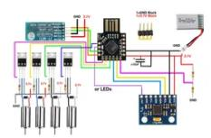

I am adding here the legacy "schematics" for the old setup I made years back, however if you compare them to the new circuitry you will see where the errors were made (whoops). My latest [Nano Quadcopter](https://easyeda.com/montvydas.klumbys/nano-quadcopter) design is available at EasyEDA so that you could either use it as it is or change the design and/or the PCB in any way you like. I also added explanation to each modules for easy understanding. Note that if you do not understand something you can always reference the **Electronics Components** or **Wiring the System Together** steps as I made sure to provide enough information to explain each part of the circuitry.

On top of Nano Quadcopter I also added the schematics for [nRF52840 Quadcopter,](https://easyeda.com/montvydas.klumbys/nrf52840-quadcopter) which will work with dev boards Particle Xenon or Adafruit Feather nRF52840 Express. It was easier to design for these boards as it already includes a lot of modules such as enable pin for adding power switch, battery level detector and a battery charging circuitry with a battery connector of course. On top of that the modules are faster, almost all of the pins support PWM and can be programmed using Circuitpython or Micropython!

# **Step 7: PCB and Soldering**

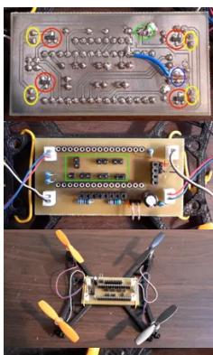

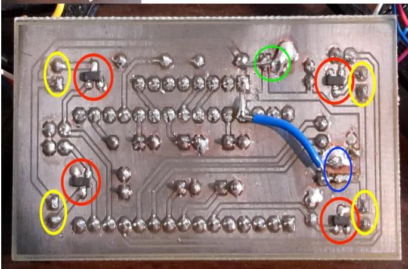

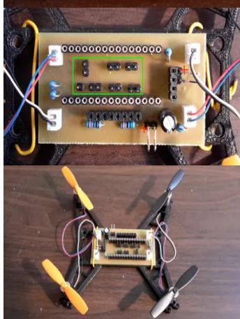

I recommend ordering the PCB from [JLCPCB,](https://jlcpcb.com/) which can be done straight off the EasyEDA. The price is only \$2 for 10 PCBs, which is really insignificant. Right now I live in Spain and the delivery here costs around \$10, thus not a bad deal, even though I will probably only need one PCB... On top of that you could also select an option for the SMD components to be pre-soldered for you for a little bit of extra cost. I selected such components choices which were available at the JLCPCB Assembled Basic SMT Type library, to keep this as an option. The only SMD part which was from the extended library was the LED WS2812B, however not having one will not stop the quadcopter from flying! You can also order them cheaply from the Aliexpress.

# **Component Size**

The PCB that I designed now will use SMD components of size 806. These settings are good enough to be able to solder the PCB by hand. However you're welcome to redesign the PCB to your likings. I might even provide a PCB for through-hole components, however fitting everything becomes a lot more complicated.

- None of the power wires should have vias, this is in order to reduce the wire resistance and thus voltage drop over the wire.
- The thickness of the wire has to be around 50 mil, however it will depend on which copper layer thickness you choose. You can simply use [online track width calculator](https://www.7pcb.com/trace-width-calculator.php) to decide this.

It is a lot easier to solder all the components on an already prepared PCB. Sadly, getting an access to a machine to make one is not always possible. We had one at the University, thus I designed a PCB using *Target 3001!* Software. To open the \*.T3001 file you will have to download Target 3001 software, which is sadly, only Windows compatible. I might export the project to Eagle later. Adding Target3001, .xps, .tif and .src (export to Eagle) for those who intend to make a PCB at home.

## **Ground Separation**

Note that it might be a good idea to separate the ground used by the motors and the other sensors as the noise caused by the motors would then not affect the sensors as discussed [here.](https://forum.arduino.cc/index.php?topic=199671.0) This however isn't very easy to do using the easyEDA PCB editor as I tried and got clearance errors. Thus for now I kept this just as an idea in my head for the future if the quadcopter fails to fly...

The printed and soldered result looks as in the provided image. I added red circles showing the soldered transistors, yellow circles showing the JST connectors for the motors, green circle marking the battery connectors, supplying power to the motor ONLY, and blue circle marking the battery connectors, supplying the power to the rest of the electronics (Arduino, MPU6050, etc.). As you can see, there is some fixes made next to both of the power connectors. You don't need to do that as the PCB was updated after making the first working model. Basically, the problem was that at first the PCB only had a single power supply. During the testing it appeared that the Bluetooth module kept constantly disconnecting from the phone as the battery voltage was dropping to low levels (< 3V). Not only that but Arduino also had issues with that, which were fixed by lowering brownout voltage. You can [do that](http://forum.arduino.cc/index.php?topic=127394.15) easily yourself as it only required modifying a single file in the Arduino IDE, however it is more of a hack as the higher the frequency, the higher voltage is needed. In the end, something else might break in the future or you might loose all available power, etc. Anyway, implementing two-battery system worked nicely, especially that the battery, powering electronics weight only around 3g.

When soldering on the motor connectors, make sure that they are soldered the correct way! On each side one of the connector is facing one way and another another way. You have to ensure that pin 1 is always connected the same side. I think it's best to first place all of the connectors, then recheck them 3 times and only then solder.

Note that I market the battery connector with a plus to make sure you do not connect it the wrong way. I might add a battery protection actually... Need to take a look into it!

## **Future Considerations**

In the future I might get rid off the 3D printed parts completely and will store all of the components on he PCB itself. This will lower the weight dramatically, however it might increase turbulence and vibrations, thus care will have to be taken to avoid these problems by lets say setting the PCB thickness to the largest available. Not only that but will need to think of a way to attach the motors so that they stay securely on the PCB.

- [PCB\\_GND\\_MODIFIED.SCR](https://content.instructables.com/FLF/QTW4/J1MEWKRO/FLFQTW4J1MEWKRO.scr) [Download](https://content.instructables.com/FLF/QTW4/J1MEWKRO/FLFQTW4J1MEWKRO.scr)
- [PCB\\_GND\\_MODIFIED.T3001](https://content.instructables.com/F1K/JX54/J1MEWKS0/F1KJX54J1MEWKS0.t3001) [Download](https://content.instructables.com/F1K/JX54/J1MEWKS0/F1KJX54J1MEWKS0.t3001)
- [quadcopter.TIF](https://content.instructables.com/FHL/RLKV/J1MEWKEJ/FHLRLKVJ1MEWKEJ.tif) [Download](https://content.instructables.com/FHL/RLKV/J1MEWKEJ/FHLRLKVJ1MEWKEJ.tif)
- [quadcopter.xps](https://content.instructables.com/F4C/9ECX/J1MEWKEO/F4C9ECXJ1MEWKEO.xps) [Download](https://content.instructables.com/F4C/9ECX/J1MEWKEO/F4C9ECXJ1MEWKEO.xps)

# **Step 8: Software**

Long time ago I wrote a library and an example program using mbed for a quadcopter which you can find in [here.](https://developer.mbed.org/users/moklumbys/code/QuadcopterProgram/) At the time though I didn't fully understand how PID worked when applied on Quadcopter theory. To develop the Software now I took a look at existing projects such as

#### **Setup**

Because I do not hate myself, I decided to program the Quadcopter using [Visual Studio Code](https://code.visualstudio.com/) editor with the installed [PlatformIO](https://platformio.org/) plugin. To install the setup I simply followed [this](https://platformio.org/install/ide?install=vscode) guide.

## **Reading Battery Voltage**

To perform analog measurement by default Arduino uses its power supply as a voltage reference. If we did not change this setup when reading the battery voltage it would always be the same as our power supply will get lower with the discharging battery. To solve this we need to use [interval voltage reference.](https://www.arduino.cc/en/Reference/analogReference) As discussed before on Atmega328 this is equal to ±1.1V. The code for reading actual battery value and printing it into Serial port would become:

// Compensation factor, which is inverse of VBAT = (150k / (150k + 150k)) #define VBAT\_DIVIDER\_COMP ((33.0 + 100.0) / 33.0) // Interval voltage reference of 1.1V in mV #define BATTERY\_VOLTAGE\_REFERENCE\_VALUE 1100 // 10-bit resolution gives 1023 steps #define RESOLUTION\_STEPS 1023 // Combine together from a formula #define REAL\_BATTERY\_MV\_PER\_LSB (VBAT\_DIVIDER\_COMP \* BATTERY\_VOLTAGE\_REFERENCE\_VALUE / RESOLUTION\_STEPS)

#define BATTERY\_PIN A0

void setup () {

 // Set internal 1.1V voltage reference analogReference(INTERNAL); Serial.begin(115200); void loop () {

Serial.println(analogRead(BATTERY\_PIN) \* REAL\_BATTERY\_MV\_PER\_LSB);

# **MPU6050**

[MPU6050 library](https://github.com/jrowberg/i2cdevlib/tree/master/Arduino/MPU6050) is available by Jeff Rowberg 2012. The provided example code MPU6050\_DMP6 is used as the main code for the project.

## **Stabilising Motors**

In the control systems a PID controller is a very popular way to stabilise the system. In here we will want to stabilise the pitch and roll of MPU6050. I used library [PID\\_v1](https://github.com/br3ttb/Arduino-PID-Library) for this purpose. In the code given below I will setup both motors and PID controller. I will then add a function to stabilise the motors depending on the required speed.

#define FL\_MOTOR 3 #define FR\_MOTOR 9 #define BR\_MOTOR 10 #define BL\_MOTOR 11

//---------------------------------PID------------------------------------ //Define Variables we'll be connecting to double rollSetpoint, rollInput, rollOutput; double pitchSetpoint, pitchInput, pitchOutput;

//Define the aggressive and conservative Tuning Parameters double consKp = 1, consKi = 0.05, consKd = 0.25; PID pitchPID(&rollInput, &rollOutput, &rollSetpoint, consKp, consKi, consKd, DIRECT); PID rollPID(&pitchInput, &pitchOutput, &pitchSetpoint, consKp, consKi, consKd, DIRECT);

void setup() {

//------------------------------PID--------------------------------- pitchInput = 0.0; rollInput = 0.0; pitchSetpoint = 0.0; rollSetpoint = 0.0; //turn the PID on pitchPID.SetMode(AUTOMATIC); rollPID.SetMode(AUTOMATIC); pitchPID.SetOutputLimits(-20, 20); rollPID.SetOutputLimits(-20, 20);

 for (int i = 0; i < 4; i++) { targetSpeed[i] = 0; } pinMode(FL\_MOTOR, OUTPUT); pinMode(FR\_MOTOR, OUTPUT); pinMode(BR\_MOTOR, OUTPUT); pinMode(BL\_MOTOR, OUTPUT); void loop() { pitchPID.Compute(); rollPID.Compute(); int actSpeed[4]; stabilise (targetSpeed, actSpeed, rollOutput, pitchOutput); // targetSpeed = actSpeed; // should this be here or not void stabilise (int\* currSpeed, int\* actSpeed, float rollDiff, float pitchDiff) { //actual Speed is calculated as follows +- half rollDiff +- half pitchDiff actSpeed[0] = (int) currSpeed[0] + (rollDiff / 2) - (pitchDiff / 2); actSpeed[1] = (int) currSpeed[1] + (rollDiff / 2) + (pitchDiff / 2); actSpeed[2] = (int) currSpeed[2] - (rollDiff / 2) + (pitchDiff / 2); actSpeed[3] = (int) currSpeed[3] - (rollDiff / 2) - (pitchDiff / 2); for (int i = 0; i < 4; i ++) { if (actSpeed[i] < 0) actSpeed[i] = 0; } void runIndividual (int\* actSpeed) { analogWrite(FL\_MOTOR, actSpeed[0]); analogWrite(FR\_MOTOR, actSpeed[1]); analogWrite(BR\_MOTOR, actSpeed[2]); analogWrite(BL\_MOTOR, actSpeed[3]);

# **BLE Connectivity**

BLE (Bluetooth Low Energy) is a completely different communication protocol from the old Bluetooth 2.0. Instead of drawing a lot of power to maintain the connectivity to a host device it instead sends bursts of pulses. Each burst might reach levels of 20-40mA, however they will be very short and will be send only a couple of times per second. On average the energy consumption gets close to sub-mA level!

Communication from the quadcopter to the phone will be done through the *BLE-Nano* built-in BLE module. The nano connects to the BLE chip using the built in Serial on pins TX and RX. Of course this slightly makes it more difficult if you want to talk to the PC instead, however I will rarely need a connection to the PC anyway. An example on how to receive an integer through BLE UART service and echo it back is given below:

void setup() { mySerial.begin(115200); void loop () { if (mySerial.available()) { int reading = mySerial.parseInt(); //flushing anything that wasn't read while (mySerial.available()) { mySerial.read(); } // Echo the integer back Serial.println(reading); }

## **Adding Bits Together**

As for the whole code, I am always working on it, so I decided not to add it ALL here. You can find the latest version of code in [GitHub.](https://github.com/Montvydas/MonteQuadcopter) I will notify in this Instructable when the code is finished. At the moment I need to setup correct PID constants etc...

# **Neopixels (Optional)**

A couple of libraries are available:

- Adafruit
- WS2812B
- [FastLED](https://github.com/FastLED/FastLED)  it was designed to control different types of RGB LED strip, thus if in the future different one was used this library would allow changing everything very easily. The downside is increased memory use.