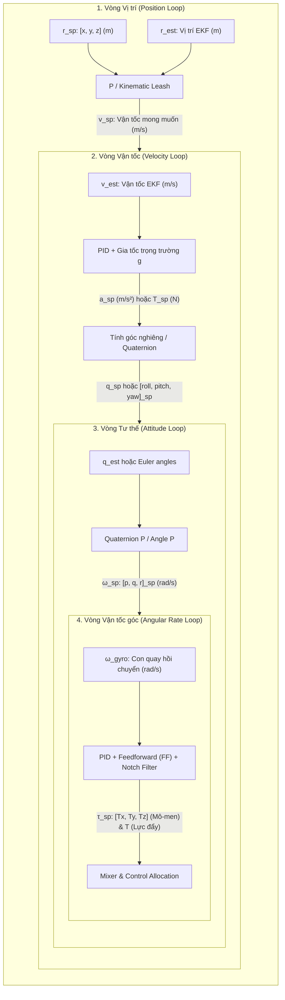

# CHI TIẾT CÁC VÒNG ĐIỀU KHIỂN: INPUT, OUTPUT & THUẬT TOÁN

Tài liệu này mổ xẻ chi tiết từng tầng vòng điều khiển trong hệ thống bay Quadrotor từ các dự án thực tế trong `docs/other_git_repo`: cách tính toán sai số, bộ điều khiển sử dụng, đầu vào, đầu ra và cơ chế chuyển đổi giữa các tầng.

---

## 1. Sơ đồ chuỗi điều khiển xếp tầng tổng thể (Full 4-Layer Cascade)

Trong các hệ thống tự động hoàn chỉnh (như **PX4-Autopilot**, **ArduPilot**, **crazyflie-firmware**), cấu trúc 4 vòng điều khiển nối tầng được chuẩn hóa như sau:



---

## 2. Vòng 1: Vòng Điều Khiển Vị Trí (Position Loop)

Vòng này duy trì tọa độ mong muốn của drone trong không gian 3 chiều hệ tọa độ thế giới (thường dùng hệ NED: North-East-Down hoặc ENU: East-North-Up).

### 2.1. Tín hiệu Đầu vào & Đầu ra
- **Đầu vào (Setpoint)**: Tọa độ mong muốn $\mathbf{r}_{sp} = [x_{sp}, y_{sp}, z_{sp}]^T$ (đơn vị: mét) từ quỹ đạo bay (trajectory generator), nhiệm vụ waypoint hoặc lệnh dịch gậy.
- **Phản hồi (Feedback)**: Tọa độ ước lượng $\mathbf{r} = [x, y, z]^T$ từ bộ lọc EKF (kết hợp GPS, Barometer, Optical Flow, VIO, v.v.).
- **Sai số (Error)**: 
  $$\mathbf{e}_{pos} = \mathbf{r}_{sp} - \mathbf{r}$$
- **Đầu ra (Output)**: Vector vận tốc mong muốn $\mathbf{v}_{sp} = [v_{x,sp}, v_{y,sp}, v_{z,sp}]^T$ (đơn vị: $\text{m/s}$).

### 2.2. Thuật toán điều khiển trong mã nguồn
- Thường dùng **P controller** (tỉ lệ thuần túy) kèm theo giới hạn vận tốc tối đa (Velocity Saturation). Không dùng I hay D ở vòng này vì tích phân sai số đã được đảm nhiệm ở vòng vận tốc, thêm tích phân ở đây dễ gây hiện tượng dao động trễ pha (phase lag) và vọt lố lớn.
- **Trích dẫn mã PX4** ([`PositionControl.cpp`](../other_git_repo/PX4-Autopilot/src/modules/mc_pos_control/PositionControl/PositionControl.cpp#L127-L141)):
  ```cpp
  void PositionControl::_positionControl()
  {
      // P-position controller
      Vector3f vel_sp_position = (_pos_sp - _pos).emult(_gain_pos_p);
      ControlMath::addIfNotNanVector3f(_vel_sp, vel_sp_position);

      // Giới hạn vận tốc ngang (XY)
      _vel_sp.xy() = ControlMath::constrainXY(vel_sp_position.xy(), 
          (_vel_sp - vel_sp_position).xy(), _lim_vel_horizontal);
      // Giới hạn vận tốc nâng/hạ (Z)
      _vel_sp(2) = math::constrain(_vel_sp(2), -_lim_vel_up, _lim_vel_down);
  }
  ```
- **Trong Crazyflie** ([`position_controller_pid.c`](../other_git_repo/crazyflie-firmware/src/modules/src/controller/position_controller_pid.c#L202-L232)):
  - Crazyflie xoay sai số vị trí từ hệ cố định Trái Đất (World) sang hệ trục thân drone (Body frame) trước khi chạy P/PID:
    $$x_{body} = x_{world} \cos\psi + y_{world} \sin\psi$$
    $$y_{body} = -x_{world} \sin\psi + y_{world} \cos\psi$$

---

## 3. Vòng 2: Vòng Điều Khiển Vận Tốc (Velocity Loop)

Vòng này điều khiển tốc độ di chuyển của drone theo 3 trục không gian.

### 3.1. Tín hiệu Đầu vào & Đầu ra
- **Đầu vào (Setpoint)**: $\mathbf{v}_{sp} = [v_{x,sp}, v_{y,sp}, v_{z,sp}]^T$ (từ Vòng 1 hoặc từ gậy điều khiển ở chế độ PosHold/Loiter).
- **Phản hồi (Feedback)**: $\mathbf{v} = [v_x, v_y, v_z]^T$ từ EKF.
- **Sai số (Error)**:
  $$\mathbf{e}_{vel} = \mathbf{v}_{sp} - \mathbf{v}$$
- **Đầu ra (Output)**: 
  - Vector gia tốc mong muốn $\mathbf{a}_{sp} = [a_{x,sp}, a_{y,sp}, a_{z,sp}]^T$ (đơn vị: $\text{m/s}^2$).
  - Hoặc chuyển đổi trực tiếp thành: **Góc nghiêng mong muốn** ($\phi_{sp}, \theta_{sp}$) và **Tổng lực đẩy tập thể** ($T_{sp}$).

### 3.2. Thuật toán điều khiển & Chuyển đổi gia tốc sang góc nghiêng
1. **PID với Anti-Windup**:
   - Thành phần $P$: Phản ứng nhanh theo sai số vận tốc.
   - Thành phần $I$: Khử sai lệch tĩnh (ví dụ khi có gió thổi liên tục tạo lực cản). Cần Anti-Reset Windup (ARW) khi góc nghiêng đạt giới hạn tối đa.
   - Thành phần $D$: Giảm chấn, thường tính trên đạo hàm của vận tốc (tức gia tốc đo được từ cảm biến $\mathbf{a}_{meas}$) để tránh hiện tượng "Derivative Kick".

2. **Chuyển đổi từ Gia tốc sang Góc nghiêng và Lực đẩy**:
   - Trục $Z$ (Độ cao): Để drone đứng yên lơ lửng, động cơ phải tạo gia tốc ngược chiều trọng lực ($g = 9.81\,\text{m/s}^2$). Lực đẩy trục $Z$ mong muốn:
     $$F_{z,sp} = m(g - a_{z,sp})$$
   - Trục $X, Y$ (Mặt phẳng ngang): Quadrotor không có cánh quạt đẩy ngang, muốn tăng tốc về phía trước ($+X$) nó phải **chúc mũi xuống** (Pitch $\theta < 0$), muốn tăng tốc sang phải ($+Y$) nó phải **nghiêng sang phải** (Roll $\phi > 0$).
   - Vector lực đẩy toàn phần trong hệ NED:
     $$\mathbf{F}_{sp} = m \begin{bmatrix} a_{x,sp} \\ a_{y,sp} \\ a_{z,sp} - g \end{bmatrix}$$
   - Độ lớn lực đẩy tập thể:
     $$T_{collective} = \|\mathbf{F}_{sp}\| = m \sqrt{a_{x,sp}^2 + a_{y,sp}^2 + (a_{z,sp} - g)^2}$$
   - Hướng vector trục $Z$ thân drone mong muốn ($\mathbf{z}_B$):
     $$\mathbf{z}_B = -\frac{\mathbf{F}_{sp}}{\|\mathbf{F}_{sp}\|}$$

- **Trích dẫn mã PX4** ([`PositionControl.cpp`](../other_git_repo/PX4-Autopilot/src/modules/mc_pos_control/PositionControl/PositionControl.cpp#L207-L225)):
  ```cpp
  void PositionControl::_accelerationControl()
  {
      float z_specific_force = -CONSTANTS_ONE_G + _acc_sp(2);

      // Tính vector hướng trục Z của body
      Vector3f body_z = Vector3f(-_acc_sp(0), -_acc_sp(1), -z_specific_force).normalized();
      ControlMath::limitTilt(body_z, Vector3f(0, 0, 1), _lim_tilt);

      // Chiếu lực đẩy lên hướng trục z của thân máy bay
      const float thrust_ned_z = _acc_sp(2) * (_hover_thrust / CONSTANTS_ONE_G) - _hover_thrust;
      const float cos_ned_body = (Vector3f(0, 0, 1).dot(body_z));
      const float collective_thrust = math::min(thrust_ned_z / cos_ned_body, -_lim_thr_min);
      _thr_sp = body_z * collective_thrust;
  }
  ```

---

## 4. Vòng 3: Vòng Điều Khiển Tư Thế (Attitude / Angle Loop)

Vòng này biến sai lệch góc nghiêng thành vận tốc góc mong muốn để kéo thân drone về hướng mong muốn.

### 4.1. Tín hiệu Đầu vào & Đầu ra
- **Đầu vào (Setpoint)**:
  - Dự án cơ bản (STM32 `Quadcopter`, `Arduino`, `Betaflight` Angle mode): Góc Euler mong muốn $[\phi_{sp}, \theta_{sp}, \psi_{sp}]$ (độ hoặc radian).
  - Dự án nâng cao (`PX4`, `ArduPilot`): Quaternion mục tiêu $\mathbf{q}_d = [q_0, q_1, q_2, q_3]^T$.
- **Phản hồi (Feedback)**:
  - Góc Euler ước lượng từ thuật toán AHRS (Madgwick/Mahony) hoặc Quaternion trạng thái $\mathbf{q}$ từ EKF.
- **Đầu ra (Output)**: Vector vận tốc góc mong muốn trong hệ trục thân (Body rate setpoints):
  $$\boldsymbol{\omega}_{sp} = [p_{sp}, q_{sp}, r_{sp}]^T \quad (\text{đơn vị: rad/s hoặc deg/s})$$

### 4.2. So sánh 2 cách tiếp cận: Euler vs Quaternion

#### Cách 1: Euler Angle P-Controller (Đơn giản, trực quan)
Được sử dụng trong dự án [`Quadcopter` (STM32)](../other_git_repo/Quadcopter/Application/Algorithm/PID.c#L96-L107) và [`crazyflie`](../other_git_repo/crazyflie-firmware/src/modules/src/controller/attitude_pid_controller.c#L156-L171):
- Tính trực tiếp sai số trên từng trục:
  $$e_\phi = \phi_{sp} - \phi, \quad e_\theta = \theta_{sp} - \theta, \quad e_\psi = \psi_{sp} - \psi$$
  *(Lưu ý: Sai số $e_\psi$ phải được quấn góc về khoảng $[-\pi, \pi]$ để tránh lộn vòng khi đi qua mốc $180^\circ$)*.
- Đầu ra tốc độ góc:
  $$p_{sp} = K_p^\phi e_\phi, \quad q_{sp} = K_p^\theta e_\theta, \quad r_{sp} = K_p^\psi e_\psi$$
- **Hạn chế**: Khi góc pitch nghiêng gần $\pm 90^\circ$, xảy ra hiện tượng **khóa trục (Gimbal Lock)** và ma trận động học góc Euler bị kỳ dị:
  $$\begin{bmatrix} \dot{\phi} \\ \dot{\theta} \\ \dot{\psi} \end{bmatrix} = \begin{bmatrix} 1 & \sin\phi\tan\theta & \cos\phi\tan\theta \\ 0 & \cos\phi & -\sin\phi \\ 0 & \sin\phi/\cos\theta & \cos\phi/\cos\theta \end{bmatrix} \begin{bmatrix} p \\ q \\ r \end{bmatrix}$$
  Khi $\theta \to \pm 90^\circ \implies \cos\theta \to 0$, giá trị phân số tiến ra vô cùng!

#### Cách 2: Quaternion Attitude Controller (Chuẩn mực trong PX4 & ArduPilot)
Không bao giờ bị Gimbal Lock, tính toán quay 3 chiều mượt mà ngay cả khi lộn nhào $360^\circ$.
1. **Tính Quaternion sai số ($\mathbf{q}_e$)**:
   $$\mathbf{q}_e = \mathbf{q}^{-1} \otimes \mathbf{q}_d$$
2. **Xử lý tính đối xứng (Antipodal ambiguity)**:
   - Vì $\mathbf{q}$ và $-\mathbf{q}$ biểu diễn cùng một phép quay, nếu phần thực $q_{e,0} < 0$, đổi dấu toàn bộ $\mathbf{q}_e \leftarrow -\mathbf{q}_e$ để drone chọn đường quay ngắn nhất.
3. **Tách thành phần Tilt và Yaw (Yaw decoupling)**:
   - Trong PX4 ([`AttitudeControl.cpp`](../other_git_repo/PX4-Autopilot/src/modules/mc_att_control/AttitudeControl/AttitudeControl.cpp#L153-L180)), thuật toán tách $\mathbf{q}_e$ thành phép quay nghiêng trục Z (Roll/Pitch) và phép quay quanh trục Z (Yaw), gán trọng số `_yaw_w` (thường $\le 1$) để luôn ưu tiên giữ thăng bằng Roll/Pitch hơn là xoay đầu Yaw.
4. **Trích xuất vector sai số góc (Rotation Vector Error)**:
   $$\mathbf{e}_{\theta} = 2 \cdot \text{sgn}(q_{e,0}) \cdot \begin{bmatrix} q_{e,1} \\ q_{e,2} \\ q_{e,3} \end{bmatrix}$$
5. **Tính toán Setpoint vận tốc góc**:
   $$\boldsymbol{\omega}_{sp} = \mathbf{K}_p \circ \mathbf{e}_{\theta} + \boldsymbol{\omega}_{FF}$$

---

## 5. Vòng 4: Vòng Điều Khiển Vận Tốc Góc (Angular Rate Loop / Inner Loop)

Đây là vòng lặp **quan trọng nhất** trong mọi thiết bị bay nhiều cánh quạt. Nó quyết định độ đầm chắc, khả năng chống gió giật và phản xạ nhanh của drone.

### 5.1. Tín hiệu Đầu vào & Đầu ra
- **Đầu vào (Setpoint)**: Vận tốc góc mục tiêu $\boldsymbol{\omega}_{sp} = [p_{sp}, q_{sp}, r_{sp}]^T$ (được sinh ra từ Vòng 3, hoặc nhận trực tiếp từ cần điều khiển của phi công khi bay chế độ **ACRO / Rate mode**).
- **Phản hồi (Feedback)**: Vận tốc góc thực tế đo từ con quay hồi chuyển **Gyro** $\boldsymbol{\omega}_{gyro} = [p, q, r]^T$ (đã qua lọc nhiễu tần số cao).
- **Sai số (Error)**:
  $$\mathbf{e}_\omega = \boldsymbol{\omega}_{sp} - \boldsymbol{\omega}_{gyro}$$
- **Đầu ra (Output)**:
  - Tín hiệu mô-men điều khiển chuẩn hóa: $\mathbf{u} = [\tau_x, \tau_y, \tau_z]^T$ (hoặc độ chênh lệch PWM/DShot cho từng trục Roll, Pitch, Yaw).

### 5.2. Cấu trúc bộ điều khiển PID trong các dự án hàng đầu

#### A. Kiến trúc kinh điển (PID chuẩn trong STM32 uCOS-II)
Trích dẫn từ [`Quadcopter/Application/Algorithm/PID.c`](../other_git_repo/Quadcopter/Application/Algorithm/PID.c#L108-L125):
```cpp
inner->err = outer->output - omega;
inner->errSum = limit(inner->errSum + inner->err * deltaT, -INNER_INT_MAX, INNER_INT_MAX);

inner->outputP = inner->Kp * inner->err;
inner->outputI = inner->Ki * inner->errSum;
inner->outputD = inner->Kd * (inner->err - inner->errLast); // D trên sai số

inner->output = limit(inner->outputP + inner->outputI + inner->outputD, -PWM_OUT_MAX, PWM_OUT_MAX);
```
- **Nhược điểm của công thức cũ**: 
  - Đạo hàm tính trên sai số `(inner->err - inner->errLast)` khiến mỗi lần phi công gạt mạnh tay điều khiển (setpoint thay đổi đột ngột), số hạng D sẽ vọt lên một xung cực lớn (hiện tượng **Derivative Kick**), làm rung động cơ và nóng motor.

#### B. Kiến trúc 2-DOF PID + FeedForward tối tân (Betaflight & PX4 & ArduPilot)
Để giải quyết bài toán đua tốc độ cao và phản xạ mượt mà, Betaflight ([`pid.c`](../other_git_repo/betaflight/src/main/flight/pid.c#L1410-L1530)) và ArduPilot áp dụng cấu trúc **2-DOF (2 bậc tự do)**:

$$\tau(t) = \underbrace{K_p \cdot e(t)}_{P} + \underbrace{K_i \int e(t) dt}_{I} - \underbrace{K_d \cdot \frac{d\,\omega_{gyro}(t)}{dt}}_{D \text{ on Measurement}} + \underbrace{K_{ff} \cdot \frac{d\,\omega_{sp}(t)}{dt}}_{\text{FeedForward (FF)}}$$

1. **Thành phần P (Proportional)**: 
   - Tạo lực kéo tỷ lệ thuận với sai số tức thời.
2. **Thành phần I (Integral) kèm I-Term Relax & Anti-Windup**:
   - Khử sai lệch trọng tâm, mất cân bằng khí động.
   - **I-Term Relax (Betaflight)**: Khi người lái gạt gậy xoay nhanh (snap roll), bộ tích phân I được tạm thời "ngủ đông" để tránh tích lũy sai số quá mức gây vọt lố (overshoot) và nảy đuôi (bounce-back) khi dừng góc.
3. **Thành phần D trên giá trị đo (Derivative on Measurement)**:
   - Đạo hàm tính trực tiếp trên tín hiệu Gyro: $-\frac{d}{dt}\omega_{gyro}$.
   - Triệt tiêu hoàn toàn hiện tượng Derivative Kick khi đổi setpoint.
   - Hoạt động như một giảm xóc ảo (virtual damper), triệt tiêu các dao động cơ học của khung drone.
   - **D_MAX (Betaflight)**: Tự động tăng hệ số $K_d$ khi phát hiện va chạm hoặc chuyển động quay tốc độ cao, và hạ $K_d$ xuống mức thấp khi bay đều nhằm tránh làm nóng động cơ do khuếch đại nhiễu cao tần.
4. **Thành phần FeedForward (F-term)**:
   - Tính trực tiếp từ đạo hàm của tín hiệu gậy điều khiển: $\Delta \text{Setpoint} / \Delta t$.
   - **Tác dụng kỳ diệu**: Cho phép drone phản ứng NGAY LẬP TỨC tại thời điểm người lái gạt tay điều khiển mà KHÔNG CẦN CHỜ sai số xuất hiện rồi mới phản hồi! Loại bỏ hoàn toàn độ trễ pha.
5. **Anti-Gravity (Chống chúi mũi khi thốc ga)**:
   - Khi tăng ga đột ngột, lực nâng tăng bất đối xứng giữa các cánh quạt khiến drone bị chúi mũi. 
   - Anti-Gravity trong Betaflight phát hiện đạo hàm của Throttle ($\frac{d}{dt}\text{Throttle}$) và tạm thời kích hoạt nhân thêm hệ số $K_i$ và $K_p$ trên trục Pitch để khóa chặt góc mũi drone.

---

## 6. Tổng hợp bảng luồng tín hiệu (Signal Flow Matrix)

| Tầng điều khiển | Tần số thực thi điển hình | Tín hiệu Setpoint | Tín hiệu Phản hồi | Thuật toán cốt lõi | Tín hiệu Đầu ra |
| :--- | :---: | :--- | :--- | :--- | :--- |
| **1. Vị trí (Position)** | $20 - 50\,\text{Hz}$ | Vị trí mục tiêu $[x, y, z]_{sp}$ $(\text{m})$ | Vị trí EKF $[x, y, z]$ $(\text{m})$ | P-Controller + Velocity Limiting | Vận tốc mục tiêu $[v_x, v_y, v_z]_{sp}$ $(\text{m/s})$ |
| **2. Vận tốc (Velocity)** | $50 - 100\,\text{Hz}$ | Vận tốc mục tiêu $[v_x, v_y, v_z]_{sp}$ $(\text{m/s})$ | Vận tốc EKF $[v_x, v_y, v_z]$ $(\text{m/s})$ | PID + Trọng lực $g$ + Chuyển đổi Vector Lực sang Góc | Gia tốc $[a_x, a_y, a_z]_{sp}$ $\to$ Lực đẩy $T$ & Quaternion $\mathbf{q}_d$ |
| **3. Tư thế (Attitude)** | $100 - 250\,\text{Hz}$ | Quaternion $\mathbf{q}_d$ hoặc Euler $[\phi, \theta, \psi]_{sp}$ | Quaternion $\mathbf{q}$ hoặc Euler $[\phi, \theta, \psi]$ | Quaternion Error $\mathbf{q}_e = \mathbf{q}^{-1} \otimes \mathbf{q}_d \to$ P-gain | Vận tốc góc thân $[p, q, r]_{sp}$ $(\text{rad/s})$ |
| **4. Tốc độ góc (Rate)** | $500\,\text{Hz} - 8\,\text{kHz}$ | $[p, q, r]_{sp}$ $(\text{rad/s})$ | Gyro $[p, q, r]$ $(\text{rad/s})$ (qua bộ lọc) | 2-DOF PID + FeedForward + D on Measurement | Mô-men điều khiển $[\tau_x, \tau_y, \tau_z]$ (Roll, Pitch, Yaw commands) |
| **Mixer / Allocation** | Đồng bộ cùng Rate Loop | $[\tau_x, \tau_y, \tau_z]$ & Lực đẩy $T$ | Trạng thái bão hòa motor | Ma trận phân bổ + Giải bão hòa (Airmode / Desaturation) | Tín hiệu điều khiển động cơ riêng lẻ: $u_1, u_2, u_3, u_4$ (PWM/DShot) |
