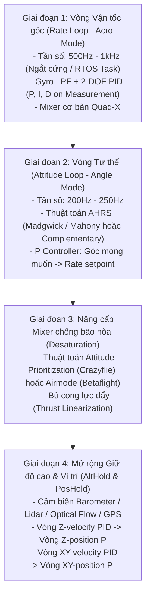

# HƯỚNG DẪN & KHUYẾN NGHỊ THIẾT KẾ BỘ ĐIỀU KHIỂN CHO QUADROTOR

Tài liệu này được đúc kết từ những tinh hoa và kinh nghiệm thực chiến từ các dự án mã nguồn mở (`PX4`, `ArduPilot`, `Betaflight`, `Crazyflie`, `STM32 Quadcopter`), cung cấp lộ trình thiết kế từng bước, các giải pháp lọc tín hiệu và các "bẫy kỹ thuật" (pitfalls) cần tránh khi xây dựng bộ điều khiển bay Quadrotor từ đầu.

---

## 1. Lộ Trình Thiết Kế Khuyến Nghị (Step-by-Step Roadmap)

Đừng cố gắng viết ngay hệ thống điều khiển tự trị 4 vòng (Position Hold) ngay từ ngày đầu tiên! Hãy chia nhỏ thành **4 giai đoạn tuần tự**:



---

## 2. Thiết Kế Chi Tiết Bộ Điều Khiển Vận Tốc Góc (Inner Rate Loop)

Đây là "trái tim" của hệ thống. Nếu vòng này chưa chuẩn, toàn bộ các vòng bên ngoài (góc, vị trí) đều sẽ dao động hoặc rơi.

### 2.1. Đạo hàm D trên giá trị đo (Derivative on Measurement)
- **Tuyệt đối tránh**: $D = K_d \frac{e(k) - e(k-1)}{\Delta t}$ (Vì khi phi công giật cần điều khiển, $e(k)$ nhảy bậc $\implies$ Xung $D$ cực đại làm giật motor).
- **Chuẩn thiết kế**:
  $$D(k) = -K_d \cdot \frac{\omega_{gyro}(k) - \omega_{gyro}(k-1)}{\Delta t}$$
  Dấu trừ thể hiện bản chất phản kháng lại tốc độ biến thiên góc của thân máy bay (giảm xóc ảo).

### 2.2. Bộ lọc số cho D-term (Bắt buộc phải có)
- Tín hiệu đo từ Gyro luôn bị nhiễm rung động cơ học tần số cao từ động cơ và cánh quạt ($100\,\text{Hz} - 400\,\text{Hz}$).
- Khi tính đạo hàm $\frac{d}{dt}$, nhiễu tần số cao bị khuếch đại lên hàng chục lần! Nếu không lọc, motor sẽ nóng ran và có thể cháy ESC/cuộn dây.
- **Giải pháp**:
  Áp dụng bộ lọc thông thấp PT1 (Low-Pass Filter bậc 1) cho thành phần D với tần số cắt $f_c \approx 30\,\text{Hz} - 60\,\text{Hz}$:
  $$D_{filtered}(k) = D_{filtered}(k-1) + \alpha \cdot \big[D(k) - D_{filtered}(k-1)\big]$$
  với $\alpha = \frac{2\pi f_c \Delta t}{1 + 2\pi f_c \Delta t}$.

### 2.3. Bổ sung FeedForward (FF)
- Để máy bay bám gậy tức thì mà không cần đẩy hệ số $K_p$ lên quá cao (dễ gây rung rơ):
  $$\text{FF}(k) = K_{ff} \cdot \frac{\omega_{sp}(k) - \omega_{sp}(k-1)}{\Delta t}$$

---

## 3. Thiết Kế Vòng Góc (Outer Attitude Loop)

### 3.1. Dùng Euler hay Quaternion?
- **Khuyến nghị cho dự án nghiên cứu ban đầu**: Bắt đầu bằng **Euler Angles** $[\phi, \theta, \psi]$ (Roll, Pitch, Yaw) để trực quan, dễ gỡ lỗi trên đồ thị.
  - Giới hạn góc nghiêng tối đa: $\phi_{max} = \theta_{max} = 35^\circ - 45^\circ$. Trong phạm vi này, không lo ngại về hiện tượng Gimbal Lock.
- **Nâng cấp giai đoạn 2**: Chuyển sang **Quaternion** $\mathbf{q} = [q_0, q_1, q_2, q_3]^T$ như chuẩn PX4 khi muốn drone có khả năng lộn nhào $360^\circ$ hoặc bay tự động hoàn toàn.

### 3.2. Cấu trúc P-controller cho vòng ngoài
- Vòng ngoài **chỉ nên dùng P (Proportional)**:
  $$p_{sp} = K_{p,att} \cdot (\phi_{sp} - \phi)$$
  $$q_{sp} = K_{p,att} \cdot (\theta_{sp} - \theta)$$
- **Tại sao không cần I và D ở vòng ngoài?**
  - Thành phần I đã có ở vòng trong (Rate loop) để khử sai số tĩnh.
  - Thành phần D vòng ngoài chính là tốc độ góc $\dot{\phi} \approx p$, bản thân vòng trong đã đo đạc và điều khiển trực tiếp biến này rồi! Thêm D ở vòng ngoài chỉ gây trễ pha và nhiễu.

### 3.3. Xử lý riêng cho trục Yaw
- Trục Yaw không tự cân bằng về $0^\circ$ như Roll/Pitch. Khi phi công buông cần điều khiển:
  - Cần phải **khóa góc đầu mũi hiện tại** (Heading Hold).
  - Tránh lỗi quấn vòng góc ($180^\circ \to -180^\circ$):
    ```c
    float err_yaw = target_yaw - current_yaw;
    while (err_yaw > 180.0f)  err_yaw -= 360.0f;
    while (err_yaw < -180.0f) err_yaw += 360.0f;
    ```

---

## 4. Thiết Kế Mixer Thông Minh (Attitude-Prioritized Mixer)

Thay vì chỉ dùng phép cộng trừ cơ bản rồi `limit(..., 1000, 2000)`, bạn nên cài đặt thuật toán **Capping ưu tiên tư thế** (học hỏi từ Crazyflie):

```c
void mixer_compute(float throttle, float roll_cmd, float pitch_cmd, float yaw_cmd, float motor_out[4])
{
    // 1. Phân bổ ma trận Quad-X
    float m[4];
    m[0] = throttle - roll_cmd + pitch_cmd - yaw_cmd; // Front-Right
    m[1] = throttle - roll_cmd - pitch_cmd + yaw_cmd; // Rear-Right
    m[2] = throttle + roll_cmd - pitch_cmd - yaw_cmd; // Rear-Left
    m[3] = throttle + roll_cmd + pitch_cmd + yaw_cmd; // Front-Left

    // 2. Tìm motor có giá trị cao nhất
    float max_m = m[0];
    for (int i = 1; i < 4; i++) {
        if (m[i] > max_m) max_m = m[i];
    }

    // 3. Giải bão hòa bảo vệ góc (Attitude Desaturation)
    // Nếu có motor vượt quá công suất tối đa (1.0), trừ đều tất cả các motor
    if (max_m > 1.0f) {
        float reduction = max_m - 1.0f;
        for (int i = 0; i < 4; i++) {
            m[i] -= reduction;
        }
    }

    // 4. Đảm bảo cận dưới không chết máy (Idle Throttle)
    const float MOTOR_IDLE = 0.05f; // 5% ga tối thiểu khi đã ARM
    for (int i = 0; i < 4; i++) {
        if (m[i] < MOTOR_IDLE) {
            m[i] = MOTOR_IDLE;
        }
        motor_out[i] = m[i];
    }
}
```

---

## 5. Những Bẫy Kỹ Thuật (Pitfalls) Nghiêm Trọng Cần Tránh

1. **Bẫy tích phân khi ở trên mặt đất (Ground I-term Windup)**:
   - Khi drone chưa cất cánh hoặc vừa tiếp đất, góc đo không bao giờ hoàn hảo phẳng $0.0^\circ$.
   - Thành phần I sẽ tiếp tục tích lũy dần theo thời gian $\implies$ Ngay khi vừa nhích ga cất cánh, drone sẽ bị lật úp lập tức!
   - **Giải pháp**: Xóa sạch tích phân (`i_term = 0`) khi cần ga ở mức tối thiểu (`Throttle < 10%`) hoặc khi chưa mở khóa (`ARMED == false`).

2. **Bẫy trễ chu kỳ (Loop Time Jitter)**:
   - Nếu chạy PID trong vòng `while(1)` với hàm `delay_ms()`, thời gian chu kỳ $\Delta t$ sẽ trôi giạt liên tục do các tác vụ khác (giao tiếp Serial, đọc cảm biến I2C/SPI).
   - $\Delta t$ không đều làm thành phần $D = \frac{\Delta \omega}{\Delta t}$ bị nhảy gai bất thường.
   - **Giải pháp**: Chạy vòng điều khiển trong **Hardware Timer Interrupt** định thời chính xác (ví dụ ngắt Timer ở tần số đúng $1000\,\text{Hz} \implies \Delta t = 0.001\,\text{s}$).

3. **Bẫy trễ pha của AHRS (Attitude Phase Lag)**:
   - Các bộ lọc Madgwick/Complementary có thông số lọc trọng lực ($\beta$). Nếu chọn $\beta$ quá nhỏ để lọc rung, góc ước lượng sẽ bị trễ pha so với chuyển động thực tế. Vòng PID điều khiển trên một tín hiệu bị trễ chắc chắn sẽ tự kích dao động lắc lư (wobble).
   - Giữ băng thông ước lượng góc vừa phải và tập trung làm mịn tín hiệu ở vòng trong (Rate loop).

4. **Bẫy bão hòa tích phân (Integrator Anti-Windup)**:
   - Luôn giới hạn giá trị tối đa của thành phần tích phân:
     $$I(k) = \text{constrain}(I(k-1) + K_i \cdot e(k) \Delta t, \;-I_{max}, \;I_{max})$$
     với $I_{max}$ thường không vượt quá $15\% - 25\%$ tổng công suất motor.
