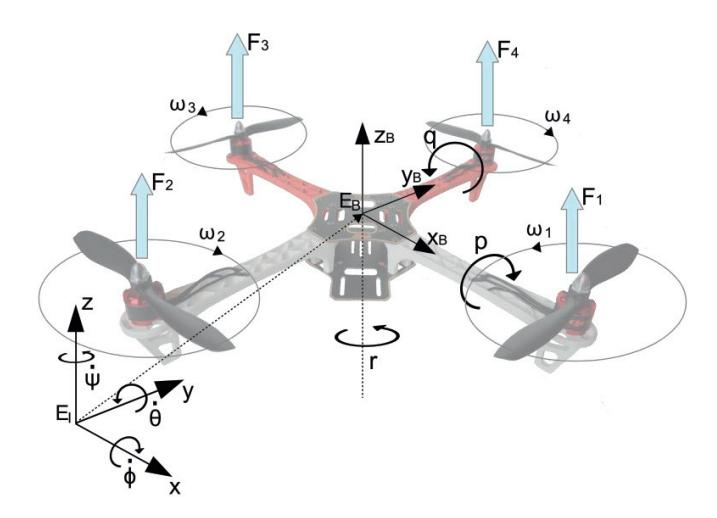
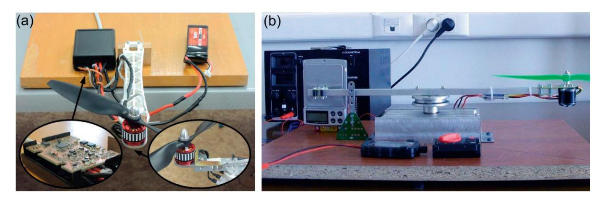
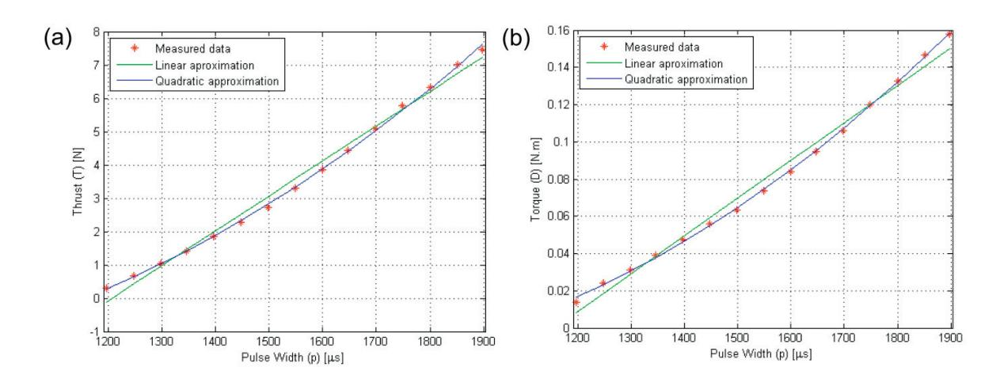
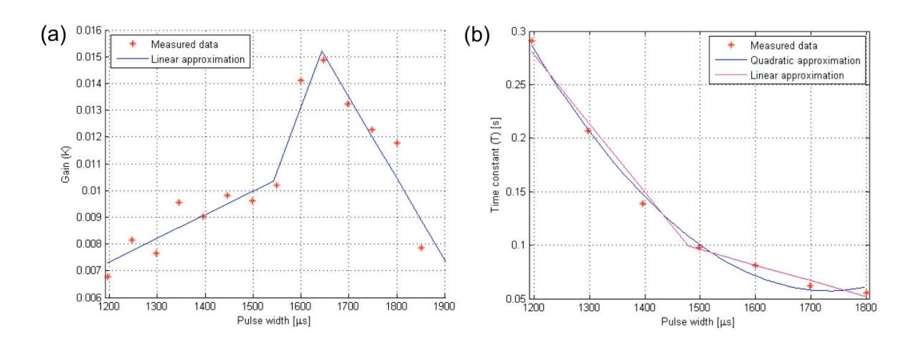

Modelling of Mechanical and Mechatronic Systems MMaMS 2014

# Mathematical Modelling and Parameter Identification of Quadrotor (a survey)

Anežka Chovancová\*a , Tomáš Ficoa , Ľuboš Chovaneca , Peter Hubinskýa

*a Faculty of Eletrical Engineering and Information Technology, Slovak University of Technology, Ilkovičova 3, 812 19, Bratislava, Slovakia* 

#### **Abstract**

The paper focuses on mathematical modelling of a quadrotor and identification of parameters used in presented models. There are several models of the quadrotor that can be used to design a controller. The nonlinear model is presented with respect to the body-fixed frame and also to the inertial frame. The next model is defined in terms of quaternions. The last presented mathematical model is a model near a hover position, where some forces and moments can be neglected. Model parameters can be obtained via experimental identification, calculations or the combination of both ways. These parameters are arm length, total mass of the quadrotor, inertia matrix, friction coefficients, thrust coefficient and drag coefficient. Experimental identification of an actuator usually required the usage of a test bed.

© 2014 The Authors. Published by Elsevier Ltd. © 2014 The Authors. Published by Elsevier Ltd. This is an open access article under the CC BY-NC-ND license

Peer-review under responsibility of organizing committee of the Modelling of Mechanical and Mechatronic Systems MMaMS (http://creativecommons.org/licenses/by-nc-nd/3.0/).

2014. Peer-review under responsibility of organizing committee of the Modelling of Mechanical and Mechatronic Systems MMaMS 2014

*Keywords:* Mathematical modelling; parameter identification; quadrotor; quaternion; test stand.

# **1. Introduction**

In recent years quadrotors have become very popular due to small size, simplicity of mechanics, good manoeuvrability, survivability and an increased payload [1]. These small flying robots are used for inspection of solar panels and also bridges. In addition, they can assist in rescue missions after natural disasters or explosions, or monitor wildlife and crop. They can also replace humans during activities that could be harmful to life, such as reconnaissance in areas with a high level of radiation.

\* Corresponding author. Tel.: +421/2/ 60-291-432; fax: +421/2/65-420-415. *E-mail address:* anezka.chovancova@stuba.sk

Quadrotors, as unmanned aerial vehicles (UAV), are controlled using an electronic control system and electronic sensors. They usually consist of several basic and of some additional components. A frame, ESCs (Electronic speed controllers), motors, propellers, battery, control board and IMU (Inertial Measurement Unit) are considered to be essentials. IMU is used to get actual information of attitude of the quadrotor and normally consists of a 3-axis accelerometer and gyroscope. The attitude gained from a gyroscope drifts with time because of the integrated random noise. However, the gyroscope is immune to linear disturbances unlike the accelerometer. Best results are obtained when both sensors are used. The complementary and Kalman filter are commonly applied to fuse signals from the abovementioned sensors. The combination of a magnetometer, IMU and an on-board processing system is ordinarily referred to as AHRS (Attitude Heading Reference System) [2].

The GPS module and VICON get the absolute position of the quadrotor. The former is used outdoors and the latter indoors. Pressure, ultrasonic and infrared sensors are mounted to a quadrotor to gain relative and absolute altitude. Quadrotors can also include sensors such as stereo vision cameras or LIDAR, which can be useful when mapping surroundings.

Quadrotors vary according to size, number of battery packs, propeller size and the choice of the components themselves. Small UAVs, such as quadrotors, are typically powered by one or more Lithium Polymer (LiPo) batteries, because of their high energy density, high charge and discharge rates, long lifetime, lack of memory effect and affordable cost [3]. Nevertheless, the first quadrotor Gyroplane No. 1 was driven by a piston engine and it covered 26 m2 of surface [4]. Nowadays quadrotors are, in general, much smaller. One of the larger platforms is Atlas, a human-powered helicopter; with maximum dimension of 46.4 m. On June 13th, 2013 the Atlas project team won the AHS Sikorsky Prize for 64-second human-powered flight during which they reached the height of 3.3 m [5]. On the other hand, at the present time the size of the smallest quadrotor Cheerson CX-10 is 40x40 mm. The most popular quadrotors are made by the following companies: Ascending Technologies GmbH, Parrot SA and DJI.

The quadrotor's main problem is the flying time. The aggregation of a quadrotor with various platforms was proposed to lower power consumption (plane, wheeled chassis, rolling cage) or to gain additional features (actuated appendage, foam ring and variable-pitch propellers) [6, 7, 8, 9, 10, 11].

|     | Nomenclature                                                                       |
|-----|------------------------------------------------------------------------------------|
| Di  | torque developed by rotor i around rotor axis                                      |
| Fi  | thrust generated by rotor i                                                        |
| I   | identity matrix                                                                    |
| I q | inertia matrix of the quadrotor                                                    |
| Jr  | moment of inertia of the rotor                                                     |
| kD  | rotor drag constant                                                                |
| kT  | rotor thrust constant                                                              |
| K ƞ | diagonal matrix with the rotational drag coefficients on the main matrix           |
| K ʋ | diagonal matrix with the translational drag coefficients on the main matrix        |
| l   | length of the quadrotor arm                                                        |
| q   | quaternion                                                                         |
| RM  | rotation matrix in terms of Tait-Bryan angles                                      |
| Rq  | rotation matrix in terms of quaternion                                             |
| R ζ | transformation matrix for angular velocities in terms of Tait-Bryan angles         |
| T   | total thrust of the quadrotor Greek symbols                                        |
| ζ   | vector of angular positions with respect to the inertial frame (Tait-Bryan angles) |
| ƞ   | vector of angular velocities with respect to the body-fixed frame                  |
| ξ   | vector of linear positions of quadrotor with respect to the inertial frame         |
| τ   | vector of torques produced by all rotors in the body-fixed frame                   |
| ʋ   | vector of linear velocities with respect to the body-fixed frame                   |
| ω i | angular speed of rotor i                                                           |

Fig. 1. Inertial and body-fixed frame of quadrotor.

### **2. Modelling of a quadrotor**

Assuming that the quadrotor is a rigid body, the dynamics of the quadrotor can be described using Newton-Euler equations. Several forms of mathematical models can be derived. In [1] a piecewise affine model was used to design a switching model predictive attitude controller. A linearized model of the quadrotor was used in [12] to design a linear quadratic (LQ) controller. This article focuses on the nonlinear model with respect to the inertial frame and also to the body-fixed frame, the model described by quaternions and the model of the quadrotor near the hover position.

Each propeller rotates at the angular velocity *ωi* producing the corresponding force *Fi* directed upwards and the counteracting torque directed opposite to the direction of the rotation. Propellers with the angular speed *ω1* and *ω3* spin counter-clockwise and the other two spin clockwise. The alteration of the position and the orientation is reached by varying the thrust of a specific rotor. Angular velocities corresponding to the inertial frame EI ( **ζ** ) and the bodyfixed frame EB (**ƞ**) are presented in Fig. 1.

The rotation matrix from EB to EI is an orthogonal matrix given by equation (1), where *Cangle* and *Sangle* designate *cos(angle)* and *sin(angle)* respectively [13, 14].

» ¼ º « « « ¬ ª T IT IT I\IT\I\IT\T\ I\IT\I\IT\T\ *SCS CC SCCSSCCSSSCS SSCSCCSSSCCC* **RM** (1)

Angular velocities with respect to the inertial frame EI can be converted to angular velocities with respect to body-fixed frame EB using the transformation matrix **Rζ** [13, 14, 15].

» ¼ º « « « ¬ ª » » » ¼ º « « « ¬ ª \ T I ITI ITI T 0 sin coscos 0 coscos sin 01 sin **η R ζζ** (2)

The reverse transformation of angular velocities can be obtained by the inverse of the transformation matrix **Rζ** -*1* [13, 14].

» ¼ º « « « ¬ ª » » » » » ¼ º « « « « « ¬ ª *r q p* T I T I I I TITI cos cos cos sin 0 0 cos sin 1 sin tan cos tan 1 **ζ Rζ η** (3)

Based on the assumption that the quadrotor has symmetric mass distribution, the inertia matrix of the quadrotor **I**q is a diagonal matrix [12]. The thrust generated by the rotor *i* is proportional to the square of the angular speed of the rotor and thrust constant *kT*, which includes the air density *ρ*, the radius of the propeller *r*, and the thrust coefficient *cT*, that depends on the blade rotor characteristics (cube of the rotor blade radius, number of blades, and chord length of the blade) [12, 16].

 The torque developed around the rotor axis is given as the product of the square of the angular velocity and the drag coefficient *kD*, which depends on the same factors as *kT* and also on the moment of inertia of rotor *Jr* and on the angular acceleration of rotor *i* [12, 13, 14].

24 2 *Ti iTi* **F** US *krc* ZZ (4)

25 2 *Di iDiri* **D** US | *kJrc* ZZZ (5)

# *2.1. Nonlinear model with respect to body-fixed frame*

The equation describing the rotation of the quadrotor in the body-fixed frame is given by equation (6), where *diag(***v***)* is a square diagonal matrix with the elements of vector *v* on the main diagonal. It involves the centrifugal force and non-conservative torques, namely, the moment developed by the four rotors, gyroscopic torque and aerodynamic drag [12, 15, 17]. **Kƞ** is a diagonal matrix with rotational drag coefficients >@ *KKK rqp* on the main diagonal.

**I ηη I ητη K** )( **ηη** )1( 0 0 4 1 *J diag í i q q r* K Z » » » ¼ º « « « ¬ ª ¦ u u (6)

The torque developed by the rotors with respect to the body-fixed frame is defined as (7), where *Φi* is the multiple of the angle between the arms of the quadrotor [16].

   ¼ º « « « ¬ ª » » » » » » ¼ º « « « « « « ¬ ª ) ) » » » ¼ º « ¬ ª ¦ ¦ ¦ 4321 31 42 4 1 4 4 1 1 cos sin *DDDD FFl FFl D Fl Fl i i i i ii i ii zB yB xB* W W W **τ** (7)

In the body-fixed frame, the equation describing the translation of the quadrotor consists of the force given by the acceleration of the quadrotor with the mass *m*, the centrifugal force, the resultant of forces generated by four rotors, the gravity force and the translational drag force [13, 14, 15]. **Kʋ** is a diagonal matrix with translational drag coefficients >@ *xB yB KKK zB* on the main diagonal.

**υηυ R** 0 **K** )( **υυ** 0 0 0 4 1 *diag F mg mm T M i i* X » ¼ º « « « ¬ ª » » » » ¼ º « « « « ¬ ª u ¦ (8)

# *2.2. Nonlinear model with respect to inertial frame*

The nonlinear model of the quadrotor in the inertial frame is derived from the Lagrangian given by expression (9), where ][ *TT* **w ζξ** .

 Euler-Lagrange equations with the external force **f**ext and the torque **τ**ext in the inertial frame are defined as follows:

*m mgz m mgz q T T q T T* **wwL ηξξ I η ξξ Rζ ζ RI ζ ζ** 2 1 2 1 2 1 2 1 ),( (9)

 The angular Euler-Lagrange equation is derived from equation (10) and can be written as [13]:

**w L w L τ f** w w ¸ ¹ · ¨ © § w w » ¼ º « ¬ ª *dt d ext ext* (10)

 In the inertial frame, the nonlinear model of translation also yields from equation (10). The translation drag force is written in terms of inertial velocities **ξ** using equation (2). Furthermore, the resultant of forces generated by four rotors is rotated using the rotation matrix **RM** [13, 15, 17].

**ζ RIR ζ ζ R τ R ζ RK ζ R ζ RIR ζ RIR ζ ζ ζζ ζ ζ ζ ζ ζ ζ** *q TT q q T i i M r dt d J diag* w w » » » ¼ º « « « ¬ ª ¦ u 2 1 )( )1( 0 0 4 1 K Z (11)

**ξ R RK ξ R ξ** *M M i i M diag F mg m* 0 )( 0 0 0 4 X » » » ¼ º « « « ¬ ª » ¼ º « « « « ¬ ª ¦ (12)

#### *2.3. Model using quaternions*

Tait-Bryan angles are widely used to describe the dynamics of a quadrotor. Despite the fact, that they are very intuitive and easy to interpret and visualize, they suffer from singularities. Moreover, the representation by Tait-Bryan angles goes hand in hand with computation of sine and cosine, which increases the computational cost. The alternative, more efficient, singularity-free way to describe the quadrotor dynamics is to use a Quaternion. The orientation can be characterized by a single rotation α around an axis **a** [14, 18, 19].

> @> @ 0 13 3210 2 sin 2 cos *qqqqq T* » ¼ º « ¬ ª **q a q** DD (13)

The three-dimensional rotation of any vector is given as a multiplication on the left by unit quaternion **q** and on the right by its conjugate **q\***, which can be written as a multiplication of matrix **Rq** and the abovementioned vector, where >@ **q**13 u is a skew-symmetric matrix [14, 19].

 >@       » » » ¼ º « « « ¬ ª u 2 2 0231 0132 0 0132 0321 0 0321 0231 3 0 1313 2 0 13 2 2 2 2 2 2 *qqqqqqqqqqqq qqqqqqqqqqqq qqqqqqqqqqqq q T q* **qqqIR** (14)

The relationship between the angular velocity and the quaternion is given by the expression (15) [14, 18, 19].

**Sη η η qq** ¼ º « « ¬ ª » ¼ º « ¬ ª 12 0 3 0 1 0 23 1 2 3 2 1 2 0 1 2 1 *qqq qqq qqq qqq* \$ (15)

In order to derive the model of the quadrotor dynamics in the form of a quaternion, the vector of angular velocities is replaced in the Lagrangian (9) using expression (15). Afterwards, the equation (10) is used to obtain the Euler-Lagrange equation of the rotation (16) and translation (17) of the quadrotor. Non-conservative torques and forces are the same as in (6), (8), (11) and (12) [14].

   ¸ ¸ ¹ · ¨ ¨ © § w w » » » ¼ º « « « ¬ ª ¦ u **qJq q τ qS qJqJqSqSK** *TT T í i i r dt d J diag* 222)(4 )1( 0 0 2 4 1 Z (16)

x x » » » ¼ º « « « ¬ ª » ¼ º « « « « ¬ ª ¦ 0 )()( 0 0 0 4 1 **ξ R RK ξ R ξ** *q q i i q diag F mg m* X (17)

### *2.4. Model near hover position*

The quadrotor spends considerable time in hover; therefore the model near the hover position can be used to design some of the controllers. Assuming that *ψ*ė0 and the angle *ϕ* and *θ* are very small, the transformation matrix for angular velocities **Rζ** is equal to the identity matrix. By neglecting higher order terms, the linear model of the rotation is obtained as [20,21]:

**η I τ** 1 *q* (18)

 The simplified quaternion based model of the rotation is obtained by linearizing equation (15) using Taylor's Theorem [18].

» ¼ º « ¬ ª **η q** 0 2 1 (19)

In the translation model, besides neglecting nonlinear terms, some assumptions are made: *cos(γ)*Ĭ1 and *sin(γ)*Ĭ *γ*, when *γ* is a small angle. The total thrust is given as *T=mg+∆T*. Then the model in terms of Tait-Bryan angles is [20,21]:

» » » » » ¼ º « « « « « ¬ ª ' » » » » ¼ º « « « « ¬ ª ¦ *m T g g F m i i M* I T 4 0 0 **ξ R** (20)

The hover position can be represented by the quaternion **q** >@ 0001 and the vector of angular velocities **η** >@ 000 . Then the rotation quaternion matrix can be rewritten as >@u 13 *q* 2 **qIR** and the translation model in terms of quaternions is given as follows [18]:

» » » » » ¼ º « « « « « ¬ ª ' » » » » ¼ º « « « « ¬ ª ¦ *m T gq gq F m i i q* 1 4 1 2 2 0 0 **ξ R** (18)

# **3. Identification of the parameters of the quadrotor**

Some of the model parameters are easy to measure using a scale or a ruler, such as the mass of the quadrotor and the arm length. In order to identify the thrust drag coefficient, the construction of a test bed is necessary. The inertia matrix, rotational and translational drag coefficients can be approximated by calculation, where some sort of measurement must be done.

# *3.1. Thrust and rotor drag coefficient identification*

Fig. 2. Test bed used to measure (a) thrust coefficient; (b) drag coefficient.

Fig. 3. Linear and quadratic approximation of (a) thrust; (b) torque relative to PWM.

The thrust and the rotor drag coefficient can be identified relative to the angular speed of the rotor or to the pulse width. In Fig. 3 (a) we can see the linear and quadratic approximation of the thrust, which was measured using a test stand in Fig. 2 (a). The test stand shown in Fig. 2 (b) can directly measure the produced torque but the relationship between the pulse width and the torque caused by the propeller drag in Fig. 3 (b) was calculated using equation (19) and (20), where the voltage, the current and the rotor speed were measured at the test stand in Fig. 2 (a) and the efficiency was approximated at around 75% [22].

*out iDii kDP* ZZ (19)

 Simplified rotor dynamics can be described by a first order transfer function given by (21), where *R* is armature resistance, *B* is viscous friction, *kt* is the motor torque constant and *ke* is the back EMF constant [17, 23]. When the operating point is changed, the gain and the time constant are also changed as we can see in Fig. 4 [24].

*PP VI out e in* KK *e* (20)

Fig. 4. Approximation of (a) gain; (b) time constant relative to PWM.

1)()( )( *Ts K J BRRs kk kk su s r et* Z *et* (21)

# *3.2. Inertia matrix*

The moments of inertia can be identified using available CAD software, where all parts of the quadrotor have to be modeled. In [17] the rotational pendulum was created for this purpose and in [24] Unscented Kalman Filter was processing flying data to identify the inertia matrix. Another option is to decompose the quadrotor to spatial objects and calculate their moments of inertia using equation (23). The inertia matrix of the quadrotor can then be calculated applying the Huygens–Steiner theorem (24), where *d* is the perpendicular distance between the axis of rotation and the axis that would pass through the centre of gravity of the quadrotor [25].

*o xI dm*2 ³ (23)

*qi II o md* (24)

# **4. Conclusion**

Knowledge of the dynamics of the quadrotor is essential when designing a controller. In the paper various mathematical models of a quadrotor were derived. The selected method for designing a controller determines whether the linear or the nonlinear model will be used.

We also described the experimental identification and the computation of model parameters, namely, the thrust coefficient, the drag coefficient, the inertia matrix, translational and rotational drag coefficients. The identification of the actuator dynamics can be used to reduce power consumption and improve the control of the actuator of the quadrotor.

#### **Acknowledgements**

This work was supported by projects VEGA 1/0178/13, VEGA 1/0177/11 and KEGA 003STU-4/2014.

### **References**

[1] K. Alexis, G. Nikolakopoulos, A. Tzes, Switching Model Predictive Attitude Control for a Quadrotor Helicopter subject to Atmospheric Disturbances, Control Engineering Practice. 19 (10) (2011) 1195–1207. [2] A. Chan, S. Tan, Ch. Kwek, Sensor data fusion for attitude stabilization in a low cost Quadrotor system, in: Proc. IEEE 15th International Symposium on Consumer Electronics, Singapore, 2011, pp. 34-39. [3] M. Podhradský, J. Bone, C. Coopmans, Battery Model-Based Thrust Controller for a Small, Low Cost Multirotor Unmanned Aerial Vehicles, in: Proc. International Conference on Unmanned Aircraft Systems (ICUAS), Grand Hyatt Atlanta, Atlanta, GA, 2013, pp. 105-113. [4] K. Munson, Helicopters and Other Rotorcraft Since 1907, second ed., Blandford Press, London, 1973. [5] C. Robertson, T. Reichert, Design and development of the atlas human-powered helicopter, in: 70th American Helicopter Society International Annual Forum 2014, Montreal, Canada, 2014, pp. 1658-1669. [6] Ch. Papachristos, K. Alexis, A. Tzes, Hybrid Model Predictive Flight Mode Conversion Control of Unmanned Quad-TiltRotors, in: 2013 European Control Conference (ECC), Zurich, Switzerland, 2013, pp. 1793-1798. [7] G. Flores, R. Lozano, Transition Flight Control of the Quad-Tilting Rotor Convertible MAV, in: 2013 International Conference on Unmanned Aircraft Systems (ICUAS), Atlanta, GA, 2013, pp. 789-794. [8] S.H. Jeong, S. Jung, Novel Design and Position Control of an Omni-directional Flying Automobile (Omni-Flymobile), in: 2010 International Conference on Control, Automation and Systems, Gyeonggi-do, South Korea, 2010, pp. 2480-2484. [9] A. Kalantari, M. Spenko, Design and experimental validation of HyTAQ, a Hybrid Terrestrial and Aerial Quadrotor, in: 2013 IEEE International Conference on Robotics and Automation (ICRA), Karlsruhe, Germany, 2013, pp. 4445-4450. [10] J.R. Thomas, J.J. Polin, K. Sreenath, V. Kumar, Draft: Avian-inspired grasping for quadrotor micro UAVs, in: Proc. ASME 2013 International Design Engineering Technical Conferences & Computers and Information in Engineering Conference (IDETC/CIE), Portland, OR, 2013, pp. 1-9.

[11] K. Kawasaki, M. Zhao, K. Okada, M. Inaba, MUWA: Multi-field Universal Wheel for Air-land Vehicle with Quad Variable-pitch Propellers, 2013 IEEE/RSJ International Conference on Intelligent Robots and Systems (IROS), Tokyo, Japan, 2013, pp. 1880-1885. [12] F. Rinaldi, S. Chiesa, F. Quagliotti, Linear Quadratic Control for Quadrotors UAVs Dynamics and Formation Flight, Journal of Intelligent & Robotic Systems. 70(1-4) (2013) 203-220. [13] T. Luukkonen, Modelling and control of quadcopter, Independent research project in applied mathematics , Espoo: Aalto University, 2011. [14] A. Alaimo, V. Artale, C. Milazzo, A. Ricciardello, L. Trefiletti, Mathematical Modeling and Control of a Hexacopter, in: 2013 International Conference on Unmanned Aircraft Systems (ICUAS), Grand Hyatt Atlanta, Atlanta, GA, 2013, pp. 1043-1050. [15] H. Bouadi, S. Simoes Cunha, A. Drouin, F. Mora-Camino, Adaptive sliding mode control for quadrotor attitude stabilization and altitude tracking, in: Proc. 12th IEEE international symposium on computational intelligence and informatics (CINTI 2011), Budapest, Hungary, 2011, pp. 449-455. [16] R. Mahony, V. Kumar, P. Corke, Multirotor Aerial Vehicles: Modeling, Estimation, and Control of Quadrotor, IEEE Robotics & Automation Magazine. 19 (3) (2012) 20-32. [17] L. Derafa, T. Madani, A. Benallegue, Dynamic modelling and experimental identification of four rotors helicopter parameters, in: Proc. IEEE International Conference on Industrial Technology, Mumbai, India, 2006, pp. 1834-1839. [18] E. Reyes-Valeria, R. Enriquez-Caldera, S. Camacho-Lara, J. Guichard, LQR control for a quadrotor using unit quaternions: Modeling and simulation, in: 23rd international conference on electronics, communications and computing, (CONIELECOMP 2013), Cholula, Puebla, Mexico, 2013, pp. 172-178. [19] E. Fresk, G. Nikolakopoulos, Full quaternion based attitude control for a quadrotor, in: 2013 12th European Control Conference (ECC 2013), Zurich, Switzerland, 2013, pp. 3864-3869. [20] M. Ranjbaran, K. Khorasani, Fault Recovery of an Under-Actuated Quadrotor Aerial Vehicle, in: 49th Proc. Conference on Decision and Control, Atlanta, 2010, pp. 4385-4392. [21] Z.T. Dydel, A.M. Annaswamy, E. Lavretsky, Adaptive Control of Quadrotor UAVs: A Design Trade Study With Flight Evaluations, IEEE Transactions on Control Systems Technology. 21(4) (2013) 1400-1406. [22] M. Elsamanty, A. Khalifa, M. Fanni, A. Ramadan, A. Abo-Ismail, Methodology for Identifying Quadrotor Parameters, Attitude Estimation and Control, in 2013 IEEE/ASME International Conference on Advanced Intelligent Mechatronics (AIM), Wollongong, Australia, 2013, pp.1343-1348. [23] I. Virgala, P. Frankovský, M. Kenderová, Friction Effect Analysis of a DC Motor, American Journal of Mechanical Engineering. 1 (1) (2013) 1-5. [24] A. Chovancova, T. Fico, Design of a test bed for parameter identifation of actuator used in quadrotors, in: ELITECH´14: 16th Conference of Doctoral Students, Bratislava, Slovakia, 2014, pp. 1-6. [25] N. Abas, A. Legowo, R. Akmeliawati, Parameter identification of an autonomous quadrotor, in: 2011 4th International Conference on Mechatronics (ICOM), Kuala Lumpur, Malaysia, 2011, pp. 1-8.