# **Adaptive trajectory tracking control of quadrotors based on trigonometric parameter estimation law**

**Cengiz Ozbek1  [·](http://orcid.org/0000-0002-3448-3608) Recep Burkan[2](http://orcid.org/0000-0001-7068-4928)**

Received: 14 May 2024 / Accepted: 4 February 2025 / Published online: 18 February 2025

© The Author(s), under exclusive licence to The Brazilian Society of Mechanical Sciences and Engineering 2025

#### **Abstract**

This paper proposes a trigonometric adaptive control (TAC) approach for quadrotors in order to obtain remarkable trajectory tracking performance in the presence of time-varying parameters. The stability of proposed controller is guaranteed by using Lyapunov stability theory. A square trajectory for way-point tracking and a 6-DoF under-actuated nonlinear quadrotor model with time-varying parameters have been used for numerical analysis. To better assess the performance of proposed adaptive controller on trajectory tracking, the results have been compared with those of a similar previous adaptive controller. The effectiveness of proposed adaptive controller has been provided highlighting that the lateral *x* and *y* position errors have been reduced by 75.18% and 71.86%, respectively, while the attitude (pitch, roll and yaw) errors have been reduced by 75.87%, 74.72% and 98.32%, respectively. Additionally, the altitude (z) error has been minimised by 37.89%. The most remarkable result to emerge from this study is that better trajectory tracking performance has been obtained by proposed adaptive controller without causing chattering phenomenon. Furthermore, the results demonstrate that the attenuation of disturbance inputs on the responses has been achieved.

**Keywords** Adaptive control · Quadrotors · Lyapunov stability · Trajectory tracking · Parameter estimation · UAVs

## **1 Introduction**

In recent years, there has been considerable interest in control of quadrotors thanks to their potential areas of application. One of the main motivations behind what makes them so popular is to carry payloads with less expensive operation costs. However, autonomous payload transfer operations from one location to another is not an easy matter to handle since the system parameters might not be exactly known or might be time varying. For such mechanical systems, some remarkable adaptive controllers have received much attention over the past decades [[1–](#page-11-0)[3\]](#page-11-1). Given the fact that the quadrotors are highly unstable and under-actuated mechanical systems, the control action is not an easy matter. To that end, various adaptive [\[4](#page-11-2), [5](#page-11-3)] and robust control [\[6](#page-11-4), [7\]](#page-12-0) approaches have been recently proposed for quadrotors so as to attain better tracking performance in the presence of timevarying parameters and external disturbances. Considering the same concerns, in their study Navabi et al. [\[8](#page-12-1)], proposed a Lyapunov-based adaptive sliding mode controller (ASMC) and adaptive integral back stepping controller (AIBC) by using particle swarm optimisation (PSO) technique. Initially, the dynamic equations of a quadrotor have been separated into two subsections. Afterwards, a comparison study was carried out between the proposed PSO optimised ASMC and AIBC. As a conclusion, satisfactory results were obtained highlighting that PSO-ASMC had better performance than PSO-AIBC.

On the other hand, it is noteworthy that the flight dynamics of quadrotors can also be studied considering suspended payloads [[9\]](#page-12-2). In this case, payload dynamics comes into focus since it can deteriorate flight dynamics behaving as an external disturbance. It is common knowledge that three methodologies are being utilised in flight control of quadrotors. These are full control of quadrotors (considering

Technical Editor: Adriano Almeida Gonçalves Siqueira.

Recep Burkan burkanr@iuc.edu.tr

\* Cengiz Ozbek cengizozbek@beykent.edu.tr

1 Department of Mechanical Engineering, Istanbul Beykent University, Sariyer, 34398 Istanbul, Turkey

2 Department of Mechanical Engineering, Istanbul University-Cerrahpasa, Avcilar, 34320 Istanbul, Turkey

position, altitude and attitude control) [[10\]](#page-12-3), altitude and attitude control [\[11](#page-12-4), [12](#page-12-5)] while the other is only attitude control of quadrotors [[13\]](#page-12-6). The focus was preliminary on attitude trajectory control. Therefore, many studies have been published only on attitude control of quadrotors without considering position control [\[14](#page-12-7)–[16\]](#page-12-8). It is crucial to note that the virtual control inputs are utilised in quadrotors if lateral position control is considered as well as altitude and attitude control [[17\]](#page-12-9). That is to say, a cascaded flight control action [\[18,](#page-12-10) [19\]](#page-12-11) is performed in which desired pitch and roll trajectories of a quadrotor are generated by virtual control inputs. The next decade is likely to witness a considerable rise in quadrotors equipped with a camera positioner since cameras are considered as one of the most indispensable peripherals of quadrotors. A recent review of the literature on this topic has suggested that nonlinear adaptive sliding mode controller integrated with neural network algorithms is well appropriate for a faster error convergence in the presence of uncertain dynamics and unknown system parameters [[20\]](#page-12-12).

A key problem with much of the controllers is chattering phenomenon which can harshly deteriorate mechanical devices. In particular, for some special tasks that require highest sensitivity and better accuracy, this phenomenon is needed to be considered. Several studies, for instance [\[21](#page-12-13)[–23\]](#page-12-14), have been conducted to address elimination of chattering. Additionally, it is well known that adaptive controllers are highly effective in the presence of large uncertainties on dynamic systems. Accordingly, the main contributions of this research are enlisted as given below within the framework of above-mentioned concerns.

- In adaptive controller [\[8](#page-12-1)], large controller parameters are needed to minimise the tracking error. However, when the parameters are increased, chattering phenomenon occurs.
- In this study, since the sine function is used in the adaptive algorithm, it has become possible to obtain more precise tracking errors with smaller control parameters that allows a chattering-free control action.
- That is, a discussion of minimising the trajectory tracking error and reducing the controller parameters of an existing adaptive algorithm in control of quadrotors which also makes an existing controller resistant to chattering behaviour is the scope of this paper.
- It is crucial to highlight that apart from existing adaptive algorithms [[1–](#page-11-0)[3](#page-11-1), [8\]](#page-12-1) the adaptation coefficient herein is not constant but is chosen as a time-dependent function as in [[24,](#page-12-15) [25\]](#page-12-16).

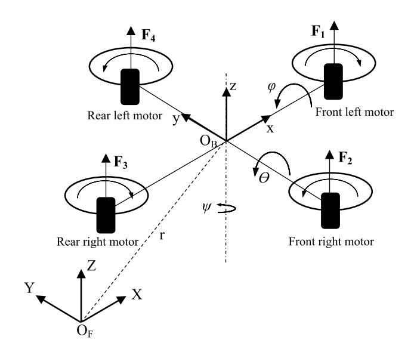

Taken together, the paper is organised as follows. The first section gives a brief overview on control of quadrotors and then, dynamic equations of a 6-DoF under-actuated quadrotor is provided and flight dynamics of a quadrotor is discussed in second section. Afterwards, the structure and stability analysis of trigonometric adaptive controller (TAC) is presented in the third section. In the fourth section, a comparative numerical analysis is performed by utilising a square trajectory to better understand the dynamic behaviour of proposed controller on way-point tracking. Finally, the conclusions are drawn in the final section.

## **2 Materials and methods**

## **2.1 Flight dynamics of a quadrotor**

In this section of the study, flight dynamics of a quadrotor is briefly examined and equations in this section are derived considering studies of [\[8,](#page-12-1) [17](#page-12-9)]. To that end, a 6-degree-of-freedom quadrotor model is illustrated in Fig. [1](#page-1-0).

Herein, *Fi* denotes thrust forces generated by each motor where *i*=1, 2, 3, 4. In addition to this, *OF* and *OB* stand for origins of global-fixed frame and body-fixed frames, respectively. Additionally, *rT*= *[x y z]* identifies the position of quadrotor with respect to global-fixed frame. Accordingly, the mathematical model of a quadrotor is then given as:

**Fig. 1**A 6 d-o-f quadrotor physical model

where *m* stands for mass of the quadrotor while *Ixx, Iyy* and *Izz* stand for moments of inertia. *Jr* is inertia of propeller and g is gravitational acceleration. Ө, φ and ψ denote pitch, roll and yaw motions (also known as attitude) of quadrotor, respectively. *x, y* and *z* stand for position and altitude of quadrotor, respectively. *𝜔r* identifies the total angular speed of rotors which is sum of the angular speeds of each rotor and is given by *𝜔r* = *𝜔*1 + *𝜔*2 +*𝜔*3 +*𝜔*4. Besides, *uj* denotes control inputs where *j*=1, 2, 3, 4. Eq. ([2\)](#page-2-0) represents these control inputs:

where *b*, *d* and *l* stand for thrust coefficient, drag coefficient and distance of *i*-th propeller from the centre of gravity of the quadrotor, respectively. It is worthy to note that control inputs *uj* represents the control action for fully actuated subsystem of the quadrotor, that is, this part deals only with altitude and attitude behaviours of the quadrotor. However, a cascaded controller is required for full control of a quadrotor including *x* and *y* position control, as well. That is, reference trajectories for pitch and roll motions can be generated on-line using virtual control inputs for under-actuated subsystem of the quadrotor. Thus, one can easily control *x* and *y* positions of a quadrotor using this technique. In an attempt to perform full control of a quadrotor, one can rearrange under-actuated subsection of Eq. ([1\)](#page-2-1) as below-given form

where *Ux* and *Uy* are inputs to perform position control of the quadrotor. As can be obviously seen from Eq. [\(3](#page-2-2)) that following equations represent these inputs

(1) *ẍ* = (cos*��* sin*��* cos*��* + sin*��* sin*��*) *u*1 *m ÿ* = (cos*��* sin*��* sin*��* − sin*��* cos*��*) *u*1 *m z̈* =−*g* + cos*��* cos*�� u*1 *m ̈��* = *�� ̇��̇ Iyy* − *Izz Ixx* − *Jr Ixx ����̇ r* + *u*2 *Ixx ��̈* = *̇�� ̇�� Izz* − *Ixx Iyy* − *Jr Iyy ̇����r* + *u*3 *Iyy ̈��* = *̇����̇ Ixx* − *Iyy Izz* + *u*4 *Izz*

(2) *u*1 = *b* ( *𝜔*2 1 + *𝜔*2 2 + *𝜔*2 3 + *𝜔*2 4 ) *u*2 = *bl*( *𝜔*2 4 − *𝜔*2 2 ) *u*3 = *bl*( *𝜔*2 1 − *𝜔*2 3 ) *u*4 = *d* ( −*𝜔*2 1 + *𝜔*2 2 − *𝜔*2 3 + *𝜔*2 4 )

(3) *ẍ* = (cos*��* sin*��* cos*��* + sin*��* sin*��*) *u*1 *m* = *Ux u*1 *m ÿ* = (cos*��* sin*��* sin*��* − sin*��* cos*��*) *u*1 *m* = *Uy u*1 *m*

It is common knowledge that roll and pitch motions of a quadrotor specify positions along x and y axes. Taken together, following desired trajectories are obtained for roll and pitch motions in order to provide virtual control input for position control.

Moreover, it could be also noted that body gyroscopic effects on roll and pitch motions are demonstrated by *�� ̇��̇* (*Iyy* − *Izz*) and *̇�� ̇��*(*Izz* − *Ixx*) in Eq. [\(1](#page-2-1)) while those of the propellers are given by *Jr����̇ r* and *Jr ̇����r*, respectively.

#### **2.2 Derivation of a trigonometric adaptive control law**

The equations of motion for altitude and attitude behaviours of a quadrotor can be given in following matrix form [[8\]](#page-12-1)

where *M(𝜂)* is *nxn* symmetric positive definite inertia matrix, *C*(*��*, *̇��*) *̇��* is *n* dimensional vector of centripetal and Coriolis terms, *G(𝜂)* is *n*-dimensional vector of gravitational terms, *𝜂* =*[z φ Ɵ ψ]T* stands for state vector of altitude and attitude motions and *𝜏* stands for *n* dimensional vector of applied torques and forces. Herein, *M(𝜂), C*(*��*, *̇��*) and *G(𝜂)* are defined as follows [\[8](#page-12-1), [11\]](#page-12-4):

Then, Eq. ([6\)](#page-2-3) can be rewritten as

where *𝜇* =[*mIxxIyyIzz*] *T* describes vector of inertia parameters, *Y*(*��*, *̇��*, *̈��*) identifies a below-given matrix composed of measurable system states

(4) *Ux* = cos*𝜑* sin*𝜃* cos*𝜓* + sin*𝜑* sin*𝜓 Uy* = cos*𝜑* sin*𝜃* sin*𝜓* − sin*𝜑* cos*𝜓*

(5) *𝜑d* = sin−1( *Ux*sin*𝜓d* − *Uy*cos*𝜓d* ) *𝜃d* = sin−1 (*Ux*cos*𝜓d* + *Uy*sin*𝜓d* cos*𝜑d* )

*M*(*��*)*̈��* + *C*(*��*, *̇��*) *̇��* + *G*(*��*) = *��* (6)

*M*(*𝜂*) = ⎡ ⎢ ⎢ ⎢ ⎢ ⎣ *m* cos*𝜑*cos*𝜃* 000 0 *Ixx* 00 00 *Iyy* 0 0 00 *Izz* ⎤ ⎥ ⎥ ⎥ ⎥ ⎦ ;*G*(*𝜂*) = ⎡ ⎢ ⎢ ⎢ ⎢ ⎣ *mg* cos*𝜑*cos*𝜃* 0 0 0 ⎤ ⎥ ⎥ ⎥ ⎥ ⎦ (7) *C*(*��*, *̇��*) *̇��* = ⎡ ⎢ ⎢ ⎢ ⎢ ⎣ 00 0 0 0 0 − *̇�� Iyy*−*Izz* 2 + *Jr��r* −*��̇ Iyy*−*Izz* 2 0 − *̇�� Izz*−*Ixx* 2 − *Jr��r* 0 − *̇�� Izz*−*Ixx* 2 0 −*��̇ Ixx*−*Iyy* 2 − *̇�� Ixx*−*Iyy* 2 0 ⎤ ⎥ ⎥ ⎥ ⎥ ⎦

*M*(*��*)*̈��* + *C*(*��*, *̇��*) *̇��* + *G*(*��*) = *Y*(*��*, *̇��*, *̈��*)*��* (8)

Multiplying both sides of Eq. [\(28\)](#page-4-0) by Γ−1 ,

Then, if Eq. [\(26](#page-3-9)) is substituted in Eq. ([29](#page-4-1)), the following parameter estimation law for the quadrotor is obtained

In this study, the initial condition of *̂𝜇*, the unloaded parameters of quadrotor, is assumed to be known and it is accepted as *̂𝜇*(0)=*𝜇*. In this case, C=0. Accordingly, the parameter estimation law Eq. [\(30\)](#page-4-2) will take the following form

If the above defined parameters of Г, *̇ ���*, Γ*̇*,*���* are substituted in Eq. [\(21](#page-3-4)), the first term of Eq. ([21\)](#page-3-4) becomes zero, that is, Γ2 *̇ ���* +ΓΓ*̇ ���* + *Yr��* = 0.

Therefore, it is straightforward to verify that *V̇* ≤ 0, that is

Since *KD* is a constant symmetric positive-definite matrix, Eq. [\(32](#page-4-3)) can be written as *V̇* (*��*, *���*) ≤ 0, proving that the time derivative of Lyapunov function is negative-definite matrix. Thus, the closed-loop system is said to be stable at around equilibrium point where *̃𝜂* , *̇ ���* converge to zero and boundedness of *𝜎* and *̂𝜇* is guaranteed.

Finally, *Ux* and *Uy* in Eq. [\(3](#page-2-2)) are derived for position control of the quadrotor by performing above-given same methodology as follows [[8\]](#page-12-1)

where *KDP* is the symmetric positive definite matrix while *𝜎P* is the error dynamics for position control which has the

Γ *̂��* =− (28) ( *��* 2*��* ) sin( *��* ∫ Yr*��*dt) +Γ*��* + *C*

(29) Γ−1Γ *̂��* = −Γ−1 ( *��* 2*��* ) sin( *��* ∫ Yr*��*dt) +Γ−1Γ*��* +Γ−1*C*

(30) *̂��* =−*��*cos( *��* ∫ Yr*��*dt) ( *��* 2*��* ) sin( *��* ∫ Yr*��*dt) + *��* + *C*Γ−1

*̂��* =− (31) ( *��*2 2*��* ) sin(2*��* ∫ Yr*��*dt)+ *��*

(32) *V̇* =−*��TKD��* ≤ 0

(33) [ *Ux Uy* ] = *m u*1 (*KDP𝜎P*)

similar structure as Eq. ([12\)](#page-3-10). To better explain, the abovegiven full control architecture of a quadrotor is illustrated in Fig. [2.](#page-4-4)

## **3 Results and discussions**

In an attempt to better evaluate the performance of proposed trigonometric adaptive controller (TAC), numerical analysis is performed in this section of the study by using both adaptive [\[8](#page-12-1)] and proposed adaptive controllers under the same circumstances. It is crucial to note that same controller parameters and same model have been utilised in this study for tracking of the same trajectory. The numerical parameters of quadrotor used in this study and their descriptions are presented in Table [1](#page-4-5).

Besides, the controller parameters used throughout the numerical analysis are provided in Table [2](#page-4-6).

Then, the time-varying inertia parameters are considered in this study as presented in the following equations [\[8](#page-12-1)]

(34) *m* = ( 1 − *t* 100 ) *m*;*Ixx* = ( 1 − *t* 100 ) *Ixx Iyy* = ( 1 − *t* 100 ) *Iyy*;*Izz* = ( 1 − *t* 100 ) *Izz*

**Table 1**Numerical values of quadrotor and their descriptions [[8](#page-12-1)]

| Parameter | Value         | Unit   | Description   |                    |
|-----------|---------------|--------|---------------|--------------------|
| m         | 0.650         | kg     | Mass          |                    |
| Ixx       | 7.5× ­10–3    | kg.m2  | Pitch         | inertia            |
| Iyy       | 7.5× ­10–3    | kg.m2  | Roll          | inertia            |
| Izz       | 1.3× ­10–2    | kg.m2  | Yaw           | inertia            |
| g         | 9.81          | m/s2   | Gravitational | acceleration       |
| Jr        | 2.8385× ­10–5 | kg.m2  | Propeller     | inertia            |
| l         | 0.23          | m      | Centre        | to centre distance |
|           |               |        | between       | a propeller and    |
| b         | 3.13× ­10–5   | N.s2   | Thrust        | coefficient        |
| d         | 7.5× ­10–7    | N.m.s2 | Drag          | coefficient        |

**Table 2**Controller parameters

| Parameter | Value |                               |
|-----------|-------|-------------------------------|
| KD        | diag  | [800 5 5 7]                   |
| KDP       | diag  | [0.6 0.6]                     |
| P         | diag  | [1.0e-4 1.0e-4 1.0e-4 1.0e-4] |
| λ         | diag  | [2 3 5 5]                     |
| λP        | diag  | [7 7]                         |
| β         | diag  | [0.25 1.0e-4 1.0e-4 1.0e-4]   |
| α         | diag  | [1.0e-4 1.0e-6 1.0e-6 1.0e-4] |

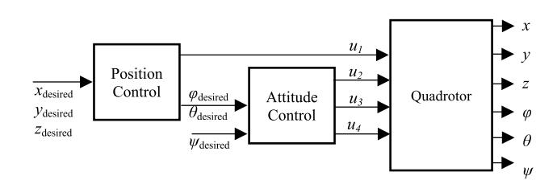

Moreover, although the disturbance model has not been taken into account within the controller architecture herein, it is assumed in this study that there are external disturbances on the responses of attitude control as given in following equations [[11\]](#page-12-4) to assess effects of the controllers on disturbances,

Accordingly, the results of this research are presented in Figs. [3,](#page-5-0) [4,](#page-5-1) [5,](#page-6-0) [6](#page-6-1), [7](#page-6-2), [8](#page-7-0), [9](#page-7-1), [10,](#page-7-2) [11,](#page-8-0) [12](#page-9-0), [13](#page-10-0) and [14](#page-11-5). The time history of lateral positions and altitude are presented in Figs. [3,](#page-5-0) [4](#page-5-1) and [5.](#page-6-0) It is apparent from the figures that overshoots, settling times and tracking errors have been remarkably reduced by proposed controller ensuring that better trajectory tracking has been achieved. As the focus of study was

(35) *d𝜑* = 0.25 sin (3*t* + 1) *d𝜃* = 0.05sin(2*t* + 1) *d𝜓* = 0.05sin(*t*)

to obtain a better tracking performance, these results verify how successful the proposed adaptive controller is.

Figure [6](#page-6-1) compares overall square trajectory tracking performance of quadrotor for both adaptive [[8\]](#page-12-1) and proposed adaptive controllers. Initially, the quadrotor gains elevation by 1.5 m, and then it tracks a square trajectory at this given altitude. Finally, it descends to home position. This figure proves that the better overall tracking has been achieved by proposed controller. It is worth mentioning herein that the mathematical representation of square trajectory utilised in this study is derived considering studies [[26,](#page-12-17) [27](#page-12-18)] and given as follows:

(36) *xd* = 1 5 *tfsg*(*t*, 0, 10) + 2*fsg*(*t*, 10, 21) + 1 5 (31 − *t*)*fsg*(*t*, 21, 31) *yd* = 1 10|*t* − 10|*fsg*(*t*, 10, 20) + *fsg*(*t*, 20, 31) + 1 10(41 − *t*)*fsg*(*t*, 31, 41) *zd* = 1.5*fsg*(*t*, 0, 41) + 1.5 4 (45 − *t*)*fsg*(*t*, 41, 45)

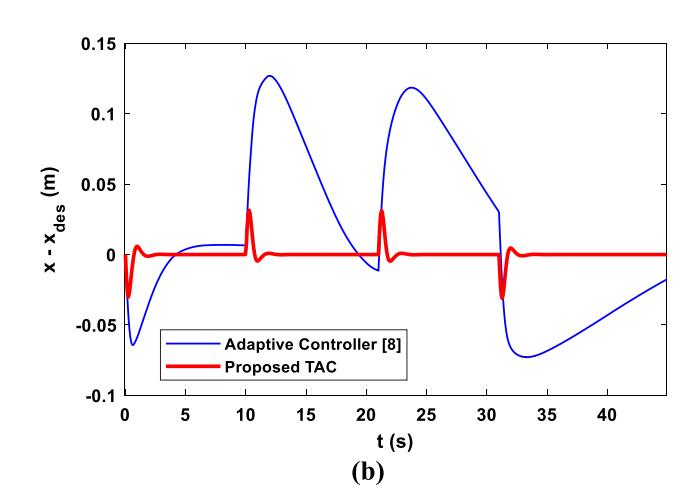

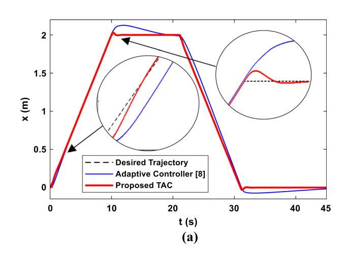

**Fig. 3**Lateral x motion (**a**), and tracking error of x position (**b**)

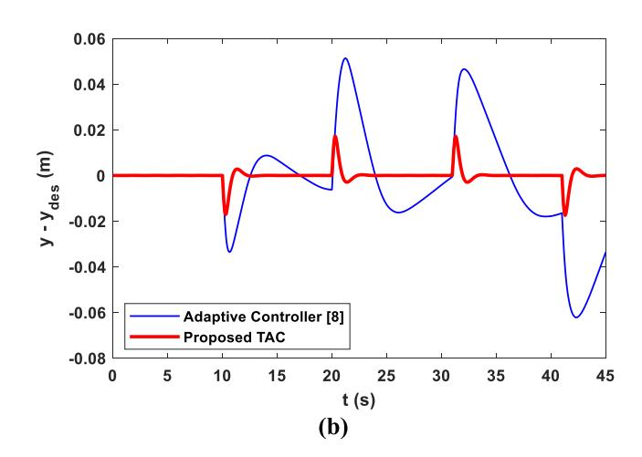

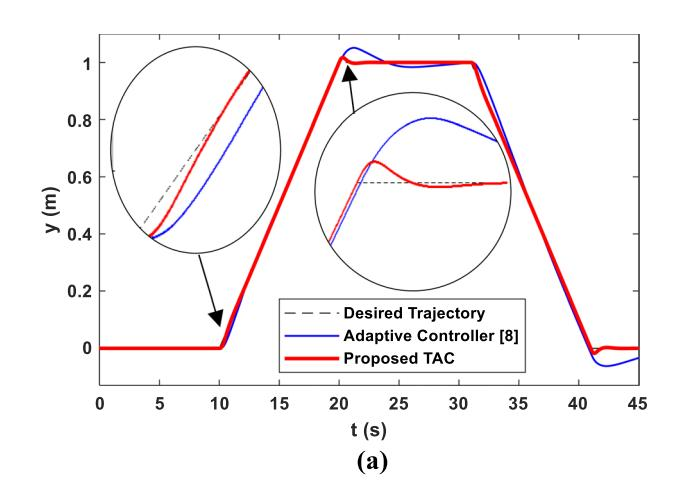

**Fig. 4**Lateral y motion (**a**), and tracking error of y position (**b**)

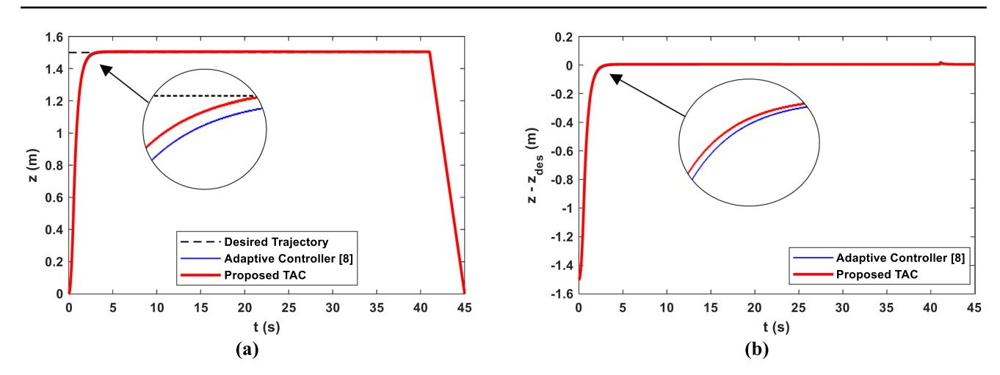

**Fig. 5**Altitude of quadrotor (**a**) and altitude tracking error (**b**)

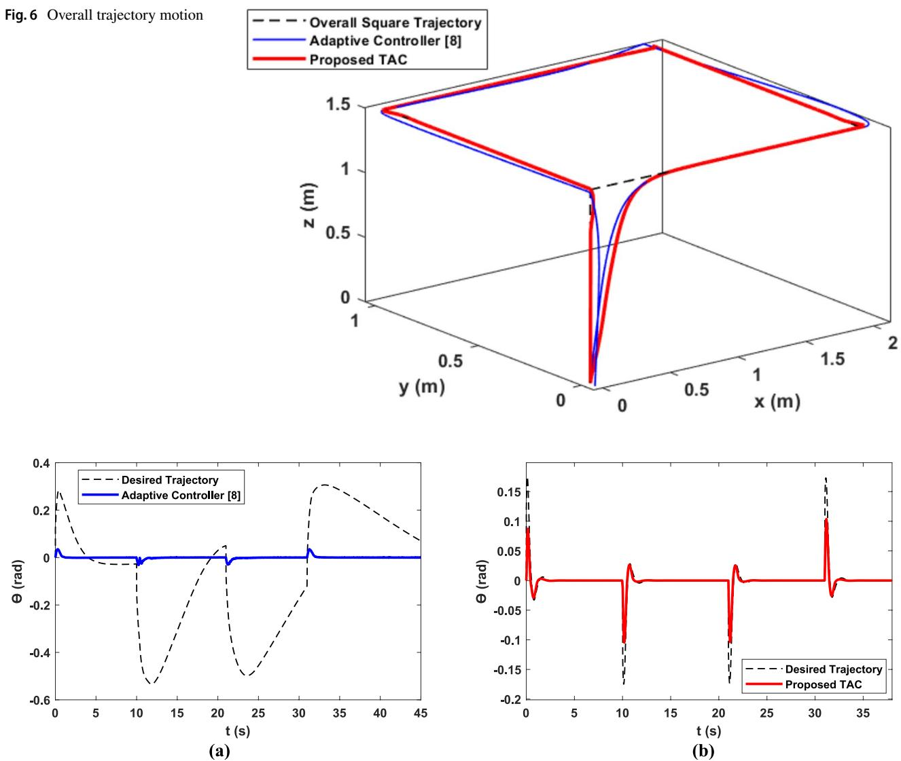

**Fig. 7**Pitch motion of quadrotor; adaptive controller [\[8](#page-12-1)] (**a**), and trigonometric adaptive controller (TAC) (**b**)

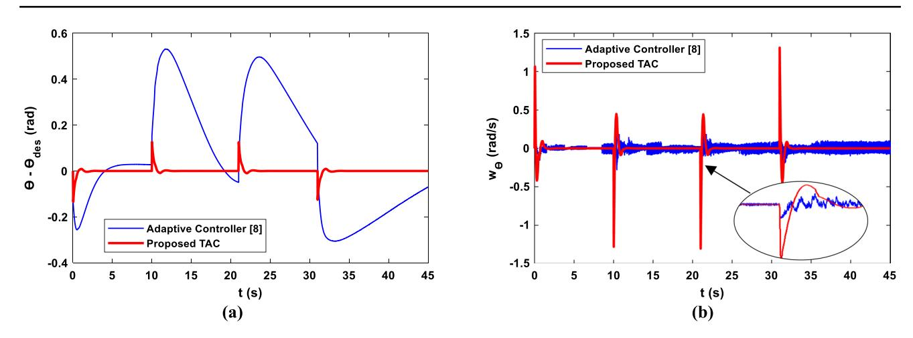

**Fig. 8**Tracking error (**a**), and angular velocity of pitch motion (**b**)

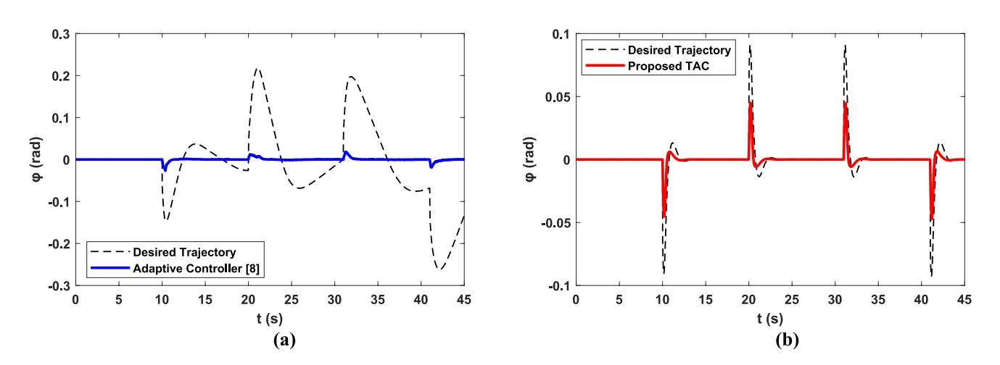

**Fig. 9**Roll motion of quadrotor; adaptive controller [\[8](#page-12-1)] (**a**), and trigonometric adaptive controller (TAC) (**b**)

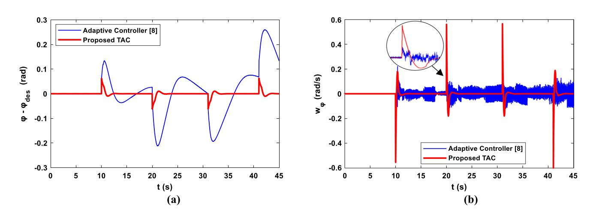

**Fig. 10**Tracking error (**a**), and angular velocity of roll motion (**b**)

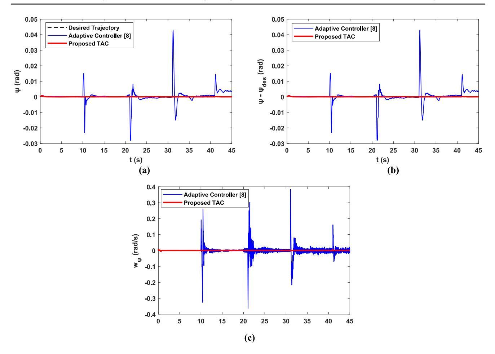

where *fsg* is a below-given interval function

As mentioned above, quadrotors are under-actuated systems and both controllers are implemented on fully actuated section of the system. For this purpose, a cascaded controller methodology is generally utilised in control of quadrotors. This technique implies that the desired trajectories of *Ɵ* and *φ* are created on-line by controllers, separately. That is, desired *Ɵ* and *φ* are generated by control of lateral positions of *x* and *y*, respectively. Figures [7,](#page-6-2) [8](#page-7-0), [9](#page-7-1) and [10](#page-7-2) clearly demonstrate that generated desired trajectories are quite different. Besides, it is observed from the figures that the amplitude of desired trajectory generated by proposed trigonometric adaptive controller (TAC) is smaller than that of the adaptive controller [[8\]](#page-12-1). So as to evaluate the trajectory tracking performance of both controllers, tracking errors and angular velocities with respect to time figures come into focus. As can be clearly seen from the figures that tracking error has been significantly

*fsg*(*t*, *a*, *b*) = (37) *sgn*(*t* − *a*) − *sgn*(*t* − *b*) 2

attenuated by proposed controller without causing any chattering phenomenon. Furthermore, one can crucially note from the figures that peak values of pitch and roll angular velocities have been increased by proposed adaptive controller. As anticipated, this implies that the quadrotor is rapidly reacting to control action ensuring a better *x* and *y* position tracking performance. Taken together, these findings suggest that a considerable enhancement has been gained by proposed controller in reducing tracking error and eliminating the chattering that might be destructive for mechanical parts of quadrotors. Moreover, it is common knowledge that these undesired vibrations can easily demolish camera view.

The effects of both controllers on yaw motion of a quadrotor can be seen in Fig. [11](#page-8-0). Herein, *0* rad is selected as desired yaw motion. From the figure, one can easily come to the conclusion that better trajectory tracking performance without chattering has been achieved by proposed controller. It should be also noted that the yaw angular velocity of quadrotor is at 0 rad/s throughout the motion. That means the head direction of quadrotor has not changed since head direction, for one instance, is crucial

**Fig. 11**Yaw motion (**a**), tracking error (**b**), and angular velocity of yaw motion (**c**)

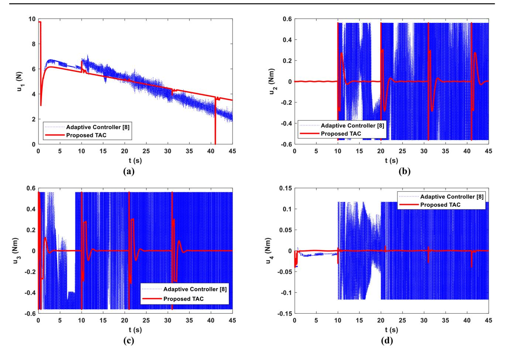

for record actions by a camera. This states that the proposed trigonometric adaptive controller (TAC) has significant role and clear advantage on reducing the tracking error and chattering issue.

So as to verify the effectiveness of proposed adaptive controller on minimising the trajectory tracking errors, a performance comparison study using maximum values of tracking errors (*̃𝜂* = *𝜂* − *𝜂d*) has been carried out and great attention has been drawn on the enhancements attained by proposed controller. Table [3](#page-11-6) highlights that significant improvements have been reached by proposed adaptive controller.

In order to reach a final decision, the time histories of total thrust force, torque inputs and motor speeds given in Figs. [12](#page-9-0) and [13](#page-10-0) should be taken into consideration, as well. A great deal of attention should also be paid on the required total thrust force, torque inputs and motor speeds. A brushless DC motor for a quadrotor requires thrust force and motor speed values within the reasonable ranges because of practical issues. Obtained results appear to be well supported by reasonable values which can be easily provided through a commercial brushless DC motor. Given that the primary aim of present study was to improve trajectory tracking performance of a quadrotor without causing chattering issue, satisfactory results have been attained.

The estimated values of inertia parameters are compared in Fig. [14](#page-11-5). From the figure, one can easily see that the real mass value is estimated by adaptive controller [[8\]](#page-12-1) whereas the real values of mass moment of inertia parameters are estimated by proposed adaptive controller. It is worth to note that adaptive dynamic compensators may not find the actual values of system parameters, *̂𝜇* , i.e., the Eq. [\(31\)](#page-4-7) is a dynamic compensator and its purpose is to reduce the tracking error to zero.

Returning to the question posed at the beginning of this research, it is now possible to declare that above-presented figures highlight exactly where the aim of this research meets the anticipations from a controller. Consequently, the success of proposed trigonometric adaptive controller (TAC) on trajectory tracking performance has been further confirmed within the reasonable values of thrust forces, torques and motor speeds without causing any chattering issue.

**Fig. 12**Control inputs: total thrust force (**a**), torque inputs; for roll motion (**b**), pitch motion (**c**), and yaw motion (**d**)

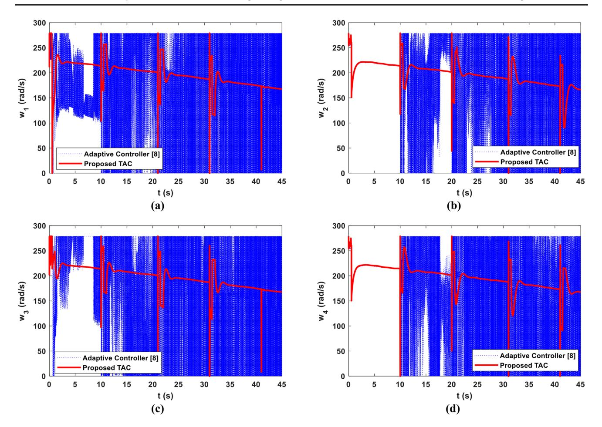

## **4 Conclusions**

In this study, adaptive control of a nonlinear quadrotor has been investigated using a trigonometric dynamic compensator so as to verify its performance on trajectory tracking error in the presence of time-varying parameters. Accordingly, a sinusoidal parameter estimation law has been proposed and its stability has been guaranteed by using Lyapunov stability theory. The current study corroborates that convergence of the error has been achieved. A comparison study has been performed between proposed trigonometric adaptive controller (TAC) and adaptive controller [\[8\]](#page-12-1) by using same controller gains and under the same conditions. Satisfactory results have been obtained from numerical analysis demonstrating that the trajectory tracking error has been further improved by sinusoidal function under the same circumstances. Besides, it is worthy to note that the chattering issue of adaptive controller [[8](#page-12-1)] while tracking a square trajectory has been significantly eliminated by proposed control law. Moreover, as the research has suggested that the required thrust force, torque values and angular speeds are acceptable for a commercial brushless DC motor proving that the findings are in good agreement with the literature. To sum up, one can easily conclude that a methodology has been devised in this research in order to reduce chattering of the motors using an economically viable proposed approach for a wide range of trajectories. On the other hand, it is crucial to note that the disturbance model has not been taken into account in this study and in stability analysis. However, simulation results have obviously illustrated that the disturbances have also been eliminated. Since the designed dynamic compensator reduces the tracking error to zero, it is understood from the simulation results that the dynamic compensator also eliminates the effects of the disturbing inputs. This matches well with [[8](#page-12-1)]. Although a disturbance model was not given in the controller structure, a measurable disturbance was utilised in numerical analyses proving that the adaptive controller [[8\]](#page-12-1) could easily deal with the given disturbances. With this in mind, a new robust or robust-adaptive control law considering external disturbances can be taken into account in future derivation of control laws. Additionally, new adaptive control laws for quadrotors can be derived using different time-dependent functions as the results herein

**Fig. 13**Angular speeds of motors: front left (**a**), front right (**b**), rear right (**c**), and rear left (**d**)

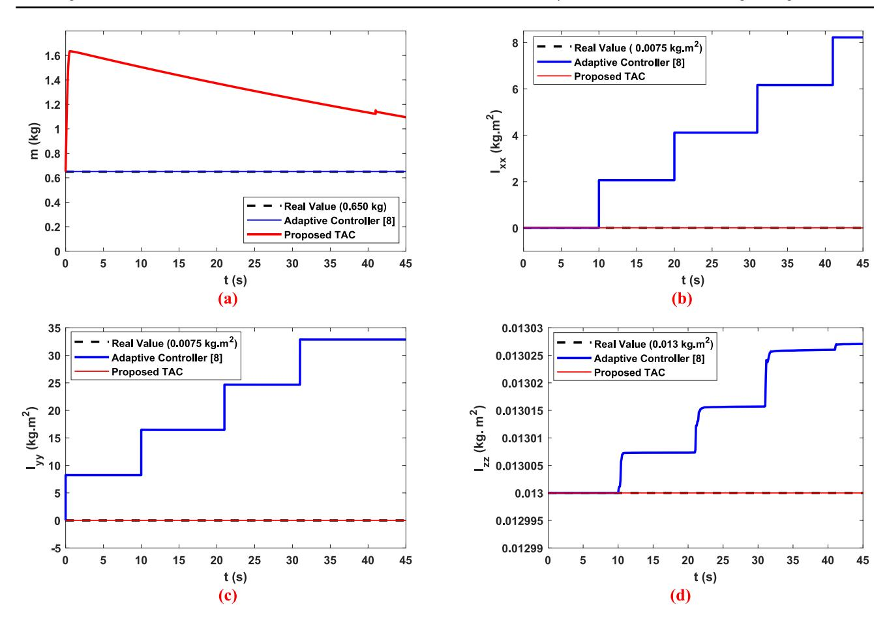

suggest. Furthermore, optimising controller parameters using neural network, fuzzy logic and algorithms such as genetic algorithm, ant colony algorithm or similar can be considered for future investigations.

**Funding** The authors did not receive support from any organisation for the submitted work.

#### **Declarations**

**Conflict of interest** The authors declare that they have no conflict of interest.

## **References**

- 1. Sciavicco L, Siciliano B (1996) Modeling and control of robot manipulators. McGraw-Hill, New York
- 2. Slotine J-JE, Weiping Li W (1991) Applied nonlinear control. Prentice-Hall, Englewood Cliffs, New Jersey
- 3. Slotine J-JE, Weiping Li W (1987) On the adaptive control of robot manipulators. Int J Rob Res 6:49–59. [https://doi.org/10.](https://doi.org/10.1177/027836498700600303) [1177/027836498700600303](https://doi.org/10.1177/027836498700600303)
- 4. Santos MCP, Rosales CD, Sarapura JA et al (2019) An adaptive dynamic controller for quadrotor to perform trajectory tracking tasks. J Intell Robot Syst Theory Appl 93:5–16. [https://doi.org/](https://doi.org/10.1007/S10846-018-0799-3/METRICS) [10.1007/S10846-018-0799-3/METRICS](https://doi.org/10.1007/S10846-018-0799-3/METRICS)
- 5. Imran IH, Wood K, Montazeri A (2024) Adaptive control of unmanned aerial vehicles with varying payload and full parametric uncertainties. Electron 13:347. [https://doi.org/10.3390/ELECT](https://doi.org/10.3390/ELECTRONICS13020347) [RONICS13020347](https://doi.org/10.3390/ELECTRONICS13020347)
- 6. Pérez-Alcocer R, Moreno-Valenzuela J, Miranda-Colorado R (2016) A robust approach for trajectory tracking control of a

**Fig. 14**Estimation of inertia parameters: mass (**a**), pitch inertia (**b**), roll inertia (**c**), and yaw inertia (**d**)

**Table 3**Performance comparison of tracking errors

| Parameters |       | Adaptive Control |     |            |     |       |
|------------|-------|-------------------|-----|------------|-----|-------|
|            |       | ler [8            | ]   |            |     |       |
| x          | − xd  | 0.1269            | m   | 0.0315     | m   | 75.18 |
| y          | − yd  | 0.0622            | m   | 0.0175     | m   | 71.86 |
| z          | − zd  | 0.0227            | m   | 0.0141     | m   | 37.89 |
| φ          | − φd  | 0.2598            | rad | 0.0627     | rad | 75.87 |
| Ɵ          | − Ɵ d | 0.5317            | rad | 0.1344     | rad | 74.72 |
| ψ          | − ψd  | 0.0430            | rad | 7.2451e-04 | rad | 98.32 |

- quadrotor with experimental validation. ISA Trans 65:262–274. <https://doi.org/10.1016/J.ISATRA.2016.08.001>
- 7. Maaruf M, Hamanah WM, Abido MA (2023) Hybrid backstepping control of a quadrotor using a radial basis function neural network. Math 11:991.<https://doi.org/10.3390/MATH11040991>
- 8. Navabi M, Davoodi A, Mirzaei H (2022) Trajectory tracking of under-actuated quadcopter using Lyapunov-based optimum adaptive controller. Proc Inst Mech Eng Part G J Aerosp Eng 236:202–215
- 9. Geronel RS, Bueno DD (2024) Adaptive sliding mode control for vibration reduction on UAV carrying a payload. J Vib Control. <https://doi.org/10.1177/10775463241231845>
- 10. Salas-Peña O, DeLeón-Morales J, Gutiérrez-Martínez SV (2024) Output feedback adaptive super twisting sliding mode control for quadrotor UAVs. Control Theory Technol 22:92–105. [https://doi.](https://doi.org/10.1007/S11768-023-00195-2/FIGURES/9) [org/10.1007/S11768-023-00195-2/FIGURES/9](https://doi.org/10.1007/S11768-023-00195-2/FIGURES/9)
- 11. Navabi M, Mirzaei H (2017) Robust optimal adaptive trajectory tracking control of quadrotor helicopter. Lat Am J Solids Struct 14:1040–1063. <https://doi.org/10.1590/1679-78253595>
- 12. Cedro L, Wieczorkowski K, Szcześniak A (2024) An adaptive PID control system for the attitude and altitude control of a quadcopter. Acta Mech Autom 18:29–39. [https://doi.org/10.2478/](https://doi.org/10.2478/AMA-2024-0004) [AMA-2024-0004](https://doi.org/10.2478/AMA-2024-0004)
- 13. Li Y, Li Z, Yu X et al (2024) Attitude tracking control for quadrotors under unknown disturbances based on dual-loop nonlinear command filters. IEEE Trans Circuits Syst II Express Briefs. <https://doi.org/10.1109/TCSII.2024.3351686>
- 14. Huang T, Gao X, Li T (2024) Adaptive fuzzy attitude sliding mode control for a quadrotor unmanned aerial vehicle. Int J Fuzzy Syst 26:686–701. [https://doi.org/10.1007/S40815-023-01628-5/](https://doi.org/10.1007/S40815-023-01628-5/FIGURES/14) [FIGURES/14](https://doi.org/10.1007/S40815-023-01628-5/FIGURES/14)
- 15. Li J, Wang H, Yang C (2024) Adaptive event-triggered quantized attitude control for QUAV with appointed-time prescribed performance function. Aerosp Sci Technol. [https://doi.org/10.1016/J.](https://doi.org/10.1016/J.AST.2024.108967) [AST.2024.108967](https://doi.org/10.1016/J.AST.2024.108967)
- 16. Ruiz A, Rotondo D, Morcego B (2024) Design of shifting statefeedback controllers for constrained feedback linearized systems: application to quadrotor attitude control. Int J Robust Nonlinear Control 34:2614–2638.<https://doi.org/10.1002/RNC.7098>
- 17. Bouabdallah S, Siegwart R (2007) Full control of a quadrotor. IEEE Int Conf Intell Robot Syst. [https://doi.org/10.1109/IROS.](https://doi.org/10.1109/IROS.2007.4399042) [2007.4399042](https://doi.org/10.1109/IROS.2007.4399042)
- 18. Trapiello C, Puig V, Morcego B (2019) Position-heading quadrotor control using LPV techniques. IET Control Theory Appl 13:783–794.<https://doi.org/10.1049/IET-CTA.2018.6147>
- 19. Maaruf M, Abubakar AN, Gulzar MM (2024) Adaptive backstepping and sliding mode control of a quadrotor. J Brazilian Soc Mech Sci Eng 4611(46):1–15. [https://doi.org/10.1007/](https://doi.org/10.1007/S40430-024-05188-Z) [S40430-024-05188-Z](https://doi.org/10.1007/S40430-024-05188-Z)
- 20. Mahmood A, Rehman F, Okasha M, Saeed A (2024) Neural adaptive sliding mode control for camera positioner quadrotor UAV. Int J Aeronaut Sp Sci. [https://doi.org/10.1007/S42405-024-00781-X/](https://doi.org/10.1007/S42405-024-00781-X/FIGURES/16) [FIGURES/16](https://doi.org/10.1007/S42405-024-00781-X/FIGURES/16)
- 21. Ben AN, Bouallègue S, Haggège J, Vaidyanathan S (2017) Chattering free sliding mode controller design for a Quadrotor unmanned aerial vehicle. Stud Comput Intell 709:61–79. [https://](https://doi.org/10.1007/978-3-319-55598-0_3/COVER) [doi.org/10.1007/978-3-319-55598-0\\_3/COVER](https://doi.org/10.1007/978-3-319-55598-0_3/COVER)
- 22. González I, Salazar S, Lozano R (2014) Chattering-free sliding mode altitude control for a quad-rotor aircraft: real-time application. J Intell Robot Syst Theory Appl 73:137–155. [https://doi.org/](https://doi.org/10.1007/S10846-013-9913-8/METRICS) [10.1007/S10846-013-9913-8/METRICS](https://doi.org/10.1007/S10846-013-9913-8/METRICS)
- 23. Lian S, Meng W, Lin Z et al (2022) Adaptive attitude control of a quadrotor using fast nonsingular terminal sliding mode. IEEE Trans Ind Electron 69:1597–1607. [https://doi.org/10.1109/TIE.](https://doi.org/10.1109/TIE.2021.3057015) [2021.3057015](https://doi.org/10.1109/TIE.2021.3057015)
- 24. Burkan R (2013) Design of adaptive compensators for the control of robot manipulators robust to unknown structured and unstructured parameters. Turkish J Electr Eng Comput Sci 21:452–469. <https://doi.org/10.3906/elk-1108-60>
- 25. Burkan R (2005) Design of an adaptive control law using trigonometric functions for robot manipulators. Robotica 23:93–99. <https://doi.org/10.1017/S0263574704000657>
- 26. Shamshirgaran A, Ebeigbe D, Simon D (2021) Position and Attitude Control of Underactuated Drones Using the Adaptive Function Approximation Technique. In: ASME 2020 Dyn Syst Control Conf DSCC 2020.<https://doi.org/10.1115/DSCC2020-3211>
- 27. Zuo Z (2010) Trajectory tracking control design with commandfiltered compensation for a quadrotor. IET Control Theory Appl 4:2343–2355. <https://doi.org/10.1049/IET-CTA.2009.0336> **Publisher's Note** Springer Nature remains neutral with regard to jurisdictional claims in published maps and institutional affiliations. Springer Nature or its licensor (e.g. a society or other partner) holds exclusive rights to this article under a publishing agreement with the author(s) or other rightsholder(s); author self-archiving of the accepted manuscript version of this article is solely governed by the terms of such publishing agreement and applicable law.