# **Attitude and position control with minimum snap trajectory planning for quadrotor UAV**

**Brajesh Kumar Singh[1](http://orcid.org/0000-0003-4914-2889) · Awadhesh Kumar1**

Received: 16 November 2022 / Revised: 12 December 2022 / Accepted: 29 December 2022 / Published online: 13 January 2023 © The Author(s), under exclusive licence to Springer-Verlag GmbH Germany, part of Springer Nature 2023

#### **Abstract**

In this paper, the Quadrotor attitude control and the problem of trajectory tracking has been addressed with minimum snap trajectory generation algorithm. The control system has been designed using proportional plus derivative (PD) control with two feedback loops. The attitude and position controllers have been designed in inner and outer loop, respectively. The designed controller is first tested for helical, infinity shaped trajectory and then for a minimum snap trajectory, which is generated from specified waypoints in three-dimensional space. The Euler–Lagrange equation has been used to obtain minimum snap trajectory condition, which results in a seventh order polynomial. The coefficients of the polynomials are obtained by applying enough constraints on velocity, acceleration, and higher derivatives. The trajectory generation with designed controller has been implemented in MATLAB environment. The controller shows efficient performance and good trajectory tracking for all the trajectories with minimum tracking error.

**Keywords** PD · Quadrotor · UAV · Minimum snap · Rotorcraft · Feedback

## **Abbreviations**

PID Proportional integral derivative SMC Sliding mode control UAV Unmanned aerial vehicle LQR Linear quadratic regulator VTOL Vertical take-off and landing MPC Model predictive control MRAC Model reference adaptive control EKF Extended Kalman filter ESO Extended state observer

## **1 Introduction**

The Quadrotor is widely used aerial vehicle because of its efficient performance of operation. There are only four control inputs and six degrees of freedom, so it is an underactuated system. It is a highly nonlinear system because of nonlinear terms associated with its dynamics. It is most demanding aerial vehicle because of its VTOL capability. The stabilization of the attitude of the Quadrotor is very challenging task to achieve an efficient operating performance. The trajectory planning of the UAV is dependent on the specific mission. The applications of Quadrotor include military, surveillance, aerial photography, security, spying, agriculture, environmental monitoring, aerospace and other civilian sectors. The construction of Quadrotor includes four motors mounted on a cross-legged airframe with onboard controller, battery and sensors. The two oppositely facing motors rotate in a counterclockwise direction and other two motors revolve in clockwise direction to balance the moments.

In real-time operation of the Quadrotor UAV specifically in the indoor operation, the trajectories are not pre-specified as there are obstacles in the environments. The trajectory generation formulated using quadratic programming with linear constraints for the Quadrotor has been reported in

B Brajesh Kumar Singh brajeshee@mmmut.ac.in Awadhesh Kumar

akee@mmmut.ac.in

1 Department of Electrical Engineering, Madan Mohan Malaviya University of Technology Gorakhpur, Gorakhpur, U.P., India

[\[1\]](#page-10-0). An online trajectory generation algorithm based on trajectory feasibility constraints regarding vehicle dynamics has been proposed in [\[2\]](#page-10-1). The trajectory generation method based on optimal smoothing B-spline has been addressed in [\[3\]](#page-10-2). The trajectory planning in cluttered indoor environment with jointly optimizing polynomial path segments formulated for efficient sparse computation has been presented in [\[4\]](#page-10-3). A time-optimal trajectory generation algorithm for landing of Quadrotor on moving platform has been proposed in [\[5\]](#page-10-4). A smooth nonlinear trajectory generation algorithm based on differential flatness of the Quadrotor considering dynamic constraints and environmental constraints has been discussed in [\[6\]](#page-10-5). The trajectory generation for precise aggressive manoeuvres has been reported in [\[7\]](#page-10-6). The researchers have been motivated to develop robust control algorithms due to rapid increase in the application of the Quadrotor [\[8\]](#page-10-7). There are various control algorithms developed for the Quadrotor in the literature, that mainly includes robust and adaptive control [\[8\]](#page-10-7). The very basic linear control scheme, PID control has been designed and implemented in [\[9,](#page-10-8) [10\]](#page-10-9). The optimal controllers such as LQR [\[11\]](#page-10-10) and LQG [\[12\]](#page-10-11) to achieve optimal response based on optimization of quadratic cost function and state estimation using Kalman filter have been designed for Quadrotor. A feedback linearization control for Quadrotor has been implemented by [\[13\]](#page-10-12), a control action is designed which cancels the system nonlinearity and converts it to a linear system. The Backstepping control for Quadrotor control has been reported in [\[14\]](#page-10-13), which is a recursive process of control design by dividing the system into subsystems and designing the virtual control by stabilizing each subsystem. In sliding mode control [\[15\]](#page-11-0), a sliding surface is designed to regulate the system states, to reach to the equilibrium state through the sliding surface. The robust controllers are also applied to Quadrotor UAV to deal with perturbations due to external disturbances and uncertainty into dynamic modelling. The robust control approaches used to control the Quadrotor include the loop shaping control [\[16\]](#page-11-1), and H∞ control [\[17\]](#page-11-2). The adaptive controllers are used in case of parameter variations in the Quadrotor system. The adaptive control has capability to adjust its gain in this situation of varying parameters. The adaptive control technique, MRAC, has been used to control the Quadrotor trajectory tracking in [\[18\]](#page-11-3). The gain scheduling-based adaptive control was implemented for Quadrotor in [\[19,](#page-11-4) [20\]](#page-11-5). The model predictive control uses system dynamic model to predict the future states, which is used to generate control action by optimizing a cost function. The MPC has been implemented for Quadrotor trajectory tracking control in [\[21,](#page-11-6) [22\]](#page-11-7). Fractional order controllers provides extra degree of freedom to the controller design. It has been proposed for Quadrotor control in [\[23,](#page-11-8) [24\]](#page-11-9). The linear matrix inequality (LMI)-based controller has been implemented in [\[25\]](#page-11-10) for Quadrotor. The artificial intelligence (AI)-based control schemes are very prominent techniques these days. Some of the intelligent controllers for Quadrotor includes neural network-based control in [\[26,](#page-11-11) [27\]](#page-11-12), fuzzy logic control in [\[28,](#page-11-13) [29\]](#page-11-14). Observer-based control schemes such as EKF and ESO are also reported in the literature in [\[30](#page-11-15)[–32\]](#page-11-16). The active disturbance rejection control (ADRC) for attitude control of Quadrotor has been proposed in [\[33\]](#page-11-17), which effectively enhanced the angular tracking performance. The dynamic surface control-based decoupling tracking controller has been addressed in [\[34\]](#page-11-18) with sliding mode disturbance observer for Quadrotor. A quaternion-based command filtered backstepping framework combined with modified Gaussian process regression control has been implemented in [\[35\]](#page-11-19), when Quadrotor subjected to perturbations. A machine learning-based control algorithm has been reported in [\[36\]](#page-11-20), where the controller gains were optimized for specific mission using machine learning.

In this paper, the problem of optimal trajectory generation for Quadrotor manoeuvring in tightly constrained indoor environment in three-dimensional space has been addressed. To incorporate more constraints on position, velocity and higher derivatives, the minimum snap trajectory has been generated for smooth take-off and landing of the Quadrotor. The closed-loop control for position and attitude has been obtained via PD control action. The PD control action is easier to implement with less computational burden, so it is preferred over most of the control actions which are complex and require more computational effort. The minimum snap trajectory has been generated using the Euler–Lagrange's equation and constraints on velocity, acceleration, and higher derivatives of the positions. The organization of this paper is described as follows: in Sect. [1,](#page-0-0) the introduction of the Quadrotor control is given with a brief literature survey. In Sect. [2,](#page-1-0) the problem statement has been briefly discussed which have been implemented in this paper. In Sect. [3,](#page-2-0) the nonlinear dynamics of the Quadrotor system has been derived using first principle. The linearization of the nonlinear dynamical equations is also provided in this section. The minimum snap trajectory generation algorithm is discussed, and mathematical derivation has also been discussed in Sect. [4.](#page-3-0) In the next Sect. [5,](#page-4-0) a trajectory tracking control system is designed and implemented for Quadrotor system which is tested for different trajectories. In Sect. [6,](#page-6-0) the simulation results have been shown and discussed. In Sect. 7, the conclusion of the work has been given.

## **2 Problem formulation**

The problem statement of Quadrotor control with generation of minimum snap trajectory has been stated as:

- 1. To derive a dynamical model of the Quadrotor system including dynamics of translational and rotational subsystems.

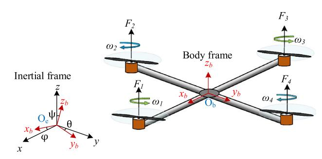

**Fig.1** Schematics of Quadrotor UAV System

- 2. To generate minimum snap trajectory from given waypoints in three-dimensional spaces by the application of Euler–Lagrange's equations.
- 3. To design and implement a controller for position as well as attitude to obtain regulatory and trajectory tracking control with minimum tracking error.

## **3 Mathematical modelling of quadrotor UAV**

In this section, the mathematical model of the Quadrotor UAV has been derived. The rotorcraft with four rotors mounted on an airframe of cross shaped with onboard controller and sensors is a Quadrotor UAV. The coordinate frames are defined as body fixed frame Ob (*xb*, *yb*, *zb*) and earth fixed frame Oe (*xe*, *ye*, *ze*). The schematic diagram of such rotorcraft has been presented in Fig. [1.](#page-2-1) It is an underactuated systems because there is less control inputs than degree of freedom. The motors 1, 3 rotates in counterclockwise direction and motors 2, 4 rotates in clockwise direction.

There are six degrees of freedom for Quadrotor motion which consists of three rotational as well as three translational motion around the three inertial frame axes. The position and attitude in inertial frame are denoted as X *xyz T* and - ϕ θψ *T* , respectively. The roll angle ϕ is defined as the angular displacement about *xe* axis, pitch angle θ is defined as the angular displacement about *ye* axis and yaw angle ψ is defined as the angular displacement about *ze* axis. The angular velocity in body fixed frame are represented as *pqr T* .

### **3.1 Motor speeds to force/moment**

The four motor speeds are represented as ω1, ω2, ω3 and ω4. The thrust *Fi* generated by ith motor is obtained as

*Fi kF*ω2 *i* (1)

where i 1 to 4 and *kF* is the thrust coefficient. The total thrust produced by four motors is obtained in body fixed frame as

*T B* 4 *i*1 *Fi* (2)

The drag moments due to each motor have been shown as

*Mi kM* ω2 *i* (3)

where i 1 to 4 and *kM* is the drag coefficient and *Mi* is the moment due to motor *i*. The three moments around body frame axis are *M B* -*Mx My Mz* are depends on the motor angular speeds and shown in the below equation

*M B* ⎡ ⎢ ⎣ *Mx My Mz* ⎤ ⎥ ⎦ ⎡ ⎢ ⎣ *lkF* ω2 2 − ω2 4  *lkF* ω2 3 − ω2 1  *kM* ω2 1 − ω2 2 + ω2 3 − ω2 4  ⎤ ⎥ ⎦ (4)

The net thrust *T B* as well as the net moments *M B* generated by the rotors is considered as the control input to the Quadrotor system as the thrust and net moment are dependent on the motor speeds. So, the Quadrotor motion control is obtained by varying the motors speed by applying a suitable control action.

### **3.2 Quadrotor dynamical equations**

The equations of motion of the Quadrotor is described with the assumptions that it is a rigid body having six degrees of freedom. The dynamical equations are described by the Newton–Euler equation of six degrees of freedom rigid body motion. The translational motion in inertial frame has been described by the following net force equation.

m*X*¨ ⎡ ⎢ ⎣ 0 0 −*mg* ⎤ ⎥ ⎦ +R ⎡ ⎢ ⎣ 0 0 *T B* ⎤ ⎥ ⎦ (5)

where m is the mass of the Quadrotor and g is gravitational acceleration acting on the Quadrotor system. The rotation matrix R is used to transform the body frame quantities to earth frame quantities and depends on Euler angles as shown in the following equation for a ZXY rotation convention.

*R* ⎡ ⎢ ⎣ cosθcosψ − sinϕsinθsinψ −cosϕsinψ sinθcosψ + cosθsinϕsinψ cosθsinψ + sinϕsinθcosψ cosϕcosψ sinθsinψ − cosθsinϕcosψ −cosϕsinθ sinϕ cosϕcosθ ⎤ ⎥ ⎦ (6)

The Quadrotor rotational dynamics in body frame has been described by the following equation

I˙ *M B* − × *I* (7)

The above equation can also be represented as

*I* ⎡ ⎢ ⎣ *p*˙ *q*˙ *r*˙ ⎤ ⎥ ⎦ ⎡ ⎢ ⎣ *lkF* ω2 2 − ω2 4  *lkF* ω2 3 − ω2 1  *kM* ω2 1 − ω2 2 + ω2 3 − ω2 4  ⎤ ⎥ ⎦ − ⎡ ⎢ ⎣ *p q r* ⎤ ⎥ ⎦ × *I* ⎡ ⎢ ⎣ *p q r* ⎤ ⎥ ⎦ (8)

I ⎡ ⎢ ⎣ *Ixx* 00 0 *Iyy* 0 00 *Izz* ⎤ ⎥ ⎦ (9)

where *I* is a diagonal matrix and known as inertia matrix, which is computed in body frame due to sake of simplicity in calculations.

The angular velocities in the body frame are converted to Euler angles by using the transformation matrix *Tr*, shown in the following equation

*Tr*-˙ (10)

where *Tr* is the transformation matrix which converts the rate of change of Euler angles into the body frame angular velocities which is obtained for ZXY rotation sequence and expressed in Eq. [\(11\)](#page-3-1).

*Tr* ⎡ ⎢ ⎣ cosθ 0 −cosϕsinθ 0 1 sinϕ sinθ 0 cosϕcosθ ⎤ ⎥ ⎦ (11)

The physical and modelling parameters of the Quadrotor system used in this simulation work are given in Table [1.](#page-3-2)

The complete dynamical equations for quadrotor motion have been described by the equations described below

*x*¨ (sinθcosψ+sinϕcosθsinψ)*T B m y*¨ (sinθsinψ−sinϕcosθcosψ)*T B m z*¨ −*g* + (cosϕcosθ)*T B m p*¨ *qr*(*Iyy*−*Izz*) *Ixx* + *Mx Ixx q*¨ *pr*(*Ixx*−*Izz*) *Iyy* + *My Iyy r*¨ *pq*(*Ixx*−*Iyy* ) *Izz* + *Mz Izz* ⎫ ⎪⎪⎪⎪⎪⎪⎪⎪⎪⎪⎬ ⎪⎪⎪⎪⎪⎪⎪⎪⎪⎪⎭ (12)

The Quadrotor state space representation of the dynamical equations has been shown in Eq. [\(12\)](#page-3-3) and the corresponding parameters used for modelling has been shown in Table [1.](#page-3-2)

**Table 1** Modelling parameters for the Quadrotor [\[37\]](#page-11-21)

## **4 Minimum snap trajectory generation**

The automatic trajectory generation for autonomous Quadrotor UAV control is very challenging because of complexity of its dynamics and obstacles in the environment. The fourth derivative of position is known as the snap. In the mathematical model of Quadrotor, the position control loop depends upon the inner attitude control loop. The second derivative of positions are depending on the first control input which is net thrust *T B*. The second derivative of rotation matrix depends on three control inputs *Mx* , *My* , *Mz*. So, mathematically it may be derived that the fourth derivative of position which again depends upon *Mx* , *My* , *Mz*. It can be mathematically proven using the linear model of the Quadrotor itself, that the position control system involves attitude control and due to this fact, the position control is a fourth order system. Therefore, for specifying trajectories, only those trajectories are considered, which are differentiable at least four times. For minimum snap trajectory generation, the start, goal and some intermediate positions (waypoints) in threedimensional spaces are given. The trajectory must pass all the waypoints provided in three-dimensional spaces. For this, the suitable functional *L* has been minimized to obtain an optimal function *x*∗(*t*), *y*∗(*t*), *z*∗(*t*). The optimum function is obtained and given below.

 x∗ (t) ,y∗ (t) ,z∗ (t)  min x(t),y(t),z(t) T 0 *L x*(4) , *y*(4) , *z*(4) *x* , ... *y* , *z* , *x*¨, *y*¨, *z*¨, *x*˙, *y*˙, *z*˙, *x*, *y*, *z*, *t* dt

The functional to be minimized, has been described by Eq. [\(13\)](#page-3-4)

*L x*(4) 2 + *y*(4) 2 + *z*(4) 2 (13)

where *x*˙, *x*¨, ... *x* and *x*(4) denotes the first, second, third and fourth derivative of *x* with respect to time. To obtain the necessary conditions for the optimal functions the generalized Euler–Lagrange equation for single function of single variable with higher derivatives are used. The generalized Euler–Lagrange equation has been shown in Eqs. [\(14](#page-4-1)[–16\)](#page-4-2).

∂*L* ∂*x* − d dt∂*L* ∂*x*˙ + d2 dt2 ∂*L* ∂*x*¨ − d3 dt3 ∂*L* ∂ ... *x* + d4 dt4 ∂*L* ∂*x*(4) 0 (14)

∂*L* ∂*y* − d dt∂*L* ∂ *y*˙ + d2 dt2 ∂*L* ∂ *y*¨ − d3 dt3 ∂*L* ∂ ... *y* + d4 dt4 ∂*L* ∂*y*(4) 0 (15)

∂*L* ∂*z* − d dt∂*L* ∂*z*˙ + d2 dt2 ∂*L* ∂*z*¨ − d3 dt3 ∂*L* ∂ ... *z* + d4 dt4 ∂*L* ∂*z*(4) 0 (16)

After substituting the functional *L* from Eq. [\(13\)](#page-3-4) into Eqs. [\(14](#page-4-1)[–16\)](#page-4-2) and solving the differential equations, we obtain the seventh-order polynomial as function of time. Therefore, the necessary condition for minimum snap trajectory generation turns out to be a seventh-order polynomial for the trajectory function. Therefore, there are eight coefficients to be determined based on the constraints.

In order to generate minimum snap trajectory, we know that the seventh-order polynomial is required to define the trajectory. Firstly, we must specify the (*n* + 1) waypoints as w0, w1, w2,…w*n*, in the three-dimensional space. The number of segments is obtained as n. Each polynomial segment travels between a pair of waypoints w*i*−1 and w*i* . It takes known amount of time *Ti* to complete, where *i* 1, ... *n*. The time to reach from waypoint w0 to waypoint w*i* has been obtained as *Si i k*1*Tk* , assuming *S*0 0. Therefore, for each polynomial segment *pi* where *i* 1, ... *n*, a seventh order polynomial has been defined as in Eq. [\(17\)](#page-4-3),

(17) *pi* (*t*) α*i*0 + α*i*1 *t* − *Si*−1 *Ti* + α*i*2 *t* − *Si*−1 *Ti* 2 + ··· + α*i*7 *t* − *Si*−1 *Ti* 7

Each polynomial consists of eight coefficients, therefore total 8n coefficients are required to be obtained. To find all the coefficients, 8n constraints must be specified. Firstly, the polynomials must pass through the specified waypoints, provide 2n constraints as shown by Eqs. [\(18](#page-4-4) and [19\)](#page-4-5), where *i* 1, 2, ... *n*.

*pi*(*Si*−1) w*i*−1 (18)

*pi*(*Si*) w*i* (19)

The velocity, acceleration and jerk must be zero at the start and end points which gives additional 6 constraints, where *k* 1, ... , 3.

*p*(*k*) 1 (*S*0) *p*(*k*) *n* (*Sn*) 0 (20)

The velocity, acceleration, jerk, snap and higher derivatives of the trajectory must be continuous at the intermediate waypoints which gives remaining 6(*n* − 1) constraints as shown in Eq. [\(20\)](#page-4-6), where *k* 1, ... , 6.

*p*(*k*) *i* (*Si*) *p*(*k*) *i*+1(*Si*) (21)

Therefore, total 8n constraints have been specified to obtain all the polynomial coefficients. The next step is to convert all the constraints into following matrix form as described by Eq. [\(22\)](#page-4-7).

*A*α *b* (22)

where α is a vector containing all the unknown coefficients. A and b matrices represent all the specified constraints. So, the unknown coefficients have been easily found by solving following Eq. [\(23\)](#page-4-8).

α *A*−1*b* (23)

For trajectory generation algorithm from given waypoints, the steps that have been followed are depicted in Fig. [2.](#page-5-0) Therefore, the minimum snap trajectory has been generated using this algorithm. After generating minimum snap trajectory, the reference position, velocity and acceleration are obtained.

## **5 Controller design**

The controller design process is composed of two feedback loops. The outer loop consists of the position controller while the inner loop is for attitude controller. The control problem is to determine the four control inputs *T B*,Mx,My,Mz such that the Quadrotor follows a desired trajectory *Xref* . The cascaded control structure of the Quadrotor control with position and attitude control has been shown in Fig. [3.](#page-5-1)

In this cascaded control loops, inner loop is working at higher frequency compared to the outer loop to obtain minimum tracking error for the attitude controller. The reference input for attitude controller is coming from the output of the position controller. In practice, the frequency of outer control loop is 100 Hz, while it is 1 kHz for inner loop to obtain desired result from the cascaded control architecture.

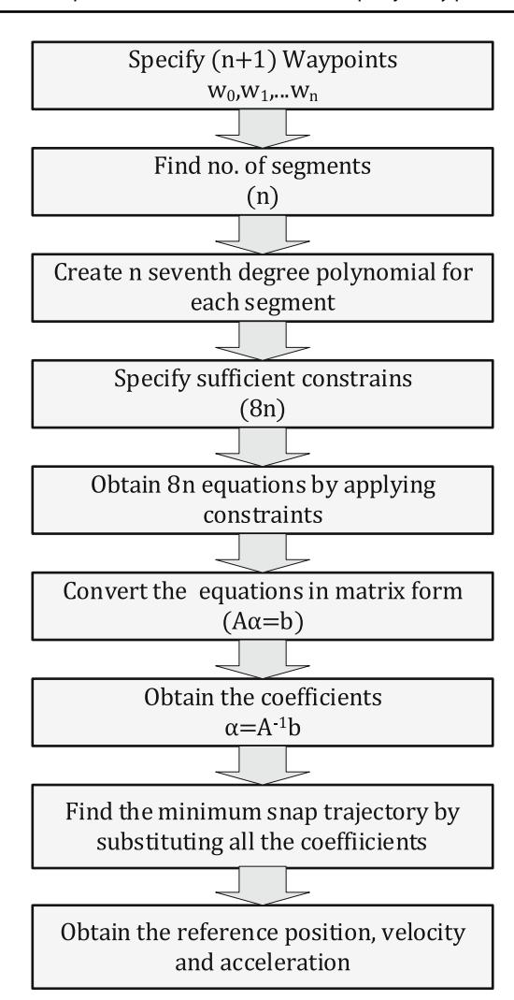

**Fig. 2** Algorithm for generating minimum snap trajectory

To derive the controllers, the quadrotor equation of motion has been linearized around an equilibrium point assumed near the hover state. For hover state,

*X X*0, ϕ θ 0, ψ ψ0, ϕ˙ θ˙ ψ˙ 0

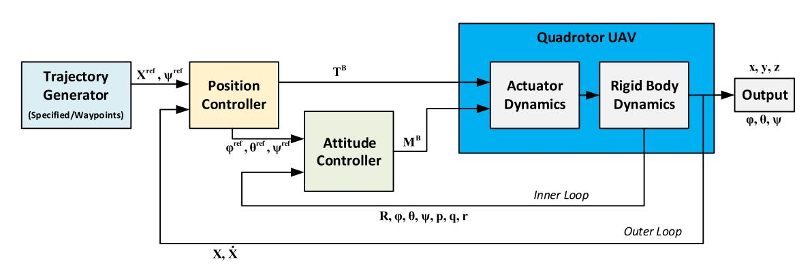

Where roll and pitch angles are small

cosϕ 1, cosθ 1, sinϕ ϕ, sinθ θ

In hover state, the thrust from four propellers has been obtained as

*Fi*,0 *mg*/4

Nominal input values at hover state are *T B mg*,Mx My Mz 0.

The translational dynamical equations of the quadrotor have been linearized as shown in Eq. [\(24\)](#page-5-2).

*x*¨ *g*(θcosψ0 + ϕsinψ0) *y*¨ *g*(θsinψ0 + ϕcosψ0) *z*¨ *T B m* − *g* ⎫ ⎪⎬ ⎪⎭ (24)

And linearization of rotational dynamic equations results following Eq. [\(25\)](#page-5-3)

⎡ ⎢ ⎣ *p*˙ *q*˙ *r*˙ ⎤ ⎥ ⎦ *I* −1 ⎡ ⎢ ⎣ *lkF* ω2 2 − ω2 4  *lkF* ω2 3 − ω2 1  *kM* ω2 1 − ω2 2 + ω2 3 − ω2 4  ⎤ ⎥ ⎦ (25)

The linearized model of Quadrotor is shown in Eqs. [\(24\)](#page-5-2) and [\(25\)](#page-5-3) which is used to derive the controllers.

### **5.1 Position controller**

The position controller acts in two modes, one is hover and other is reference tracking. The hover control is to keep the quadrotor stationary in three-dimensional space to a desired position vector (*X*0). In trajectory tracking control, the quadrotor follows a reference trajectory (*Xref* ) provided by the trajectory generator. The reference yaw angle is specified independent of reference trajectory in both the control modes. The reference positions (*Xref* ) and reference yaw angle (ψ*ref* ) are provided by the trajectory generator. The

position controller provides the reference roll (ϕ*ref* ), pitch (θ*ref* ) angle and the total thrust (*T B*). The reference roll and pitch angles along with reference yaw angle act as reference input for attitude controller. The error in the reference position tracking has been obtained as shown in Eq. [\(26\)](#page-6-1)

*ex xref* − *x ey yref* − *y ez zref* − *z* ⎫ ⎪⎬ ⎪⎭ (26)

The commanded acceleration may be obtained by the proportional and derivative (PD) controller. To make the error exponentially zero the following relationship must hold.

(*x*¨*ref* −¨*xd* )+ *kdx* (*x*˙*ref* −˙*x*)+ *k px* (*xref* − *x*) 0 (*y*¨*ref* −¨*yd* )+ *kdy* (*y*˙*ref* −˙*y*)+ *k py* (*yref* − *y*) 0 (*z*¨*ref* −¨*zd* )+ *kdz*(*z*˙*ref* −˙*z*)+ *k pz*(*zref* − *z*) 0 ⎫ ⎪⎬ ⎪⎭ (27)

For hover control, the reference accelerations and velocities for all the three dimensions must be zero.

*x*¨ *ref* ¨*yref* ¨*zref* ˙*xref* ˙*yref* ˙*zref* 0

For trajectory tracking control, the reference accelerations and velocities are not zero and are obtained from the specification of the reference trajectory. In both cases, the desired accelerations have been obtained from Eq. [\(27\)](#page-6-2). The reference values for roll and pitch angles are obtained from following Eq. [\(28\)](#page-6-3).

*x*¨*d g* θ*ref* cosψ*ref* + ϕ*ref* sinψ*ref y*¨*d g* θ*ref* sinψ*ref* + ϕ*ref* cosψ*ref z*¨*d* 1 *m T B* − *g* ⎫ ⎪⎬ ⎪⎭ (28)

The ϕ*ref* and θ*ref* are derived are shown in Eqs. [\(29\)](#page-6-4) and [\(30\)](#page-6-5). The total thrust force is obtained as shown in Eq. [\(31\)](#page-6-6).

ϕ*ref* 1 *g x*¨*d* sinψ*ref* −¨*yd* cosψ*ref* (29)

θ*ref* 1 *g x*¨*d* cosψ*ref* + *y*¨*d* sinψ*ref* (30)

*T B m*(*z*¨*d* + *g*) (31)

The reference roll ϕ*ref*  and pitch θ*ref*  are fed to attitude controller as reference input. The total thrust force *T B* fed to the plant which is the first control input. The controller parameters *k px* , *kdx* , *k py* , *kdy* , *k pz*, and *kdz* are tuned accordingly, to get better response.

#### **5.2 Attitude controller**

The reference values for roll, pitch and yaw angles are provided to the attitude controller. The role of the attitude controller is to take care of the actual roll, pitch and yaw angles close to the reference values. The proportional and derivative (PD) control is used as control law for the attitude controller. Since the control action is derived based on the linearized model of the quadrotor, therefore it is necessary that the attitude angles are closed to the nominal hover state where the roll and pitch angles are small. The PD control law at nominal hover state has been obtained as shown in Eq. [\(32\)](#page-6-7).

*Mx k p*ϕ ϕ*ref* − ϕ  + *kd*ϕ ϕ˙*ref* −˙ϕ *My k p*θ θ*ref* − θ  + *kd*θ θ˙*ref* − θ˙  *Mz k p*ψ ψ*ref* − ϕ  + *kd*ψ ψ˙ *ref* −˙ϕ  ⎫ ⎪⎬ ⎪⎭ (32)

The attitude controller provides the moments *Mx* , *My* and *Mz* as the three control inputs to the quadrotor, which alters the rotational dynamics to achieve desired control objective.

## **6 Simulation results and discussion**

The simulation of the work has been done in MATLAB environments with the mathematical model discussed in Sect. [3.](#page-2-0) The controller has been implemented as discussed in Sect. [5.](#page-4-0) First, the controller is tested against two specified reference trajectories, helical and infinity trajectories. Secondly, the minimum snap trajectory is generated with specified waypoints in the three-dimensional space as discussed in Sect. [4.](#page-3-0) The results for all the trajectories have been discussed one by one.

### **6.1 Helical trajectory**

The controller has been first tested for a helical trajectory as reference trajectory. The helical trajectory has been generated with minimum snap using the algorithm, discussed in Sect. [4](#page-3-0) with specified initial, final time and constraints for solving the coefficients of the seventh order polynomial.

The controller has been tested for the Quadrotor with helical trajectory and it was found to be able to track the desired trajectory with minimum steady state error. The initial positions for the Quadrotor have been automatically allocated to the controller as a starting point on the trajectory. The trajectory tracking plot for the helical trajectory has been shown in Fig. [4.](#page-7-0)

The reference and actual positions of x, y and z has been plotted against time and shown in Fig. [5.](#page-7-1) The steady state error has been found to be minimum owing to the minimum snap trajectory generation by the proposed algorithm.

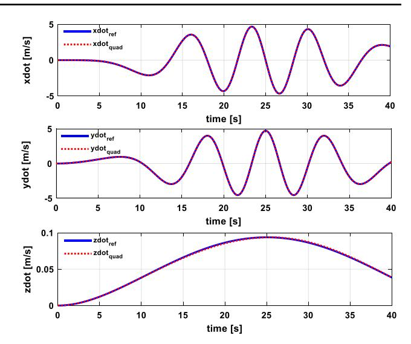

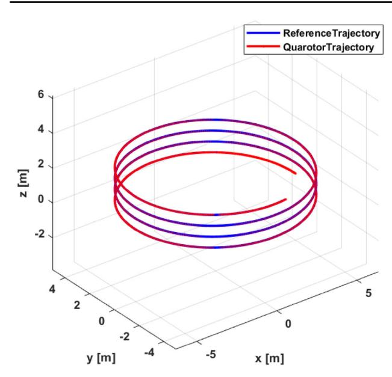

**Fig.4** Helical Trajectory Tracking for the Quadrotor motion

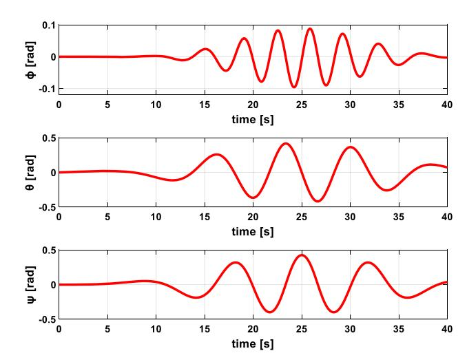

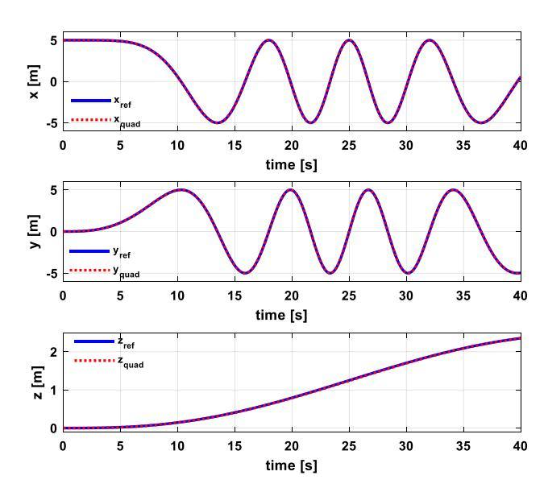

**Fig.5** Translational x, y and z positions of Quadrotor for helical trajectory

The derivatives of positions *x*˙, *y*˙ and *z*˙ which are the translational velocities of the Quadrotor in the inertial frame has been plotted with respect to time and shown in Fig. [6.](#page-7-2)

The Euler angles or attitude of the Quadrotor variations against time has been shown in Fig. [7.](#page-7-3) The variations of the angles are small as per the small angle assumptions for the controller design.

**Fig.6** Translational x, y and z velocities of Quadrotor for helical trajectory

**Fig.7** Roll, pitch and yaw angles of Quadrotor for helical trajectory

### **6.2 Infinity shaped trajectory**

The Quadrotor trajectory tracking controller has been tested for a second trajectory which is infinity shaped trajectory. This trajectory has also been generated for minimum snap trajectory using the algorithm discussed for minimum snap trajectory generation. The initial point of the Quadrotor has been obtained from the starting point of the trajectory, using proposed algorithm. The trajectory tracking plot of the Quadrotor has been shown in Fig. [8.](#page-8-0) The controller shows efficient performance with minimum steady state error.

The translational positions x, y and z has also been plotted against time in Fig. [9.](#page-8-1) The trajectory is generated for minimum snap, so its initial variation is smooth as per the trajectory with less error. The reference vertical height of the

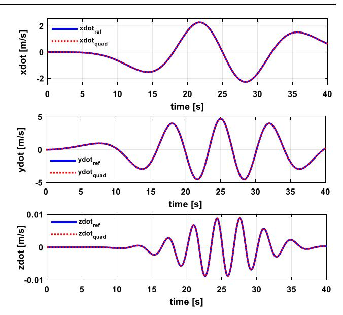

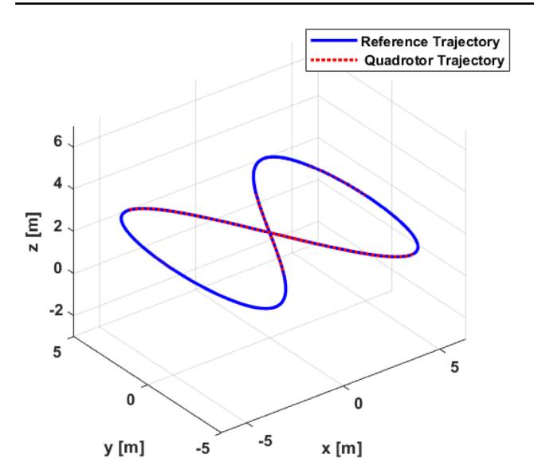

**Fig.8** Infinity Trajectory Tracking by the Quadrotor motion

**Fig.9** Translational x, y and z positions of Quadrotor for infinity trajectory

Quadrotor along z axis is constant but there are very small deviations that are visible in the z position plot.

The translational velocities of the Quadrotor in inertial

frame are *x*˙, *y*˙ and *z*˙ variations with time are shown in Fig. [10.](#page-8-2) The attitude angles roll, pitch and yaw variations with time are very little as per the small angle approximation in the linear dynamics of the Quadrotor. The plots of various attitude angles have been shown in Fig. [11.](#page-8-3)

The controller shows efficient tracking performance for the infinity trajectory with minimum steady state error too.

**Fig.10** Translational x, y and z velocities of Quadrotor for infinity trajectory

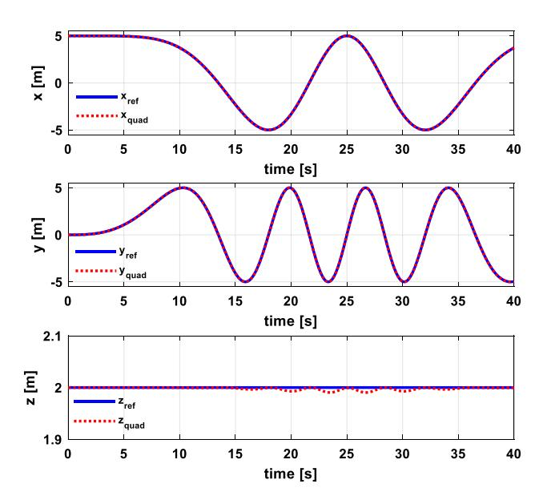

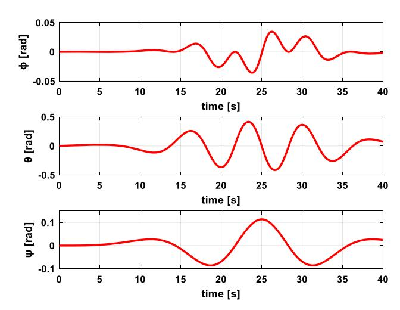

**Fig.11** Roll, pitch and yaw angles of Quadrotor for infinity trajectory

### **6.3 Minimum snap trajectory from given waypoints**

The previous trajectories used for the Quadrotor were specified trajectories. The minimum snap trajectory has been generated in case of specified waypoints in the threedimensional space. The waypoints that are used for minimum snap trajectory generation in this section are listed in Table [2.](#page-9-0)

The reference trajectory has been generated through the proposed algorithm for minimum snap trajectory and the same is provided as reference input to the controller. The trajectory tracking plot of the Quadrotor with reference trajectory has been shown in Fig. [12.](#page-9-1)

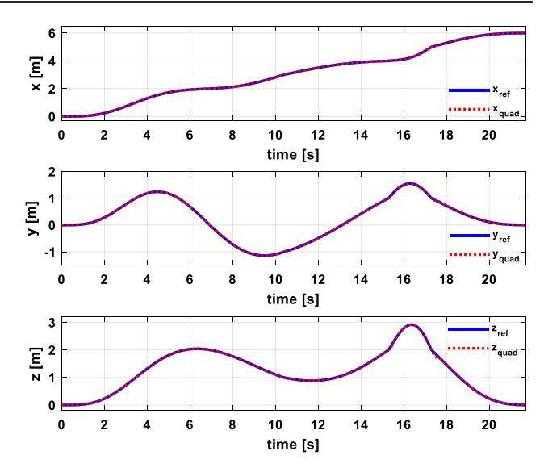

**Table 2** Waypoints for the minimum snap trajectory generation

| Waypoints | x | y   | z |
|-----------|---|-----|---|
| w1        | 0 | 0   | 0 |
| w2        | 1 | 1   | 1 |
| w3        | 2 | 0   | 2 |
| w4        | 3 | − 1 | 1 |
| w5        | 4 | 1   | 2 |
| w6        | 5 | 1   | 2 |
| w7        | 6 | 0   | 0 |

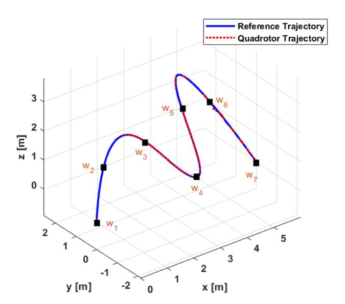

**Fig.12** Minimum snap Trajectory tracking for specified waypoints by the Quadrotor

The variations of translational positions *x*, *y*, *z* and velocities *x*˙, *y*˙, *z*˙ with respect to time has been plotted in Figs. [13](#page-9-2) and [14,](#page-9-3) respectively.

The velocity plots showing some minor deviations from the reference. The path from the waypoints w5 to w6 encounters a steep change in its trajectory. To track the path the Quadrotor has to accommodate more variations in attitude angles and velocity. This might be the reason for the error seen around 16 to 18 s corresponding to the waypoints.

The variations of attitude angles of the Quadrotor in inertial frame with time has been plotted in Fig. [15.](#page-10-14) The variations of the attitude angles are small as in the small angle approximation of the Quadrotor dynamics.

The results for all the three trajectories have been included in this section. The results show the efficient controller performance with minor variations from the reference trajectories with minimum trajectory tracking error. By observing the velocity plots, it has been concluded that the velocity plots start at zero velocity and ends at zero velocity because

**Fig.13** Translational x, y and z positions of Quadrotor for waypoints trajectory

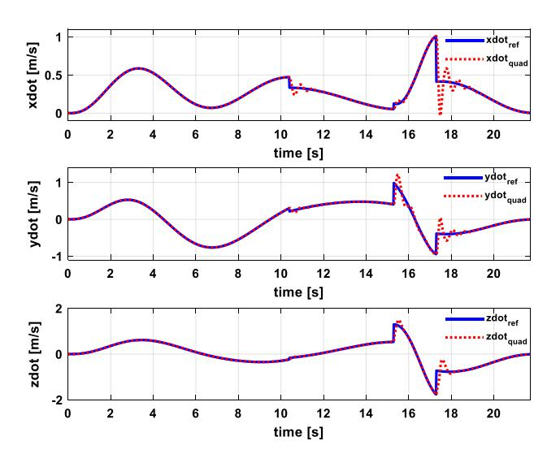

**Fig.14** Translational x, y and z velocities of Quadrotor for waypoints trajectory

of the constraints used in minimum snap trajectory generation. The attitude angles are also varying about zero radian which is required for the stable operation of the Quadrotor. The proposed control scheme has been compared to the LQR control [\[11\]](#page-10-10) for the Quadrotor. The comparison has been made using the root mean square error between the reference and actual trajectories followed by the Quadrotor for both the controllers.

Therefore, from Table [3](#page-10-15) on comparing the root mean square errors in the positions it is concluded that the controller shows efficient performance with good trajectory tracking.

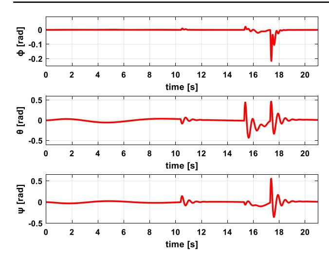

**Fig.15** Roll, pitch and yaw angles of Quadrotor for waypoint trajectory

**Table 3** Comparison of root mean square error values

## **7 Conclusion**

In this paper, the minimum snap trajectory generation has been implemented on MATLAB environment with proposed trajectory generation algorithm. The minimum snap trajectory has been obtained by considering seventh-order polynomial and finding its coefficients by applying sufficient constraints. Then a PD controller has been derived based on the reference and actual states of the Quadrotor system. The designed controller has been tested for two kinds of trajectories: one is specified trajectory and other is trajectory generated by specified waypoints in three-dimensional spaces. The specified trajectories for which the controller has been tested are helical trajectory and infinity shaped trajectories. Another trajectory has been generated using specified waypoints. The proposed control scheme has been compared to the LQR control in terms of root mean square error. The proposed controller shows efficient tracking performance with less tracking error compared to the LQR control. For all the trajectories, the initial position is computed by the trajectory equations. Since the trajectory is being generated as minimum snap trajectory, hence the transients of the trajectory tracking are smooth with negligible deviation from the actual trajectory.

**Author contributions** The first author conceptualized the proposed work and prepared the manuscript while the second author supervised the work and reviewed the manuscript to improve the quality.

**Funding** No funding was received to assist with the preparation of this manuscript.

**Data availability** The data, material and Code used or analyzed during the current study are available from the corresponding author on reasonable request.

#### **Declarations**

**Conflict of interest** The authors declare no conflict of interest.

### **References**

- 1. Yu G, Cabecinhas D, Cunha R, Silvestre C (2019) Quadrotor trajectory generation and tracking for aggressive maneuvers with [attitude constraints. IFAC-PapersOnLine 52:55–60.](https://doi.org/10.1016/j.ifacol.2019.11.069) https://doi.org/ 10.1016/j.ifacol.2019.11.069
- 2. Hehn M, D'Andrea R (2011) Quadrocopter trajectory generation [and control. IFAC Proc 44:1485–1491.](https://doi.org/10.3182/20110828-6-IT-1002.03178) https://doi.org/10.3182/ 20110828-6-IT-1002.03178
- 3. Xi L, Peng Z, Jiao L, Chen BM (2021) Smooth quadrotor trajectory generation for tracking a moving target in cluttered environments. Sci China Inf Sci 64:1–16. [https://doi.org/10.1007/s11432-020-](https://doi.org/10.1007/s11432-020-3056-5) 3056-5
- 4. Richter C, Bry A, Roy N (2016) Polynomial trajectory planning for aggressive quadrotor flight in dense indoor environments. [Springer Tracts Adv Robot 114:649–666.](https://doi.org/10.1007/978-3-319-28872-7_37) https://doi.org/10.1007/ 978-3-319-28872-7\_37
- 5. Hu B, Mishra S (2019) Time-optimal trajectory generation for landing a quadrotor onto a moving platform. IEEE/ASME Trans Mechatronics 24:585–596. [https://doi.org/10.1109/TMECH.2019.](https://doi.org/10.1109/TMECH.2019.2896075) 2896075
- 6. Yu J, Cai Z,Wang Y (2017) The minimum jerk trajectory generation of a quadrotor based on the differential flatness. In: CGNCC 2016
  - 2016 IEEE Chinese Guid Navig Control Conf, pp 1061–1066. <https://doi.org/10.1109/CGNCC.2016.7828934>
- 7. Mellinger D, Michael N, Kumar V (2012) Trajectory generation and control for precise aggressive maneuvers with [quadrotors. Int J Robot Res 31:664–674.](https://doi.org/10.1177/0278364911434236) https://doi.org/10.1177/ 0278364911434236
- 8. Zulu A, John S (2014) A review of control algorithms for [autonomous quadrotors. Open J Appl Sci 04:547–556.](https://doi.org/10.4236/ojapps.2014.414053) https://doi. org/10.4236/ojapps.2014.414053
- 9. Li J, Li Y (2011) Dynamic analysis and PID control for a quadrotor. [IEEE Int Conf Mechatron Autom ICMA 2011:573–578.](https://doi.org/10.1109/ICMA.2011.5985724) https:// doi.org/10.1109/ICMA.2011.5985724
- 10. Bolandi H, Rezaei M, Mohsenipour R et al (2013) Attitude control of a quadrotor with optimized PID controller. Intell Control Autom 4:335–342. <https://doi.org/10.4236/ICA.2013.43039>
- 11. Martins L, Cardeira C, Oliveira P (2019) Linear quadratic regulator for trajectory tracking of a quadrotor. IFAC-PapersOnLine 52:176–181. <https://doi.org/10.1016/j.ifacol.2019.11.195>
- 12. Nonami K, Kendoul F, Suzuki S et al (2010) Autonomous control of a mini quadrotor vehicle using LQG controllers. Autonomous flying robots: unmanned aerial vehicles and micro aerial vehicles. Springer, pp 61–76
- 13. Voos H (2009) Nonlinear control of a quadrotor micro-uav using feedback-linearization. In IEEE 2009 Int Conf Mechatronics, ICM 2009. <https://doi.org/10.1109/ICMECH.2009.4957154>
- 14. Shang B, Liu J, Zhao T, Chen YQ (2016) Fractional order robust visual servoing control of a quadrotor UAV with larger sampling

- period. Int Conf Unmanned Aircr Syst ICUAS 2016:1228–1234. <https://doi.org/10.1109/ICUAS.2016.7502645>
- 15. Rios H, Falcon R, Gonzalez OA, Dzul A (2019) Continuous slidingmode control strategies for quadrotor robust tracking: real-time [application. IEEE Trans Ind Electron 66:1264–1272.](https://doi.org/10.1109/TIE.2018.2831191) https://doi. org/10.1109/TIE.2018.2831191
- 16. Prempain E, Postlethwaite I (2005) Static H∞loop shaping control [of a fly-by-wire helicopter. Automatica 41:1517–1528.](https://doi.org/10.1016/J.AUTOMATICA.2005.04.001) https://doi. org/10.1016/J.AUTOMATICA.2005.04.001
- 17. Kim HS, Park JB, Joo YH (2017) A systematic approach to fuzzy-model-based robust H∞ control design for a quadrotor UAV under imperfect premise matching. Int J Fuzzy Syst 19:1227–1237. <https://doi.org/10.1007/s40815-016-0233-6>
- 18. Song G, Tao G (2020) A partial-state feedback model reference adaptive control scheme. IEEE Trans Automat Contr 65:44–57. <https://doi.org/10.1109/TAC.2019.2906457>
- 19. Qiao J, Liu Z, Zhang Y (2018) Gain Scheduling based PID control approaches for path tracking and fault tolerant control of a Quad[rotor UAV. Int J Mech Eng Robot Res 7:401–408.](https://doi.org/10.18178/ijmerr.7.4.401-408) https://doi.org/ 10.18178/ijmerr.7.4.401-408
- 20. Milhim AB, Zhang Y, Rabbath CA (2010) Gain scheduling based PID controller for fault tolerant control of a quad-rotor UAV. AIAA Infotech Aerosp 2010:1–13. <https://doi.org/10.2514/6.2010-3530>
- 21. Singh BK, Kumar A (2022) Model predictive control using LPV approach for trajectory tracking of quadrotor UAV with external [disturbances. Aircr Eng Aerosp Technol.](https://doi.org/10.1108/AEAT-12-2021-0368) https://doi.org/10.1108/ AEAT-12-2021-0368
- 22. Abdolhosseini M, Zhang YM, Rabbath CA (2013) An efficient model predictive control scheme for an unmanned quadrotor heli[copter. J Intell Robot Syst Theory Appl 70:27–38.](https://doi.org/10.1007/s10846-012-9724-3) https://doi.org/ 10.1007/s10846-012-9724-3
- 23. Dulf EH, Timis DD, Szekely L, Miclea LC (2019) Adaptive fractional order control applied to a multi-rotor system. In: Proceedings of the 2019 22nd int conf control syst comput sci CSCS 2019 696–699. <https://doi.org/10.1109/CSCS.2019.00124>
- 24. Sadigh RSM (2019) Optimizing PID controller coefficients using fractional order based on intelligent optimization algorithms for quadcopter. Proc 6th RSI int conf robot mechatronics. IcRoM 2018:146–151. <https://doi.org/10.1109/ICROM.2018.8657616>
- 25. Ryan T, Kim HJ (2013) LMI-based gain synthesis for simple robust quadrotor control. IEEE Trans Autom Sci Eng 10:1173–1178. <https://doi.org/10.1109/TASE.2013.2259156>
- 26. Jiang F, Pourpanah F, Hao Q (2020) Design, implementation, and evaluation of a neural-network-based quadcopter UAV system. [IEEE Trans Ind Electron 67:2076–2085.](https://doi.org/10.1109/TIE.2019.2905808) https://doi.org/10.1109/ TIE.2019.2905808
- 27. Shirzadeh M, Amirkhani A, Jalali A, Mosavi MR (2015) An indirect adaptive neural control of a visual-based quadrotor robot for [pursuing a moving target. ISA Trans 59:290–302.](https://doi.org/10.1016/j.isatra.2015.10.011) https://doi.org/ 10.1016/j.isatra.2015.10.011
- 28. Cervantes J, Yu W, Salazar S, Chairez I (2017) Takagi-sugeno dynamic neuro-fuzzy controller of uncertain nonlinear systems. [IEEE Trans Fuzzy Syst 25:1601–1615.](https://doi.org/10.1109/TFUZZ.2016.2612697) https://doi.org/10.1109/ TFUZZ.2016.2612697
- 29. Torres F, Rabhi A, Lara D et al (2016) Fuzzy state feedback for atti[tude stabilization of quadrotor. Int J Adv Robot Syst 13:2.](https://doi.org/10.5772/61934) https:// doi.org/10.5772/61934
- 30. González JAC, Salas-Peña O, De León-Morales J (2021) Observerbased super twisting design: a comparative study on quadrotor [altitude control. ISA Trans 109:307–314.](https://doi.org/10.1016/j.isatra.2020.10.026) https://doi.org/10.1016/ j.isatra.2020.10.026
- 31. Gai W, Liu J, Qu C, Zhang J (2018) Trajectory tracking control for a quadrotor UAV via extended state observer. Syst Sci Control Eng 6:126–135. <https://doi.org/10.1080/21642583.2018.1539931>
- 32. Shao X, Liu J, Cao H et al (2018) Robust dynamic surface trajectory tracking control for a quadrotor UAV via extended state observer. [Int J Robust Nonlinear Control 28:2700–2719.](https://doi.org/10.1002/rnc.4044) https://doi.org/10. 1002/rnc.4044
- 33. Zhao K, Zhang J, Ma D, Xia Y (2020) Composite disturbance rejection attitude control for quadrotor with unknown disturbance. [IEEE Trans Ind Electron 67:6894–6903.](https://doi.org/10.1109/TIE.2019.2937065) https://doi.org/10.1109/ TIE.2019.2937065
- 34. Zhang X, Wang Y, Zhu G et al (2021) Compound adaptive fuzzy quantized control for quadrotor and its experimental verification. [IEEE Trans Cybern 51:1121–1133.](https://doi.org/10.1109/TCYB.2020.2987811) https://doi.org/10.1109/TCYB. 2020.2987811
- 35. Cen R, Jiang T, Tang P (2021) Modified Gaussian process regression based adaptive control for quadrotors. Aerosp Sci Technol 110:106483. <https://doi.org/10.1016/j.ast.2020.106483>
- 36. Nascimento RG, Fricke K, Viana FAC (2020) Quadcopter control optimization through machine learning. AIAA Scitech 2020 Forum 1 PartF <https://doi.org/10.2514/6.2020-1148>
- 37. Michael N, Mellinger D, Lindsey Q, Kumar V (2010) Experimental evaluation of multirobot aerial control algorithms. IEEE Robot Autom Mag 17:56–65 Springer Nature or its licensor (e.g. a society or other partner) holds exclusive rights to this article under a publishing agreement with the author(s) or other rightsholder(s); author self-archiving of the accepted manuscript version of this article is solely governed by the terms of such publishing agreement and applicable law.