# Comparing LQR and PID Controllers for Quadcopter Control Effectiveness and Cost Analysis

Mahmoud S. Abu Ihnak *dept. of Electrical and Electronic Engineering University of Tripoli* Tripoli, Libya m.abohanak@uot.edu.ly

Mohamed M. Edardar *dept. of Electrical and Electronic Engineering University of Tripoli* Tripoli, Libya m.edardar@uot.edu.ly

*Abstract***— Quadcopters, a type of Unmanned Arial Vehicle, have gained a major area of interest due to their various applications, small size, low cost, and maneuverability. The flight principle of a quadcopter regulates its thrust and moments to control movements. This paper investigates linear controllers for non-linear systems based on linearized systems, comparing PID and LQR with integral control, examining input/output disturbance effects, and comparing cost and performance. The results of this investigation show that the LQR controller outperforms the PID controller in controlling quadcopters with satisfactory performance and cost results. It offers a balance between performance and cost, handling constant disturbances efficiently. In the non-linear model, there is a minimal difference in performance and controllers' costs due to the strong coupling between system states and constant disturbances.**

*Keywords—Quadcopter, LQR, Integral Control, PID, Cost, Performance*

## I. INTRODUCTION

Quadcopters are unmanned aerial vehicles (UAVs) used for military, commercial, and recreational purposes. They are popular due to their low cost, ease of use, and versatility. Designing and modeling quadcopters are crucial for various engineering disciplines due to their complex dynamics, interdisciplinary nature, and safety benefits.

Quadcopters, or multirotor helicopters with four rotors, have a history dating back to the early 1900s. The first quadcopters appeared in 1907 with the Gyroplane No. 1 [1], but were unstable and impractical. The development continued in the 1920s in France, but quadcopters gained widespread popularity later [2]. Early designs had complex control systems, but by the late 2000s, advancements in GPS, battery life, and Electronic Speed Controllers made them more popular. Today, studies focus on enhancing quadcopters' autonomy and cooperation, with Raffaello D'Andrea demonstrating a Kinect-controlled quadcopter during a TED Global 2013 talk [3].

Quadcopter flight principle uses four propellers for propulsion, controlling thrust, moments, attitude, and position. Four types of movement, including upward downward, forward backward, leftward rightward, and yaw, compensate for weight.

The main challenge that many researchers have with the quadcopter is that its dynamics are coupled with nonlinear multiple input multiple output (MIMO) and passive dynamics [4]. This complexity is further complicated by the fact that the quadcopter has 6DoF degrees of freedom (three translational and three rotational) with only four independent inputs (rotor speeds). The resulting dynamics are highly nonlinear, especially after accounting for complex aerodynamic effects [5].

In the literature, Quadcopter modeling and design with LQR and PID controllers reveals several studies that have been conducted on this topic. In one study [6], A PID controller with manual adjustment was used to control a quadcopter, demonstrating its effectiveness in stabilizing altitude and attitude. Another study [7] the study introduced full-state feedback and PID control methods for a quadcopter model, demonstrating their functionality with suitable initial parameters. A third study analyzed and tested the performance of an LQR control algorithm for quadrotor helicopters. A fourth study [8] presented a neural network control model for quadcopter stabilization, utilizing a classic PID controller and comparing its results with machine learning controllers. A fifth study [9] built a PD controller for altitude stability and succeeded with a simple quadcopter prototype. Finally, these studies demonstrate the effectiveness of LQR and PID controllers in quadcopter modeling and design, as well as the potential for using machine learning and meta-heuristic algorithms to optimize controller performance. This paper investigates linear controller application to non-linear quadcopter model using PID and LQR with integral control, compares controllers' cost and performance, and examines input and output disturbance effects.

# II. QUADCOPTER FLIGHT CONTROL MODEL

In order to represent the drone, we need two coordinate frames: an Inertial Frame (IF) and a Body Frame (BF), as shown in Fig. 1. To know the relationship between the inertial frame and the body frame, we need the rotation matrix �� represented in the following equation:

�� = [ ���� ���� ���� ���� ���� − ���� ���� ���� ���� ���� + ���� ���� ���� ���� ���� ���� ���� + ���� ���� ���� ���� ���� − ���� ���� −���� ���� ���� ���� ���� ] (1)

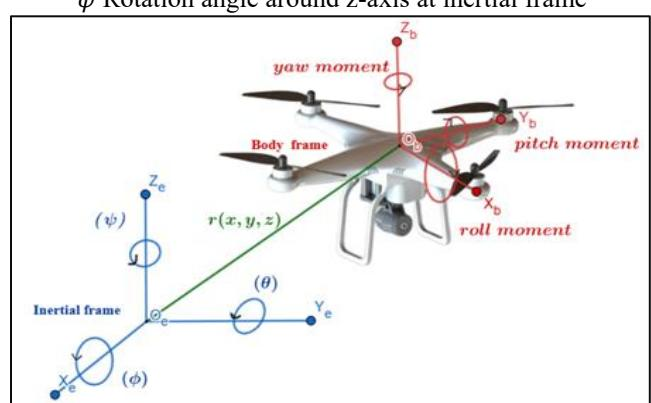

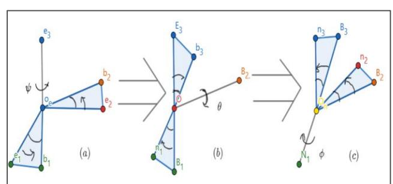

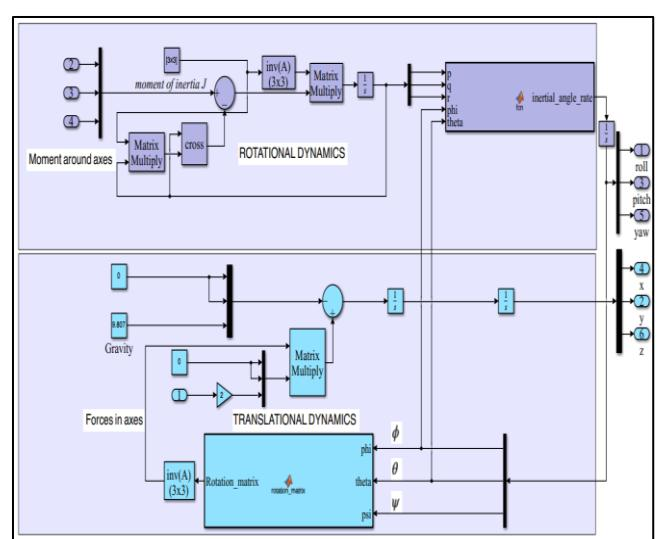

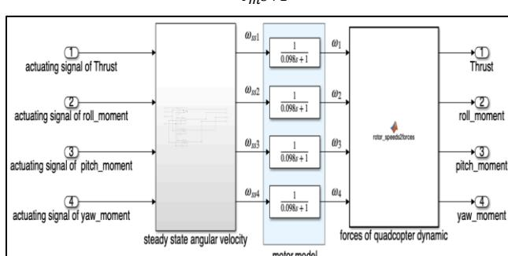

| PID      | controller name | k p   | PID k i | parameters k d | N   |
|----------|-----------------|-------|---------|----------------|-----|
| Altitude | controller      | 0.45  | 0.053   | 0.99           | 100 |
| position | controller      | 0.004 | 0.0001  | 0.036          | 100 |
| attitude | controller      | 0.015 | 0.0003  | 0.135          | 100 |
| Yaw      | controller      | 0.005 | 0.0005  | 0.01           | 100 |

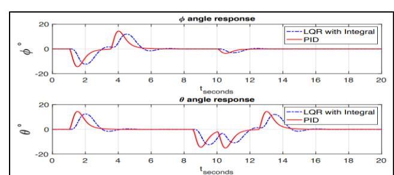

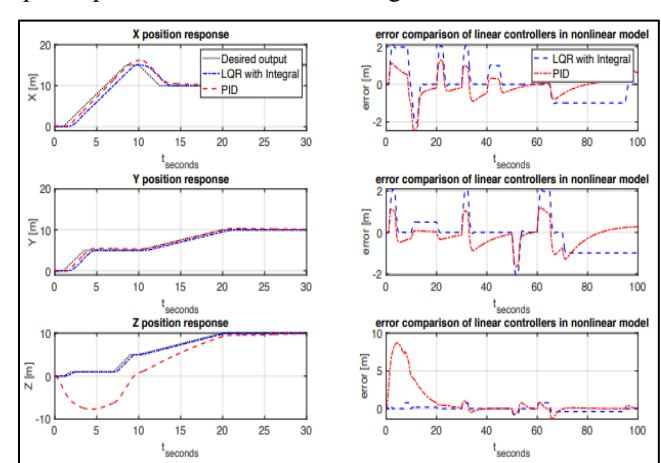

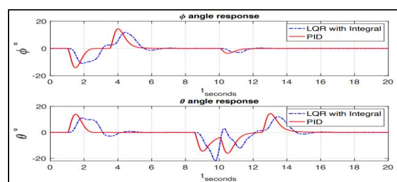

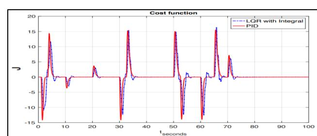

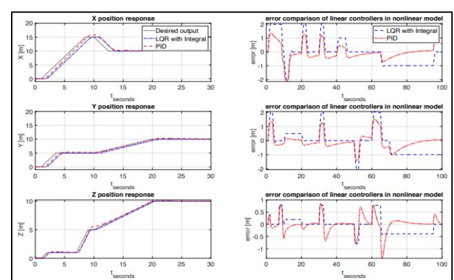

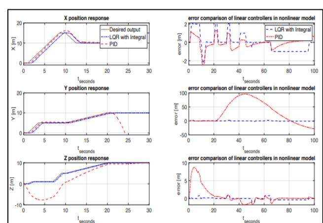

Fig. 10 The trajectory-tracking response to position with error in nonlinear model with disturbance.

Fig. 11 The effect of trajectory tracking on angles of nonlinear dynamic model with disturbance.

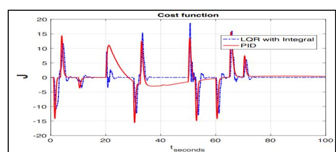

Fig. 12 Cost function of linear controllers for nonlinear model with disturbance.

(4) In the 3D simulation in Fig. 13, the difference between the two controllers is clear in terms of overshoot, where LQR was better than PID.

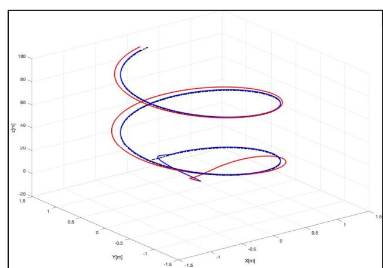

Fig. 13 Comparison of linear controllers in nonlinear model in 3 dimensions.

### *A. Conclusion*

PID provided fast tracking but with overshoots, which are undesirable. Steady-state error was good, but PID could not handle disturbances well, making the system unstable. LQR with integral control balanced performance and cost. Tracking was similar to PID with no overshoot and better cost. It could also efficiently handle constant disturbances. When applying controllers to the nonlinear vs linearized models, minimal differences in performance and cost were observed. This was due to strong coupling between nonlinear states. Constant disturbances had a greater influence on the nonlinear model compared to the linearized one.

## *B. Future work*

In the future, it is recommended to use the 2-DoF PID or FOPID (Fractional Order PID) instead of the PID to reduce overshooting. Additionally, a combined control system between LQR and PID can be used to obtain the best results in terms of performance and cost.

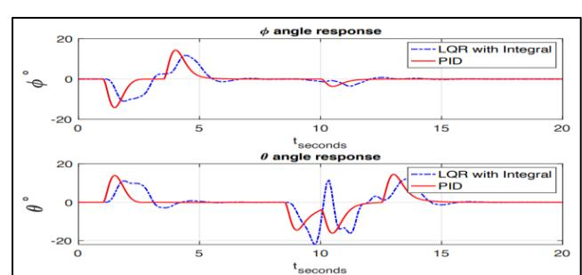

### REFERENCES

[1] Z. M. Miličević and Z. S. Bojković, "From the early days of unmanned aerial vehicles (UAVs) to their integration into wireless networks," Vojnotehnicki glasnik/Military Technical Courier, pp. 941-962, 2021. [2] L. J. Gordon, "ETIENNE OEHMICHEN: SCIENTIST, ENGINEER AND HELICOPTER PIONEER," Annual Forum of the American Helicopter Society, pp. 1570-1582, 2006. [3] Q. Quan, Introduction to Multicopter Design and Control, Beijing: Springer Nature Singapore, 2017. [4] S. Bouabdallah, A. Noth and R. Siegwart, "PID vs LQ Control Techniques Applied to an Indoor Micro Quadrotor," in In Proceedings 2004 IEEE/RSJ International Conference on Intelligent Robots and Systems, 2004. [5] M. Z. Ali, A. Ahmed, and H. K. Afridi, "Control System Analysis and Design of Unmodelled Dynamics and Disturbances," International Federation of Automatic Control, pp. 8840-8846, 2020. [6] N. Hayati Sahrir and M. A. Mohd Basri, "Modelling and Manual Tuning PID Control of Quadcopter," in Control, Instrumentation and Mechatronics: Theory and Practice, Johor, Springer Link, 2022, pp. 346-357. [7] D. Dam, "ANALYSIS AND CONTROL OF A NON-LINEAR FLIGHT VEHICLE," MSc thesis, Department of Electrical and Computer Engineering, University of Houston, 2014. [8] G. Battsengel, T. Tserendondog, L. Choimaa and B. Amar, "QUADCOPTER STABILIZATION USING NEURAL NETWORK MODEL FROM COLLECTED DATA OF PID CONTROLLER," ICT Focus, vol. 1, no. 1, 2022. [9] S. JULAKANTI, "STABILITY CONTROL OF A QUADCOPTER," MSc thesis, Mechanical Engineering, Texas A&M University-Kingsville, 2015. [10] MathWorks, "Introduction to Cascade Control," The MathWorks, Inc., [Online].Available: https://www.mathworks.com/help/control/ug/designing-cascadecontrol-system-with-pi-controllers.html. [Accessed 06 July 2023]. [11] D. J. Powell, M. L. Workman and G. F. Franklin, Digital Control of Dynamic Systems, 3rd ed., Half Moon Bay, CA: Ellis-Kagle Press, 1998.