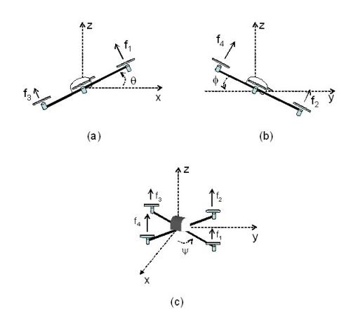
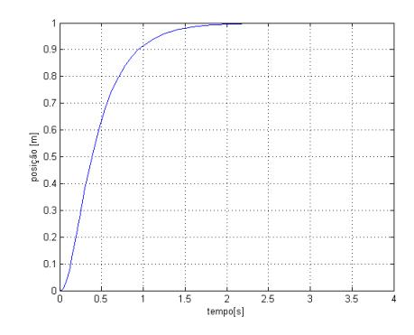
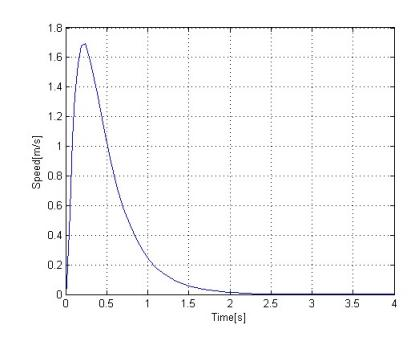
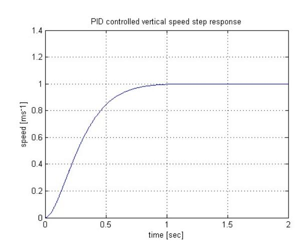
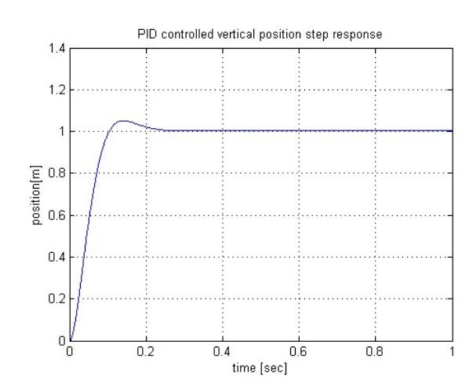
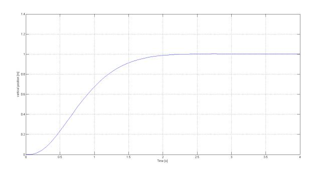
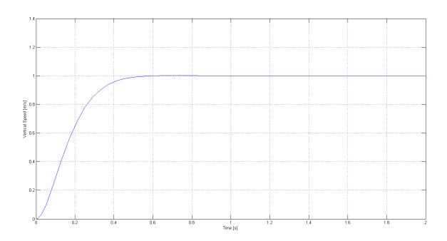
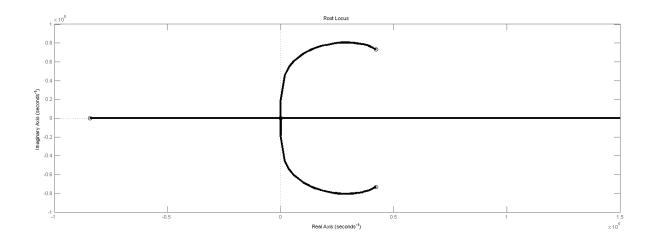

# PID, LQR and LQR-PID on a Quadcopter Platform

Lucas M. Argentim Centro Universitario da FEI ´ unielargentim@fei.edu.br

Willian C. Rezende Centro Universitario da FEI ´ uniewrezende@fei.edu.br

Paulo E. Santos Centro Universitario da FEI ´ psantos@fei.edu.br

Renato A. Aguiar Centro Universitario da FEI ´ preaguiar@fei.edu.br

*Abstract*—This paper aims to present a comparison between different controllers to be used in a dynamic model of a quadcopter platform. The controllers assumed in this work are an ITAE tuned PID, a classic LQR controller and a PID tuned with a LQR loop. The results were obtained through simulations for 10 different attitudes of the quadcopter, however, in this paper simulation results will be presented for the vertical attitude only (the remainder are analogous and were omitted for brevity).

# I. INTRODUCTION

In the last decades the use of Unmanned Aerial Vehicles (UAV) has increased due to the development and improvement of control systems. This increase can also be justified by the fact that these aircrafts are very versatile in contrast to their lower complexity. Within UAV hardware, quadcopters are being widely used for different purposes, such as educational, commercial or entertainment. This choice can be justified by the fact that this model presents a very low moment of inertia and six degrees of freedom, which results in great stability of the quadcopter.

Facing these considerations, the motivation of this work is to develop and compare control mechanisms for a quadcopter model by tuning them with three different approaches. This work applies performance indexes obtained by the ITAE tuning method on a PID controller, a classic LQR controller and a PID controller whose gains where obtained by a LQR loop (according to the method proposed in [1]).

The PID controller was chosen in this work due of its versatility and facile implementation, while also providing a consistent response for the model dynamics attitudes. Also, the LQR controller seemed as a good comparative controller because of its great performance and robustness in the plant in question. The PID controller tuned using a LQR loop is considered since it makes use of the best characteristics of both previous methods.

# II. BIBLIOGRAPHIC REVIEW

The scientific literature describes various techniques for controlling quadcopter models in order to perform an efficient stabilising system and navigation. The choice of a suitable technique to be used in a control project depends (among a series of other factors) mainly on the intended use of the quadcopter [2].

Among the most commonly used control techniques, one can cite PID Control [3], Back-Stepping [4], nonlinear H∞ Control [5], Kalman Filter [6] and so on. In this section we provide a brief summary of these control techniques.

There are several controllers already implemented in various models of quadcopters, each one with its peculiarities: in [7] a PID control system is used based on the dynamic model taking into account the bending in the rotor and the propeller.

In [8] is presented a backstepping control that uses resources from the Extended Kalman Filter, producing good results in a quadcopter designed for indoor flight.

A comparison of the PID tuning and the Linear Quadratic Regulator (LQR) is proposed in [2] where both controllers have been studied based on a dynamic model of a quadcopter. In this study it is concluded that both controllers provide satisfactory feedback for a quadcopter stabilisation.

Other control strategies were also investigated, such as saturation alignment techniques that were applied to a quadcopter, as described in [9]. [5] describes the H∞ controller, along with a predictive state space controller for a quadcopter performing tracking trajectories tasks.

# III. DYNAMIC MODEL

The mathematical model of the quadcopter has to describe its attitude according to the well-known geometry of this UAV. More specifically, this aerial vehicle basically consists of four propellers located orthogonally along the body frame. Figure 1 shows this configuration.

Fig. 1. Plant view of the Quadcopter

There are three movements that describe all possible combinations of attitude Figure 2 : Roll (rotation around the X axis) is obtained when the balance of rotors 2 and 4 is changed (speed increases or decreases). By changing the φ angle, lateral acceleration is obtained; pitch movement (rotation around the Y axis) is obtained when the balance of the speed of the rotors 1 and 3 is changed. The θ angle change results in a longitudinal acceleration; yaw (ψ) (rotation about the Z axis) is obtained by a simultaneous change of speed of the pair (1,3) or (2,4).

Fig. 2. Description of the Roll(φ), Pitch (θ) and Yaw (ψ) angles

Due to the presence of two coordinate systems, it is necessary to use the transformation matrix to obtain the response of any movement from a coordinate system (Earth-fixed frame) to the other (model-fixed frame). With 6 degrees of freedom, modelling can be a complex task. The equations and the parameters needed to generate the matrices that describe the Quadcopter attitudes are estimated based on empirical experimentations and measurements of a LinkQuad Quadcopter1 . This work assumes the physical model presented in [10] as described below.

#### *A. Vertical attitude equations*

The equations that describe the vertical attitudes related to the Z axis of the aircraft are shown below. The state space matrices that make up these attitudes are described in equations 1 through 5:

 z˙ w˙ Ω˙ 1 Ω˙ 2 Ω˙ 3 Ω˙ 4 = A z w Ω1 Ω2 Ω3 Ω4 + 7BU (1)

Y = z w Ω1 Ω2 Ω3 Ω4 T (2)

where,

A = 0 1 0 0 0 0 0 0 −0.0106 0.0106 −0.0106 0.0106 0 0 −10 0 0 0 0 0 0 −10 0 0 0 0 0 0 −10 0 0 0 0 0 0 −10 (3)

B = -0 0 1 −1 1 −1 T (4)

C = -0 1 0 0 0 0. (5)

In equation 1, z is the vertical coordinate in Earth-fixed frame, w is the vertical speed in body-fixed frame and Ωn is the angular rate of each propeller. It is possible to modify the values of the matrix C so either the vertical speed or position are chosen as the system output.

### IV. CONTROL TECHNIQUES

After analysing the transfer function from the state space matrices, it was noticed that in most attitudes the equations could be simplified. Some of the roots from the numerator (zeros) could be simplified with the corresponding roots of the denominator (poles). By doing this, it was possible to obtain a lower-order plant model, which means that the controller gains could be calculated in a straightforward way. This controller (tuned with simplified equations) was able to give a consistent response when used in the original plant, as seen in the results shown in the following sections.

### *A. LQR - Linear Quadratic Regulator*

A generic form of the system presented in equation 1 is shown in equation 6 where x˙ and x represent the system outputs and inputs respectively. The matrices A and B were also described in equations 3 and 4 and represent the particular dynamic model of the quadcopter LinkQuad [10].

x˙ = Ax + Bu (6)

According to [11] for a Linear Quadratic Regulator Controller tuning it is convenient to know a vector u that minimises the quadratic cost function presented in equation 7 which leads to the linear control law presented in equation 8.

J = Z ∞ 0 (x.Qx + u.ru)dt (7)

u = −Kx (8)

1From UAS Technologies Sweden AB (http://www.uastech.com/).

the parameters k, p, e were obtained applying a lqr function shown in equation 9, where Q is a square matrix of sixth order described in equation 10, adjusted to provide the most efficient values and R is a unitary vector.

[k, p, e] = lqr(A, B, Q, R) (9)

Q = 10000000 0 0 0 0 0 0 1 0 0 0 0 0 0 1 0 0 0 0 0 0 1 0 0 0 0 0 0 1 0 0 0 0 0 0 1 (10)

The output of the LQR function was the vector K shown in equation (11) containing the six elements that controls each state of the system individually, this makes a expansion of the state space function necessary. This expansion is obtained solving the equation 6 and the result is a system of six equations 12 to 17 that represent each one of the states.

K = −3.1623 × 103 −1.5070 × 103 1.3062 −1.3062 1.3062 −1.3062 (11)

x˙1 = x2 (12)

x˙2 = −0.0106x3 − 0.0106x4 + 0.0106x5 + 0.0106x6 (13)

x˙3 = 10x3 + 7u (14)

x˙4 = 10x4 + 7u (15)

x˙5 = 10x5 + 7u (16)

x˙6 = 10x6 + 7u (17)

When a block diagram of the new expanded equations 12 to 17 is built, and the control law shown in equation 8 is applied, it becomes a closed loop system with six feedback gains and no inputs. As the regulators are known for leading the responses of the system to a null value, a disturbance (step) was performed at the state which the control was required and a result for the vertical position is presented in figure 3.

Fig. 3. Vertical position step response for LQR control

Figure 3 shows the step response for the vertical position of the plant with no overshooting value and with an accommodating time of two seconds. It was also performed the LQR control for all other movements of the quadcopter from where analogous satisfactory results were obtained.

Figure 4 shows the vertical-speed step response that was acquired when a step source was placed in the vertical position state.

Fig. 4. Vertical speed step response for LQR Control

As mentioned above, the speed response is null after a transition time because of the regulator controller. It does not mean that in a practical model the vertical speed goes to zero because there will always be a disturbance at the position state.

### *B. ITAE - tuning PID*

*1) Vertical speed controller:* The simplified transfer function that describes the vertical position is shown in equation 18:

Gw(s) = −0.0424 s(s + 10) (18)

Once obtained the transfer function of the attitude, a controller function can be defined as:

C(s) = (k3s 2 + k1s + k2) s , (19)

where k3, k2, k1 represents, respectively, the derivative, integral and proportional gains. Then, the transfer function of the closed-loop system can be dened as:

Fw(s) = k3s 2 + k1s + k2 s 3 + (10 + k3)s 2 + k1s + k2 . (20)

Equalling the coefficients of the characteristic equation 20 with ITAE model optimum coefficients [12], values k1, k2 and k3 were obtained.

k1 = 860 (21)

k2 = 8000 (22)

k3 = 25 (23)

After implementing the controller using the values found with the ITAE method, it was verified that the plant was not being controlled. That can be explained analysing the behaviour of the model, which tends to a negative response before achieving stability. This kind of process usually has its origin on two competing effects: a fast dynamic effect and a slow dynamic effect. These effects produce the negative start to the response before the step recovers to settle at a positive state value. To solve this problem, an additional negative unitary gain is placed at the output of the controller to maintain a negative feedback loop, which gives us a reverseacting controller.

The phase delay compensators are also known for their properties of assisting for a better steady response with the consequence of shifting the poles to the right side of the root locus plane. This effect causes a destabilisation of the model and a longer transient time feedback [13]. Analysing the transfer function of the plant, it is possible to perceive the natural presence of one integrator, so the integral gain k2, shown in equation 22 was set to null.

Equations 21 and 23 (k1 and k3 gains) were applied in the ways mentioned above, producing the response shown at figure 5.

Fig. 5. PID vertical speed step response.

Figure 5 shows the step response for the vertical speed controlled by the gains calculated above. Equations 21 and 23 (respectively k1 and k3 gains) were obtained using the simplified model shown in equation 18 and later applied to the space state matrices given by equations 3 through 5.

*2) Vertical position controller:* The transfer function of vertical position is described by equation 24, which will be controlled by new proportional, integral and differential gains:

Gz(s) = −0.0424 s 2(s + 10). (24)

The new vertical position controller CB can be described as

CB(s) = (k3B)s 2 + (k1B)s + (k2B) s . (25)

Considering the same simplification shown in equation 18, and neglecting k2B for the same reason as k2 22 , the vertical position transfer function was obtained, as shown in equation 26.

Fz(s) = CB(s)(k3s 2 + k1s) s(1 + CB(s)((k3 + 1)s 2 + (k1 + 10)s)) (26)

Performing an analogous process to that described in Section IV-B1 for equation 26, the new gains k1B, k2B and k3B are

k1B = 63.92 (27)

k2B = 31.39 (28)

k3B = 0.7 (29)

Applying this new controller to the state space matrices given by equations 3, 4 and the modified equation 5 (to select the vertical positions as the system output), we obtained the response illustrated in figure 6. Once again, the model simplification was validated.

Fig. 6. PID Vertical position step response.

#### *C. LQR - tuning PID*

*1) Vertical speed controller:* As a comparative criterion, we decided to tune controllers for the same attitudes, but this time using the method proposed by [1], where the PID gains are calculated based on equations 30 trhough 34

Kp Kd = KpC −1 (30)

Ki = (Im + KdCB)Ki (31)

Where:

C = C CA − CBKp (32)

Kp = (Im + KdCB) −1 (KpC + KdCA) (33)

Ki = (Im + KdCB) −1Ki (34)

The methodology for obtaining the PID parameters is fully described in [1]. For better tuning results, it is necessary to execute the algorithm innumerous times until the desired response for the system is reached. In order to accomplish that, an algorithm was developed 2 that calculates automatically the gains based on the simplified space state matrices generated from equation 18 of the plant and the matrix Q (from the LQR control theory). Development time increased drastically and the controller could be tuned with reasonable parameters for the system.

Using matrix Q = diag[0, 10000, 10000] as a parameter of our algorithm, the following gains kP w, kIw and kDw were obtained:

kP w = −2.3758 × 103 (35)

kIw = −1 (36)

kDw = −173.6511 (37)

Figure 7 shows the step response for the vertical speed controller.

Fig. 7. PID - LQR vertical speed step response

*2) Vertical position controller:* Analogously, the same methodology can be applied for the vertical position controller, by using the state space matrices given by equation 24.

Using matrix Q = diag[0, 0, 1000, 10000] as parameter for the software, the parameters kP z, kIz and kDz are as follows:

kP z = −834.6291 (38)

kIz = −1 (39)

kDz = −701.7901 (40)

Figure 8 shows the step response for the vertical position controller.

Fig. 8. PID - LQR vertical position step response.

#### V. RESULT ANALYSIS

Looking back at the step responses shown above, it is clear that each control system has a different response for the same attitudes. However, it is possible to choose the most suitable technique based on the characteristics that is needed for the quadcopter.

#### *A. Vertical speed responses*

Comparing figures 4, 5 and 7, it is possible to notice that the PID controller tuned by LQR theory is the fastest. The controller presented a fast response with no overshooting value.

# *B. Vertical position responses*

The results for the vertical position controllers presented some differences between their performances. The PID controller tuned with ITAE performance indexes, presented in figure 6, showed a faster response compared to the other controllers. Even with less than ten percent overshooting, the settling time is around 0.25 seconds.

When looking at the step response for the PID tuned with LQR theory (figure 8) and the classic LQR (figure 3) , the settling time is about the same, but with no overshoot value.

However, it is important to point out that the robustness of the controllers are not being analysed. Faster controllers does not necessarily means consistent responses under disturbances.

2Available at: https : //dl.dropbox.com/u/9185049/P ID LQ.m

The authors judged important to expose the fact that the longitudinal movements (speed and position) presents a natural instability. It is clear when analysing the root locus diagram that there is a complex pole pair in the right half of the s-plane.

Fig. 9. Root Locus for longitudinal speed

Using a method for pole allocation by a state feedback loop [14], stability is achieved. However, this method implies that all states described in the equations of the attitude are accessible (usually the angular rates of the motors, speed and position of the frame). If that is not the case, a state observer is proposed as a practical solution. The methodology applied to the problem can be extended to the longitudinal position controller in an analogous way.

#### VI. CONCLUSION

Considering the previous analysis and results found in this work it is easy to observe that the plant was controlled with three different control methods presenting satisfactory results. Each one of these controllers offers singular characteristics that makes hard to say which one is the best.

It is known that the LQR controllers are robust and produce a very low steady state error, but with a big transition delay and using six feedback gains, that makes them a bad choice when the system needs fast parameters update and has no direct access to all states of the plant. On the other hand, a PID controller gives a faster response but not with robust gains as the previous controller. The classic PID theory implies in not developing a robust controller.

Looking back at the responses we verified that in some attitudes, the PID tuned by the LQR controller presented inferior performance when compared to the others. However, this delayed response does not compromise the correct operation of the plant in the tested conditions. Therefore, as a practical solution, the classic PID tuned by an LQR robust controller resulted in a robust, versatile and easy implementable controller.

In future work, the results will be applied in a LinkQuad quadcopter recently obtained, which will allow us to make considerations about the actual applicability of the controllers proposed, while also assessing the robustness of the methods.

[1] S. Mukhopadhyay, "PID equivalent of optimal regulator," *Electronics Letters*, vol. 14, no. 25, pp. 821–822, 1978. [2] S. Bouabdallah, A. Noth, and R. Siegwart, "PID vs LQ control techniques applied to an indoor micro quadrotor," in *proceedings of IEEE International Conference on Intelligent Robots and Systems IROS*, 2004, pp. 2451–2456. [3] A. L. Salih, M. Moghavvemi, H. A. F. Mohamed, and K. S. Gaeid, "Flight PID controller design for a UAV quadrotor," *Scientific Research and Essays*, vol. 5, pp. 3360–3367, 2010. [4] T. Madani and A. Benallegue, "Backstepping control for a quadrotor helicopter," *Intelligent Robots and Systems, 2006 IEEE/RSJ International Conference on*, pp. 3255–3260, 2006. [5] G. V. Raffo, M. G. Ortega, and F. R. Rubio, "An integral predictive/nonlinear H infinity control structure for a quadrotor helicopter," *Automatica*, vol. 46, pp. 29–39, 2009. [6] M. Jun, S. I. Roumeliotis, and G. S. Sukhatme, "State estimation of an autonomous helicopter using Kalman filtering," in *Intelligent Robots and Systems*, 1999, pp. 1346 – 1353. [7] P. P. R. Mahony and P. Corke, "Modelling and control of a quadrotor robot," in *In Proceedings Australasian Conference on Robotics and Automation*, 2006. [8] A. Soumelidis, P. Gaspar, G. Regula, and B. Lantos, "Control of an experimental mini quad-rotor UAV," in *proceedings of 16th Mediterranean Conference on Control and Automation*, 2008, pp. 1252–1257. [9] J. Escareo and S. Salazar-Cruz, "Embedded control of a four-rotor UAV," in *Proceedings of the 2006 american control conference*, 2006, pp. 3936–3941. [10] T. Jirinec, "Stabilization and control of unmanned quadcopter," Master's thesis, CZECH TECHNICAL UNIVERSITY IN PRAGUE, 2011. [11] K. Ogata, *Modern Control Engineering*. Prentice Hall - Br, 1999. [12] R. H. B. Richard C. Dorf, *Modern Control Systems*. Addison-Wesley, 1995. [13] R. D. H. Charles L. Phillips, *Basic Feedback Control Systems*, 1990. [14] J. Kautsky, N. Nichols, and P. V. Dooren, "Robust pole assignment in linear state feedback," *International Journal of Control*, vol. 41, pp. 1129–1155, 1985.