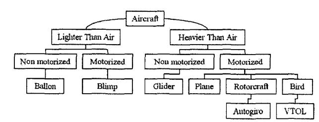

# Design and Control of an Indoor Micro Quadrotor

**Samir** Bouabdallah Pierpaolo Murrieri Roland Siegwart Autonomous Systems Laboratory Interdepartmental' Center "E. Piaggio" Autonomous Systems Laboratory University of Pisa Lausanne, Switzerland Pisa, Italy Lausanne, Switzerland Email: p.murrieri @ing.unipi.it

Swiss Federal Institute of Technology Email: samir.bouabdallah @epfl .ch

Swiss Federal Institute of Technology Email: roland. siegwart @epfl .ch

*Abstruct-* **Recent progress in sensor technology, data processing and integrated actuators has made the development of miniature flying robots fully possible. Micro VTOL' systems represent a useful class of flying robots because of their strong capabilities for small-area monitoring and building exploration. In this paper we describe the approach that our lab' has taken to micro VTOL evolving towards full autonomy, and present the mechanical design, dynamic modelling, sensing, and control of our indoor VTOL autonomous robot 0S43.** 

### I. INTRODUCTION

Autonomous flying robots have gained enormous commercial potential during the last years. Recent developments in high density power storage, integrated miniature actuators and MEMS4 technology sensors have made autonomous miniaturized flying robots possible. This new situation has opened the way to several, complex and highly important applications for both military and civilian markets. Military applications currently represent the lion's part of the unmanned flying vehicle market, and this industrial sector is growing strongly. Depending on the flying principle and the propulsion mode, one can classify aircraft vehicles in multiple categories as shown in figure 1. In the motorized heavier-than-air category, a new generation of MAV5 with a wingspan less than 15cm and less than 100 grams in mass has emerged. Generally these MAVs are fully equipped with stabilization sensors and miniature cameras. The Black Widow6 MAV is a 15cm span, fixed-wing aircraft with an embedded color camera. It flies at 48 **km/h** with an endurance of 30 minutes, and a maximum communication range of 2km. In the same category, birdlInsect-like MAVs seem to be the perfect solution for fast navigation in narrow spaces and perhaps the best approach to miniaturization. The Micromechanical Flying Insects (MFI) project at UC Berkeley [l] uses biomimetic principles to develop a flapping wing MAV. This project represents one of the most promising endeavors towards autonomous MFIs. In the motorized lighter-than-air .category, Floreano's group at ASL' is applying biomimetic and evolutionary methods to

Fig. 1. Aircraft general classification depending on the flying principle and the propulsion mode.

indoor flying robots for autonomous vision-based navigation, and has achieved noteworthy results with the "Blimp" **[2].** 

The state of the art in micro helicopters is not far behind, and considerable efforts are being made, especially in control and miniaturization. Mesicopter **[3],** an ambitious project currently underway, is exploring the science of millimeter and centimeter-size vehicles in spite of unfavorable scaling laws. The project's driving application is the deployment over large areas or planets of a huge number of micro vehicles providing atmospheric and meteorological data.

### *A. Helicopters vs Other Flying Principles*

Compared with the other flying principles discussed above, VTOL systems have specific characteristics which allow the execution of applications that would be difficult or impossible otherwise. Table I gives a non-exhaustive comparison between the different flying principles from the miniaturization point of view. From this table, one can easily conclude that the VTOL systems like helicopters or blimps have an unquestionable advantage compared to the other concepts. This superiority is thanks to their unique ability for vertical, stationary and low speed flight. The key advantage of blimps is the "autolift" and the simplicity of control which can be essential for critical applications such as space exploration **[4].** However, VTOL vehicles with different configurations probably represent currently the most promising flying concept seen in terms of miniaturization.

### 11. THE **OS4** PROJECT

The OS4 project, initiated at the Autonomous Systems Laboratory (EPFL), focuses on micro VTOL vehicles evolving towards a full autonomy in indoor environments. The long

&#x27;Vertical **Take-Off** and Landing

&#x27;Autonomous Systems Lab

&#x27;Onmidirectional Stationary Flying Outstretched Robot

4Micro Electromechanical Systems

5M~~~ Aerial Vehicle

<a href='http://www.aerovironment.com'>&#x27;www.aerovironment.com </a>

&#x27;Autonomous Systems Laboratory, <b>EPFL,, </b>Switzerland

<b>TABLE I FLYING PRINCIPLES COMPARISON FOCUSED ON ABILITY TO MINIATURIZATION. BAD, 3=GOOD) </b>

<table><thead><tr><th>I Airplane Helicopter Power cost I 2</th><th>I</th><th>Bird</th><th>I</th><th>Autogiro</th><th>I</th><th>Blimp</th></tr></thead><tbody><tr><td>1</td><td>1</td><td>1</td><td>1</td><td>2</td><td>1</td><td>3</td></tr><tr><td></td><td></td><td>2</td><td></td><td>1</td><td></td><td></td></tr><tr><td></td><td></td><td></td><td></td><td>2</td><td></td><td>2</td></tr><tr><td></td><td></td><td>2</td><td></td><td>1</td><td></td><td>3</td></tr><tr><td></td><td></td><td>3</td><td></td><td>2</td><td></td><td>1</td></tr><tr><td></td><td></td><td>2</td><td></td><td>1</td><td></td><td>2</td></tr><tr><td></td><td></td><td>26</td><td></td><td>20</td><td></td><td>26</td></tr></tbody></table>

term goal is to allow indoor navigation using various concepts. The approach advocated for this project is to simultaneously work on design and control. This original approach makes it possible to simplify control by design changes, and vice versa. A Quadrotor configuration vector has been chosen as a starting platform for the preliminary experiments. This vector configuration considerably simplifies the vehicle design and intrinsically reduces the gyroscopic effects. The project started with the dynamic modelling and the development of a static method for propulsion group evaluation and optimization. In addition, a test bench has been designed to experiment and tune the first controllers.
<h3><i>A. Quadrotor Conjiguration </i></h3>
The Quadrotor concept has been around for a long time. The Breguet-Richet Quadrotor helicopter <i>Gyroplane No.1 </i>built in 1907 is reported to have lifted into flight <b>[5]. </b>One can describe the vehicle as having four propellers in cross configuration. The two pairs of propellers <b>(1,3) </b>and <b>(2,4) </b>as described in figure 2, turn in opposite directions. By varying the rotor speed, one can change the lift force and create motion. Thus, increasing or decreasing the four propeller&#x27;s speeds together generates vertical motion. Changing the 2 and <b>4 </b>propeller&#x27;s speed conversely produces roll rotation coupled with lateral motion. Pitch rotation and the corresponding lateral motion, result from 1 and 3 propeller&#x27;s speed conversely modified. Yaw rotation is more subtle, <b>as </b>it results from the difference in the counter-torque between each pair of propellers. In spite of the four actuators, the Quadrotor still an under-actuated and dynamically unstable system.

<i>1) Advantages </i>and <i>Drawbacks: </i>Although disadvantages, such as space and energy requirements for the Quadrotor, spring more quickly to mind than the system&#x27;s advantages, this concept offers a better payload and is potentially simpler to build and to control. This could be a decisive advantage. Table 11 gives a rapid idea about Quadrotor&#x27;s advantages and drawbacks.

<h3>111. QUADROTOR DYNAMIC MODELLING</h3>
The first step before control development is an adequate dynamic system modelling [6]. Especially for lightweight flying

<b>Fig. 2. Quadrotor concept motion description, the arrow width is proportional to propeller rotational speed. </b>

<b>TABLE 11 QUADROTOR MAIN ADVANTAGES </b>&amp; <b>DRAWBACKS. </b>

systems, the dynamic model ideally includes the gyroscopic effects resulting from both the rigid body rotation in space, and the four propeller&#x27;s rotation. These aspects have been often neglected in previous works. However, the main effects acting on a helicopter [7] are describe&#x27;d briefly in table <b>III. </b>

Let us consider earth fixed frame E and body fixed frame B, as seen in <a href='#page-2-0'>figure 3.</a> The center of mass and the body fixed frame origin are assumed tlo coincide. Using Euler angles parametrization, the airframe orientation in space is given by a rotation R from B to E, where R <b>E </b><i>SO3 </i>is the rotation matrix. The dynamics of a rigid body under external forces applied to the center of mass and expressed in the body fixed frame as shown in [6] and [8] are in Newton-Euler formalism:

Where I <b>E k(3r3) </b>the inertia matrix; V the body linear speed vector and <i>w </i>the body angular speed.

In the frame system figure 3, the equations of motion for the helicopter can be written as [ <b>111: </b>

Fig. <b>3. and the inertial </b>frame <i>E. </i> <b>Quadrotor configuration, frame system with a body fixed </b>frame <i>B </i>

The first-level approximate model (3) of the Quadrotor can be rewritten as:

where

<i>&amp;@(1.113? I, </i>+ <b>?U4 </b>

Then, the system&#x27;s inputs are posed <b>171, </b><i>U2, U3, U4 </i>and R a disturbance, obtaining:

<b>A. </b><i>Rotor Dynamics </i>

equations [ 101: The rotors are driven by DC-motors with the well known

The torque applied on the vehicle&#x27;s body along an axis is the difference between the torque generated by each propeller on the other axis.

The full Quadrotor dynamic model with the x,y,z motions as a consequence of a pitch or roll rotation is:

<i>Lg </i>= <i>U </i>- <i>Ri </i>- k,wm <b>(7) </b> <i>J9 =Tm-Td </i>

<b>As </b>we use <b>a </b>small motor with <b>a </b>very low inductance, the second order DC-motor dynamics may be approximated by:

<b>(3) </b>

<i>Jdw, dt </i>= <b>-%urn </b><i>R </i>- <i>rd </i>+9. <b>(8) </b>

<i>Wm </i>= -+wm - <i>+w; </i>+ <i>=U </i><b>1</b> <i>qr </i><b>Jt </b> <i>with </i>: <b>(9) </b>-- <b>1-&amp; </b>{ <i>T RJt </i>

By introducing the propeller and the gearbox models, the equation <b>(8) </b>may be rewritten:

The equation (9) can be linearized around <b>an </b>operation point <i>WO </i>to the form wm = <i>-Awm </i>+ <i>Bu </i>+ <i>C</i>with:

<i>A=(\$+\*), B=(&amp;), C=\$&amp; </i><b>(10) </b>

<b>Fig. 4. OS4 test bench for stabihation strategies testing, 3DOF are locked, the cross is made with carbon rods and the </b>flying <b>system weight is about 240g. 1)RS232 to 12C translator, 2)Motor modules, 3)3D captured universal joint, 4)Micro IMU, 5)Propulsion group. </b>

<b>Fig. </b><i>5. </i><b>OS4 test bench block diagram </b>
<h1><b>IV. </b>OS4 TEST BENCH DESIGN</h1>
The development of a control system for a flying robot requires the development of an adequate test bench at least for the preliminary experiments. This can help lock some number of degrees of freedom in order to reduce control complexity and avoid system damage.

From a PC and through a standard RS232 port, one can send orders to the test bench. The RS232 to 12C module translates the serial signals to the 12C bus motor modules. These modules integers a P.1.D regulator on a PIC16F876 microcontroller and are capable of open or closed loop operation in position, speed or torque control. The MT9-B8 MU9 estimates with a kalman filter the 3D orientation data and gives the calibrated data of acceleration and angular velocity. It weights about 33g and communicates at 115kbps. The captured motion from the 3D universal jointlo can be decoded to extract absolute orientation information, thanks to the micro optical encoders in each axis. The vehicle is thus lightweight, about 2358 for all the flying system. The OS4 test bench has <b>4 </b>propulsion group, each composed of a 29g motor&quot; including magnetic encoders, a 6g gear box and a 6g propeller. To design the propulsion group, a test, evaluation and comparison method was developed.
<h2><i>A. Propulsion group evaluation and design procedure </i></h2>
Finding the highest thrust to weight ratio is one of the most important challenges in micro VTOL design. Our approach is firstly to specify the application requirements in terms of thrust, energy and overload allowed. Secondly is to build a propeller and motor data bank and then find the best combination. Finally we compare the results to the requirements. For the propeller data-bank, we use a specific test bench to extract thrust and drag coefficients through experiments where we measure tension, cum:nt, thrust and rotational speed. Designing a flying robot is an icerative process and one has to fix starting conditions. For our development, we have chosen to start from the determination of the vehicle&#x27;s approximate size which allows the propeller selection from the data base according to its size. Using the evaluation tool, one can easily select the appropriate motor. Finally, we use the well known motor equations to determine the optimal reduction ratio for our propulsion group.
<h1>v. CONTROL OF THE VTOL SYSTEM</h1>
The model <b>(3, </b>developed in the previous sections, can be rewritten in a state-space form <b>X </b>= <i>f </i>(X, U) by introducing X = <b>(~1...212)~ E %I2 </b>as state vector of the system as follows: <b>x1 </b>= <i>x</i>

<b>22</b>=<i>x, </i>= <i>x</i> <b>23</b>= <b>Y 24 </b>= <b>\$3 </b>= <i>25 </i>= <i>z 26</i>= <i>x5 </i>= <i>i </i> <b>x7=4 </b>. <b>x9 </b>= <i>e </i> <b>210</b>= <b>km3 </b>= <i>e </i> <b>211 </b><i>=11, </i>. <b>212</b>= <b>kll </b>= <i>11, xg </i>= j.7 = <b>4 </b>

From (11) and <i>(5) </i>we obtain:

It is worthwhile to note inside the dynamic of the latter system how the angles and their time derivatives do not depend on. translation components; on the other hand the

<b>8www.xsens.com </b>

<b>&#x27;Inertial Measurement Unit </b>&#x27; <b><a href='http://Owww.forcedimension.com'>Owww.forcedimension.com</a> </b>

&quot; <b>1724 motor from: www.minimotor.ch </b>

translations depend on angle (and not on angular velocities). We can ideally imagine the overall system described by (12) as constituted by two subsystems, the angular rotations and the linear translations, see figure 6. The angular rotations subsystem has as state the restriction <i>X, </i>of <i>X </i>to the last <i>6 </i>components which regard the roll, pitch, yaw and their time derivative. The dynamics of these variables are described by <i>f,(X, U) </i>which corresponds to the last 6 components of the mapping (12). Note that the mapping <i>f,(X, U) </i>is function only of <i>X, </i>and of <b>(172, U3; </b><i>U4)T, </i>and does not depend on translation components. On the other hand, the translations subsystem (with state <i>XA) </i>regards the first 6 element of the state <i>X, </i>which are the <i>2, </i><b>y. </b><i>z </i>and their time derivative: in this case too the dynamics are described by the first 6 rows <i>fa(X, U) </i>of the mapping (12). Conversely to the previous case, the translations subsystem mapping <i>fa(X,U) </i>is not independent of the angle variables but depends only on roll, pitch and yaw and not on their time derivative.

<b>Fig. 6. Connection of the </b>two <b>ideal subsystems </b>of <b>the overall dynamical system described by mapping (12). From the angular rotations subsystem the </b> roll, <b>pirch and yaw are obtained and become </b>with <i>U1 </i><b>inputs </b>for <b>the </b>following <b>translation subsystem. </b>
<h4><i>A. Control </i>of <i>the Angular Rotations Subsystem </i></h4>
Due to its complete independence from the other subsystem, it is interesting to consider first the control of the angular rotations subsystem. In particular, in this subsection we consider the stabilization of the OS4 angles in a particular configuration <i>xi </i>=<i>(2&amp; </i>0, <i>x,&quot;, </i>0, <b>5fl1; </b>O)?

Let <b>us </b>consider the Lyapunov Function <i>V(Xa) </i>which is <b>C&#x27; </b> and positive defined around the desired position <i>X:. </i>

<b>(27 </b>- <i>2;) +xi </i>+ <i>(29 </i>- <i>2:) </i>+ <i>\$0 </i>+ <b>(211 </b>- <b>2 2 </b>+ &amp; 2 (13)

The time derivative of (13), <i>V </i>= <i>(VV)Tf,, </i>in the case of a perfect cross VTOL <i>(Iz </i>= <i>Iy) </i>is drastically reduced to:

<i>v </i>=<b>(27 </b>- <i>2\$)28 </i>+ <i>Xs&amp;Uz </i>+ <b>(29 </b>- <i>Xd 9) 2 </i><b>10 </b>+ <b>210kU3+ +(Zll </b>- <b>&amp;)212 </b>+ <b>51294</b>

(14) Equation in which does not appear the perturbation term with R. By simply choosing:

<b>U2 </b>= - <i>(57 </i>- <i>2;) </i>- <i>k1Xg t </i> <b>U3 </b>= <i>-f(Zg </i>- <i>2,&quot;) </i>- <i>k2210 </i>(15) <b>U4 </b>= <b>-Iz(zll </b>- <b>%ti) </b>- <b>k3212, </b>

with <b>kl, </b><i>k2 </i>and <b>k3 </b>positive constants, we obtain for (14):

which is only negative semi-defined. By Lyapunov theorem [12] is now ensured the simple stability for equilibrium. By Lasalle invariance theorem we can ensure also that starting from a level curve of the Lyapunov function defined in (13) where <i>V(X,) </i>is constant, the state evolution is constrained inside the region bounded by the level curve. This is very useful when trying to avoid particular configuration; it is simply necessary to start with a level curve not containing these points and apply the previous defined controls. We can also ensure the asymptotic stability by applying the Lasalle theorem because the maximum invariance set of (angular rotations) subsystem under control (15) contained in the set S = <i>{Xz </i>E <b>s6 </b>: <i>VIx: </i>= 0) is restricted only to the equilibrium point.

By the latter consideration we can ensure an asymptotical stability starting from a point in a set around the equilibrium. To ensure the global stability it is sufficient that the limp,l,m <i>V(X,) </i>= <i>00, </i>which is our case.

<h3><i>B. Height Controller </i></h3>
Let us consider the simple task for the VTOL to hover at a particular height <i>z </i>= <i>zd. </i>The dynamic of the height is described by lines 5 and 6 of system (1 2), that is:

) (17) ( <b>2 </b>) = ( <i>-g </i>+ <i>cosx~cos2g~ </i> <b>26 </b>

Using the considerations in the previous paragraph V-A, we ensure that starting from an initial condition where <i>V(X,) </i>&lt; 4, the angles and their velocities are constrained in this hypersphere of <b>s6. </b>In this case <i>cosx7cosxg </i># 0 during all the trajectories of the system under previous control law. If the latter condition is satisfied we can linearize system (17) by simply co-mpensating the weight force by <b>U1 </b>= the latter law (17) becomes: <b>cos.,~oszQ </b><i>m</i>+ <i>cos~~~s5Q, </i>where <b>U1 </b>is an additional term. By

By a simple state-space linear stabilization law <b>U1 </b>= <i>k425 </i>+ <b>k5x6 </b>we can stabilize the height by placing the poles of the subsystem in any position in the complex left half plane.
<h4>VI. SIMULATIONS</h4>
Before implementation on the real system, we performed several simulations on Matlab. The controller&#x27;s task was to stabilize the height while compensating the initial error on the roll, pitch and yaw angles. The real system suffers from undesired but unavoidable delays and actuator saturation. The delays are mainly due to RS232 communications and the actuator time constant. To emulate this lacks, two Simulink discrete-step delay blocks have been introduced in the feedback loop and on the actuators. Saturation level depends on the chosen actuators. The motors work in our application

<b>Fig. 7. Simulation: the system has to maintain the height of 2 meters although the noise on the actuators. </b>

with a maximum angular velocity of 600 <i>radlsec; </i>a saturation block has been placed between the controller and the delay. Finally, the overall system has been simulated at 30Hz using a discrete time solver in order to model the behavior of the digital controller. In the simulation, see figure 7, the task is to hover although an added normal gaussian noise of variance <i>4radlsec </i>on each angular velocity. The height is taken with an added zero mean error.
<h3>VII. EXPERIMENTS</h3>
In order to validate the control law developed in the previous section, we implemented the controller and we performed several experiments on the real system. The task was to control the vehicle orientation thus, the Roll, the Pitch and the Yaw angles was controlled, see figure 8, while the height was fixed by the test bench.

In spite of the test bench limitations in term of delays and errors introduced by the tethering system, the experimental results obtained show that the proposed controller works well especially for the yaw angle.
<h3>VIII. CONCLUSION AND FUTURE WORK</h3>
In this paper, we presented a survey of existing flying microvehicles and made a comparison to micro VTOLs in terms of miniaturization. We introduced the <b>OS4 </b>project and discussed the undergoing developments of flying robots at ASL. This includes dynamic modelling, vehicle design optimization and control. <b>As </b>it can be seen from the experimental plots, the controller introduced prove the ability to control the orientation angles. Our next goal is to enhance the control with position controller and to develop a fully autonomous vehicle. The positive results obtained in this development towards autonomous micro-VTOL reinforce our conviction that these systems have potential as candidhtes for the miniaturized flying micro-vehicles emergence.

<b>Fig. 8. Experiments: </b>the <b>controller </b>has ito <b>stabilize the system by maintaining the roll, pitch and yaw angels to zero. </b>
<h3><b>ACKNOWLE~DGMENT </b></h3>
The authors would like to thank Jean-Christophe Zufferey for fruitful discussions and advices on flying robots, Georges Perrenoud for the realization of the test bench mechanical components and all the students who worked or are working on this project.
<h4><b>REFERENCES </b></h4>
<ul><li block-type='ListItem'><b>X. Deng, L. Schenato and </b><i>S.S </i>Sasrry, <i>Attitude Control for a Micromechanical Flying Insect Including Thorar and Sensor Models </i><b>ICRA 2003, Teipei, Taiwan 2003. J.C Zufferey, D. Floreano </b><i>Evolving Won-Based Flying Robots. </i><b>Proceedings of the 2nd International \Vorkshop on Biologically Motivated Computer Vision, LNCS 2525, pp 592-600, Berlin, Springer-Verlag, 2002. </b></li><li block-type='ListItem'><b>I. </b>Kroo, <b>F.B. Prinz, </b><i>The Mesicopter: A Meso-Scale Flight Vehicle. </i> <b><a href='http://aero.stanford.edu/mesicopter'>http://aero.stanford.edu/mesicopter/</a>. </b></li><li block-type='ListItem'><b>A. Elfes, S.S. Bueno and </b>al, <i>Robotic Airship for Exploration of planetary Bodies with an Ahmsphere Autonomy Challenges. </i><b>Autonomous Robots Journal: Khwer Academic Publishers, 2003. J.G. Leishman </b>, <i>The Breguet-Richet Quad-Rotor Helicopter of 1907. </i> <b><a href='http://www.enae.umd.edu/AGRC/Aem/Breguet.pdf'>http://www.enae.umd.edu/AGRC/Aem/Breguet.</a>pdf, </b></li><li block-type='ListItem'><i>S. </i><b>Sastry, </b><i>A mathematical infroductton to robotic manipulation </i>. <b>Boca Raton, FL, 1994. </b></li><li block-type='ListItem'><b>P. Mllhaupt, </b><i>Analysis and Control of Underactuated Mechanical Nonminimum-phase System. </i><b>Phd thesis, Department of Mechanical Engineering, EPFL, 1999. </b></li><li block-type='ListItem'><b>A. Chriette, </b><i>Contribution a la commande et </i>a <i>la modt!lisation des hdlicopt2res </i>: <i>Asservissement visud er commande adaptative.. </i><b>Phd Thesis, 2001. </b></li><li block-type='ListItem'><b>P. Pounds, R.Mahony, </b><i>Design of a Fcur-Rotor Aerial Robot. </i><b>Australasian Conference on Robotics and Automation. Auckland. Australia. 2002. </b> [ <b>101 E. Jucker, </b><i>Equations fondamenta1e.i des micromoteurs courant continu avec rotor sans fer. </i><b>Bulletin technique Portescap, La Chaud-de-Fonds, 1914. [l 11 R. Olfati-Saber, </b><i>Nonlinear Control of Underactuated Mechanical Systems with Application to Robotics and Aerospace Vehicles. </i><b>Phd thesis, Department of Electrical Engineering and Computer Science, </b>MIT, <b>2001. [12] </b><i>S. </i><b>Arimoto, </b><i>Control Theorf of Nonlinear Mechanical Systems. </i><b>Oxford Science Publications, 1996. </b></li></ul>

 </body>
</html>