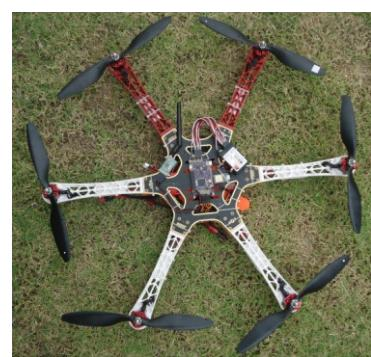
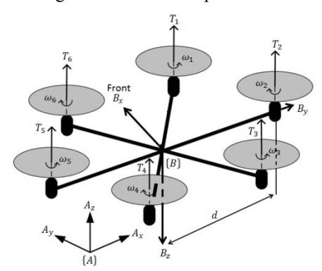
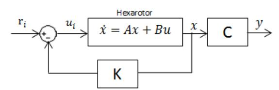
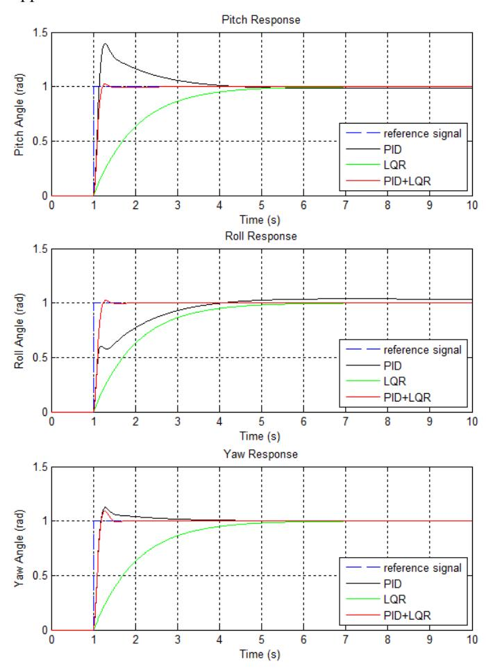
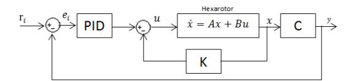
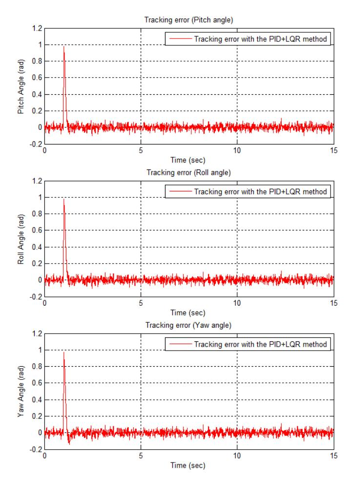
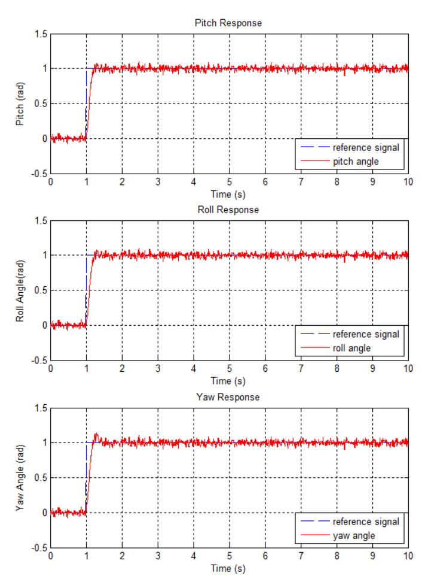

# PID plus LQR Attitude Control for Hexarotor MAV in Indoor Environments

Nurul Dayana Salim, Dafizal Derawi, Shahrum Shah Abdullah, Saiful Amri Mazlan

Malaysia-Japan International Institute of Technology Universiti Teknologi Malaysia Kuala Lumpur, Malaysia {ndayana5, dafizal2}@live.utm.my {shahrum, amri}@ic.utm.my

Hairi Zamzuri\*

UTM-PROTON Active Safety Laboratory Universiti Teknologi Malaysia Kuala Lumpur, Malaysia hairi@ic.utm.my

*Abstract***—The aim of this paper is to propose an optimum linear control algorithm that is able to stabilize the attitude of a hexarotor micro aerial vehicle (MAV) in indoor environment. The work will then compare it with the classical control PID (proportional-integral-derivative) and optimal control LQR (linear quadratic regulator) techniques. The proposed attitude controller is based on an outer-inner loop structure PID plus LQR (PID+LQR) control method where the controller combines the positive features of each sub-controller (PID and LQR). The key contribution of this work is the proposed attitude controller can improve robustness and transient response thus leads to faster response in indoor flying environment. The attitude tracking errors are proven to be ultimately bounded with specified boundaries. Simulation results on the hexarotor demonstrate the effectives of the proposed attitude controller.** 

*Keywords—Hexarotor MAV; attitude control; PID+LQR; faster; simulation* 

# I. INTRODUCTION

Recently, a new generation of aerial vehicles called multirotors micro aerial vehicles (MAVs) which have a great potential for civilian and military applications, has been gaining tremendous attention around the world. They are much safer to operate than helicopters or fixed-wing unmanned aerial vehicles (UAVs) due to the smaller rotors with a protective frame. They are highly maneuverable, have the ability to do vertical takeoff and landing (VTOL), can easily hover above target, fly at low altitude, and have ability to move in 3D space. Previous studies show that quadrotor MAVs have become a standard platforms for robotic research worldwide [1]. However, there is another type of multirotors that has high potential compared to quadrotor which is hexarotor MAV as shown in Fig. 1. The hexarotor consists of six rotors attached to a rigid body frame and these additional two rotors make it able to carry more payload and high maneuverability compared to quadrotor. Because of these two extra rotors, the torque of the hexarotor about each axis is different from that of quadrotor and thus affects the dynamical response.

Previous studies on multirotors are mainly focused on the control problem of quadrotor. The classical PID (proportionalintegral-derivative) control approache is widely applied in feedback control of quadrotor (e.g. [2]-[4]). PID controller enables to provide good performance for flight control system. However, PID method faced problems in many cases such as parameters variation or disturbance is not appropriate. A comparison of the PID and LQR(Linear Quadratic Regulator) is proposed in [5] where both control methods have been implemented on a quadrotor platform. In this study, they concluded that both controllers provide satisfactory feedback for attitude control of quadrotor.

This paper shows that the performance of an attitude controller can be optimized by combining the positive features of both PID and LQR controllers. In this paper, the proposed attitude controller is based on outer-inner loop structure: PID plus LQR (PID+LQR). LQR is used to overcome some problems that faced by PID controller. LQR is a control scheme that gives the best possible performance with respect to some given measures of performances where the performance measure is a quadratic function composed of state vector and control input. In this paper, the rotation dynamical system (attitude) is divided into three subsystems: the pitch subsystem, the roll subsystem, and the yaw subsystem. A linear nominal model is obtained for each subsystem. The coupling, nonlinear dynamics, parametric uncertainties, and external disturbances are considered as uncertainties (equivalent disturbances).

The rest of this paper is arranged as follows. Section II describes the model of hexarotor. Section III presents the control scheme. Section IV presents the simulation results and finally, Section V summarizes this paper and provides suggestion for the future research.

Figure 1. The hexarotor MAV.

This research was sponsored by Malaysia-Japan International Institute of Technology, UTM and Ministry of Education Malaysia under ERGS research grant (vote no: 4L033). \*Corresponding author

#### II. HEXAROTOR MODEL

This section describes the model of hexarotor based on hexarotor notation as depicted in Fig. 2. The hexarotor has six rotors. Let {*A*} = {*Ax*, *Ay*, *Az*} denote an inertial frame with unit vectors {ܽ⃗ଵ, ܽ⃗ଶ, ܽ⃗ଷ} along the axis of frame {A} and {*B*} = {*Bx*, *By*, *Bz*} be a body-fixed frame for the vehicle's airframe with unit vectors {ܾሬ⃗ ଵ, ܾሬ⃗ ଶ, ܾሬ⃗ ଷ} along the axis of frame {*B*} with respect to {*A*}. The body-fixed frame {B} has positive *z*-axis downward following the standard aerospace convention.

Figure 2. Hexarotor notation in "X" configuration.

The orientation of the rigid body is given by a rotation matrix in the special orthogonal group ܴ ∈ ܱܵ(3). The *X-Y-Z* Euler angle is used to model this rotation. The Euler angles ߠ,߶ , and ߰ representing pitch angle, roll angle, and yaw angle respectively. The orientation of the rigid body frame {*B*} with respect to the inertial frame {*A*} can be described by

߰ݏ߶ݏ + ܿ߰ߠݏ߶ܿ ߰ݏ߶ܿ − ܿ߰ߠݏ߶ݏ ܿ߰ߠܿ൭ = ܴ ܿ߰߶ݏ − ߰ݏߠݏ߶ܿ ܿ߰߶ܿ + ߰ݏߠݏ߶ݏ ߰ݏߠܿ (1) ൱ ߠܿ߶ܿ ߠܿ߶ݏ ߠݏ−

where *c* and *s* represents cosine and sine, respectively.

Let ߦ) =ݖݕݔ(் denote the position of the origin of the body fixed-frame {*B*} with respect to the inertial frame {*A*}. Let ݒ} ∋ ܣ {denote the linear velocity of {*B*} with respect to {*A*}

(2) ݒ = ̇ߦ

The translational dynamics of the hexarotor in world coordinates is modeled by Newton's second law

(3) ܨܴ + ଷ݉݃ܽ⃗ = ̇ݒ݉

where *m* is the total mass of the rigid object, *g* is gravitational acceleration, and ܨ is nonconservative forces , yields

0 ൭ =̇ݒ݉ 0 ݉݃൱−ܴ൭0 0 ܶ ൱ (4)

where *T* is the total upward thrust. The first term is the force of gravity which acts downward in the world frame and the second term is the total thrusts in the vehicle frame rotated into the world coordinate frame. The total upward thrust applied to the airframe is the sum of the thrusts from each individual rotor

 ܶ = ܶ ୀଵ (5)

Let I denote the constant 3×3 inertia matrix of the vehicle. Let Ω ∈ {ܤ {denote the angular velocity of body-fixed frame {*B*} with respect to {*A*} and ߬ = (߬థ ߬ ఏ ߬ ట)் is the torque applied to the hexarotor airframe. The rotational acceleration of the hexarotor is modeled by Euler's equation of motion

ΙΩ̇ = −Ω × ΙΩ + ߬ (6)

The simplified model ignoring drag coefficient can be derived based on (4) and (6)

ݔ̈=−)sin ߶ sin ߰ + cos ߶ sin ߠ cos ߰)ܶ݉⁄ ݕ̈=−)cos ߶ sin ߠ sin ߰ − sin ߶ cos ߰)ܶ݉⁄ (7) ܶ݉⁄(ߠ cos ߶ cos (݃−=̈ݖ ̇߶൫= ̈ߠ ߰̇ (Ι௭௭ −Ι௫௫) +߬௬൯Ι ൗ ௬௬ ̇ߠ൫= ̈ ߶ ߰̇ ൫Ι௬௬ −Ι௭௭൯+߬௫൯Ι ⁄ ௫௫ ߰̈= ൫߶̇ ̇ߠ ൫Ι௫௫ −Ι௬௬൯+߬௭൯Ι ⁄ ௭௭

In this paper, the complexity of aerodynamic model has been ignored. The thrust force *Ti* (݅ = 1,2, … ,6) are the thrust force generated by the six rotors respectively and it is a upward vector

 ܶ = ܾ߱ ଶ, ݅ = 1,2, … ,6 (8)

where *b* is a positive lift constant and ߱ (݅ = 1,2, … ,6) are the angular velocity of the six rotors respectively.

The pitching torque which is the torque about the vehicle's *y*-axis is

 ߬ఏ =݀ቆ√3 2 ܶଵ + √3 2 ܶ − √3 2 ܶସ − √3 2 ܶଷቇ (9)

where *d* is the distance from the motor to the center mass. It can be expressed in terms of angular velocity of rotor as

 ߬ఏ = ܾ݀ ቆ√3 2 ߱ଵ ଶ + √3 2 ߱ ଶ − √3 2 ߱ସ ଶ − √3 2 ߱ଷ ଶቇ (10)

The rolling torque which is the torque about the vehicle's *x*axis is

 ߬థ =݀൬1 2 ܶ +ܶହ + 1 2 ܶସ − 1 2 ܶଷ −ܶଶ − 1 2 ܶଵ൰ (11)

It can be expressed in terms of rotor speed as

߬థ = ܾ݀ ൬1 2 ߱ ଶ +߱ହ ଶ + 1 2 ߱ସ ଶ − 1 2 ߱ଷ ଶ −߱ଶ ଶ − 1 2 ߱ଵ ଶ൰ (12)

The reaction torque due to aerodynamic drag acting on the airframe generate by a hovering rotor *i* free air may be modeled as

 ܳ = ݇߱ ଶ, ݅ = 1,2, … ,6 (13)

where *k* depends on the same factors as *b*. The total reaction torque about the z-axis is

߬ట =ܳଵ −ܳଶ +ܳଷ −ܳସ +ܳହ −ܳ (14)

while in terms of rotor speeds

 ߬ట =݇(߱ଵ ଶ −߱ଶ ଶ +߱ଷ ଶ −߱ସ ଶ +߱ହ ଶ −߱ ଶ) (15)

The motion of hexarotor is obtained by integrating the forward dynamics equations (4) and (6) where the forces and moments on the airframe

ቀ ܶ ߬ ቁ=൮ −ܾ −ܾ −ܾ −ܾ −ܾ −ܾ −ܾ݀ܿଵ −ܾ݀ −ܾ݀ܿଵ ܾ݀ܿଵ ܾ݀ ܾ݀ܿଵ ܾ݀ܿଶ 0 −ܾ݀ܿଶ −ܾ݀ܿଶ 0 ܾ݀ܿଶ ݇ −݇ ݇ −݇ ݇ −݇ ൲߱ (16)

where ߱= (߱ଵ ଶ ߱ଶ ଶ ߱ଷ ଶ ߱ସ ଶ ߱ହ ଶ ߱ ଶ)் ,ܿଵ =1 2⁄ , and ܿଶ = √3⁄2.

# III. ATTITUDE CONTROL TECHNIQUES

In this section, the attitude control design will be discussed. The desired reference angle *ri* for pitch, roll, and yaw angles are denoted by ݎఏ, ݎథ, and ݎట, respectively. The control inputs *Ui* (*i=*ߠ*,*߶*,*߰ (for the pitch angle, roll angle, and the yaw angle could be written as

ܷఏ = ܾ݀√3⁄( 2 ߱ଵ ଶ +߱ ଶ −߱ସ ଶ −߱ଷ ଶ) ܷథ = ܾ݀(߱ହ ଶ −߱ଶ ଶ) + ܾ݀ 2⁄(߱ ଶ +߱ସ ଶ −߱ଷ ଶ −߱ଵ ଶ) ܷట =݇(߱ଵ ଶ −߱ଶ ଶ +߱ଷ ଶ −߱ସ ଶ +߱ହ ଶ −߱ ଶ) (17)

Attitude tracking errors ݁ (*i=*ߠ*,*߶*,*߰ (can be defined as

(18) ݅ − ݎ= ݁

Attitude control is the most important part of the control system since it is low level flight control of aerial robot. In this paper, rotational dynamics system consists of three subsystems: the pitch subsystem, the roll subsystem, the yaw subsystem. The next sub-sections present the classical PID (proportionalintegral-derivative) attitude control, optimal LQR (linear quadratic regulator) attitude control, and the proposed attitude controller PID+LQR.

# *A. PID - Proportional-Integral-Derivative*

The PID control method is a kind of feedback controller which is based on the error between desired set point and measured process value. Fig. 3 shows the block diagram of the classical PID attitude controller.

Figure 3. The block diagram of the PID attitude controller with the pitch subsystem (*i=*ߠ(, the roll subsystem (*i=*߶), and the yaw subsystem (*i=*߰).

As can be seen from Fig. 3, the error is feedback to PID controller to generate *Ui*(*i=*ߠ*,*߶*,*߰ (

 ܷ =݇݁ +݇ூ න݁ ݀ݐ + ݇ ݀݁ (19) ݐ݀

# *B. LQR – Linear Quadratic Regulator*

The Linear Quadratic Regulator (LQR) control algorithm is an optimal control that is concerned with operating a dynamic system like hexarotor as shown in Fig. 4. The LQR design problem is to design a state feedback controller *K* such that the objective cost function *J* is minimized.

Figure 4. The block diagram of the LQR attitude controller with the pitch subsystem (*i=*ߠ(, the roll subsystem (*i=*߶), and the yaw subsystem (*i=*߰).

Considering the general equations for linear state-space of hexarotor system with *u* inputs vector and ݔ state vector

(20) ݑܤ + ݔܣ = ̇ ̇ݔ

where the input is *u* and the output is

(21) ݑܦ + ݔܥ = ݕ ்(߰߶ߠ) =ݕ

The state vector defined as

߰߰̇ ̇߶߶ ̇ߠߠ) = ݔ )் (22)

The quadratic cost function defined as

ݐ݀(ݑ்ܴݑ + ݔ்ܳݔ)න = ܬ ஶ (23)

The feedback control law that minimizes the value of the cost is

(24) ݔܭ− = ݑ

where *K* is given by

(25) ்ܲܤଵܴି = ܭ

P can be obtained by solving the continuous time differential Riccati equation.

(26) 0 = ܳ + ்ܲܤଵܴିܤܲ − ܣܲ + ்ܲܣ

Matrices *Q* and *R* in (23) is given by the Bryson's rule. In this paper, *Q* and *R* are diagonal matrix of 6×6 and diagonal matrix of 3×3, respectively.

Bryson's rule specifies the weight of the *Q* and *R* matrices. The gain matrix *K* is determined by choosing the *Q* and *R* matrices and in this paper *K* is

0 0 0 0 1.0062 1൭ = ܭ 0 0 1 1.0062 0 0 0 0 0 0 1 1.0111 ൱ (27)

#### *C. PID+LQR - Proportional-Integral-Derivative plus Linear Quadratic Regulator*

The proposed attitude controller is based on an outer-inner loop structure PID plus LQR (PID+LQR) control method as shown in Fig. 5. The values of all vector or matrices in inner loop (LQR) are remained same as previous section. The proposed attitude control combines the positive features from each control loop. Usually, an integral is added to the LQR control to reject the disturbances and the model uncertainties. However, in order to get faster response time (very important to aggressive dynamic system like hexarotor) and reduce the overshot effects of the controller, this paper introduces a new approach which is by integrating PID consists of proportionalintegral-derivative gains with LQR. The goal of the proposed approach is to improve robustness and transient response in attitude control system.

Figure 5. The block diagram of the PID+LQR attitude controller with the pitch subsystem (*i=*ߠ(, the roll subsystem (*i=*߶), and the yaw subsystem (*i=*߰).

### IV. SIMULATION RESULTS

Simulations are carried out to demonstrate the effectiveness of the proposed attitude control method based on outer-inner loop structure of PID plus LQR (PID+LQR). Firstly, parametric uncertainties and external disturbances are not considered in the simulations. The result will be compared with the classical PID and optimal LQR attitude control techniques. The control parameters for all control structures (except LQR) are shown in Table 1. These parameters are obtained by using PID tuning tool in Simulink. The reference signals of the three attitude angles are step signals where the step time is 10 seconds, initial value is 0 rad, and final value is 1 rad. The initial attitude of hexarotor is ߠ)0= (0 ,)߶ 0 = (0 , and ߰(0) =0. For simulation purpose, the parameters of hexarotor are ݉ = 0.5݇݃ , ݃ = 9.81݉ݏଶ , ܫ௫௫ = 6.228ܧ − 3 ݇݃. ݉ଶ , ܫ௬௬ = 6.228ܧ − 3 ݇݃. ݉ଶ, and ܫ௭௭ = 1.121ܧ − 2 ݇݃. ݉ଶ.

The simulation results for attitude control are presented in Fig. 6. As can be seen from Fig. 6, the closed-loop system by the proposed attitude PID+LQR controller achieves excellent dynamical performance and outstanding performance compared to classical PID and optimal LQR controllers. As can be seen, the transient response can be improved by applying outer-inner loop structure by combining the positive features from each control loop. The most important thing, the proposed PID+LQR attitude controller can reduce the overshoot effects, improve robustness and transient response in attitude control system and thus leads to faster response times for typical systems. These features make the proposed linear attitude controller is a best option for real-time implementation in indoor environment compared to classical and optimal approach.

Figure 6. Pitch, Roll, and Yaw response with PID, LQR and PID+LQR controller for the nominal model.

TABLE I. CONTROL PARAMETERS FOR ATTITUDE CONTROL SYSTEM

Secondly, parametric uncertainties and external disturbances are considered. All of the parameter perturbations are assumed 3% of the nominal values. The response with the proposed attitude controller PID+LQR is depicted in Fig. 7. The tracking errors of the closed-loop system under the effect uncertainties are presented in Fig. 8. From these figures, the proposed PID+LQR attitude control method achieve slightly better dynamical and steady-state tracking performance. As can be seen from Fig. 8, the attitude tracking errors are proven to be ultimately bounded with specified boundaries. In overall, the tracking errors are between -0.1 rad and 0.1 rad only.

Figure 7. Responses with the PID+LQR control method under the effects of parametric uncertainties and external disturbances.

Figure 8. Tracking errors of the closed-loop system under the effects of uncertainties.

# V. CONCLUSIONS

This paper has proposed an optimum linear control algorithm that is able to stabilize the attitude of a hexarotor micro aerial vehicle (MAV) in indoor environment. The proposed attitude controller is based on an outer-inner loop structure PID plus LQR (PID+LQR) control method. The proposed attitude control combines the positive features of each sub-controller (PID and LQR). The simulation results proved that the proposed attitude controller is much better than classical control PID (proportional-integral-derivative) and optimal control LQR (linear quadratic regulator) techniques and finally, it can improve robustness and transient response and thus leads to faster response time. Further work can be done on applying the proposed attitude control on the real-time hexarotor platform. In future, a robust compensator would be implemented to restrain the influence of uncertainties especially in outdoor flying environment.

## ACKNOWLEDGMENT

This research was supported by Malaysia-Japan International Institute of Technology, Universiti Teknologi Malaysia (UTM) and Ministry of Education Malaysia under ERGS research grant (vote no: 4L033).

REFERENCES [1] R. Mahony, V. Kumar, and P. Corke, "Multirotor aerial vehicles: modeling, estimation, and control of quadrotor," IEEE Robot. Autom. Mag., vol. 19, no. 3, pp. 20–32, 2012. [2] G. M. Hoffmann, H. Huang, S. L. Waslander, and C. J. Tomlin, "Precision flight control for a multi-vehicle quadrotor helicopter testbed," Control Eng. Pract., vol. 19, no. 9, pp. 1023-1036, 2011. [3] E. Altug, J. P. Ostrowski, and C. J. Taylor, "Control of a quadrotor helicopter using dual camera visual feedback," Int. J. Robot. Res., vol. 24, no. 5, pp. 329-341, 2005. [4] A. L. Salih, M. Moghavvemi, H. A. F. Mohamed, and K. S. Gaeid, "Modelling and PID controller design for a quadrotor unmanned air vehicle," Automation Quality and Testing Robotics, vol. 1, pp. 1-5, 2010. [5] S. Bouabdallah, A. Noth, and R. Siegwart, "PID vs LQ control techniques applied to an indoor micro quadrotor," in proceedings of IEEE International Conference on Intelligent Robots and Systems IROS, 2004, pp. 2451-2456.