# Modeling and Simulation of Quadrotor UAV Using PID Controller

Mehmet Karahan and Cosku Kasnakoglu

*Electrical and Electronics Engineering, TOBB University of Economics and Technology,* Ankara, Turkey Email: {mkarahan,kasnakoglu}@etu.edu.tr

*Abstract***—Recent developments in sensor technology, actuators and energy storage devices provides opportunities for development of micro flying robots. This paper provides information about modeling and control of a Quadrotor. Proportional Integral Derivative (PID) controller is designed for altitude and attitude control of Quadrotor. Various simulations were performed and it could be interpreted that the PID controller is capable of tracking the desired reference values. Finally, the last section is devoted for discussing the results of each simulation.** 

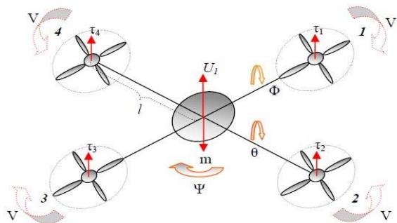

*Keywords—quadrotor, UAV control, quadcopter, dynamic modeling, PID controller, mathematical model, attitude control, altitude control* 

# I. INTRODUCTION

The wide range of uses in both defence industry and civilian markets was supporting the funding of UAV based projects. Search and rescue, cargo carriage, forest fire detection, crop dusting, defense industry and security applications are major fields that UAVs could be used. [1], [2]

In this paper, the nonlinear mathematical model of the quadrotor is derived. Based on the nonlinear mathematical model, a quadrotor simulator is developed in Matlab Simulink for an OS4 micro quadrotor platform. Finally, PID controller approach is presented and its performance is demonstrated.

### II. QUADROTOR CONFIGURATION

Quadrotors have four rotors that they could be controlled separately. This makes possible to move in six degrees of freedom (6 DOF). Six degrees of freedom consists of three translational and three rotational DOF. Quadrotors have 4 propellers and these propellers could be configured in cross or plus configuration. In this paper, cross configuration is used. Quadrotor's (1,3) and (2,4) pairs of propellers counterly rotate in each other. Changing the rotor speed of quadrotor produces lift force and generates movement. In this way, increasing or reducing all of the 4 propeller's speeds jointly changes vertical movement. By varying the 2 and 4 propeller's speed inversely generates roll rotation combined with lateral movement. Changing 1 and 3 propeller's speed conversely produces pitch rotation and the corresponding lateral motion. Yaw rotation is more different than others. It arises from the difference in the counter-torque between each pair of propellers. Fig. 1 demonstrates the concept movement of quadrotor. [3], [4], [5]

Fig. 1. Quadrotors' movements and angles description

#### III. QUADROTOR DYNAMIC MODELLING

There are many studies about derivation and analysis of the mathematical model of quadcopters in the scientific literature. The nonlinear mathematical model of a quadcopter is summarized in this section.

# *A. The Mathematical Model of Quadrotor*

Conversion from earth frame to body frame is possible. Equation (1) through "(5)" demonstrate the transition between earth and body frames. (cos : c and sin : s) [6], [7].

 ᇱݔ ᇱݕ ᇱݖ ൩ = R \* ቈ ݑ ݒ ݓ (1)

 R (ψ) = cos(ψ) sin(ψ) 0 − sin(ψ) cos(ψ) 0 0 01 ൩ (2)

 R (θ) = cos(θ) 0 − sin(θ) 01 0 sin(θ) 0 cos(θ) ൩ (3)

 R (φ) = 10 0 0 cos(φ) sin(φ) 0 − sin(φ) cos(φ) ൩ (4)

R (φ, θ, ψ) = R (φ) R(θ) R(ψ) (5)

R is the rotation matrix from body to inertial frame and is given with eqn. 6.

 R = cθcψ cθsψ −sθ sθsφcψ − sψcφ sψsθsφ + cψcφ sφcθ sθcφcψ + sψsφ sψsθcφ − cψsφ cφcθ൩ (6)

The following equations (7) and (8) reflects the relation between the Euler angle rates and the body angular rates.

 ܲ ܳ ܴ ൩ = 1 0 − sin(θ) 0 cos(φ) sin(φ) cos(θ) 0 − sin(φ) cos(φ) cos(θ) φ' θ' ψ'൩ (7)

 Φ' θ' ψ'൩ = 1 sin(φ) tan(θ) cos(φ) tan(θ) 0 cos(φ) − sin(φ) 0 sin(φ) sec(θ) cos(φ) sec(θ) ܲ ܳ ܴ ൩ (8)

Fi and Τi are the thrust and torque produced by each rotor (i = 1; 2; 3; 4). wi is ith motor speed, b is a positive thrust factor, d is drag factor, wr = - w1 + w2 - w3 + w4 and lastly l is the arm length of the quadrotor. [8]

Fi = bwi2 (9)

Ti = dwi2 (10)

Using Newton-Euler equations, the force and torque

equations could be defined in ''(11)". [9]

 u = ۏ ێ ێ ێ ۍ ܷଵ ܷଶ ܷଷ ܷସ ے ۑ ۑ ۑ ې = ۏ ێ ێ ێ ۍ ܨ ܶ ܶ ܶந ے ۑ ۑ ۑ ې =൦ ܾ ܾ ܾܾ 0 −݈ܾ 0 ݈ܾ ݈ܾ 0 −݈ܾ 0 −݀ ݀ −݀ ݀ ൪ ۏ ێ ێ ێ ۍ ଵݓ ଶ ଶݓ ଶ ଷݓ ଶ ସݓ ଶ ے ۑ ۑ ۑ ې (11)

U1 is the total lift force; U2, U3, U4 are the torques acting on quadrotor. Omega to force & torques' block has following equations.

ۏ ێ ێ ێ ۍ ଵݓ ଶ ଶݓ ଶ ଷݓ ଶ ସݓ ଶ ے ۑ ۑ ۑ ې = ۏ ێ ێ ێ ێ ଵ ۍ ସ 0 ଵ ଶ ଵ ସௗ ଵ ସ − ଵ ଶ 0 ଵ ସௗ − ଵ ସ 0− ଵ ଶ − ଵ ସௗ ଵ ସ ଵ ଶ 0 ଵ ے ସௗ ۑ ۑ ۑ ۑ ې ۏ ێ ێ ێ ۍ ܷଵ ܷଶ ܷଷ ܷସ ے ۑ ۑ ۑ ې (12)

The dynamic model of the quadrotor with the x, y, z motions as a result of translational and rotational movement is in equation (13) through "(18)".

 Xሷ = (sinθcosφcosψ + sinψsinφ) ଵ (13)

 Yሷ = (sinψsinθcosφ - cosψsinφ) ଵ (14)

 Zሷ = (cosφcosθ) ଵ – g (15)

 φሷ = ( ୍౯ି୍ ୍౮ ) θሶ ψ ሶ + ୍౮ θሶ wr + ୪ ୍౮ U2 (16)

 θሷ = ( ୍ି୍౮ ୍౯ ) θሶ ψ ሶ + ୍౮ φሶwr + ୪ ୍౯ U3 (17)

 ψሷ = ( ୍౮ି୍౯ ୍ ) φሶ θሶ + ଵ ୍ U4 (18)

# *B. Pysical Parameters of Quadrotor*

In this paper, OS4 quadrocopter is used as a quadrotor platform. Table I indicates the physical parameters of this platform. [10]

TABLE I. OS4 PARAMETERS

| Parameter | Name                         | Value          |
|-----------|------------------------------|----------------|
| m         | Quadrotor mass               | 0.65 kg        |
| l         | Quadrotor arm length         | 0.23 m         |
| b         | Thrust factor                | 3.13x10-5 Ns2  |
| d         | Drag factor                  | 7.5x10-7 Ns2   |
| Ix        | Inertial moment along x-axis | 7.5x10-3 kg.m2 |
| Iy        | Inertial moment along y-axis | 7.5x10-3 kg.m2 |
| Iz        | Inertial moment along z-axis | 1.3x10-2 kg.m2 |
| Jr        | Moment inertia of propellers | 6.5x10-5 kg.m2 |
| wmax      | Max. rotor speed             | 1000 rad/sec   |
| tmax      | Max torque                   | 0.15 Nm        |
| g         | gravity                      | 9.81m/s2       |

#### *C. PID Controller Design*

 In this section, for the OS4 platform, PID control scheme is designed. PID Controller has three parameters. These parameters are proportional, integral and derivative gains. Increasing proportional term Kp decreases the rise time and tends to decrease but could not remove the steady-state error. The integral control term Ki could remove the steady-state error, but it could cause a poor transient response. The derivative control term Kd improves the stability, decreases the overshoot, and leads to a better transient response.

The three crucial flight dynamics parameters are the angles of rotation in three dimensions about the quadrotor's center of gravity (cg), known as pitch, roll and yaw angles We designed various PID controllers for altitude and attitude (roll, pitch and yaw angles). Control method for altitude PID is as below

ez = zd – z (19)

U1 = ୫∗(ା ୣ୮ ା ୧ ୢ ୲ି ୢ ୣ) ୡ୭ୱୡ୭ୱ (20)

Fig. 2 shows PID control block diagram for altittude control.

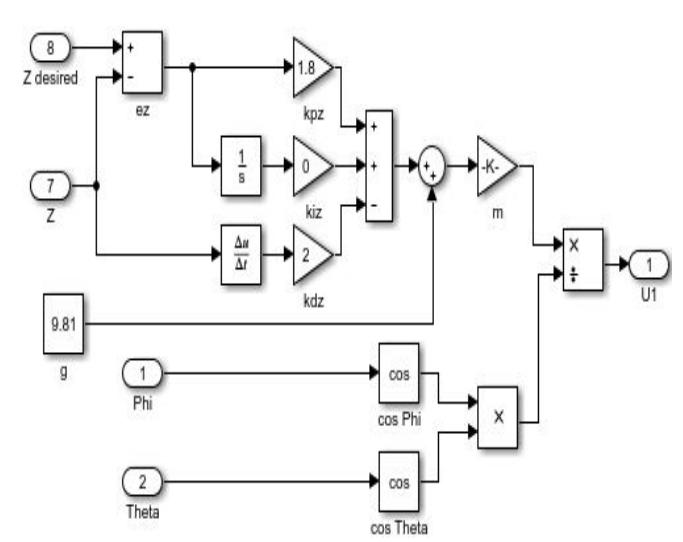

Fig. 2. Block diagram of altitude controller

Table II shows altitude controller parameters.

| TABLE II. | ALTITUDE CONTROLLER PARAMETERS |
|-----------|--------------------------------|
| Parameter | Value                          |
| Kp        | 1.8                            |
| Ki        | 0                              |
| Kd        | 2                              |

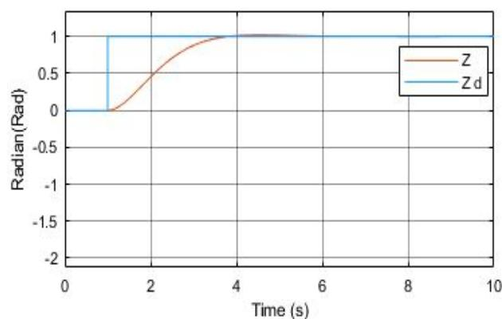

݁ = φௗ – φ (21)

U2 = ݁Kp + Ki ݁ dt − Kd ௗ ௗ௧ φ) (22)

Fig. 3 shows PID control block diagram for roll control. Pitch and yaw control block schemes are also similar except for reference angles.

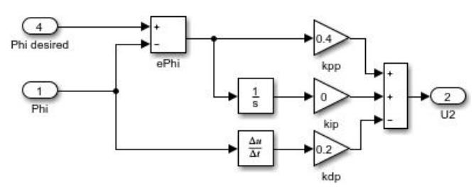

Fig. 3. Block diagram of roll controller

Table III shows PID coefficients for attitude control.

TABLE III. ATTITUDE CONTROLLER PARAMETERS

| Parameter | TTITUDE Roll | ONTROLLER Angle Pitch | ARAMETERS Yaw |
|-----------|--------------|-----------------------|---------------|
| Kp        | 0.4          | 0.6                   | 0.3           |
| Ki        | 0            | 0                     | 0             |
| Kd        | 0.2          | 0.2                   | 0.2           |

݁ is error in roll angle and it is calculated by taking difference between desired roll angle φௗ and current roll angle φ. Thereafter PID controller is applied to minimize error as indicated in Fig. 3. Kp value is set to reduce the rise time but it cause overshoot in the system. Due to this, Kd is set to decrease overshoot. Ki will only be used for reducing the steady state error when there exist some steady state error in the system. [11]

Control method for pitch angle is below

݁ = θௗ – θ (23)

U3 = ݁Kp + Ki ݁ dt − Kd ௗ ௗ௧ θ) (24)

Control method for yaw angle is below

݁ = ψௗ –ψ (25)

U4 = ݁நKp + Ki ݁ந dt − Kd ௗ ௗ௧ ψ) (26)

# IV. SIMULATION RESULTS

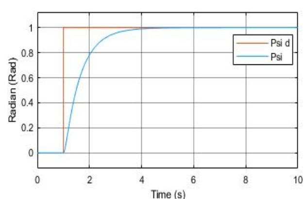

In the previous parts, the mathematical model of quadrotor and PID control method are described. This section contains the simulation results. Fig. 4 shows simulation results for altitude for PID controller.

Fig. 4. Simulation results for altitude

Fig. 5 through 7 shows simulation results for roll, pitch and yaw angles which are obtained for PID controller.

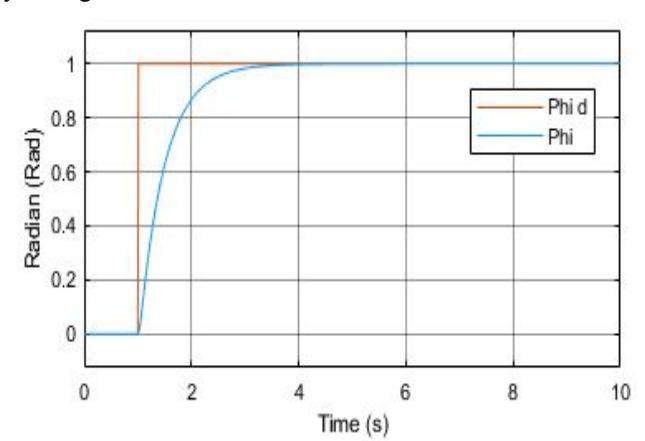

Fig. 5. Simulation results for roll angle

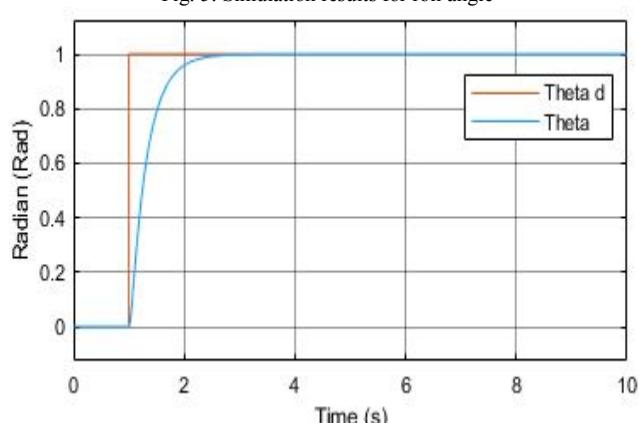

Fig. 6. Simulation results for pitch angle

 Fig. 8 through 11 shows simulation results of each four rotor's torque values.

Fig. 8. Rotor 1 Torque

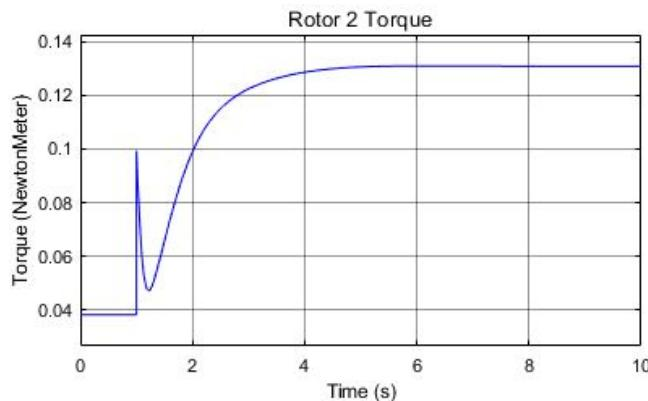

Fig. 9. Rotor 2 Torque

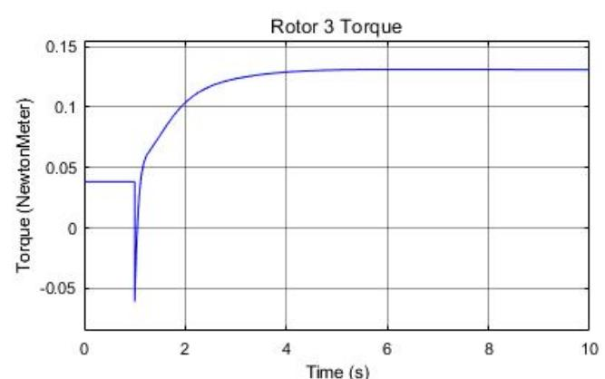

Fig. 10. Rotor 3 Torque

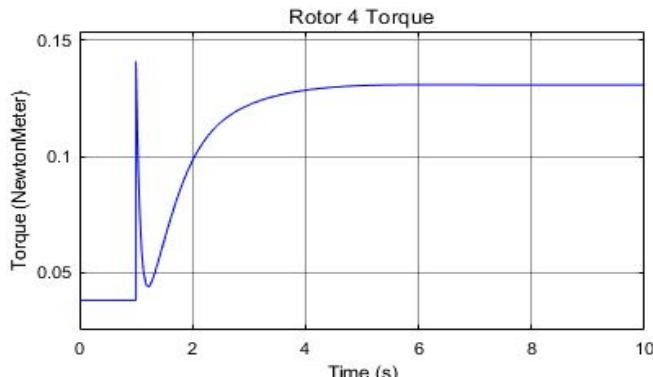

Fig. 11. Rotor 4 Torque

#### V. CONCLUSION

In this paper, the nonlinear dynamic model of the quadrotor is formulated. Based on the nonlinear equations, a quadrotor simulator was developed in Simulink. PID contoller is designed for OS4 micro quadrotor platform. Simulation results show that the PID controller provides satisfactory results in tracking the desired reference values. Table I. indicates that each rotor of quadrotor reach 0.15 Nm max. torque value. Torque simulation results prove that rotors' torque values are compatible with quadrotor's physical parameters.

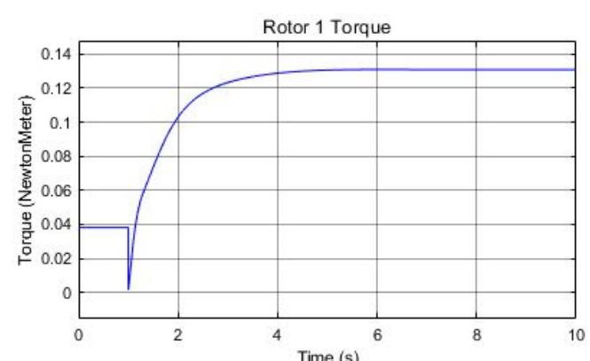

#### REFERENCES

[1] H. Eisenbeiss, "A mini unmanned aerial vehicle system overview and image acqusition," in Proc. International Workshop on Processing and Visualization Using High Resolution Imagery,Thailand, 18-20 November, 2004. [2] H. Shraim, A.Awada, R. Youness, "A survey on quadrotors: Configurations, modeling and identification, control, collision avoidance, fault diagnosis and tolerant control," IEEE Aerospace and Electronic Systems Magazine,Volume: 33 , Issue: 7 , July 2018 [3] C. Comert, C. Kasnakoğlu, "Comparing and Developing PID and Sliding Mode Controllers for Quadrotor," International Journal of Mechanical Engineering and Robotics Research vol. 6, No. 3, May 2017 [4] S. Bouabdallah, R. Siegwart, "Backstepping and Sliding-mode Techniques Applied to an Indoor Micro Quadrotor," Proceedings of the 2005 IEEE International Conference on Robotics and Automation, Barcelona, Spain, 18-22 April 2005 [5] I. C. Dikmen, A. Arisoy, H. Temeltas, "Attitude control of a quadrotor," 2009 4th International Conference on Recent Advances in Space Technologies, Istanbul, Turkey, 2009 [6] Ø. Magnussen and K. E. SkjØnhaug, "Modelling design and experimental study for quadcopter system construction," M.S. thesis, Dept. Eng, University of Adger, Norway, 2011. [7] S. Stevanovic, J. Kasac, and J. Stepanic, "Robust tracking control of a quadrotor helicopter without velocity measurement," in Proc. Annals of DAAAM for 2012 and Proceedings of the 23rd International DAAAM Symposium, 2012, pp. 595-600. [8] T. Bresciani, "Modelling, identification and control of a quadrotor helicopter." MSc Theses, 2008. [9] S. Vaidyanathan, C. H. Lien, "Applications of Sliding Mode Control in Science and Engineering (Studies in Computational Intelligence Book 709)," Springer; 1st ed., 2017, page 65 [10] R. Vepa, "Nonlinear Control of Robots and Unmanned Aerial Vehicles: An Integrated Approach," CRC Press 1st edition, 14 Aug. 2016, page 531 [11] M. Numan, "Controller Design for Attitude and Position Control of Quadrotor," MSc Thesis, 2017