# PID & LQR Control for a Quadrotor: Modeling and Simulation

Shahida Khatoon Department of Electrical Engineering Faculty of Engineering Jamia Millia Islamia, New Delhi, India Shahidakhatoon2008@gmail.com

Dhiraj Gupta Department of Electrical Engineering Jamia Millia Islamia, New Delhi , India gupta.dhiraj1@gmail.com

L .K. Das IDDC, IIT Delhi, India lkdas@gmail.com

*Abstract-***This paper aims to present a comparison between various controllers to be used in dynamic model of a quadrotor platform. The controllers assumed in this work are conventional PID and a classic LQR controller. The PID controller is chosen for quadrotor model because of its versatility and facile implementation, while also providing a good response for the model dynamics attitudes. The LQR controller seemed to be a good comparative controller due to its great performance and robustness in the plant. In this study, it is accomplished that both the controllers provide satisfactory feedback for quadrotor stabilization.** 

**Keywords-** *PID, LQR, Quad rotor, Rolling, Pitching, Yawing* 

## I. INTRODUCTION

Proportional-integral-derivative controller is a common control feedback mechanism broadly used in industrial control system. A PID controller estimates an "error" value as the difference between a measured process variable and a desired set point. The controller attempts to minimize the error by altering the process control inputs. The PID controller algorithm involves three different constant parameters: the proportional, the integral and derivative values, denoted P, I, and D*.* the values can be explained in terms of time: the present error is dependent on P, past error accumulates on I, the future error is forecasted by D, based on current rate of change. For a given time restraints, a PID controller can be selected chosen to provide attitude control for the quadrotor craft. The Euler angles are generally used as a feedback to the projected controller in order to achieve the desired orientation. Tuning a control loop is the amendment of its control parameters (proportional band/gain, integral gain/reset, derivative gain/rate) to the optimum values for the preferred control response. Stability is the basic requirement while designing any controller for the system. The PID tuning is a complex problem, even though there are only three parameters and in principle is simple to describe, because it must assure complex criteria within the limitation of PID control. The present quadrotor modes is a highly nonlinear and so parameters that work well at fullload conditions don't work initially when the process is starting up from no-load; this can be corrected by gain scheduling. PID controllers generally provide acceptable control using default tunings, but performance can usually be improved by adequate and careful tuning.

# II. LITERATURE SURVEY

Quadrotor controls for many applications have been studied for a long time and considerable progress has been made in the field. Although quad rotors are now able of autonomous flight and aggressive manoeuvring, a number of important issues remain open, with no single accepted solution. Research presented in [1, 2] presents a PID controller for attitude stabilization of a quadrotor UAV. Having mathematical dynamic model of vehicle is essential for designing a good controller. Nevertheless, UAV model always includes some uncertainties. As the model becomes simpler, the controller becomes more complicated and a model with more details leads to more confident controller. UAV modelling procedure includes determining the dynamic equations of the vehicle body and the structure of uncertain dynamics, specifying the relationship between control inputs and outputs of actuators, and finally dynamics of actuators and sensors must be considered. The universal and common scheme to design a control system is to analyze and compute the dynamic model of the system. The system model is a set of mathematical equation that includes all the forces that act or perform on the system at the given time. Different control technologies have been compared by various researchers [3, 13, 23]. In majority of cases quadrotor prove to be a dynamic vehicle with major challenges because of it's under actuated nature. Modelling and control of quadrotor helicopters is currently a common area of research and application, with different levels of model complexity and control design described all through recent literature. The modelling of the vehicle dynamics is classically kept relatively uncomplicated. Control methodologies range from linear proportional-integral-derivative (PID) [4, 24] to linear quadratic (LQ) optimal [5] to a range of

adaptive and semi-adaptive schemes [6, 10] to feedback linearization, back stepping, and dynamic inversion, among a variety of others. The aims and the level of control developed vary, with some sources looking for only to control the orientation of the vehicle, and others seeking to control orientation and position..

#### III. LINEAR QUADRATIC REGULATOR

The LQR control algorithm is an optimal control that is apprehensive with operating a dynamic system at minimum cost. The cost of the system that represented by a linear differential equations is defined by a quadratic functional. The LQR controller is applied to minimize the small errors. The positive definite matrix Q weighs the size of state responses. Frequently we chose it diagonal. If the entries of Q are large numbers, then small deviation of the state from zero will source the cost to increase considerably, thus the control will have the high gain. The symmetric matrix R, which should be positive matrix, weighs the control. It may be also selected diagonal. If the entries of this matrix are large , then the control action will be small, opposite to what happens with Q .If we want to augment the size of the control action , we can reduce the entries of the control weighting matrix. Once the system is modelled mathematically, a control strategy is implemented to achieve stability. The performance of the designed control structure is analyzed through time domain factors such as overshoot, settling time and integral error index, and robustness. In this study, the attitude stabilization is intended. For this purpose the selected controller is LQR. In order to use LQR the nonlinear system at hand must be linearized about a certain operating point. For this reason, the Jacobians of the nonlinear state equations are derived with respect to the states and the inputs. After putting the state values of operating point, we get the matrices A, B, C and D. By inspection of controllability matrix, the system is examined controllable and all the 12 states are found controllable. This means that the settings of a controller leading either a machine or process are set up with mathematical algorithm which minimizes the cost function given by a human. The total deviations by required values of key measurements are defined as cost. In effect this algorithm finds those controller settings that minimize the undesired deviations, like deviations from required altitude or process temperature. Over and over again the magnitude of the control action itself is included in this sum so as to remain the energy expended by the control action itself restricted.

## IV. GENERATING STATE SPACE MODEL

The quadrotor system is six degrees of freedom system described with twelve states. Six out of twelve states manage the attitude of the system. These comprise the angles (ij, ș, ȥ) and angular rates (p, q, r) around the three orthogonal body axes. With reference to earth frame the six states are the three positions and three linear velocities. The two coordinate frames are, one is fixed at the ground and the other is fixed at the centre of gravity of the quad rotor. The rotation matrix is derived in order to derive the state equations with respect to those frames. The different variables are defined as p Pitch Angular Rate, q Roll Angular Rate, r Yaw Angular Rate, ij Pitch Angle, ș Roll Angle, ȥ Yaw Angle, x Position Along x axis, y Position Along y axis, z Position Along z axis, u Linear Speed Along Body x axis, v Linear Speed Along Body y axis, w Linear Speed Along Body z axis, Ixx The Inertia Around the x axis, Iyy The Inertia Around the y axis, Izz The Inertia Around the z axis, g Gravitational Acceleration, m Mass of Quad rotor, ȍ Angular Speed.

Decoupling the

inputs Rotor dynamics Vehicle model

z(4) x(4) y(4) *y ..*

u1 u2 u3 u4 v1 v2 v3 v4 *q y y*  x, x, x, x y, y, y, y z, z, z, z

The aim of this step is once again to modify the input variables in order to make the control aspects easier.

(1) ܷܤ ܺܣ ൌ ሶܺ

(2) ܷܦ ܺܥ ൌܻ

Where X is the state vector and U is the input vector.

gravity N thurst sin 0 1 cos sin 0 cos cos *bb b b b uP u d v mg q v dt m ww r w* θ θθ θθ §· ªº ª º ªº ªº ªº ¨¸ − «» « » «» «» «» = + −× ¬¼ ¬ ¼ ¬¼ ¬¼ ¬¼ ©¹ (3)

This is the first differential equation describing the translational velocity in body frame relating it to rotational velocity in body frame.

1 2222 1 241 3 thurst moment you moment ( )( ) 0 *T j pp p d q I rF K I q Iq dt rw r r* −− §· ¨¸ ª º ª º §ª º ª º· «» «» «» «» ¨¸ = × + Ω +Ω −Ω −Ω − × ¨¸ ¬ ¼ ¬ ¼ ©¬ ¼ ¬ ¼¹ ©¹ ¦ (4)

Second differential equation relating the rotational velocity of body frame to the thrust moment and yaw moment.

1 tan sin tan cos 0 cos sin sin cos 0 cos sin *b p d q dt r* φ θθ θ φ θ φφ ψ φφ θθ ªº ªº ªº «» «» «» = −− ¬¼ ¬¼ ¬¼ (5)

Third differential equation relating the angles of body frame to the rotational velocity.

*T p cc cs s u d p cs ssc cc sss sc v dt p ss csc sc css cc w* θψ θψ θ θψ φθψ θψ φθψ θψ θψ φθψ θψ φθψ θψ ª º ª º ªº − « » « » «» =− + + − ¬ ¼ ¬ ¼ ¬¼ + −+ (6)

Fourth differential equation relating the position of body frame with respect to inertial frame to the translational velocity. The parameter values for the quadrotor are given as:

Table I Quadrotor Specifications

| S.N. | Attributes                   | Specification   |
|------|------------------------------|-----------------|
| 1    | Ultra light weight carbon    |                 |
| 2    | Flight Time                  | >10-20 min      |
| 3    | Payload capacity             | 450-500g        |
| 4    | Weighs                       | 1.25 kg         |
| 5    | Battery life (hovering)      | 23 minute       |
| 6    | Battery life (with max load) | 12 minute       |
| 7    | Motor Spacing                | 330mm (Shaft to |
| 8    | Motors:(4) brushless motor   | kV1100          |
| 9    | ESC: (4)                     | 10A ESC         |

From the above mathematical equations and putting the variables & parameters values, we get the following state space model of the quad rotor:-

0001 000 0 0000 00001 00 0 0000 000001 0 0 0000 0000000 0000 000000 0 0000 0000000 0 0000 0000000 0 01 00 0000000 0 001 0 0000000 0 0001 0000000 0 0000 0000000 0 0000 0000000 0 0000 *u m u m A* ªº «» − = ¬¼

00 0 0 00 0 0 00 0 0 00 0 0 00 0 0 1 00 0 00 0 0 00 0 0 00 0 0 cos( ) sin( ) 00 sin( ) cos( ) 00 (cos( )\* ) (cos( )\* ) sin( )\* tan( ) cos( )\* tan( ) 1 0 *m B Ix Iy Ix Iy IxIy Iz* φψ ψψ φφ ψφ ψφ ªº «» − = − ¬¼

C= [1]; D= [0]

The gain matrix is calculated using conventional root locus method.

V. RESULTS

Responses of Closed loop system with PID & LQR

Fig. 1 Dynamic Response of Closed Loop System Designed with PID Controller from Input Pitching Moment (u3)

Fig.2 Dynamic Response of Closed Loop System Designed with LQR Controller from Input Pitching Moment (u3) Time

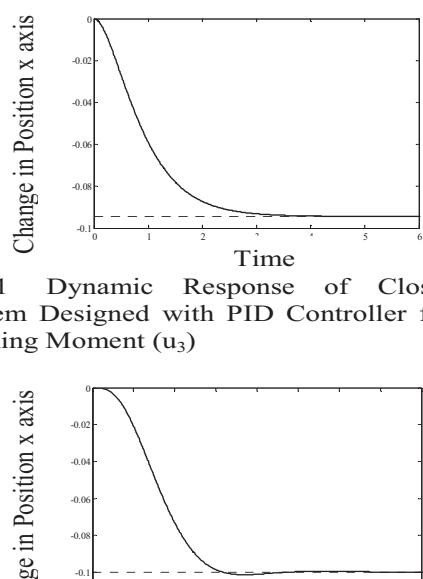

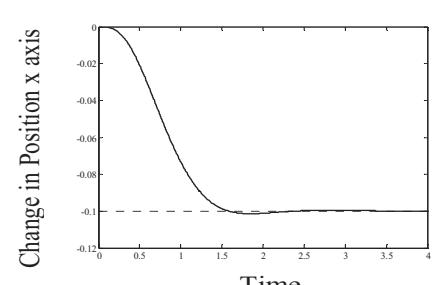

Fig. 3 Dynamic Response of Closed Loop System Designed with PID Controller from Input Rolling Moment (u2)

Fig. 4 Dynamic Response of Closed Loop System Designed with LQR Controller from Input Rolling Moment (u2)

Fig. 5 Dynamic Response of Closed Loop System Designed with PID Controller from Input Vertical Thrust (u1)

Fig. 6 Dynamic Response of Closed Loop System Designed with LQR Controller from Input Vertical Thrust (u1) Time

Fig. 7 Dynamic Response of Closed Loop System Designed with PID Controller from Input Pitching Moment (u3)

Fig. 8 Dynamic Response of Closed Loop System Designed with LQR Controller from Input Pitching Moment (u3)

Fig. 9 Dynamic Response of Closed Loop System Designed with PID Controller from Input Rolling Moment (u2)

Fig. 10 Dynamic Response of Closed Loop System Designed with LQR Controller from Input Rolling Moment (u2)

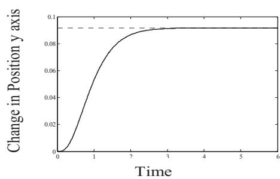

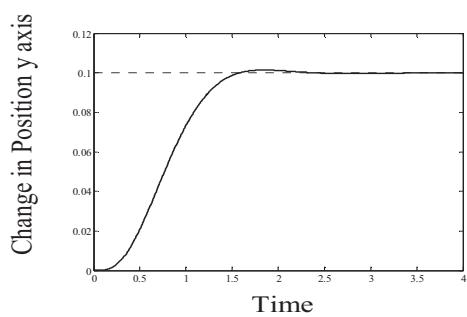

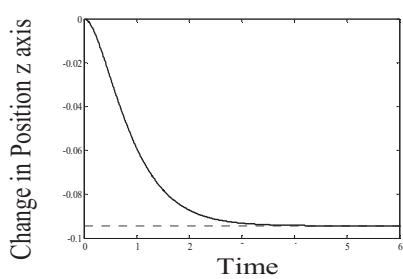

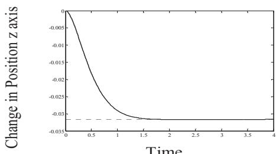

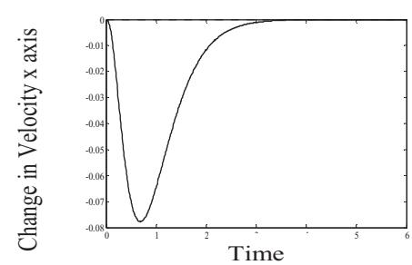

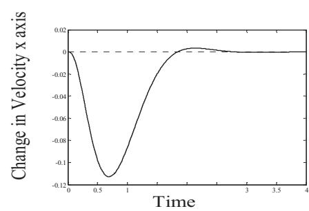

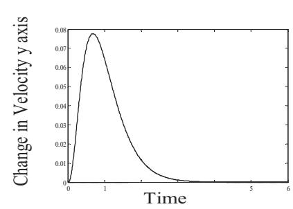

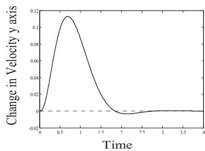

Fig. 11 Dynamic Response of Closed Loop System Designed with PID Controller from Input Vertical Thrust (u1)

Fig. 12 Dynamic Response of Closed Loop System Designed with LQR Controller from Input Vertical Thrust (u1)

Fig. 13 Dynamic Response of Closed Loop System Designed with PID Controller from Input Rolling Moment (u2)

Fig. 14 Dynamic Response of Closed Loop System Designed with LQR Controller from Input Rolling Moment (u2)

Fig. 15 Dynamic Response of Closed Loop System Designed with PID Controller from Input Pitching Moment (u3)

Fig. 16 Dynamic Response of Closed Loop System Designed with LQR Controller from Input Pitching Moment (u3)

Fig.17 Dynamic Response of Closed Loop System Designed with PID Controller from Input Yawing Moment (u4)

Fig. 18 Dynamic Response of Closed Loop System Designed with LQR Controller from Input Yawing (u3)

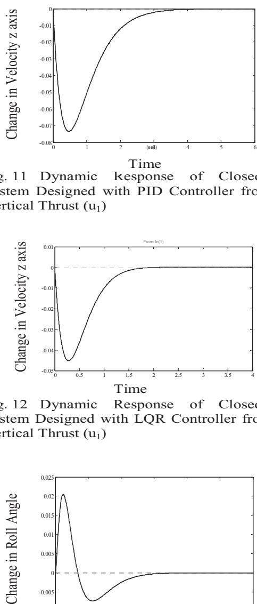

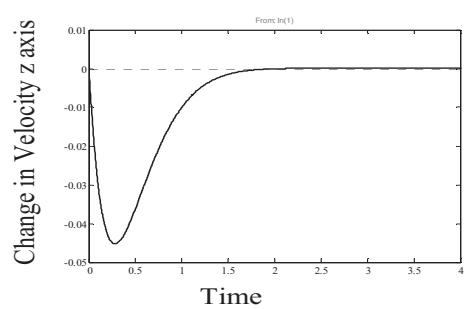

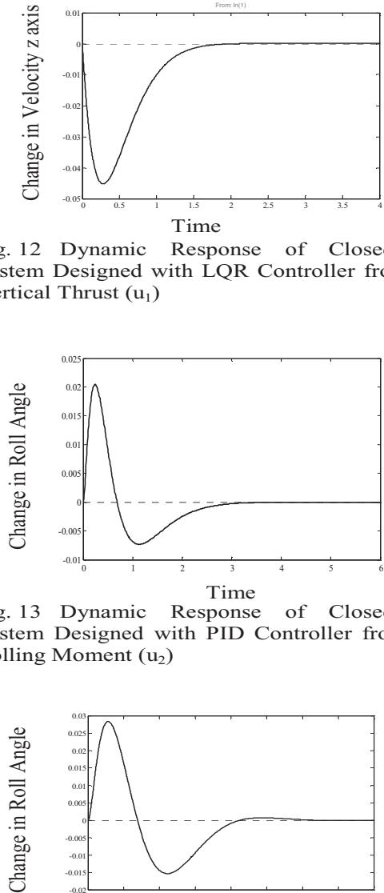

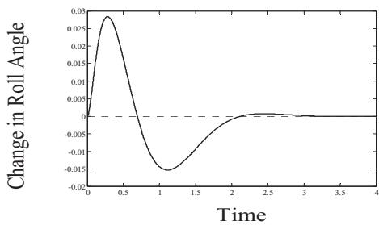

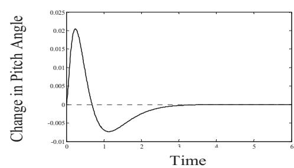

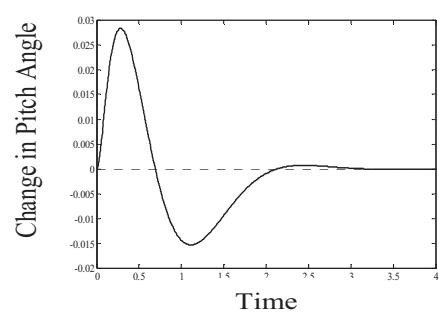

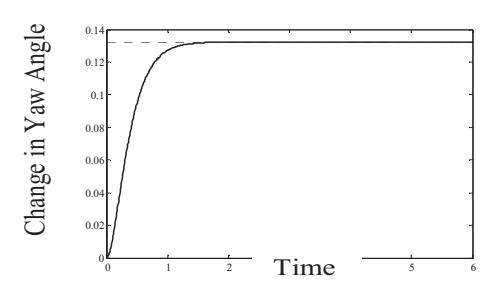

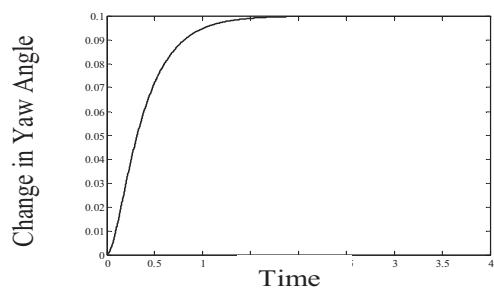

Fig. 19 Dynamic Response of Closed Loop System Designed with PID Controller from Input Rolling Moment (u2)

Fig. 20 Dynamic Response of Closed Loop System Designed with LQR Controller from Input Rolling Moment (u2)

Fig. 21 Dynamic Response of Closed Loop System Designed with PID Controller from Input Pitching Moment (u3)

Fig. 22 Dynamic Response of Closed Loop System Designed with LQR Controller from Input Pitching Moment (u3)

Fig. 23 Dynamic Response of Closed Loop System Designed with PID Controller from Input Yawing Moment (u4)

Fig. 24 Dynamic Response of Closed Loop System Designed with LQR Controller from Input Yawing Moment (u4)

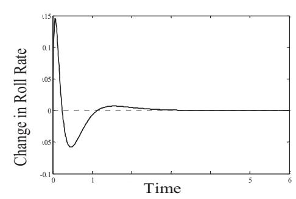

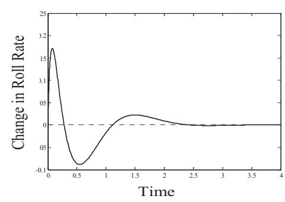

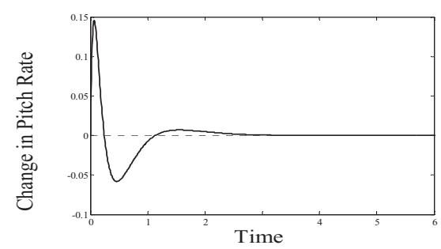

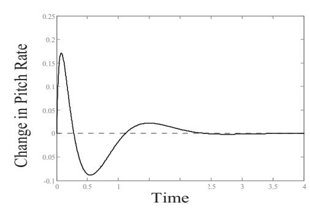

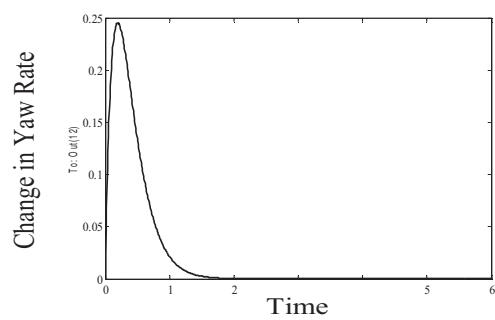

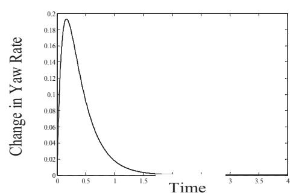

Table II Comparison of PID & LQR controller

Table II Comparing the Eigen Values

### VI. RESULTS AND CONCLUSION

Various controllers designed can be compared on the basis of robustness and speed of response. Faster controllers do not necessarily mean consistent responses under disturbances. The longitudinal moments i.e. position and velocity present a natural instability. Looking back at the step responses it is clear that each controller has the different responses for the same attitude; however it is possible to choose most suitable technique based on the characteristics needed for quadrotor control. From the table II, the Eigen values, it is concluded that PID controllers give better stability by bringing the closed loop poles to more negative side of s-plane as compared to LQR controller. The system is stabilized by using either PID or LQR controller. From table I ,it is observed that LQR controller are robust and produced very low steady state error with higher speed of response. On the other hand PID controller gives delayed response that makes it a bad choice when the system needs fast parameter update and has no direct access to all the states of the system.

## REFERENCES

[1] J. Li and Y. Li., "Dynamic Analysis and PID Control for a Quad rotor," *Proc. of IEEE International Conference on Mechatronics and Automation*, Beijing, China, pp. 573– 578, August, 2011. [2] Zul Azfar and D. Hazry., "Simple Approach on Implementing IMU Sensor Fusion in PID Controller for Stabilizing QuadrotorFlight Control," *IEEE 7th International Colloquium on Signal Processing and its Applications*, Penang, Malaysia, March, 2011. [3] Benallegue A., Mokhtari A. and Fridman L., "Feedback Linearization and High order Sliding Mode Observer for a Quadrotor UAV," *Proceedings of IEEE international Work- Shop on variable structure system*, pp. 365 – 372, Alghero, June, 2006. [4] T. Buchholz, D. Gretarsson, and E. Hendricks, "Construction of a Four rotor Helicopter Control System," *Technical University of Denmark*, 2009. [5] Mellinger, Q. Lindsey, M. Shomin, and V. Kumar, "Design, Modelling, Estimation and Control for Aerial Grasping and Manipulation," in *IEEE International Conference on Intelligent Robots and Systems (IROS),* pp. 2668–2673, 2011. [6] Salih A.L., Moghavvemi and Mohammed A.F., "Flight PID Controller Design for a UAV Quad rotor," *Scientific Research and Essays*, pp.3660-3667, 2010. [7] Zhang Z., Cong M., "Controlling Quad rotors Based on Linear Quadratic Regulator," *Applied Science and Technology*, pp. 38-42, 2011. [8] Cai G., Chen B.M., Peng K., Dong M. and Lee T.H., "Modelling and Control System Design for a UAV helicopter*," Proceedings of the fourteenth Mediterranean Conference on Control and Automation*, Ancona, Italy, pp. 600-606, 2006. [9] D. H. Shim, H. J. Kim, S. Sastry, "Decentralized Nonlinear Model Predictive Control of Multiple Flying Robots*,*" *Proceedings of the 42nd IEEE Conference on Decision and Control Maui*, Hawaii, USA, 2003. [10] Yoonsoo Kim, Da-Wei Gu, and Ian Postlethwaite, "Real-Time Optimal Mission Scheduling and Flight Path Selection*,*" *IEEE Transactions on Automatic Control*, Vol. 52, No.6, pp.1119-1122, June, 2007. [11] Alexander Lanyon, Alessandro Freddi, and Sauro Longhi. "Flight Control of a QuadrotorVehicle Subsequent to a Rotor Failure", *Journal of Guidance, Control, and Dynamics*, Vol. 37, No. 2 (2014), pp. 580- 591.2014.

| S. | Controlling                                                                                                                                                                                                                                                                                                                                                                               |
|----|-------------------------------------------------------------------------------------------------------------------------------------------------------------------------------------------------------------------------------------------------------------------------------------------------------------------------------------------------------------------------------------------|
|    | Inputs PID LQR position in z Settling time position in z Settling time axis,-.09 3.5 sec axis,-.03 2.5 sec                                                                                                                                                                                                                                                                                |
| 1. | u1(Vertical thrust) velocity in z Settling time velocity in z Settling time axis,-.075 4 sec axis,-.045 2.5 sec position in y Settling time position in y Settling time axis,-.9 3.5 sec axis,-.1 3 sec velocity in y Settling time velocity in y Settling time axis,.075 3.5 sec axis,.15 3.5 sec                                                                                        |
| 2. | u2(Rolling Roll Settling time Roll angle(Rad.) Settling time moment) angle(Rad.) 3.5 sec .028 to -.015 3.5 sec .02 to -.007 Roll Settling time Roll rate(Rad.) Settling time rate(Rad.) 3 sec .17 to -.1 3 sec .14 to -.06 position in x Settling time position in x Settling time axis,-.09 3.5 sec axis,-.1 3.5 sec                                                                     |
| 3. | u3(Pitching                                                                                                                                                                                                                                                                                                                                                                               |
|    | velocity in x velocity in x Settling time Settling time axis,-.075 3.5 sec axis,-.11 3.5 sec Pitch Settling time Pitch angle(Rad.) Settling time moment) angle(Rad.) 3.5 sec .027 to -.014 3 sec .02 to -.008 Pitch Settling time Pitch rate(Rad.) Settling time rate(Rad.) 3 sec .16 to -.09 3 sec .14 to -.05 Yaw Settling time Yaw angle(Rad.) Settling time angle(Rad.) 2 sec 2.3 sec |
| 4. | u4(Yawing moment) Yaw Settling time Yaw rate(Rad.) Settling time rate(Rad.) 2 sec 2.2 sec                                                                                                                                                                                                                                                                                                 |