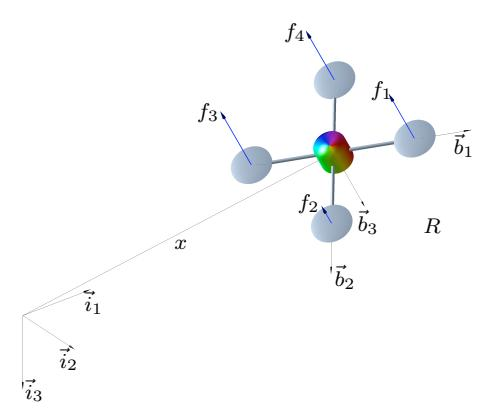
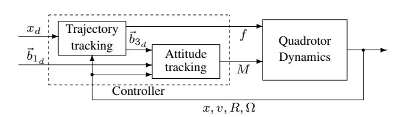
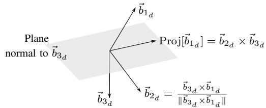
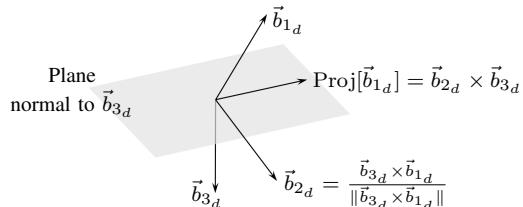
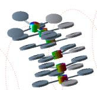
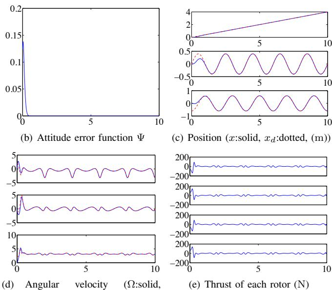
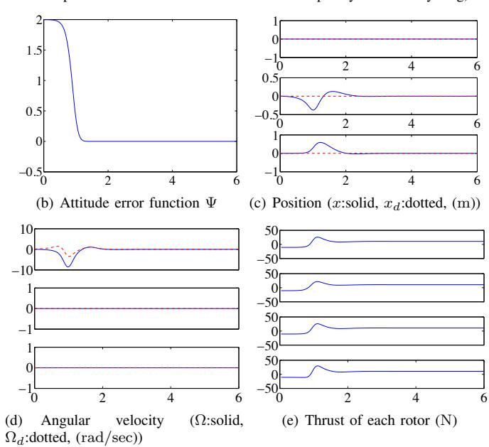

# Geometric Tracking Control of a Quadrotor UAV on SE(3)

Taeyoung Lee∗ , Melvin Leok† , and N. Harris McClamroch

*Abstract*— This paper provides new results for the tracking control of a quadrotor unmanned aerial vehicle (UAV). The UAV has four input degrees of freedom, namely the magnitudes of the four rotor thrusts, that are used to control the six translational and rotational degrees of freedom, and to achieve asymptotic tracking of four outputs, namely, three position variables for the vehicle center of mass and the direction of one vehicle body-fixed axis. A globally defined model of the quadrotor UAV rigid body dynamics is introduced as a basis for the analysis. A nonlinear tracking controller is developed on the special Euclidean group SE(3) and it is shown to have desirable closed loop properties that are almost global. Several numerical examples, including an example in which the quadrotor recovers from being initially upside down, illustrate the versatility of the controller.

# I. INTRODUCTION

A quadrotor unmanned aerial vehicle (UAV) consists of two pairs of counter-rotating rotors and propellers, located at the vertices of a square frame. It is capable of vertical take-off and landing (VTOL), but it does not require complex mechanical linkages, such as swash plates or teeter hinges, that commonly appear in typical helicopters. Due to its simple mechanical structure, it has been envisaged for various applications such as surveillance or mobile sensor networks as well as for educational purposes. There are several university-level projects [1], [2], [3], [4], and commercial products [5], [6], [7] related to the development and application of quadrotor UAVs.

Despite the substantial interest in quadrotor UAVs, little attention has been paid to constructing nonlinear control systems for them, particularly to designing nonlinear tracking controllers. Linear control systems such as proportionalderivative controllers or linear quadratic regulators are widely used to enhance the stability properties of an equilibrium [1], [3], [4], [8], [9]. A nonlinear controller is developed for the linearized dynamics of a quadrotor UAV with saturated positions in [10]. Backstepping and sliding mode techniques are applied in [11]. Since these controllers are based on Euler angles, they exhibit singularities when representing complex rotational maneuvers of a quadrotor UAV, thereby fundamentally restricting their ability to track nontrivial trajectories.

Taeyoung Lee, Mechanical and Aerospace Engineering, Florida Institute of Technology, Melbourne, FL 39201 taeyoung@fit.edu

Melvin Leok, Mathematics, University of California at San Diego, La Jolla, CA 92093 mleok@math.ucsd.edu

N. Harris McClamroch, Aerospace Engineering, University of Michigan, Ann Arbor, MI 48109 nhm@umich.edu

∗This research has been supported in part by NSF under grants CMMI-1029551.

†This research has been supported in part by NSF under grants DMS-0726263, DMS-1001521, DMS-1010687, and CMMI-1029445.

Geometric control is concerned with the development of control systems for dynamic systems evolving on nonlinear manifolds that cannot be globally identified with Euclidean spaces [12], [13], [14]. By characterizing geometric properties of nonlinear manifolds intrinsically, geometric control techniques provide unique insights to control theory that cannot be obtained from dynamic models represented using local coordinates [15]. This approach has been applied to fully actuated rigid body dynamics on Lie groups to achieve almost global asymptotic stability [14], [16], [17], [18].

In this paper, we develop a geometric controller for a quadrotor UAV. The dynamics of a quadrotor UAV is expressed globally on the configuration manifold of the special Euclidean group SE(3). We construct a tracking controller to follow prescribed trajectories for the center of mass and heading direction. It is shown that this controller exhibits almost global exponential attractiveness to the zero equilibrium of tracking errors. Since this is a coordinatefree control approach, it completely avoids singularities and complexities that arise when using local coordinates.

Compared to other geometric control approaches for rigid body dynamics, this is distinct in the sense that it controls an underactuated quadrotor UAV to stabilize six translational and rotational degrees of freedom using four thrust inputs, while asymptotically tracking four outputs consisting of its position and heading direction. We demonstrate that this controller is particularly useful for complex, acrobatic maneuvers of a quadrotor UAV, such as recovering from being initially upside down.

# II. QUADROTOR DYNAMICS MODEL

Consider a quadrotor vehicle model illustrated in Fig. 1. This is a system of four identical rotors and propellers located at the vertices of a square, which generate a thrust and torque normal to the plane of this square.

We choose an inertial reference frame {~i1,~i2,~i3} and a body-fixed frame { ~b1, ~b2, ~b3}. The origin of the body-fixed frame is located at the center of mass of this vehicle. The first and the second axes of the body fixed frame, ~b1, ~b2, lie in the plane defined by the centers of the four rotors, as illustrated in Fig. 1. The third body fixed axis ~b3 is normal to this plane, and points downward, opposite to the direction of the total thrust. Define

m ∈ R the total mass J ∈ R 3×3 the inertia matrix with respect to the bodyfixed frame R ∈ SO(3) the rotation matrix from the body-fixed frame to the inertial frame Ω ∈ R 3 the angular velocity in the body-fixed frame

Fig. 1. Quadrotor model

x ∈ R 3 the location of the center of mass in the inertial frame v ∈ R 3 the velocity of the center of mass in the inertial frame d ∈ R the distance from the center of mass to the center of each rotor in the ~b1, ~b2 plane fi ∈ R the thrust generated by the i-th propeller along the −~b3 axis τi ∈ R the torque generated by the i-th propeller about the ~b3 axis f ∈ R the total thrust, i.e., f = P4 i=1 fi M ∈ R 3 the total moment in the body-fixed frame

The configuration of this quadrotor UAV is defined by the location of the center of mass and the attitude with respect to the inertial frame. Therefore, the configuration manifold is the special Euclidean group SE(3), which is the semidirect product of R 3 and the special orthogonal group SO(3) = {R ∈ R 3×3 | RT R = I, det R = 1}.

We assume that the thrust of each propeller is directly controlled, i.e., we do not consider the dynamics of rotors and propellers, and the direction of the thrust is normal to the quadrotor plane. The total thrust is f = P4 i=1 fi , which acts along the direction of −~b3. According to the definition of the rotation matrix R ∈ SO(3), the direction of the i-th body fixed axis ~bi is given by Rei in the inertial frame, where e1 = [1; 0; 0], e2 = [0; 1; 0], e3 = [0; 0; 1] ∈ R 3 . Therefore, the total trust is given by −fRe3 ∈ R 3 in the inertial frame.

We also assume that the torque generated by each propeller is directly proportional to its thrust. Since it is assumed that the first and the third propellers rotate clockwise, and the second and the fourth propellers rotate counterclockwise, when they are generating a positive thrust fi along −~b3, the torque generated by the i-th propeller can be written as τi = (−1)i cτ f fi for a fixed constant cτ f . All of these assumptions are common [19], [4], and the presented control system can readily be extended to include linear rotor dynamics studied in [11]. Under these assumptions, the total thrust f and the total moment M can be written as

 f M1 M2 M3 = 1 1 1 1 0 −d 0 d d 0 −d 0 −cτ f cτ f −cτ f cτ f f1 f2 f3 f4 . (1)

The determinant of the above 4 × 4 matrix is 8cτ f d 2 , so it is invertible when d 6= 0 and cτ f 6= 0. Therefore, for a given f, M, the thrust of each rotor fi can be obtained from (1). Using this equation, the total thrust f ∈ R and the moment M ∈ R 3 are considered as control inputs in this paper.

The equations of motion of this quadrotor UAV can be written as

x˙ = v, (2)

mv˙ = mge3 − fRe3, (3)

R˙ = RΩˆ, (4)

JΩ + Ω ˙ × JΩ = M, (5)

where the *hat map* ˆ· : R 3 → so(3) is defined by the condition that xyˆ = x × y for all x, y ∈ R 3 .

# III. GEOMETRIC TRACKING CONTROL ON SE(3)

We develop a controller to follow a prescribed trajectory of the location of the center of mass, xd(t), and the desired direction of the first body-fixed axis, ~b1d (t).

The overall controller structure is as follows. The translational dynamics of a quadrotor UAV is controlled by the total thrust −fRe3, where the magnitude of the total thrust f is directly controlled, and the direction of the total thrust −Re3 is along the third body-fixed axis −~b3. For a given translational command xd(t), we select the total thrust f, and the desired direction of the third body-fixed axis ~b3d to stabilize the translational dynamics.

Once the desired direction of the third body-fixed frame ~b3d is chosen, there is one remaining degree of freedom in selecting the desired attitude, Rd ∈ SO(3). This corresponds to the heading direction of the quadrotor UAV in the plane normal to ~b3d , and it is determined by the desired direction of the first body-fixed axis, ~b1d (t). More explicitly, we assume that ~b1d is not parallel to ~b3d , and we project it onto the plane normal to ~b3d to obtain the complete desired attitude: Rd = [~b2d × ~b3d , ~b2d , ~b3d ] ∈ SO(3), where ~b2d = ( ~b3d ×~b1d )/k ~b3d ×~b1d k. The control moment M is selected to follow this desired attitude.

In short, four-dimensional control inputs are designed to follow a three-dimensional translational command, and a one-dimensional heading direction, i.e., we guarantee that x(t) → xd(t) and Proj[~b1(t)] → Proj[~b1d (t)] as t → ∞, where Proj[·] denotes the normalized projection onto the plane orthogonal to ~b3d . The overall controller structure and the definition of the heading direction are illustrated in Fig. 2 and 3.

Fig. 3. Definition of the desired heading direction

We develop this controller directly on the nonlinear configuration Lie group and thereby avoid any singularities and complexities that arise in local coordinates. As a result, we are able to achieve almost global exponential attractiveness to the zero equilibrium of tracking errors. Due to page limit constraint, all of the proofs are relegated to [20].

### *A. Tracking Errors*

We define the tracking errors for x, v, R, Ω as follows. The tracking errors for the position and the velocity are given by:t

ex = x − xd, (6)

ev = v − vd. (7)

The attitude and angular velocity tracking error should be carefully chosen as they evolve on the tangent bundle of the nonlinear space SO(3). The error function on SO(3) is chosen to be

Ψ(R, Rd) = 1 2 tr-I − R T d R . (8)

This is locally positive-definite about R = Rd within the region where the rotation angle between R and Rd is less than 180◦ [14]. This set can be represented by the sublevel set of Ψ where Ψ < 2, namely L2 = {Rd, R ∈ SO(3)| Ψ(R, Rd) < 2}, which almost covers SO(3). When the variation of the rotation matrix is expressed as δR = Rηˆ for η ∈ R 3 , the derivative of the error function is given by

DRΨ(R, Rd) · Rηˆ = − 1 2 tr-R T d Rηˆ = 1 2 (R T d R − R T Rd) ∨ · η, (9)

where the *vee map* ∨ : so(3) → R 3 is the inverse of the hat map. We used the fact that − 2 tr[ˆxyˆ] = x T y for any x, y ∈ R 3 . From this, the attitude tracking error eR is chosen to be

eR = 1 2 (R T d R − R T Rd) ∨ . (10)

The tangent vectors R˙ ∈ TRSO(3) and R˙ d ∈ TRd SO(3) cannot be directly compared since they lie in different tangent spaces. We transform R˙ d into a vector in TRSO(3), and we compare it with R˙ as follows:

R˙ − R˙ d(R T d R) = RΩˆ − RdΩˆ dR T d R = R(Ω − R T RdΩd) ∧ .

We choose the tracking error for the angular velocity as follows:

eΩ = Ω − R T RdΩd. (11)

We can show that eΩ is the angular velocity of the rotation matrix RT d R, represented in the body-fixed frame, since d dt (RT d R) = (RT d R) ˆeΩ.

#### *B. Tracking Controller*

For given smooth tracking commands xd(t), ~b1d (t), and some positive constants kx, kv, kR, kΩ, we define

~b3d = − −kxex − kvev − mge3 + mx¨d k−kxex − kvev − mge3 + mx¨dk , (12)

where we assume that

k−kxex − kvev − mge3 + mx¨dk 6= 0. (13)

We also assume that ~b1d is not parallel to ~b3d . The desired attitude is given by Rd = [~b2d×~b3d , ~b2d , ~b3d ] ∈ SO(3), where ~b2d = (~b3d×~b1d )/k ~b3d×~b1d k. The desired trajectory satisfies

k − mge3 + mx¨dk < B (14)

for a given positive constant B. The control inputs f, M are chosen as follows:

f = −(−kxex − kvev − mge3 + mx¨d) · Re3, (15)

M = −kReR − kΩeΩ + Ω × JΩ

− J(ΩˆR T RdΩd − R T RdΩ˙ d). (16)

The control moment M given in (16) corresponds to a tracking controller on SO(3). For the attitude dynamics of a rigid body described by (4), (5), this controller exponentially stabilizes the zero equilibrium of the attitude tracking errors.

Similarly, the expression in the parentheses in (15) corresponds to a tracking controller for the translational dynamics on R 3 . The total thrust f and the desired direction ~b3d of the third body-fixed axis are chosen such that if there is no attitude tracking error, the thrust vector term −fRe3 in the translational dynamics of (3) becomes this tracking controller in R 3 . Therefore, the translational tracking error will converge to zero provided that the attitude tracking error is identically zero.

Certainly, the attitude tracking error may not be zero at any instant. As the attitude tracking error increases, the direction of the control input term fRe3 of the translational dynamics deviates from the desired direction Rde3. This may cause instability in the complete dynamics. In (15), we carefully design the magnitude of the total thrust f so that it is reduced when there is a large attitude tracking error. The expression of f includes the dot product of the desired third body-fixed axis ~b3d = Rde3 and the current third body-fixed axis ~b3 = Re3. Therefore, the magnitude of f is reduced when the angle between those two axes becomes larger. These effects are carefully analyzed in the stability proof for the complete dynamics in [20].

In short, this control system is designed so that the position tracking error converges to zero when there is no attitude tracking error, and it is properly adjusted for nonzero attitude tracking errors to achieve asymptotic stability of the complete dynamics.

## *C. Exponential Asymptotic Stability*

We first show exponential stability of the attitude dynamics in the sublevel set L2 = {Rd, R ∈ SO(3)| Ψ(R, Rd) < 2}, and based on this result, we show exponential stability of the complete dynamics in the smaller sublevel set L1 = {Rd, R ∈ SO(3)| Ψ(R, Rd) < 1}

*Proposition 1:* (Exponential Stability of Attitude Dynamics) Consider the control moment M defined in (16) for any positive constants kR, kΩ. Suppose that the initial condition satisfies

Ψ(R(0), Rd(0)) < 2, (17)

keΩ(0)k 2 < 2 λmax(J) kR(2 − Ψ(R(0), Rd(0))), (18)

where λmin(J) denotes the minimum eigenvalue of the inertia matrix J. Then, the zero equilibrium of the attitude tracking error eR, eΩ is exponentially stable. Furthermore, there exist constants α2, β2 > 0 such that

Ψ(R(t), Rd(t)) ≤ min 2, α2e −β2t . (19) *Proof:* See [20].

In this proposition, (17), (18) represent a region of attraction for the attitude dynamics. This requires that the initial attitude error should be less than 180◦ . Therefore, the region of attraction for the attitude almost covers SO(3), and the region of attraction for the angular velocity can be increased by choosing a larger controller gain kR in (18).

Since the direction of the total thrust is the third bodyfixed axis, the stability of the translational dynamics depends on the attitude tracking error. More precisely, the position tracking performance is affected by the difference between ~b3 = Re3 and ~b3d = Rde3. In the proceeding stability analysis, it turns out that for the stability of the complete translational and rotational dynamics, the attitude error function Ψ should be less than 1, which states that the initial attitude error should be less than 90◦ . For the stability of the complete system, we restrict the initial attitude error to obtain the following proposition.

*Proposition 2:* (Exponential Stability of the Complete Dynamics) Consider the control force f and moment M defined in (15), (16). Suppose that the initial condition satisfies

Ψ(R(0), Rd(0)) ≤ ψ1 < 1 (20)

for a fixed constant ψ1. Define W1, W12, W2 ∈ R 2×2 to be

W1 = c1kx m − c1kv 2m (1 + α) − c1kv 2m (1 + α) kv(1 − α) − c1 , (21)

W12 = kxevmax + c1 m B 0 B 0 , (22)

W2 = " c2kR λmax(J) − c2kΩ 2λmin(J) − c2kΩ 2λmin(J) kΩ − c2 # , (23)

where α = p ψ1(2 − ψ1), evmax = max{kev(0)k, B kv(1−α) }, c1, c2 ∈ R. For any positive constants kx, kv, we choose positive constants c1, c2, kR, kΩ such that

c1 &lt; min kv(1 − α), 4mkxkv(1 − α) k v (1 + α) 2 + 4mkx , p kxm , (24)

c2 &lt; min kΩ, 4kΩkRλmin(J) 2 k 2 Ω λmax(J) + 4kRλmin(J) 2 , p kRλmin(J), r 2 2 − ψ1 kRλmax(J) , (25) λmin(W2) > 4kW12k 2 λmin(W1) . (26)

Then, the zero equilibrium of the tracking errors of the complete system is exponentially stable. The region of attraction is characterized by (20) and

keΩ(0)k 2 < 2 λmax(J) kR(1 − Ψ(R(0), Rd(0))). (27) *Proof:* See [20].

#### *D. Almost Global Exponential Attractiveness*

Proposition 2 requires that the initial attitude error is less than 90◦ to achieve exponential stability of the complete dynamics. Suppose that this is not satisfied, i.e. 1 ≤ Ψ(R(0), Rd(0)) < 2. From Proposition 1, we are guaranteed that the attitude error function Ψ exponentially decreases, and therefore, it enters the region of attraction of Proposition 2 in a finite time. Therefore, by combining the results of Proposition 1 and 2, we can show almost global exponential attractiveness.

*Definition 1:* (Exponential Attractiveness [21]) An equilibrium point z = 0 of a dynamic systems is *exponentially attractive* if, for some δ > 0, there exists a constant α(δ) > 0 and β > 0 such that kz(0)k < δ ⇒ kz(t)k ≤ α(δ)e −βt for any t > 0.

This should be distinguished from the stronger notion of exponential stability, in which the constant α(δ) in the above bound is replaced by α(δ) kz(0)k.

*Proposition 3:* (Almost Global Exponential Attractiveness of the Complete Dynamics) Consider a control system designed according to Proposition 2. Suppose that the initial condition satisfies

1 ≤ Ψ(R(0), Rd(0)) < 2, (28)

keΩ(0)k 2 < 2 λmax(J) kR(2 − Ψ(R(0), Rd(0))). (29)

Then, the zero equilibrium of the tracking errors of the complete dynamics is exponentially attractive.

*Proof:* See [20].

Since the region of attraction given by (28) for the attitude almost covers SO(3), this is referred to as almost global exponential attractiveness in this paper. The region of attraction for the angular velocity can be expanded by choosing a large gain kR in (29).

# *E. Properties and Extensions*

One of the unique properties of the presented controller is that it is directly developed on SE(3) using rotation matrices. Therefore, it avoids the complexities and singularities associated with local coordinates of SO(3), such as Euler angles. It also avoids the ambiguities that arise when using quaternions to represent the attitude dynamics. As the threesphere S 3 double covers SO(3), any attitude feedback controller designed in terms of quaternions could yield different

control inputs depending on the choice of quaternion vectors. The corresponding stability analysis would need to carefully consider the fact that convergence to a single attitude implies convergence to either of the two disconnected, antipodal points on S 3 [22]. This requires a continuous selection of the sign of quaternions or a discontinuous control system, which are shown to be sensitive to small measurement noise [23]. Without these considerations, a quaternion-based controller can exhibit an unwinding phenomenon, where the controller unnecessarily rotates the attitude through large angles [15]. In this paper, the use of rotation matrices in the controller design and stability analysis completely eliminates these difficulties.

Another novelty of the presented controller is the choice of the total thrust in (15). This is designed to follow position tracking commands, but it is also carefully designed to guarantee the overall stability of the complete dynamics by feedback control of the direction of the third body-fixed axis. This consideration is natural as each column of a rotation matrix represents the direction of each body-fixed axis. Therefore, another advantage of using rotation matrices is that the controller has a well-defined physical interpretation.

In Propositions 1 and 3, exponential stability and exponential attractiveness are guaranteed for almost all initial attitude errors, respectively. The attitude error function defined in (8) has the following critical points: the identity matrix, and rotation matrices that can be written as exp(πvˆ) for any v ∈ S 2 . These non-identity critical points of the attitude error function lie outside of the region of attraction. As it is a two-dimensional subspace of the three-dimensional SO(3), we claim that the presented controller exhibits *almost global* properties in SO(3). It is impossible to construct a smooth controller on SO(3) that has global asymptotic stability. The two-dimensional family of non-identity critical points can be reduced to four points by modifying the error function to be 1 2 tr[G(I −RT d R)] for a matrix G 6= I ∈ R 3×3 . The presented controller can be modified accordingly.

#### IV. NUMERICAL EXAMPLE

The parameters of the quadrotor UAV are chosen according to a quadrotor UAV developed in [2].

J = [0.0820, 0.0845, 0.1377] kgm2 , m = 4.34 kg d = 0.315 m, cτ f = 8.004 × 10−4 m.

The controller parameters are chosen as follows:

kx = 16m, kv = 5.6m, kR = 8.81, kΩ = 2.54.

We consider the following two cases.

- (I) This maneuver follows an elliptical helix while rotating the heading direction at a fixed rate. Initial conditions are chosen as

x(0) = [0, 0, 0], v(0) = [0, 0, 0], R(0) = I, Ω(0) = [0, 0, 0].

xd(t) = [0.4t, 0.4 sin πt, 0.6 cos πt],

~b1d (t) = [cos πt, sin πt, 0].

- (II) This maneuver recovers from being initially upside down. Initial conditions are chosen as

x(0) = [0, 0, 0], v(0) = [0, 0, 0], R(0) = 1 0 0 0 −0.9995 −0.0314 0 0.0314 −0.9995 , Ω(0) = [0, 0, 0].

The desired trajectory is as follows.

xd(t) = [0, 0, 0], ~b1d (t) = [1, 0, 0].

Simulation results are presented in Figures 4 and 5. For Case (I), the initial value of the attitude error function Ψ(0) is less than 0.15. This satisfies the conditions for Proposition 2, and exponential asymptotic stability is guaranteed. As shown in Figure 4, the tracking errors exponentially converge to zero. This example illustrates that the proposed controlled quadrotor UAV can follow a complex trajectory that involve large angle rotations and nontrivial translations accurately.

In Case (II), the initial attitude error is 178◦ , which yields the initial attitude error function Ψ(0) = 1.995 > 1. This corresponds to Proposition 3, which implies almost global exponential attractiveness. In Figure 5(b), the attitude error function Ψ decreases, and it becomes less than 1 at t = 0.88 seconds. After that instant, the position tracking error and the angular velocity error converge to zero as shown in Figures 5(c) and 5(d). The region of attraction of the proposed control system almost covers SO(3), so that the corresponding controlled quadrotor UAV can recover from being initially upside down.

#### V. CONCLUSION

We presented a global dynamic model for a quadrotor UAV, and we developed a geometric tracking controller directly on the special Euclidean group that is intrinsic and coordinate-free, thereby avoiding the singularities of Euler angles and the ambiguities of quaternions in representing attitude. It exhibits exponential stability when the initial attitude error is less than 90◦ , and it yields almost global exponentially attractiveness when the initial attitude error is less than 180◦ . These are illustrated by numerical examples.

This controller can be extended as follows. In this paper, four input degrees of freedom are used to track a threedimensional position, and a one-dimensional heading direction. But, without changing the controller structure, they can be used to follow arbitrary three-dimensional attitude commands. The remaining one input degree of freedom can be used to maintain the altitude as much as possible. By constructing a hybrid controller based on these two tracking modes, we can generate complicated acrobatic maneuvers of a quadrotor UAV.

#### REFERENCES

[1] M. Valenti, B. Bethke, G. Fiore, and J. How, "Indoor multi-vehicle flight testbed for fault detection, indoor multi-vehicle flight testbed for fault detection, isolation, and recovery," in *Proceedings of the AIAA Guidance, Navigation and Control Conference*, 2006.

(a) Snapshots for 2 ≤ t ≤ 2.6 (an animation illustrating this maneuver is available at http://my.fit.edu/˜ taeyoung)

(d) Angular velocity (Ω:solid, Ωd:dotted, (rad/sec))

Fig. 4. Case I: following an elliptic helix (horizontal axes represent simulation time in seconds)

[2] P. Pounds, R. Mahony, and P. Corke, "Modeling and control of a large quadrotor robot," *Control Engineering Practice*, vol. 18, pp. 691–699, 2010. [3] G. Hoffmann, H. Huang, S. Waslander, and C. Tomlin, "Quadrotor helicopter flight dynamics and control: Theory and experiment," in *Proceedings of the AIAA Guidance, Navigation, and Control Conference*, 2007, AIAA 2007-6461. [4] P. Castillo, R. Lozano, and A. Dzul, "Stabilization of a mini rotorcraft with four rotors," *IEEE Control System Magazine*, pp. 45–55, 2005. [5] Mikrokopter. [Online]. Available: http://www.mikrokopter.de/ [6] Microdrone-bulgaria. [Online]. Available: http://www. microdrones-bulgaria.com/ [7] Dragonfly innovations. [Online]. Available: http://www.draganfly.com/ [8] S. Bouabdalla, P. Murrieri, and R. Siegward, "Towards autonomous indoor micro VTOL," *Autonomous Robots*, vol. 18, no. 2, pp. 171–183, 2005. [9] E. Nice, "Design of a four rotor hovering vehicle," Master's thesis, Cornell University, 2004. [10] N. Guenard, T. Hamel, and V. Moreau, "Dynamic modeling and intuitive control strategy for an X4-flyer," in *Proceedings of the IEEE International Conference on Control and Application*, 2005. [11] S. Bouabdalla and R. Siegward, "Backstepping and sliding-mode techniques applied to an indoor micro quadrotor," in *Proceedings of the IEEE International Conference on Robotics and Automation*, 2005, pp. 2259–2264. [12] V. Jurdjevic, *Geometric Control Theory*. Cambridge University, 1997. [13] A. Bloch, *Nonholonomic Mechanics and Control*, ser. Interdisciplinary Applied Mathematics. Springer-Verlag, 2003, vol. 24. [14] F. Bullo and A. Lewis, *Geometric control of mechanical systems*, ser. Texts in Applied Mathematics. New York: Springer-Verlag, 2005, vol. 49, modeling, analysis, and design for simple mechanical control systems. [15] S. Bhat and D. Bernstein, "A topological obstruction to continuous global stabilization of rotational motion and the unwinding phenomenon," *Systems and Control Letters*, vol. 39, no. 1, pp. 66–73, 2000. [16] D. Maithripala, J. Berg, and W. Dayawansa, "Almost global tracking of simple mechanical systems on a general class of Lie groups," *IEEE Transactions on Automatic Control*, vol. 51, no. 1, pp. 216–225, 2006. [17] D. Cabecinhas, R. Cunha, and C. Silvestre, "Output-feedback control for almost global stabilization of fully-acuated rigid bodies," in *Proceedings of IEEE Conference on Decision and Control*, 3583-3588, Ed., 2008. [18] N. Chaturvedi, N. H. McClamroch, and D. Bernstein, "Asymptotic smooth stabilization of the inverted 3-D pendulum," *IEEE Transactions on Automatic Control*, vol. 54, no. 6, pp. 1204–1215, 2009. [19] A. Tayebi and S. McGilvray, "Attitude stabilization of a VTOL quadrotor aircraft," *IEEE Transactions on Control System Technology*, vol. 14, no. 3, pp. 562–571, 2006. [20] T. Lee, M. Leok, and N. McClamroch, "Geometric tracking control of a quadrotor UAV on SE(3)," arXiv:1003.2005v1. [Online]. Available: http://arxiv.org/abs/1003.2005v1 [21] Z. Qu, *Robust Control of Nonlinear Uncertain Systems*. New York, NY, USA: John Wiley & Sons, Inc., 1998. [22] C. Mayhew, R. Sanfelice, and A. Teel, "Robust global asymptotic attitude stabilization of a rigid body by quaternion-based hybrid feedback," in *Proceedings of IEEE Conference on Decision and Control*, 2009, pp. 2522–2527. [23] R. Sanfelice, M. Messian, S. Tuna, and A. Teel, "Robust hybrid controller for continous-time systems with applications to obstacle avoidance and regulation to disconnected set of points," in *Proceeding of the American Control Conference*, 2006, pp. 3352–3357.

(a) Snapshots for 0.5 ≤ t ≤ 4 (Snapshots are shifted forward to represent the evolution of time. In reality, the quadrotor is flipped at a fixed position. An animation is available at http://my.fit.edu/˜ taeyoung)

Fig. 5. Case II: recovering from an initially upside down attitude (horizontal axes represent simulation time in seconds)