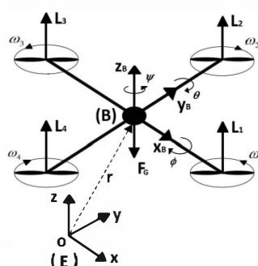
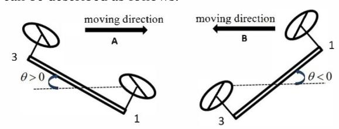
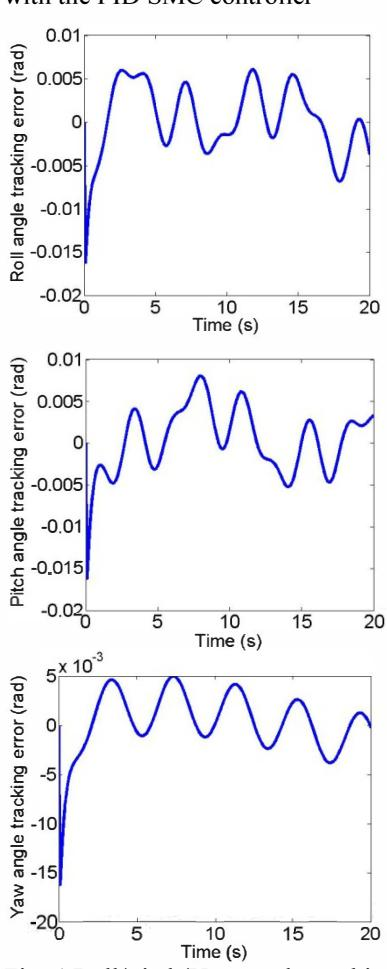
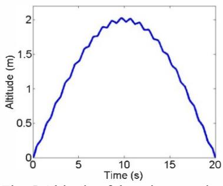
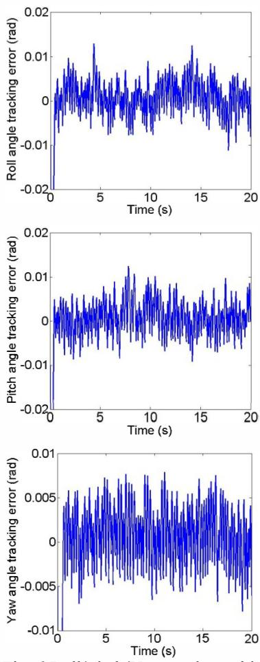
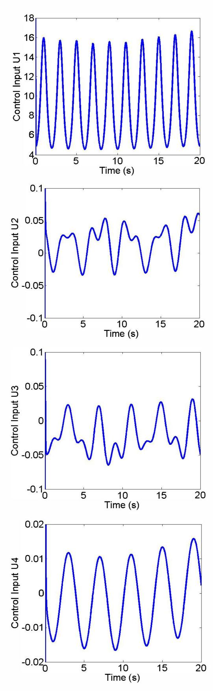
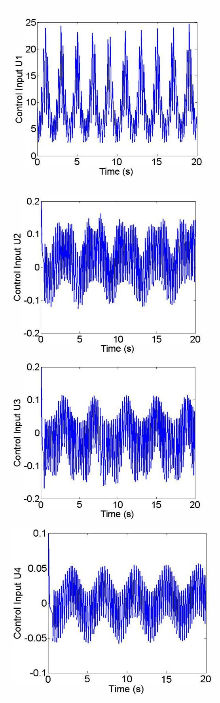

# PID based sliding mode controller design for the micro quadrotor

Luong Tuan Longl and Sangchul Won2\*

1 Graduate Institute of Ferrous Technology, POSTECH, San 31 Hyoja - dong, Pohang, Republic of Korea

(Tel : +82-54-279-9276; E-mail: hnlonglt@postech.ac.kr) 2 Department of Electronic and Electrical Engineering, POSTECH, San 31 Hyoja - dong, Pohang, Republic of Korea (Tel : +82-54-279-2221; E-mail:won@postech.ac.kr) \* Corresponding author

Abstract: In this paper, a PID based sliding mode controller is implemented on a micro quadrotor. The micro quadrotor is a nonlinear, underactuated and interconnected system, thus it should be regulated by an appropriate control technique. The advantages of the proposed controller are to remain the robustness characteristics to disturbances and to solve the chattering phenomenon of the conventional sliding mode control (SMC). Therefore, it can prevent the unexpected instability, decrease the energy consumption and improve the operation of the micro quadrotor. The effectiveness of the proposed controller is demonstrated through simulation results.

Keywords: PID based sliding mode control, micro quadrotor dynamics.

#### 1. INTRODUCTION

Unmanned Aerial Vehicles (UAVs) have a long development history. Early UAV models were introduced and used by the US Army during World War I [I]. Since then, military applications still have been the principal motivation for the growth in this area because UAVs can perform many challenging tasks without putting soldiers' lives at risk. In recent years, UAVs have also shown their great potential in other civilian applications, such as aerial surveillance, topographic survey, transportation and scientific research.

One type of UAV, which has become more popular in research activities, is the micro quadrotor. A micro quad rotor is small in size and equipped with four propellers. It can operate outdoors, indoors and even in small space. From the mechanical point of view, micro quadrotors allow simple design but good operating ability.

Several control techniques have been proposed to control a micro quadrotor, see [2] to have an overview and [3 - 7] to cite a few. In [3] the authors design a PID controller to regulate the quadrotor rotational angles. However, the simulation results show that the whole system cannot prevent the impact of the disturbance and if the faster response is preferred, the large overshot will occur. In [4], a controller based on state - dependent Riccati equation is developed but it may not be implemented in the real - time system since the computational requirement is large. In [5], the authors design a backstepping controller, nevertheless, [2] indicates the response of [5] is slow and the system is also complicated to realize. Since the micro quadrotor is an underactuated system, its dynamic model is nonlinear, interconnected and during the flight, it undergoes a variety of external impacts, sliding mode control technique seems to be the suitable solution for the challenge. The most disadvantage of sliding mode control method is the chattering phenomenon, which is shown by the experiment results in [6], when applied to a real micro quadrotor. In [7], the author tries to

decrease the drawback by replacing the signum function in the sliding mode controller with a saturation function, however, [9] shows that this method may cause an exchange between system performance and chattering effects. Thus, in this paper, we will develop a PID based sliding mode controller (PIDSMC) for the micro quadrotor, which remains the robustness to disturbances but also solve the chattering problem. The method has been mentioned in some papers [9-10].

The remainder of this paper is organized as follows. [n section 2, the modeling of a micro quad rotor is described. Section 3 is devoted to the controller design. Simulation results achieved from two control techniques, namely PIDSMC and conventional SMC, are presented for evaluation in section 4. Finally, section 5 yields some conclusions.

#### 2. DYNAMIC MODEL OF THE MICRO QUADROTOR

Consider a micro quad rotor in the earth fixed frame (E - frame) and in the body fixed frame (8 - frame).

Zk//r :' y (�) x

Fig.1 Micro quadrotor configuration, earth fixed frame E and body fixed frame 8

The fundamental motion of a micro quadrotor can be described as follows. [t has two pairs of counter rotating rotors, namely (1,3) and (2,4). If all four rotors spin at the same speed, the quadrotor will hover. [f rotor 2 spins faster but rotor 4 spins slower, and vice versa, a roll rotation will be produced. [f the speed of rotor I increases but the speed of rotor 3 decreases, and vice

versa, this will return a pitch rotation. Finally, if one pair of rotors spins faster than another, the quadrotor will yaw about its vertical axis.

The micro quadrotor has the position of the center of gravity given by vector r = (x y Z)T and its orientation )' identified by vector a = (¢ e If/) , where ¢, a, Iff are roll, pitch and yaw angle respectively. The dynamics of a micro quadrotor, taking into account numerous physical phenomena, are quite complicated. For a thorough modeling study, refer to [6-8]. The simplified model can be described by the translational equation w.r.t E - frame and the rotational equation w.r.t. B frame as follows:

mr = L + F(j, (I)

1 a+ a x 1 a = 7 + 7 g. (2)

where m and 1 = diag(lx Iy IJ in order are the mass and the inertia matrix of the quadrotor.

### 2.1 Translational motion

The lift force produced by rotor i (i = I, 2, 3, 4) can be modeled as L; = cL m;2, where cr. is the lift coefficient and � is the speed of rotor i. Thus in the

E - frame , the lift force L applied to the quadrotor: L = RLB, (3)

where the rotation matrix R is defined as:

[CBCIj/ s¢sBclj/ -c¢slj/ c¢sBclj/ + S¢SIj/] R = cBslj/ s¢sBslj/ + c¢clj/ c¢sBslj/ -s¢clj/ , -sB s¢cB c¢cB (4)

and in the B - frame, the lift force LB is expressed as:

4 LB =(00 LLf, i=l (5)

0; in Eq. (1) denotes the gravity force:

FG = (0 0 -mgf, (6)

### 2.2. Rotational motion

The torque exerted by rotor i can be obtained as 7; = kd«{ with kd is the drag coefficient. Thus, the torques produced by the quad rotor propellers in Eq. (2) are:

[d(L2 - L4) ] 7= d(Ly - LI) , -71 +72 -7y +74 (7)

d denotes the distance between the center of a propeller and the center of the quadrotor.

The torques 'fg in Eq. (2) caused by the gyroscopic effects is defined as:

4 'fg = -Ir aA (0 0 L(-ly+lm;Y, (8) i=l

### 2.3. Equations of motion

In Eq. (8), we define the new variable:

OJd=� - OJ2 +OJy - OJ4' (9) In Eq. (5) and Eq. (7), we assign control inputs UI'U2,UJ,U4 :

4 4 UI = LL; = CLLW; 2 , i=l 1=1 U2 = L2 - L4 = Cr (OJ; -OJ;), (10)

U3 = L3 - LI = Cr. (OJ; \_ � 2 ),

U4 = -71 + 72 -7y + 74 = kd ( \_�2 + OJ; -OJ; + OJ;).

Finally, from Eqs. (1) � (10), the dynamic model of a micro quadrotor can be represented by:

U x= (c¢sBclj/+ S¢SIj/)\_1 + Dx' m U y=(c¢sBslj/-S¢CIj/)\_1 +Dy ' m U z=C¢CB\_I - g+Dz, m (11)

¢=((!y -/JBIj/-lr B OJd +dU2)/ I, +DfjJ'

B = ((Iz -/JIj/¢+ Ir ¢OJd + dU3)/ Iy +De'

Ij/ = ((I, -Iy)¢B+ U4) / Iz + DIf' D" Dy,Dz,DfjJ ,De,DIf are disturbances.

#### 3. CONTROLLER DESIGN

From Eq. (11), the micro quadrotor is identified as an underactuated system, that is, there are only four inputs (UpU2,UJ,U4)to control six outputs (x,y, z,¢,B,Ij/) . However, the translational motions depend on the rotational motions of the quadrotor. This relationship can be described as follows:

Fig. 2 The relationship between the pitch angle and the moving direction.

If the altitude can be maintained, when the quadrotor produces a pitch angle B> 0, it moves along the A direction. After that, if the quadrotor creates the pitch angle B < 0, its velocity decreases to zero and the movement along the B direction starts to occur. The similarity happens to the roll angle ¢ and the corresponding translational motion. Therefore, this paper is determined to design a controller to track the desired altitude and rotational angles (z d' ¢d' Bd, Ij/d ) since the translational motions can be obtained through pitch and roll rotations. In addition, in many cases, the micro quad rotor should be able to turn its rigid body flexibly to avoid the obstacles. Thus, controlling the altitude and rotational angles is an important task.

In this section, the PID based sliding mode control technique proposed in [9-10] is employed due to its efficiency and simple implementation. Consult [9-10] for more details. The main idea of this technique is to replace the discontinuous switching function in the controller with a continuous one, which is governed by the PID control algorithm with self - tuning parameters but the sliding condition is still satisfied. [11] suggests that the smoothing function may remove the chattering phenomenon, or at least generate an approximation to the properties of ideal sliding motion.

## 3.1 Rotational controller

In Eq. (II), consider the roll angle equation:

¢ = ((Iy -IJBlj/-ir Bmd +dUz)/ Ix +D¢, (12)

Introduce new control input �,which satisfies:

Uz =(-(!y-/JBlj/+IP;)/d, (13)

Thus, Eq. (13) reduces to:

¢=/2+U;+D¢, (14)

Iwhere 12 = -tBmd is not exactly known. x

� � Let ¢ = ¢ - ¢d denotes the tracking error and S2 = ¢+ ,1,2 ¢ denotes the sliding surface for the variable t/J where � is a positive constant.

From [9 - 10], one obtains:

(15)

For eachkp2 ' the integral gaink;2 and the derivative gain kd2 must satisfY the following rules:

Let k \* ;z and k \* d2 be the integral gain and derivative gain to make the sliding condition S2.SZ < 0 fulfilled.

Let k;2 and kd2 be expressed as:

k;2 = ki2 -k \* iZ' (16)

kdZ = kd2 -k dZ ' (17)

where:

ki2 = '(;2S2 fS2dt, (18)

� ds kd2 = YdZSZ \_ 2 , (19) dt

In Eqs.( 18)�( 19), '(;z and YdZ are positive constants.

The same steps are applied to obtain U3, U4

(20)

, 1 fdS3 U3 = Bd-/"J B-(kp3S3 +ki3 S3dt+kd3 -), dt (21)

And:

U4 = -(Ix -Iy)¢B+IP;, (22)

where:

## 3.2 Altitude controller

(23)

From the equation describing the quad rotor altitude in Eq. (II), UI is derived as:

m\* UI =--(g+UI ), c¢cB (24)

where:

and S3 =B+�B , S4 =lj/+,1,4lj/ , S] =z+,1,]z

where �,,1,4' A, are positive constants.

(25)

In addition, their integral gains k;3' k;4' k;] and derivative gains kd3,kd4,kdl must follow the next conditions:

(26)

(27)

(28)

� ds kdi = YdiS J . \_J , (29) . dt

In Eqs.(28)�(29), Yij and Ydi are positive constants where j= 1 ;3;4.

#### 4. SIMULATIONS

We use MATLAB/SIMULINK to establish the micro quadrotor model described in section 2 and its controller developed in section 3. We also solve the problem with the conventional SMC for the evaluation purpose. The real micro quadrotor parameters are based on [8] as follows:

Table I Micro quadrotor parameters

| Parameter | Value           | Unit       |   |
|-----------|-----------------|------------|---|
| m         | 0.486           | kg         |   |
| d         | 0.25            | m          |   |
| Ir        | 2.8385* 1 QI\-5 | N.m/ rad / | S |
| Ix        | 3.8278*IQI\-3   | N.m/ rad / | S |
| Iy        | 3.8288*IQI\-3   | N.m/ rad / | S |
| Iz        | 7.6566*IQI\-3   | N.m/ rad / | S |

The PTDSMC controller parameters are given in table 2:

Table 2 The PIDSMC controller parameters

Fig. 3 Altitude of the micro quadrotor with the PID SMC controller

Fig. 4 Roll/Pitch/Yaw angle tracking error of the micro quadrotor with the PID SMC controller

The required roll, pitch, yaw angle and height are:

¢d = 0d = If/d = sin(ll"t )(rad), (30) 2

Zd = 2sinC t)(m). 20 (31)

Suppose that the disturbance D in the simulation for all cases is: D =0.4 sin(O.2t)

Figs. 3�8 show the performance of the micro quad rotor with the PIDSMC controller (the left column) and with the conventional SMC controller (the right column).

Fig. 5 Altitude of the micro quad rotor with the conventional SMC controller.

Fig. 6 Roll/Pitch/Yaw angle tracking error of the micro quadrotor with the conventional SMC controller

Fig. 7 Control inputs of the micro quad rotor with the PID SMC controller.

Fig. 8 Control inputs of the micro quadrotor with the conventional SMC controller.

From Figs. 3�8, we notice that the PID SMC controller can make the micro quadrotor track its desired altitude and roll, pitch, yaw angles. In addition, it brings better results than the conventional SMC controller does, namely smaller tracking errors, no chattering problem and especially smaller control inputs. The last result means that the real micro quadrotor equipped with the PID SMC controller consumes lower energy than with the conventional SMC controller. Thus, it can operate for longer hours.

#### 5. CONCLUSIONS

In this paper, we derive the dynamic model of a micro quadrotor, followed by the development of a PID based sliding mode controller for the altitude and rotational angles tracking purpose. The simulation proves the satisfactory results of the proposed system in terms of accomplishing the required tasks, ensuring the robustness features and removing the chattering phenomenon of the conventional SMC method. Tn addition, the proposed system has smaller tracking errors, consumes lower energy and works for longer period. Tn the following stage, we will develop the trajectory tracking algorithm and implement the controller on an experiment module to examine the actual activity.

#### REFERENCES

[I] L. R. G. Carrillo, A E. D. Lopez, R. Lozano and C. Pegard, Quad Rotorcraft Control: Vision - Based Hovering and Navigation, Springer, London, 2013. [2] Y. Li and S. Song, "A survey of control algorithms for quadrotor unmanned helicopter", Proc. of the International Conference on Advanced Computational Intelligence, pp. 365 - 369, 2012. [3] Y. Zeng, Q. Jiang, Q. Liu and H. Jing, "PID vs. MRAC control techniques applied to a quadrotor's attitude", Proc. of the International Conference on Instrumentation, Measurement, Computer, Communication and Control, pp. 1086 - 1089,2012. [4] H. Voos, "Nonlinear state - dependent Riccati equation control of a quad rotor UAV", Proc. of the International Conference on Control Applications, pp. 2547- 2552, 2006. [5] T. Madani and A. Benallegue, "Backstepping control for a quadrotor helicopter", Proc. of the International Conference on Intelligent Robots and Systems, pp. 3255 - 3260, 2006. [6] S. Bouabdallah and R. Siegwart, "Backstepping and sliding-mode techniques applied to an indoor micro Quadrotor", Proc. of the International Conference on Robotics and Automation, pp. 2259 - 2264, 2005. [7] F. Sharifi, M. Mirzaei, B.W. Gordon and Y. Zhang, "Fault tolerant control of a quadrotor UAV using sliding mode control", Proc. of the International Conference on Control and Fault - Tolerant Systems, pp. 239 - 244, 2010.

[8] L. Derafa, T. Madani and A Benallegue, "Dynamic modelling and experimental identification of four rotors helicoper parameters", Proc. of the International Conference on Industrial Technology, pp. 1834 - 1839, 2006. [9] M. Li, F. Wang and F. Gao, "PID - based sliding mode controller for nonlinear processes ", Industrial & Engineering Chemistry Research, Vol. 40, No. 12, pp. 2660 - 2667, 2001. [10] Y. J. Choi and M. C. Lee, "PID sliding mode control for steering of lateral moving strip in hot strip rolling", International Journal of Control, Automation and Systems, Vol. 7, Issue 3, pp. 399 - 407, 2009. [11] A Burton and AS. Zinober, "Continuous approximation of variable structure control," International Journal of Systems Science, Vol. 17, No.6, pp. 875-885, 1986.