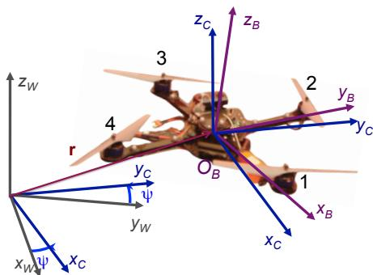
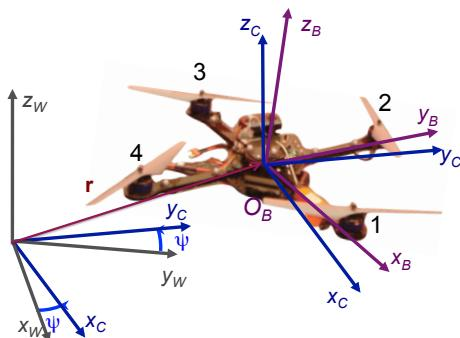
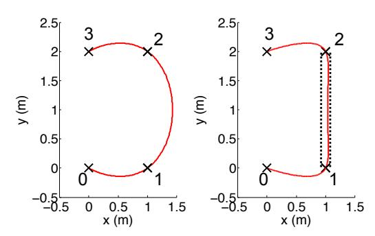
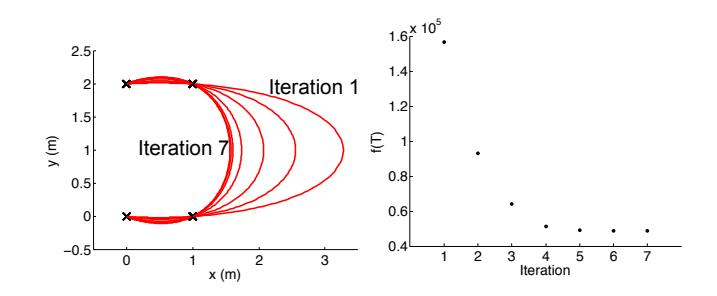
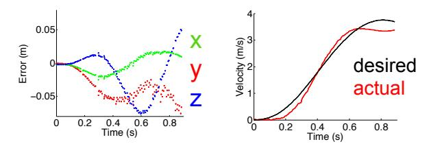
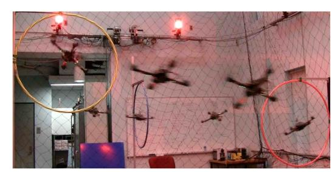
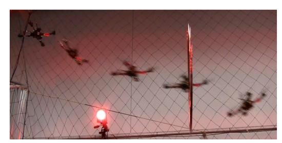
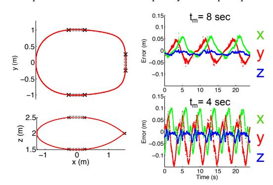

# Minimum Snap Trajectory Generation and Control for Quadrotors

Daniel Mellinger and Vijay Kumar

*Abstract*— We address the controller design and the trajectory generation for a quadrotor maneuvering in three dimensions in a tightly constrained setting typical of indoor environments. In such settings, it is necessary to allow for significant excursions of the attitude from the hover state and small angle approximations cannot be justified for the roll and pitch. We develop an algorithm that enables the real-time generation of optimal trajectories through a sequence of 3-D positions and yaw angles, while ensuring safe passage through specified corridors and satisfying constraints on velocities, accelerations and inputs. A nonlinear controller ensures the faithful tracking of these trajectories. Experimental results illustrate the application of the method to fast motion (5-10 body lengths/second) in three-dimensional slalom courses.

## I. INTRODUCTION

The last decade has seen many exciting developments in the area of micro Unmanned Aerial Vehicles that are between 0.1-0.5 meters in length and 0.1-0.5 kilograms in mass [1]. In particular, there has been extensive work on multirotor aircrafts, with many recent advances in the design [2], control [3] and planning [4] for quadrotors, rotorcrafts with four rotors. Our focus in this paper is on the modeling, controller design, and trajectory generation for quadrotors.

Most of the work in this area uses controllers that are derived from linearization of the model around hover conditions and are stable only under reasonably small roll and pitch angles [5]. Exploring the full state space using reachability algorithms [6], incremental search techniques [7] or LQR-tree-based searches [8] is impractical for a dynamic system with six degrees of freedom. Some work in this area has addressed aerobatic maneuvers [3, 6, 9, 10]. However, there are no stability and convergence guarantees when the attitude of the rotor craft deviates substantially from level hover conditions. While machine learning techniques have been successful in learning models using data from human pilots [9] and in improving performance using reinforcement learning [3], these approaches do not appear to lend themselves to motion planning or trajectory generation in environments with obstacles. Similar problems have been addressed using model predictive control (MPC) [11, 12]. With these approaches, guarantees of convergence are only available when the linearized model is fully controllable [12] or if a control Lyapunov function can be synthesized [13]. As such it appears to be difficult to directly apply such techniques to the trajectory generation of a quadrotor.

In this paper, we address the controller design and the trajectory generation for a quadrotor maneuvering in threedimensions in a tightly constrained setting typical of indoor

This work was supported by ONR Grants N00014-07-1-0829 and N00014-09-1-1051 and ARL Grant W911NF-08-2-0004.

Fig. 1. The flat outputs and the reference frames.

environments. In such settings, it is necessary to develop flight plans that leverage the dynamics of the system instead of simply viewing the dynamics as a constraint on the system. It is necessary to relax small angle assumptions and allow for significant excursions from the hover state. We develop an algorithm that enables the generation of optimal trajectories through a series of keyframes or waypoints in the set of positions and orientations, while ensuring safe passage through specified corridors and satisfying constraints on achievable velocities, accelerations and inputs.

## II. MODEL

The coordinate systems including the world frame, W, and body frame, B, as well as the propeller numbering convention for the quadrotor are shown in Fig. 1. Because we want to control attitudes that represent large deviations from hover, to avoid singularities we use rotation matrices to represent frame orientations. We also use Z − X − Y Euler angles to define the roll, pitch, and yaw angles (φ, θ, and ψ) as a local coordinate system. The rotation matrix from B to W is given by W RB = W RC C RB where W RC represents the yaw rotation to the intermediate frame C and C RB represents the effect of roll and pitch. The angular velocity of the robot is denoted by ωBW, denoting the angular velocity of frame B in the frame W, with components p, q, and r in the body frame:

ωBW = pxB + qyB + rzB. (1)

These values can be directly related to the derivatives of the roll, pitch, and yaw angles.

Each rotor has an angular speed ωi and produces a force, Fi , and moment, Mi , according to

Fi = kF ω 2 i , Mi = kMω 2 i .

In practice, the motor dynamics are relatively fast compared to the rigid body dynamics and the aerodynamics so for the controller development in this work we assume they can be instantaneously achieved. Therefore the control input to the system can be written as u where u1 is the net body force

D. Mellinger and V. Kumar are with the GRASP Lab, University of Pennsylvania, {dmel, kumar}@seas.upenn.edu.

u2, u3, u4 are the body moments which can be expressed according to the rotor speeds as

u = kF kF kF kF 0 kF L 0 −kF L −kF L 0 kF L 0 kM −kM kM −kM ω 2 1 ω 2 2 ω 2 3 ω 2 4 , (2)

where L is the distance from the axis of rotation of the rotors to the center of the quadrotor.

The position vector of the center of mass in the world frame is denoted by r. The forces on the system are gravity, in the −zW direction, and the sum of the forces from each of the rotors, u1, in the zB direction. Newton's equations of motion governing the acceleration of the center of mass are

m¨r = −mgzW + u1zB. (3)

The angular acceleration determined by the Euler equations is

ω˙ BW = I −1 −ωBW × IωBW + u2 u3 u4 , (4)

where I is the moment of inertia matrix referenced to the center of mass along the xB − yB − zB axes. The state of the system is given by the position and velocity of the center of mass and the orientation (locally parameterized by Euler angles) and the angular velocity:

x = [x, y, z, φ, θ, ψ, x,˙ y,˙ z, p, q, r ˙ ] T ,

or without the parameterization by the the position and velocity of the center of mass and the rotation matrix W RB and the angular velocity ωBW.

## III. DIFFERENTIAL FLATNESS

In this section we show that the quadrotor dynamics with the four inputs is *differentially flat* [14]. In other words, the states and the inputs can be written as algebraic functions of four carefully selected *flat outputs* and their derivatives. This facilitates the automated generation of trajectories since any smooth trajectory (with reasonably bounded derivatives) in the space of flat outputs can be followed by the underactuated quadrotor. Our choice of flat outputs is given by

σ = [x, y, z, ψ] T ,

where r = [x, y, z] T are the coordinates of the center of mass in the world coordinate system and ψ is the yaw angle. We will define a trajectory, σ(t), as a smooth curve in the space of flat outputs:

σ(t) : [t0, tm] → R 3 × SO(2). (5)

We will now show that the state of the system and the control inputs can be written in terms of σ and its derivatives.

The position, velocity and acceleration of the center of mass are simply the first three terms of σ, σ˙ , and σ¨, respectively. To see that W RB is a function of the flat outputs and their derivatives, consider the equation of motion (3). From (3),

zB = t ktk , t = [¨σ1, σ¨2, σ¨3 + g] T , (6)

xC = [cos σ4, sin σ4, 0]T ,

as shown in Figure 1. We can determine xB and yB as follows:

yB = zB × xC kzB × xC k , xB = yB × zB,

provided xC × zB 6= 0. In other words, we can uniquely determine

W RB = [xB yB zB]

provided we never encounter the singularity where zB is parallel1 to xC .

To show the angular velocity is a function of the flat outputs and their derivatives, take the first derivative of (3):

ma˙ = ˙u1zB + ωBW × u1zB. (7)

Projecting this expression along zB, and using the fact that u˙ 1 = zB · ma˙ , we can substitute u˙ 1 into (7) to define the vector hω as

hω = ωBW × zB = m u1 (˙a − (zB · ˙a)zB).

hω is the projection of m u1 ˙a onto the xB − yB plane. If we write the body frame components of angular velocity as in (1) the components p and q are found as

p = −hω · yB, q = hω · xB.

The third component r is found by simply writing ωBW = ωBC +ωCW and observing that ωBC has no zB component:

r = ωCW · zB = ψ˙zW · zB.

The components of the angular acceleration αBW along xB and yB are found by computing the second of derivative of (3) and following the same procedure as above. To find the zB component of αBW we use the fact that

αBW = αBC + ωCW × ωBC + αCW ,

and note αBC · zB = 0 and zB · ωCW × ωBC = 0. The zB components of αBW is

αBW · zB = αCW · zB = ψ¨zW · zB.

The net thrust from the quadrotor propellers is seen to be a direct function of the flat outputs and their derivatives from (3,6), u1 = mktk. Given that the angular velocity and acceleration are functions of the flat outputs and their derivatives we use the Euler equations (4) to compute the inputs u2, u3, and u4.

## IV. CONTROL

We now present a controller to follow specified trajectories, σT (t) = [rT (t) T , ψT (t)]T . This controller is similar to the one in our previous work [15] with some exceptions that will be pointed out later. First we define the errors on position and velocity as

ep = r − rT , ev = r˙ − r˙T .

Next we compute the desired force vector for the controller and the desired body frame z axis:

Fdes = −Kpep − Kvev + mgzW + m¨rT ,

1Although from a theoretical standpoint we can determine W RB from the flat outputs and their derivatives almost everywhere, there is a practical limitation in using this map at points near this singularity since the rotation matrix can undergo large changes even with small changes of the flat output. Our practical fix to this problem is discussed later in Section IV.

where Kp and Kv are positive definite gain matrices. Note that here we assume kFdesk 6= 0. Next we project the desired force vector onto the actual body frame z axis in order to compute the desired force for the quadrotor and the first input:

u1 = Fdes · zB.

To determine the other three inputs, we must consider the rotation errors. First, we observe that the desired zB direction is along the desired thrust vector:

zB,des = Fdes kFdesk .

Thus if e3 = [0, 0, 1]T , the desired rotation W RB denoted by Rdes for brevity is given by:

Rdese3 = zB,des.

Knowing the specified yaw angle along the trajectory, ψT (t), we compute xB,des and yB,des as in the previous section:

xC,des = [cos ψT , sin ψT , 0]T ,

and

yB,des = zB,des × xC,des kzB,des × xC,desk , xB,des = yB,des × zB,des,

provided xC,des × zB,des 6= 0. This defines the desired rotation matrix Rdes. While mathematically this singularity is a single point in SO(3), this computation results in large changes in the unit vectors in the neighborhood of the singularity. To fix this problem, we observe that −xB,des and −yB,des are also consistent with the desired yaw angle and body frame z axis. In practice we simply check which one of the solutions is closer to the actual orientation of the quadrotor in order to calculate the desired orientation, Rdes.

Next we define the error on orientation:

eR = 1 (R T des W RB − W R T BRdes) ∨

2 where ∨ represents the *vee map* which takes elements of so(3) to R 3 . This is the major departure from [15] where the angular errors were computed using the small angle assumption.

The angular velocity error is simply the difference between the actual and desired angular velocity in body frame coordinates:

eω = B[ωBW] − B[ωBW,T ].

Now the desired moments and the three remaining inputs are computed as follows:

[u2, u3, u4] T = −KReR − Kωeω, (8)

where KR and Kω are diagonal gain matrices. This allows unique gains to be used for roll, pitch, and yaw angle tracking. Finally we compute the desired rotor speeds to achieve the desired u. In practice, this is done by inverting the linearization of (2) about ωi = q u1 4kF .

Note that the linearization about the hover point for this controller is the same as the controller presented in our previous work [15]. This nonlinear controller presented here adds two new important features. First, the orientation error is not based on the Euler angles which contain singularities. Second, the desired force is projected onto the actual z body axis. Proofs of stability and convergence are presented for a similar controller in [16] but with (a) the addition of feedforward terms including the angular acceleration; (b) the inclusion of feedback terms cancelling the ω× Iω in (8); (c) the assumption that all gain matrices are scalar multiples of the identity (e.g., KR = kRI); (d) the assumption that motor dynamics are insignificant; and (e) perfect knowledge of m and I. Under these conditions the dynamics are exponentially stable provided the initial conditions satisfy two conditions:

tr -I − R T des(0)W RB(0) < 2, keω(0)k 2 < 2 λmin(I) kR(1 − 1 2 tr -I − R T des(0)W RB(0) ),

and almost globally exponential attractiveness of the complete dynamics with less restrictive conditions. Our realization of the controller is different and does not quite satisfy all the assumptions listed above. However, as we will see in Section VI, the controller yields good tracking performance even with very large roll and pitch angles.

## V. TRAJECTORY GENERATION

We define a *keyframe* as a position in space along with a yaw angle. Consider the problem of navigating through m keyframes at specified times. In between each keyframe there is a safe corridor that the quadrotor must stay within. A trivial trajectory that satisfies these constraints is one that interpolates between keyframes using straight lines. However this trajectory is inefficient because it has infinite curvature at the keyframes which requires the quadrotor to come to a stop at each keyframe.

Our method generates an optimal trajectory that smoothly transitions through the keyframes at the given times while staying within safe corridors. Building on the results of Section III, we consider trajectories in the flat output space of the form of (5). It is convenient to write them as piecewise polynomial functions of order n over m time intervals as:

σT (t) = Pn i=0 σT i1t i P t0 ≤ t < t1 n i=0 σT i2t i t1 ≤ t < t2 . . P . n i=0 σT imt i tm−1 ≤ t ≤ tm (9)

The reason for the choice of this basis is simple. We are interested in finding trajectories that minimize functionals which can be written using these basis functions. The optimization program to solve this problem while minimizing the integral of the krth derivative of position squared and the kψth derivative of yaw angle squared (without corridor constraints) is shown below.

minR tm t0 µr d kr rT dtkr 2 + µψ d kψ ψT dtkψ 2 dt (10)

s.t. σT (ti) = σi , i = 0, ..., m d pxT dtp |t=tj = 0 or free, j = 0, m; p = 1, ..., kr

d pyT dtp |t=tj = 0 or free, j = 0, m; p = 1, ..., kr

d p zT dtp |t=tj = 0 or free, j = 0, m; p = 1, ..., kr

d pψT dtp |t=tj = 0 or free, j = 0, m; p = 1, ..., kψ

where µr and µψ are constants that make the integrand nondimensional. Here σT = [xT , yT , zT , ψT ] T and σi =

[xi , yi , zi , ψi T . We enforce continuity of the first kr derivatives of rT and first kψ derivatives of ψT at t1,...,tm−1.

The cost function in (10) is similar to that used by Flash and Hogan [17] who showed human reaching trajectories appear to minimize the integral of the square of the norm of the jerk (the derivative of acceleration, kr = 3). In our system, since the inputs u2 and u3 appear as functions of the fourth derivatives of the positions, we generate trajectories that minimize the integral of the square of the norm of the snap (the second derivative of acceleration, kr = 4). Since the input u4 appears in the second derivative of the yaw angle we use kψ = 2. The basis (9) allows us to go to higher order polynomials which can potentially allow us to satisfy different constraints on the states and the inputs.

We can formulate the problem as a quadratic program (or QP) by writing the constants σT ij = [xT ij , yT ij , zT ij , ψT ij ] T as a 4nm×1 vector c with decision variables {xT ij , yT ij , zT ij , ψT ij}:

min c T Hc + f T c (11) s.t. Ac ≤ b

Here the objective function incorporates the minimization of the functional while the constraints can be used to satisfy constraints on the flat outputs and their derivatives and thus constraints on the states and the inputs. A specification of an initial condition, final condition, or intermediate condition on any derivative of the trajectory (e.g., d kxT dtk |t=ti ) can be written as an equality constraint in (11). If conditions do not need to be specified exactly then they can be represented with an inequality constraint in (11). After computing the trajectory, the methods described in Section III can be used to calculate the angular velocities, angular accelerations, total thrust, and moments required over the entire trajectory.

#### *A. Nondimensionalization*

We note that in (10) the quantities xT , yT , zT , and ψT are decoupled in both the cost function and the constraints so this problem can be separated into four optimization problems. We now consider a general form of the optimization problem for a nondimensional variable w˜(τ ) where τ represents nondimensionalized time:

min R 1 0 d kw˜(τ) dτ k 2 dτ (12) s.t. w˜(τi) = ˜wi , i = 0, ..., m d pw˜(τ) dτ p |τ=τj = 0 or free, τj = 0, 1; p = 1, ..., k

Next we introduce the dimensional time, t = ατ , (assuming t0 = 0 without loss of generality) and the dimensional variable, w, defined as

w(t) = w(ατ ) = β1 + β2w˜(τ ).

Next we rewrite (12) using w and t:

min α 2k−1 β2 R α 0 d kw(t) dtk dt (13) s.t. w(ti) = β1 + β2w˜i , i = 1, ..., m d pw(t) dtp |t=tj = 0 or free, tj = 0, α; p = 1, ..., k

Note that in this problem the boundary conditions are spatially shifted by β1 and scaled by β2 and time is scaled by α. Letting the optimal solution to the nondimensional problem be w˜ ∗ the solution to the new problem is

w ∗ (t) = β1 + β2w˜ ∗ (t/α).

Now let's consider the nondimensional form of (10) where r, ψ, and t are replaced by the nondimensional variables ˜r, ψ˜, and τ . One can solve four nondimensional problems by letting ˜rT = [ ˜w1, w˜2, w˜3] T and ψ˜ T = ˜w4. Then the optimal nondimensional solutions, w˜ ∗ i (t), can be mapped to the optimal solutions for xT , yT , zT , and ψT in the original problem (10). The time scale, α, is the same for each variable but the spatial transformation, β1 and β2, can be different.

*1) Temporal Scaling:* If we change the time to navigate the keyframes by a factor of α so that the new times to reach the keyframes are ti = ατi the solution to the true problem is simply a time-scaled version of the nondimensional solution:

r ∗ T (t) = ˜r∗ T (t/α), ψ∗ T (t) = ψ˜∗ T (t/α).

As α is increased the plan takes longer to execute and becomes *safer*. As α goes to infinity all the derivatives of position and yaw angle as well as the angular velocity go to zero which leads to

u(t) → [mg, 0, 0, 0]T .

We can therefore satisfy any safety constraint by making α large enough. Conversely, as α is decreased the trajectory takes less time to execute, the derivatives of position increase, and the trajectory becomes more aggressive.

*2) Spatial scaling:* Here we describe how the spatial scaling property can be exploited for trajectories with only two keyframes. We consider a single case of the nondimensional form of (10) where ˜rT (0) = 0 and ˜rT (1) = 1 and the final velocities are specified in the same way as in the true problem. The optimal solution to the actual problem is then

x ∗ T (t) = x0 + (x1 − x0)˜x ∗ T (t/t1),

and likewise for y ∗ T (t) and z ∗ T (t). This is convenient because it is faster to analytically modify a solution than to solve a QP. For this reason, this approach is useful for quickly reacting to dynamic obstacles or targets. Note that spatial scaling also applies to the problem with multiple keyframes but the property is less useful as the positions of all keyframes must be scaled by the same factor.

## *B. Adding corridor constraints*

We will now add corridor constraints to (10). First we define ti as the unit vector along the segment from ri to ri+1. The perpendicular distance vector, di(t), from segment i is defined as

di(t) = (rT (t) − ri) − ((rT (t) − ri) · ti)ti .

A corridor width on the infinity norm, δi , is defined for each corridor:

kdi(t)k∞ ≤ δi while ti ≤ t ≤ ti+1.

This constraint can be incorporated into the QP by introducing nc intermediate points as

xW · di ti + j 1 + nc (ti+1 − ti)  ≤ δi for j = 1, ..., nc

and equivalently for yW and zW . Note that each absolute value constraint can be written as two linear constraints. The use of corridor constraints is shown in Fig. 2. In the left figure

Fig. 2. Optimal trajectories (red) passing through 4 keyframes (black). Left: no corridor constraints. Right: corridor constraint between keyframes 2 and 3 forces changes from the unconstrained trajectory on the left.

the optimization problem is solved without any corridor constraints and in the right figure a corridor constraint is added for the 2nd segment (δ2 = 0.05 and nc = 8). The trajectory stays within the dotted lines that illustrate the corridor.

## *C. Optimal segment times*

In some cases the arrival times at different keyframes is important and may be specified. However, in other cases these arrival times may not matter and we can try to find a better solution by allowing more time for some segments while taking the same amount of time away from the others. Here we describe a method for finding the optimal relative segment times for a given set of keyframes. For this part it is more convenient to think of the time allowed for segment i, Ti , rather than the arrival time for keyframe i, ti , where Ti = ti − ti−1. We then solve the minimization problem:

min f(T) (14) s.t. PTi = tm Ti ≥ 0

where f(T) is the solution the optimization problem (10) for segment times T = [T1, T2, ..., Tm]. We solve (14) via a constrained gradient descent method. We do this by numerically computing the directional derivative for m vectors denoted by gi :

∇gi f = f(T + hgi) − f(T) h ,

where h is some small number. The vectors gi are constructed so that the ith element has a value of 1 and all other elements have the value −1 m−2 . This is done so that Pgi = 0 and gi can be added or subtracted from T and the final time does not change. Given the estimates of the directional derivatives we perform gradient descent using backtracking line search.

An illustration of this method for a trajectory in the x−y plane where the keyframes are points on the plane is shown in Fig. 3. The first choice of segment times was chosen by assuming the quadrotor travels in straight line paths from keyframe to keyframe at a uniform velocity. This initial choice allocates too much time for the 2nd segment and the trajectory for this segment deviates significantly from the keyframes. The algorithm converges to an optimal solution after 7 iterations as shown in Fig. 3. The final trajectory appears to be a very natural trajectory for passing through

Fig. 3. Illustration of relative time scaling. Left: Trajectory for different iterations. Right: Cost function vs. iteration.

Fig. 4. Performance data for a trajectory for flying through a thrown hoop.

all keyframes which qualitatively validates the choice of the cost function.

## VI. EXPERIMENTS

All experiments in this paper are conducted with the Ascending Technologies Hummingbird quadrotor [18]. We use a Vicon motion capture system [19] to estimate the position, orientation, and velocity of the quadrotor and the onboard gyros to estimate the angular velocities. The software infrastructure is described in [15].

#### *A. Spatially Scaled Trajectories*

This experiment demonstrates how the spatially scaled trajectory is used to fly through a thrown circular hoop. After detecting that the hoop has been thrown the future position of the hoop is predicted with a quadratic air drag model. The predicted future time and x and y position of descent through a chosen z plane is found. The chosen z-plane is 0.6 meters below the quadrotor. The allowed region for hoop interception is x ∈ [1.2, 1.6] meters and y ∈ [−0.4, 0.4] meters, where x is towards the hoop. The time allowed for all trajectories, t1, is 0.9 seconds. The x and z velocity are allowed to be free so the quadrotor can fly forward and down through the hoop while the y velocity is constrained to be zero as it is assumed the hoop falls approximately straight down. The worst case performance is for the position the farthest away (x = 1.6 meters and y = 0.4 meters) for which data is shown in Fig. 4.

Even in this worst-case scenario the position error is always less than 8 cm in any direction. Note that this is a highly aggressive trajectory as the quadrotor quickly reaches a velocity of 3.6 m/s and at one point hits a pitch angle of 60◦ . A series of images showing the full experiment are shown in Fig. 5.

## *B. Temporal Scaling, Corridor Constraints, and Optimal Segment Times*

This experiment demonstrates the ability to fly through environments with several narrow gaps. We design a sce-

Fig. 5. Composite image of a single quadrotor flying through a thrown circular hoop. See attached video or http://tinyurl.com/pennquad.

Fig. 6. Trajectory generated to fly through three gaps (left) and performance data for two traversal speeds (right).

nario with three fixed circular hoops the quadrotor must continuously fly through. Six keyframes with the identical yaw angles are selected at 0.25 meters on either side of the gaps with a small corridor constraint, 1 cm, added for the segments passing through the gaps. The corridor widths for the other segments are allowed to be 1 meter so the quadrotor may take a less direct and lower cost path where there is no position constraint. Since arrival time at the keyframes is not important for this problem the segment times are determined by solving (14). The final trajectory generated is shown in Fig. 6.

This generated trajectory can be tracked at different speeds. The right side of the Fig. 6 shows 24 seconds of performance data for tracking this trajectory in 8 seconds (top) and 4 seconds (bottom). The data shows that we can tradeoff speed for accuracy. The faster trajectory has velocities as large as 2.6 m/s and roll and pitch angles of up to 40◦ . Images from the faster experiment are shown in Fig. 7. The tracking performance of a particular trajectory is very repeatable as can be seen by the periodicity in the errors in Fig. 6.

#### VII. CONCLUSION

We presented a quadrotor control algorithm for following aggressive trajectories requiring large accelerations and an automated approach to synthesizing three-dimensional trajectories for quadrotors that can satisfy constraints on positions, velocities, accelerations and inputs. The trajectories are optimal in the sense that they minimize cost functionals that are derived from the square of the norm of the snap (the fourth derivative of position). These cost functionals are meaningful since the input variables are algebraically related to the snap. The time scaling property of this approach allows

Fig. 7. Composite image of a single quadrotor quickly flying through three static circular hoops. See attached video or http://tinyurl.com/pennquad.

trajectories to be slowed down to be made *safer*.

#### REFERENCES

[1] D. Pines and F. Bohorquez, "Challenges facing future micro air vehicle development," *AIAA Journal of Aircraft*, vol. 43, no. 2, pp. 290–305, 2006. [2] D. Gurdan, J. Stumpf, M. Achtelik, K. Doth, G. Hirzinger, and D. Rus, "Energy-efficient autonomous four-rotor flying robot controlled at 1 khz," in *Proc. of the IEEE Int. Conf. on Robotics and Automation*, Roma, Italy, Apr. 2007. [3] S. Lupashin, A. Schollig, M. Sherback, and R. D'Andrea, "A simple learning strategy for high-speed quadrocopter multi-flips," in *Proc. of the IEEE Int. Conf. on Robotics and Automation*, Anchorage, AK, May 2010, pp. 1642–1648. [4] R. He, A. Bachrach, M. Achtelik, A. Geramifard, D. Gurdan, S. Prentice, J. Stumpf, and N. Roy, "On the design and use of a micro air vehicle to track and avoid adversaries," *The Int. Journal of Robotics Research*, vol. 29, pp. 529–546, 2010. [5] G. Hoffmann, S. Waslander, and C. Tomlin, "Quadrotor helicopter trajectory tracking control," in *AIAA Guidance, Navigation and Control Conference and Exhibit*, Honolulu, Hawaii, Apr. 2008. [6] J. H. Gillula, H. Huang, M. P. Vitus, and C. J. Tomlin, "Design of guaranteed safe maneuvers using reachable sets: Autonomous quadrotor aerobatics in theory and practice," in *Proc. of the IEEE Int. Conf. on Robotics and Automation*, Anchorage, AK, May 2010, pp. 1649–1654. [7] M. Likhachev, G. Gordon, and S. Thrun, "ARA\*: Anytime A\* with provable bounds on sub-optimality," *Advances in Neural Information Processing Systems*, vol. 16, 2003. [8] R. Tedrake, "LQR-Trees: Feedback motion planning on sparse randomized trees," in *Proc. of Robotics: Science and Systems*, Seattle, WA, June 2009. [9] P. Abbeel, "Apprenticeship learning and reinforcement learning with application to robotic control," Ph.D. dissertation, Stanford University, Stanford, CA, Aug. 2008. [10] D. Mellinger, N. Michael, and V. Kumar, "Trajectory generation and control for precise aggressive maneuvers," in *Int. Symposium on Experimental Robotics*, Dec. 2010. [11] H. Kim, D. Shim, and S. Sastry, "Nonlinear model predictive tracking control for rotorcraft-based unmanned aerial vehicles," vol. 5, 2002, pp. 3576 – 3581. [12] J. Yu, A. Jadbabaie, J. Primbs, and Y. Huang, "Comparison of nonlinear control design techniques on a model of the caltech ducted fan," in *IFAC World Congress, IFAC-2c-112*, 1999, pp. 53–58. [13] A. Jadbabaie and J. Hauser, "On the stability of receding horizon control with a general terminal cost," *Automatic Control, IEEE Transactions on*, vol. 50, no. 5, pp. 674 – 678, may. 2005. [14] M. J. Van Nieuwstadt and R. M. Murray, "Real-time trajectory generation for differentially flat systems," *International Journal of Robust and Nonlinear Control*, vol. 8, pp. 995–1020, 1998. [15] N. Michael, D. Mellinger, Q. Lindsey, and V. Kumar, "The grasp multiple micro uav testbed," *IEEE Robotics and Automation Magazine*, Sept. 2010. [16] T. Lee, M. Leok, and N. McClamroch, "Geometric tracking control of a quadrotor uav on SE(3)," in *Proc. of the IEEE Conf. on Decision and Control*, 2010. [17] T. Flash and N. Hogan, "The coordination of arm movements: An experimentally confirmed mathematical model," *The Journal of Neuroscience*, vol. 5, pp. 1688–1703, 1985. [18] "Ascending Technologies, GmbH," http://www.asctec.de. [19] "Vicon Motion Systems, Inc." http://www.vicon.com.