# **Trajectory generation and control for precise aggressive maneuvers with quadrotors**

**Daniel Mellinger, Nathan Michael, and Vijay Kumar**

### **Abstract**

*We study the problem of designing dynamically feasible trajectories and controllers that drive a quadrotor to a desired state in state space. We focus on the development of a family of trajectories defined as a sequence of segments, each with a controller parameterized by a goal state or region in state space. Each controller is developed from the dynamic model of the robot and then iteratively refined through successive experimental trials in an automated fashion to account for errors in the dynamic model and noise in the actuators and sensors. We show that this approach permits the development of trajectories and controllers enabling such aggressive maneuvers as flying through narrow, vertical gaps and perching on inverted surfaces with high precision and repeatability.*

### **Keywords**

Trajectory generation, control, quadrotors

# **1. Introduction**

There has been exciting progress in micro unmanned aerial vehicle (MAV) research in the past decade (Pines and Bohorquez 2006). In particular, there has been extensive work on multi-rotor aircrafts, with many recent advances in the design (Gurdan et al. 2007), control (Bouabdallah 2007; Lupashin et al. 2010) and planning (He et al. 2010) for quadrotors. Our focus in this paper is the design of aggressive trajectories for quadrotors via the composition of three simple control modes. In particular, we consider the design of dynamically feasible trajectories and controllers that drive a quadrotor to a desired state (position, orientation, linear and angular velocity) in state space. We focus on the development of a family of trajectories defined as a sequence of segments, each with a controller parameterized by a goal state or region in state space. Each controller is developed from the dynamic model of the robot, and then automatically refined through successive experimental trials to account for errors in the dynamic model and noise in the actuators and sensors. We show that this approach permits the development of trajectories and controllers enabling aggressive maneuvers such as flying through narrow, vertical gaps and perching on inverted surfaces with high precision and repeatability.

Aggressive maneuvers with aerial robots is an area of active research. Exciting results have been demonstrated for perching with fixed-wing aerial vehicles (Cory and Tedrake 2008; Desbiens and Cutkosky 2010) as well perching on inclined surfaces with a small helicopter (Bayraktar and Feron 2007). A number of groups have demonstrated aggressive aerial maneuvers with small-scale rotorcraft (Abbeel 2008; Gillula et al. 2010; Lupashin et al. 2010). In this area considerable effort is focused on strategies for generating sequences of controllers that stabilize the robot to a desired state. Gillula et al. (2009, 2010) presented an optimization-based control design methodology that generates a sequence of stabilizing controllers that drive a robot to a hover state after entering a flipping maneuver. The authors are able to provide guarantees of recovery from a flipping maneuver based on the robot model and present experimental results to validate their approach. Tedrake (2009) proposed an optimization-based design methodology with similar guarantees using a guided

GRASP Laboratory, University of Pennsylvania, Philadelphia, PA, USA.

### **Corresponding author:**

Daniel Mellinger, GRASP Laboratory, University of Pennsylvania 3330 Walnut Street, Philadelphia, PA 19104, USA. Email: dmel@seas.upenn.edu

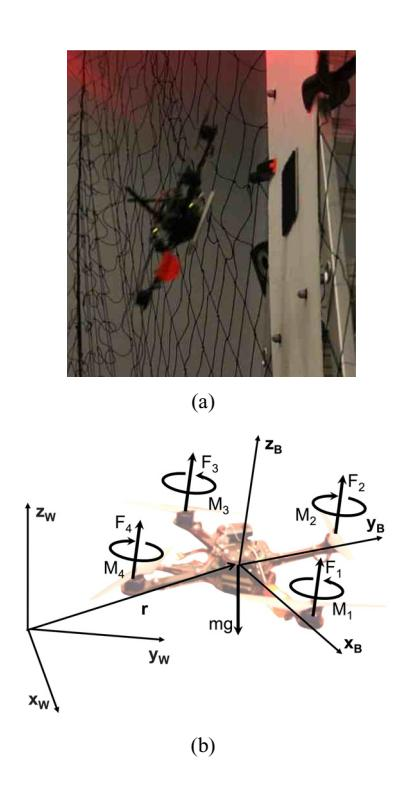

**Fig. 1.** (a) Quadrotor during a perch maneuver. (b) Coordinate systems and forces/moments acting on the quadrotor.

sampling of the state space and creating sequences of stabilizing controllers that drive the system to a desired state through a sequence of sampled states.

Impressive results are also shown using methods based on reinforcement learning or iterative adaptation of the control law. Lupashin et al. (2010) proposed a control law with initial parameters for flipping a quadrotor multiple times. The control law is executed many times and corrected after each trial toward the desired performance. A similar strategy is presented by Tang et al. (2010) and Abbeel (2008), where the authors developed a minimal control law model and refine the model based on data collected from an expert human operator executing the aggressive maneuver. In both cases, system models are based on first principles.

In contrast to the work presented by Abbeel (2008) and Gillula et al. (2009), we address the challenge of designing trajectories in the full, 12-dimensional state space with an underactuated robot with only four actuators. Specifically, we consider goal states parameterized by an arbitrary position, linear velocity, roll, pitch and the derivatives of roll and pitch. We depart from the optimization-based methods described by Gillula et al. (2009, 2010) and Tedrake (2009) and incremental search techniques (Likhachev et al. 2003) because these methods do not appear to scale to 12 dimensions. The apprenticeship learning methods of Tang et al. (2010) and Abbeel (2008) require an expert human operator to generate data for model and control identification and therefore limit the ability of the control law to handle cases not considered *a priori* by the human operator. Indeed, in several cases considered in this paper, it was not possible for a trained human operator to fly the robot in the specified manner.

Similar problems have also been addressed using model predictive control (MPC) (Yu et al. 1999; Kim et al. 2002). With these approaches, guarantees of convergence are only available when the linearized model is fully controllable over the entire trajectory (Yu et al. 1999) or if a control Lyapunov function can be synthesized (Jadbabaie and Hauser 2005). As such it appears to be difficult to directly apply such techniques for the trajectory generation of a quadrotor in scenarios outside of near-hover conditions when the quadrotor is tilted at large angles.

We develop a dynamic model based on first principles (Section 2) and feedback control laws (Section 3). The model and control laws are similar to those presented by Michael et al. (2010). Here a trajectory consists of a sequence of trajectory segments and associated controllers, each of which are refined in simulation and experimentation (Section 4). Experimental evaluation of the approach shows that with limited experimental refinement (four trials of parameter adaptation) we are able to generate controllers that show repeatability and precision (Section 6).

### **2. Modeling**

# *2.1. Dynamic model*

The coordinate systems and free body diagram for the quadrotor are shown in Figure 1(b). The world frame, *W*, is defined by axes *xW* , *yW* , and *zW* with *zW* pointing upward. The body frame, *B*, is attached to the center of mass of the quadrotor with *xB* coinciding with the preferred forward direction and *zB* perpendicular to the plane of the rotors pointing vertically up during perfect hover (see Figure 1(b)). Rotor 1 is on the positive *xB*-axis, 2 on the positive *yB*-axis, 3 on the negative *xB*-axis, 4 on the negative *yB*axis. We use *Z*–*X*–*Y* Euler angles to model the rotation of the quadrotor in the world frame. To get from *W* to *B*, we first rotate about *zW* by the yaw angle, ψ, then rotate about the intermediate *x*-axis by the roll angle, φ, and finally rotate about the *yB* axis by the pitch angle, θ. The rotation matrix for transforming coordinates from *B* to *W* is given by

*W RB* = ⎡ ⎣ *c*ψ *c*θ − *s*φ*s*ψ *s*θ −*c*φ*s*ψ *c*ψ *s*θ + *c*θ *s*φ*s*ψ *c*θ *s*ψ + *c*ψ *s*φ*s*θ *c*φ*c*ψ *s*ψ *s*θ − *c*ψ *c*θ *s*φ −*c*φ*s*θ *s*φ *c*φ*c*θ ⎤ ⎦ ,

where *c*θ and *s*θ denote cos(θ) and sin(θ), respectively, and similarly for φ and ψ. The position vector of the center of mass in the world frame is denoted by **r**. The forces on the system are gravity, in the −*zW* direction, and the forces from

each of the rotors, *Fi*, in the *zB* direction. The equations governing the acceleration of the center of mass are

*m***r**¨ = ⎡ ⎣ 0 0 −*mg* ⎤ ⎦ + *W RB* ⎡ ⎢ ⎢ ⎢ ⎣ 0 0 4 *i*=1 *Fi* ⎤ ⎥ ⎥ ⎥ ⎦ . (1)

The components of angular velocity of the robot in the body frame are *p*, *q*, and *r*. These values are related to the derivatives of the roll, pitch, and yaw angles according to

⎡ ⎣ *p q r* ⎤ ⎦ = ⎡ ⎣ *c*θ 0 −*c*φ*s*θ 01 *s*φ *s*θ 0 *c*φ*c*θ ⎤ ⎦ ⎡ ⎣ φ˙ θ˙ ψ˙ ⎤ ⎦ .

In addition to forces, each rotor produces a moment perpendicular to the plane of rotation of the blade, *Mi*. Rotors 1 and 3 rotate in the −*zB* direction while 2 and 4 rotate in the *zB* direction. Since the moment produced on the quadrotor is opposite to the direction of rotation of the blades, *M*1 and *M*3 act in the *zB* direction while *M*2 and *M*4 act in the −*zB* direction. We let *L* be the distance from the axis of rotation of the rotors to the center of the quadrotor. The moment of inertia matrix referenced to the center of mass along the *xB*– *yB*–*zB* axes, *I*, is found by weighing individual components of the quadrotor and building a physically accurate model in SolidWorks.1 The angular acceleration determined by the Euler equations is

*I* ⎡ ⎣ *p*˙ *q*˙ *r*˙ ⎤ ⎦ = ⎡ ⎣ *L*( *F*2 − *F*4) *L*( *F*3 − *F*1) *M*1 − *M*2 + *M*3 − *M*4 ⎤ ⎦ − ⎡ ⎣ *p q r* ⎤ ⎦ × *I* ⎡ ⎣ *p q r* ⎤ ⎦ . (2)

## *2.2. Motor model*

Each rotor has an angular speed ω*i* and produces a vertical force *Fi* according to

*Fi* = *kF*ω2 *i* . (3)

Experimentation with a fixed rotor at steady state shows that *kF* ≈ 6.11 × 10−8 *N rpm*2 . The rotors also produce a moment according to

*Mi* = *kM* ω2 *i* . (4)

The constant, *kM* , is determined to be about 1.5 × 10−9 Nm rpm−2 by matching the performance of the simulation to the real system.

The results of a system identification exercise suggest that the rotor speed is related to the commanded speed by a first-order differential equation

ω˙*i* = *km*(*w*des *i* − *wi*).

This motor gain, *km*, is found to be about 20 s−1 by matching the performance of the simulation to the real system. The desired angular velocities, ωdes *i* , are limited to a minimum and maximum value determined through experimentation to be approximately 1,200 rpm and 7,800 rpm.

### **3. Control**

Our basic approach relies on the development of three controllers (described next), and the composition of these controllers (described in the next section). Each controller is tuned automatically to obtain the desired performance using a combination of off-line system identification techniques and on-line parameter identification techniques (Landau et al. 1998; Mellinger et al. 2011). These controllers are have the following objectives:

- 1. *attitude control*, driving the robot to a desired roll, pitch and yaw, while maintaining a constant nominal thrust in the body-fixed frame;
- 2. *hover control*, achieving and maintaining a desired three-dimensional position and yaw angle;
- 3. *3D path following*, controlling the center of mass to follow a prescribed three-dimensional path while maintaining a specified, possibly varying yaw angle along the path, with a specified velocity (and acceleration) profile along the path.

In this section, we present methods used for all three controllers. The controllers for hover and path following rely on small angle assumptions. In other words, we assume small deviations from the nominal hover position. This assumption is relaxed in Mellinger and Kumar (2011).

### *3.1. Attitude control*

The goal of this controller is to reach a desired attitude with a specified angular velocity. The vector of desired rotor speeds can be written as a linear combination of four terms

⎡ ⎢ ⎢ ⎣ ωdes 1 ωdes 2 ωdes 3 ωdes 4 ⎤ ⎥ ⎥ ⎦ = ⎡ ⎢ ⎢ ⎣ 10 −11 11 0 −1 10 1 1 1 −10 −1 ⎤ ⎥ ⎥ ⎦ ⎡ ⎢ ⎢ ⎣ ω*h* + ω*F* ωφ ωθ ωψ ⎤ ⎥ ⎥ ⎦ , (5)

where the nominal rotor speed required to hover in steady state is ω*h*, and the deviations from this nominal vector are ω*F*, ωφ, ωθ , and ωψ . ω*F* results in a net force along the *zB* axis, while ωφ, ωθ , and ωψ produce moments causing roll, pitch, and yaw, respectively. Note that ω*F* can be given any value here since the position of the craft is not controlled. To control the attitude we use proportional derivative control laws that take the form

ωφ = *kp*,φ( φdes − φ) +*kd*,φ( *p*des − *p*), ωθ = *kp*,θ (θ des − θ) +*kd*,θ ( *q*des − *q*), ωψ = *kp*,ψ ( ψdes − ψ) +*kd*,ψ (*r* des − *r*). (6)

Substituting (6) along with a chosen ω*F* into (5) yields the desired rotor speeds.

### *3.2. Hover control*

The goal of the hover controller is to reach a desired position and yaw angle with zero linear and angular velocities. Here we use the pitch and roll angles to control position in the *xW* and *yW* plane, ωψ to control yaw angle, and ω*F* to control position along *zW* . We let **r***T* and ψ*T* be the trajectory and yaw angle we are trying to track. The command accelerations, **r**¨des *i* , are calculated from PID feedback of the position error, *ei* =( **r***i*,*T* − **r***i*), as

**r**¨ des *i* = *kp*,*i*( **r***i*,*T* − **r***i*) +*ki*,*i* ( **r***i*,*T* − **r***i*) *dt* + *kd*,*i*( −**r**˙*i*).

We linearize (1) to get the relationship between the desired accelerations and roll and pitch angles

**r**¨ des 1 = *g*(θ des cos ψ*T* + φdes sin ψ*T* ), **r**¨ des 2 = *g*(θ des sin ψ*T* − φdes cos ψ*T* ), **r**¨ des 3 = 8*kF*ω*h m* ω*F*.

These relationships are inverted to compute the desired roll and pitch angles for the attitude controller as well as ω*F* from the desired accelerations

φdes = 1 *g* ( **r**¨ des 1 sin ψ*T* − **r**¨ des 2 cos ψ*T* ) , (8a)

θ des = 1 *g* ( **r**¨ des 1 cos ψ*T* + **r**¨ des 2 sin ψ*T* ) , (8b)

ω*F* = *m* 8*kF*ω*h* **r**¨ des 3 . (8c)

We use two sets of position gains (*kp*,*i*, *kp*,*i*, and *ki*,*i*) for the hover controller. The first set of gains are designed to minimize transient errors, resulting in a stiff position controller. We call this the 'stiff hover control'. The second set of gains are smaller in order to increase the region of convergence while sacrificing the time needed to reach a steady state. These gains result in a slower response and we call this the 'soft hover control'.

# *3.3. 3D path following*

The 3D path following controller is used to follow paths in space, **r***T* ( ξ ), and yaw angle, ψ( ξ ), with modest accelerations so the linearization about the hover state is still acceptable. Here ξ represents a path coordinate that ranges from 0 at the start of the path to 1 at the end. We use an approach similar to that described by Hoffmann et al. (2008) but extend it from 2D to 3D trajectories. At each time instant, we calculate the point on the trajectory, **r***T* ( ξ ), closest to the current position, **r**, in the neighborhood of the last closest point on the trajectory. We let the path coordinate at that closest point be ξ ∗. Let the unit tangent vector of the trajectory associated with **r***T* ( ξ ∗) be ˆ**t** and the desired velocity vector be **r**˙*T* ( ξ ∗). We now define the position and velocity errors as

**e***p* = ((**r***T* ( ξ ∗) −**r**) ·**n**) **n**ˆ+((**r***T* ( ξ ∗) −**r**) ·**b**ˆ) **b**ˆ

and

**e***v* = **r**˙*T* ( ξ ∗) −**r**˙.

Note that here we ignore position error in the tangent direction by only considering position error in the normal, **n**ˆ, and binormal, **b**ˆ, directions.

We calculate the commanded acceleration, **r**¨*i*,des, from PD feedback of the position and velocity errors:

**r**¨ des *i* = *kp*, *iei*, *p* + *kd*,*iei*, *v* + **r**¨*i*, *T* ( ξ ∗).

Note that the **r**¨*i*,*T* ( ξ ∗) terms represent feed-forward terms on the desired accelerations. At low accelerations these terms can be ignored but at larger accelerations they can significantly improve controller performance. Finally, we use (8a)–(8c) to compute the desired roll and pitch angles as well as ω*F*.

### **4. Trajectory generation via sequential composition**

In the previous section we described three controllers. Each controller can be naturally thought of as a mode in a hybrid system (Alur et al. 1995). Each mode has a number of underlying *parameters* and *set points* that determine its behavior as shown in Table 1. The parameters determine the feedback performance and the set points govern the feedforward component that determine the orientation, position, or path to be tracked. Changing the parameters of a controller allows us to use it to serve different purposes. For example, a hover controller with stiff gains can be used to hold a position very precisely while a hover controller with soft gains can be used to reject large disturbance and recover from a larger range of initial conditions.

These three simple types of controllers can be sequenced in an intelligent way to perform complex tasks. The transitions between modes of operation can be time-triggered or event-triggered. A time-triggered transition between modes arises when it is necessary to spend a specified amount of time in a particular mode (for example, hover) before exiting out of the mode (for example, to fly to a new position). An event-triggered transition arises when a specified region in state space is reached or a specified condition on state and input variables is satisfied.

In this section, we describe two applications of the basic idea of mode switching for trajectory generation. In the first example, we develop a method for controlling to any position in space with a specified range of velocities and pitch angles. This enables flying through windows at different specified angles and perching on vertical or inclined surfaces. In the second example, we demonstrate approaches to robustly recover from failed perching attempts.

**Table 1.** Parameters underlying feedback control and set points and desired paths for feed-forward control for each of the three control modes.

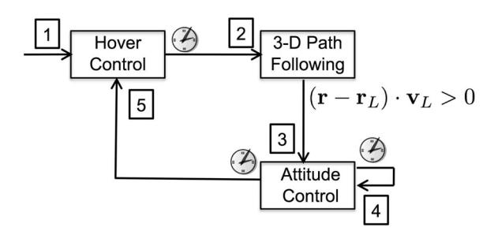

**Fig. 2.** Composition of controllers to execute an aggressive trajectory to a goal state. The clocks at the base of the arrows represent time-triggered transitions whereas mathematical conditions represent event-triggered transitions. The phase number is labeled near the tip of each arrow.

### *4.1. Sequence for aggressive trajectories*

*4.1.1. Trajectory description* We design a sequence of controllers to reach a goal state, *G*, with a specified position, **r***G*, velocity, **v***G*, yaw angle, ψ*G*, and pitch angle, θ*G*, with zero angular velocity and roll angle. The sequence consists of five phases:

- Phase 1: hover control (stiff) to a desired position (Section 3.2);
- Phase 2: 3D path following toward a desired position, **r***L*, and yaw angle, ψ*G* (Section 3.3);
- Phase 3: attitude control to desired pitch angle, θ*G*, yaw angle, ψ*G*, and zero roll (Section 3.1);
- Phase 4: attitude control to zero pitch angle, yaw angle, ψ*G*, and zero roll;
- Phase 5: hover control (soft) to a desired position.

The sequence can also be illustrated as a hybrid automaton in Figure 2.

The yaw angle is controlled to be a specified ψ*G* during all phases. In Phase 2, the robot controls along a 3D trajectory to build up momentum and reach a commanded velocity **v***L* at a *launch point*, **x***L*. Phase 3 is initiated when the quadrotor passes the plane perpendicular to the desired velocity at the launch point. In Phase 3, the robot's attitude is controlled to a commanded pitch angle and a roll angle of zero. Note that during Phase 3, a constant net thrust is commanded. Phases 4 and 5 are recovery phases. In Phase 4, we use the attitude controller to control to a pitch and roll angle of zero. In Phase 5, a soft hover controller is used to stabilize to a position in space with zero velocity.

*4.1.2. Initial parameter selection* The parameters which fully define the five-phase trajectory can be found automatically for the 12-degree-of-freedom mathematical model of the quadrotor. The procedure for finding these parameters is described in this section. Conceptually, we start at the goal state for the quadrotor, *G*, and work backwards to automatically find all of the required parameters. The pitch tracking controller used in Phase 3 is tuned so that the settling time is approximately *Ts* seconds and the response is close to critically damped in response to a step input. For this reason, we design the system to reach the state *G*, *Ts* seconds after starting Phase 3. The position of the launch point, **r***L*, and the velocity vector at the launch point, **v***L*, necessary to achieve the desired state *G* are found via backwards integration of the equations of motion (1) from *G* to *L*. Here we assume the pitch angle tracks a trajectory with a critically damped response characterized by a settling time of *Ts* seconds, the yaw angle is ψ*G*, the roll angle is zero, and the net thrust is equal to the desired thrust. During Phase 2, the quadrotor starts at hover at **r***S* and follows the line segment from **r***S* to **r***L* with commanded velocity **v***L*. So the start position, **r***S*, is simply a chosen distance, *l*, in the direction of −**v***L* from **r***L* according to

**r***S* = **r***L* − *l* **v***L* **v***L* . (9)

In summary, we first integrate backwards *Ts* seconds from *G* to find **r***L* and **v***L* and then find **r***S* from Equation (9).

*4.1.3. Parameter adaptation* The real quadrotor does not perform exactly the same as the model. The system will not reach the exact launch point, **r***L*, or have the exact desired velocity, **v***L*, at the launch point. In addition, the quadrotor will not have an exactly zero pitch angle at the launch point and the angle performance will not be exactly critically damped with a settling time of *Ts* seconds. These deviations are caused by air drag, rotor dynamics, and actuator saturation limits. It is difficult to accurately model these effects so we iterate on experimental trials to achieve the goal state *G* using a form of iterative learning (Arimoto et al. 1984).

In this approach, starting with the initial parameter selection, we iterate *na* times on the commanded pitch angle

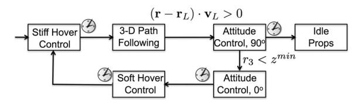

**Fig. 3.** Control strategy for robust perching on a vertical wall. The clocks at the base of the arrows represent time-triggered transitions whereas mathematical conditions represent event-triggered transitions.

during Phase 3. We let the commanded pitch angle at iteration *k* be θ *k C*. We let θ *k* act be the actual pitch angle achieved *Ts* seconds after entering Phase 3 during iteration *k* and update with a step size parameter, γθ ≤ 1, as follows

θ *k*+1 *C* = θ *k C* + γθ (θ*G* − θ *k* act) . (10)

Since the pitch angle achieved during Phase 3 is not strongly affected by the velocity commanded during Phase 2, we can iterate on the commanded velocity without significantly affecting the pitch angle. We use the same strategy as for pitch angle and iterate *nv* more times on velocity:

**v***k*+1 *C* = **v***k C* + γ*v*( **v***G* − **v***k* act) (11)

Finally, we run the final parameters for *nx* trials and let **r**¯act be the average position achieved *Ts* seconds after entering Phase 3 during the trials. The entire trajectory is then simply shifted by the difference between the desired position, **r***G*, and the actual position, **r**¯act, as follows:

**r***L* = **r***L*+( **r***G* − **r**¯act) **r***S* = **r***S*+( **r***G* − **r**¯act).

Note that the gains for all of the controllers are designed ahead of time. During parameter adaptation only the feedforward control parameters, the commanded pitch angle and the three components of the commanded velocity are adapted in this iterative learning process.

## *4.2. Sequence for robust perching*

The mode-switching sequence described in the previous section can be used for perching on surfaces at different angles. In this section, we show how this approach can be used to perch on vertical surfaces and recover from failed attempts (Figure 3).

In the 3D path following mode, the robot controls along a 3D line segment at a commanded velocity, **v***L*, towards a launch point, **r***L*. Attitude control to 90◦ is initiated when the quadrotor passes the plane perpendicular to the desired velocity at the launch point after which the robot's attitude controls to a commanded pitch angle of 90◦ and a roll angle of zero. At this point if the quadrotor successfully attaches to the vertical surface, the propellers are controlled to idle.

If the quadrotor misses perching on the wall then steps must be taken for the quadrotor to recover. First we must detect that the quadrotor has failed to attach to the wall. We do this by sensing that the quadrotor has dropped below the height of the perch, *z*min. After sensing that the quadrotor has missed the perch, it switches to the attitude control to 0◦ mode for a specified time and then to hover at a distance away from the wall with a controller with soft gains and a large basin of attraction. After recovering from the failed perching attempt, the quadrotor tries the perching sequence again until it succeeds.

### **5. Experiment design and implementation details**

In this work we present a systematic approach for designing trajectories and associated controllers that permit aggressive maneuvers with quadrotor robots. We consider four experimental scenarios:

- flying through a vertical opening at varying angles;
- flying downward through a horizontal opening;
- flying upward through a horizontal opening;
- perching on a target at varying angles.

Note that adhesion during perching is achieved by placing Velcro® on the underside of the quadrotor and on a target location. Graphics depicting the four scenarios are shown in Figure 4. The first and last scenarios include cases at various angles. For each of the cases, the quadrotor executed 15 trials of the trajectory after completing 2 iterations of (10) and 4 iterations of (11). We report the results of these experiments in Section 6.

The hardware, software, and implementation details of the experiments follows. The pose of the quadrotor is observed using a VICON motion capture system at 225 Hz.2 The position is numerically differentiated to compute the linear velocity of the robot. These values are available to MATLAB via ROS3 and a ROS–MATLAB bridge.4 All commands are computed in MATLAB using the latest state estimate at the rate of the VICON. The commands in MAT-LAB are bridged to ROS and the most recent command is sent to the robot via ZIGBEE at a fixed rate of 100 Hz. This fixed rate is due to the limited bandwidth of ZIGBEE (57.6 kbps). Commands sent to the robot consist of the gains and desired attitude, desired angular velocities, and thrust values described in Section 3.1.

The robot (Figure 1(a)) is sold commercially.5 The quadrotor follows a standard four-propeller design and is equipped with two embedded processors running at 1 kHz (denoted as high-level (HL) and low-level (LL)), an IMU (running at 300 Hz), and other sensors not required for this work. The HL processor runs our custom firmware, receives commands via ZIGBEE, and sends motor commands to the

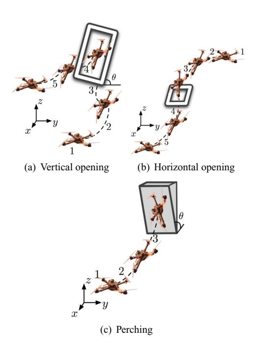

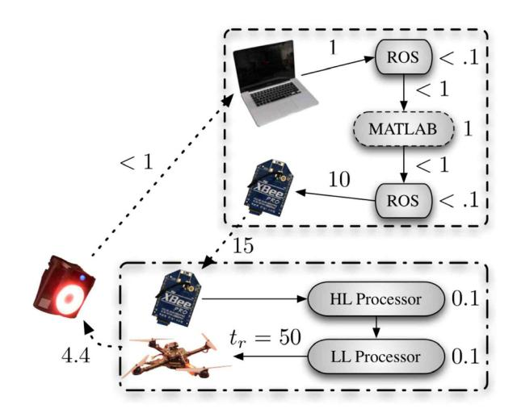

**Fig. 4.** The four experimental scenarios considered in this work. Flying downward and upward through a horizontal opening are both shown in (b), where the stages of the robot's progression are reversed for the latter. Note that in (a) and (c), θ denotes the varied window and perching orientation.

LL processor to execute those commands. The LL processor provides attitude estimates to the HL processor. A comparison between attitude estimates and VICON shows very similar results. Latencies and data flow are shown in Figure 5.

### **6. Results**

### *6.1. Basic control modes*

Here we illustrate the performance of the basic control modes. Standard deviations for the *x*–*y* and *z* errors are shown in Table 2 for hover control with stiff gains and 3D path following along a specified circular path. The VICON motion capture provides the position update at up to 225 Hz. To simulate a slower localization method we tested the hover control with the position and velocity updated at slower rates as shown in Table 2. Note that we found the performance of the hover controller to be the same at rates above 35 Hz. In addition to being slower, an alternate localization method could have larger errors which would further decrease performance. However, despite these limitations similar trajectories as those demonstrated in this work should be possible, albeit less precise, with a less powerful localization method.

**Fig. 5.** Latencies (ms) in an experimental system. The motion capture system operates at 225 Hz. Quadrotor pose and velocity data is received and bridged to Matlab. Commands are computed in Matlab and the latest command is sent to the robot via Zigbee at 100 Hz (throttled due to bandwidth limitations). Commands are received on the robot; the high-level (HL) embedded microprocessor computes direct motor commands using (5) and (6), then sends the motor commands to the lower-level (LL) processor. Our custom firmware runs on the HL processor and the proprietary firmware runs on the LL processor. The motor response time is denoted as *tr*. Negligible times (< 0.01 ms) are not noted. The worst-case response of the system from observation to motors rotating based on the observation is approximately 85 ms with *tr* as the dominant limiting factor.

We performed experiments to characterize the performance of the attitude controller. The quadrotor was commanded to gain vertical velocity in order to enter a free-fall state. Then a desired pitch angle was commanded for 0.6 seconds while a nominal net thrust of 0.2*mg* was commanded. The data shown in Figure 6 demonstrates the performance for desired angles of 60◦ and 90◦. This data justifies the assumption that the pitch angle approximately tracks a critically damped trajectory with a settling time, *Ts*, of 0.4 seconds.

### *6.2. Aggressive trajectories*

Nine cases of the four scenarios shown in Figure 4 were tested. All of the cases use a desired yaw angle, ψ*G*, of 90◦. The details of these cases are shown in Table 3. To help illustrate these maneuvers experimental data for Phase 2 and 3 for each case is shown in Figure 7. In all of the vertical window cases (1–4) the desired velocity is 2 m s−1 through the window and zero in the other directions. This speed is large enough for the quadrotor to coast through the window at the desired angle. For descending though the horizontal window (case 5), the desired downward speed is

**Table 2.** Standard deviations in centimeters for hover control and 3D path following of a 1 meter radius circle with the axis making a 45◦ angle from the vertical at 1.5 m s−1. The update rate of the position controller is also shown.

|       |                | Position and velocity update | rate x – y error | z error |
|-------|----------------|------------------------------|------------------|---------|
| Hover | control        | 225                          | 0.7              | 0.3     |
| Hover | control        | 20                           | 0.8              | 0.4     |
| Hover | control        | 10                           | 1.5              | 0.85    |
| Hover | control        | 6                            | 2.6              | 1.2     |
| 3D    | path following | 225                          | 1.3              | 0.7     |

**Table 3.** The nine test cases used to generate the experimental results for this paper.

| Case | Description |            |            |    |                | vG  | ( x     | , y , z ) (m s − 1)  |
|------|-------------|------------|------------|----|----------------|-----|---------|----------------------|
| 1    | Vertical    | window     | at         | 45 | ◦              | (2, | 0,      | 0)                   |
| 2    | Vertical    | window     | at         | 60 | ◦              | (2, | 0,      | 0)                   |
| 3    | Vertical    | window     | at         | 75 | ◦              | (2, | 0,      | 0)                   |
| 4    | Vertical    | window     | at         | 90 | ◦              | (2, | 0,      | 0)                   |
| 5    | Down        | through    | horizontal |    | window at 90 ◦ | (0, | 0,      | − 1.5)               |
| 6    | Up through  | horizontal |            |    | window at 90 ◦ | (0, | 0.4,    | 2.2)                 |
| 7    | Perch       | at 60 ◦    |            |    |                | (0, | 0.8cos( | 30), − 0.8 sin( 30)) |
| 8    | Perch       | at 90 ◦    |            |    |                | (0, | 0.8,    | 0)                   |
| 9    | Perch       | at 120 ◦   |            |    |                | (0, | 0.8cos( | 30), 0.8sin( 30))    |

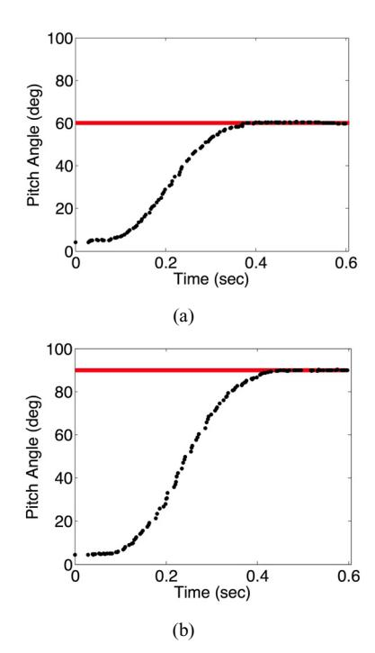

**Fig. 6.** Pitch angle response to step inputs: (a) tracking 60◦; (b) tracking 90◦.

1.5 m s−1 and zero in the other directions. This speed has to be small enough to give the quadrotor time to recover after passing through the window. Ascending through the horizontal window (case 6) is the most difficult case because the quadrotor must achieve enough vertical speed to coast upward through the window. For each of the perching cases (7–9), the desired velocity was set to be 0.8 m s−1 normal to the perching surface. This speed is large enough to guarantee adhesion given proper alignment of the quadrotor to the perching surface. Representative images from cases 4, 5, and 9 are shown in Figure 8 (see also Extension 1).

The performance of the iteration scheme for a representative case (case 8) in Figure 9. After the first iteration the initial angle error drops from 10◦ to less than 2◦ for the rest of the iterations. The velocity adaptation begins after iteration 3. The velocity error improves significantly in iteration 4 and continues to stay low for the remainder of the iterations. All cases show qualitatively similar performance improvements. In addition, the application of this iterative learning method to an individual case yields the same solution for multiple trials. As such, it appears that for the cases tested here, the parameter sets are unique and there are not multiple solutions that result in the same goal state.

For all cases a large portion of the error that the iteration scheme accounts for is due to the fact that the quadrotor is commanded to follow a line segment at a specified velocity starting from rest. However, it is known that this trajectory cannot be followed exactly since instantaneous changes in velocity are not possible. Further, we cannot even initially produce the desired force vector required to stay on the line segment as the quadrotor must first orient itself in the correct direction.6 This deviation from the line segment can observed in several of the trajectories shown in Figure 7.

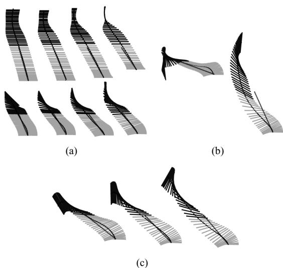

**Fig. 7.** Experimental data for first two phases for each tested case. The lines represent the orientation of the quadrotor. Phase 2 is shown with light gray lines and Phase 3 is shown with dark gray lines. The dotted straight line illustrates the line segment that the quadrotor is commanded to follow during Phase 2. (a) Vertical window, cases 1–4, top views (above) and front views (below). (b) Horizontal window, cases 5 and 6, side views. (c) Perching, cases 7–9, side views.

**Fig. 8.** Images from representative experimental trials. (a)–(d) A trial of the quadrotor passing through a vertical window at 90◦ (case 4). (e)–(h) The quadrotor descending through a horizontal window (case 5). (i)–(l) The quadrotor perching on a 120◦ surface (case 9). Videos of the experiments are available at http://tinyurl.com/quadrotorcontrol and Extension 1.

The iterative learning procedure also accounts for differences between the model and the real system during Phase 3. We assume that the propellers produce a constant force during this phase but this is not exactly true due to actuator saturation limits and the motor dynamics described in Section 2.2. Also, the attitude does not respond exactly

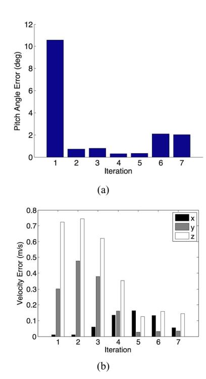

**Fig. 9.** Pitch angle and velocity improvement after iterating when perching at 90◦ (case 8).

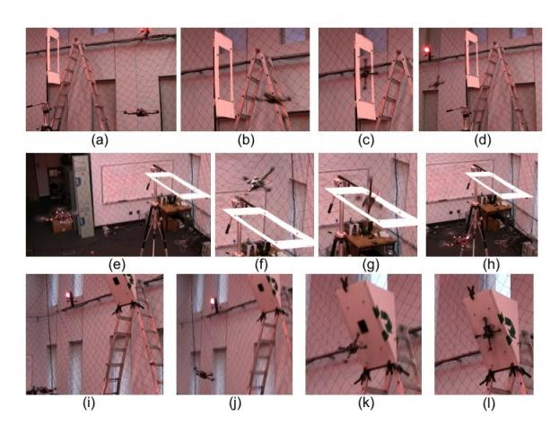

as a second-order system with the exact desired settling time. Further, the aerodynamic body forces on the craft are ignored during this phase.

After performing the iteration scheme for each of the cases, 15 trials with the same parameters are run for each case. A summary of the data collected from the 15 trials for all of the cases is shown in Figures 10 and 11(b). For a representative case (case 3) the standard deviation on the achieved angle is 0.9◦ and the standard deviations on the velocity and position are around 8 cm s−1 and 2 cm, respectively, for all axes. Note that the final trajectory should always have zero-mean error for the desired position and yaw angle because any maneuver can be shifted in space since the system dynamics are invariant to *x*, *y*, *z*, and ψ.

### *6.3. Robust perching*

The quadrotor was commanded to perch on a vertical surface for 10 trials. In order to guarantee failure no mechanism was placed on the quadrotor to enable attachment. For all 10 trials the quadrotor recovered to a stable hover. A representative trial is shown in Figure 11(a). The quadrotor launches to the wall then controls to a pitch angle of 90◦. After failing to attach to the wall the quadrotor is controlled to a pitch angle of 0◦ and then finally to a stable hover.

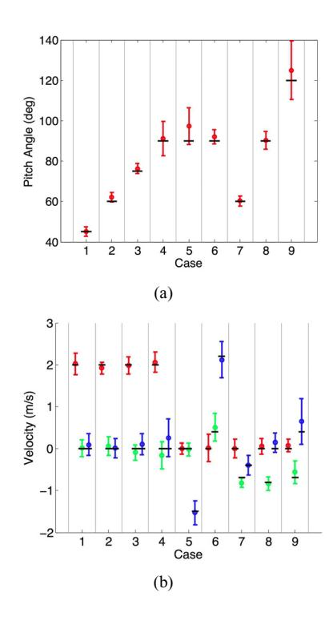

**Fig. 10.** Mean pitch angles (a) and velocities (b) for 15 trials of each case. The error bars represent three standards deviations and the solid bars are the desired pitch angles and velocities. In (b) the *x*, *y*, and *z* velocities are shown in the left, middle, and right positions, respectively, for each case.

## **7. Conclusion and future work**

In this paper we study the problem of designing dynamically feasible trajectories and controllers that drive a quadrotor to a desired state in state space. We focus on the development of a family of trajectories defined as a sequence of segments, each with a simple controller parameterized by a few gains and a goal state. Each controller is developed from the dynamic model of the robot, but is deliberately kept simple with a relatively few parameters to permit iterative refinement through successive experimental trials. These iterations allow us to account for the inevitable errors in the dynamic model and limitations of the actuators and sensors. Four scenarios are tested experimentally as considered by nine case studies with fifteen trials of each case study. The scenarios include flying through narrow, vertical and horizontal openings and perching on an inverted surface. We show that our approach results in repeatable and precise control along trajectories that demand velocities and accelerations that approach the limits of the vehicle's capabilities.

Our future work is directed toward planning for dynamically feasible trajectories that require more switches of controllers than the number shown here (at most five in

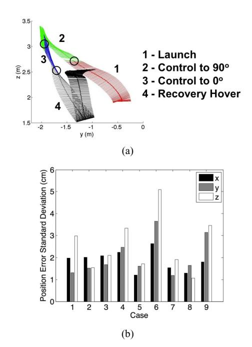

**Fig. 11.** (a) Recovery from a failed perching attempt on a vertical surface. The circles represent the transitions between control modes. (b) Standard deviations on goal positions for 15 trials for each case.

this work). We believe that by representing families of trajectories by specialized controllers the high-dimensionality of the planning problem may be reduced and so we are actively pursuing this area of research. We are also pursuing the extension of our approach to external disturbances such as a gust of wind. Preliminary results in this direction are forthcoming (Mellinger et al. 2011). Finally, we are interested in considering more advanced methods for optimizing and adapting the trajectory parameterizations to deal with differences between the analytic model and reality.

### **Notes**

- 1. The off-diagonal terms of *I* are nearly zero since *xB*–*yB*–*zB* are close to the principal axes of the quadrotor.
- 2. See http://www.vicon.com.
- 3. See http://www.ros.org.
- 4. See http://github.com/nmichael/ipc-bridge.
- 5. See http://www.asctec.de.
- 6. This deviation can be reduced by replacing the linear segment with a trajectory that satisfies boundary conditions on positions, velocities and accelerations, but with a significant increase in complexity. This is explored in Mellinger and Kumar (2011).

**Funding** This work was supported by the ARL (grant number W911NF-08-2-0004) and the ONR (grant numbers N00014-07-1-0829 and N00014-09-1-1051). **References** Abbeel P (2008) *Apprenticeship Learning and Reinforcement Learning with Application to Robotic Control*. PhD thesis, Stanford University, Stanford, CA. Alur R, Courcoubetis C, Halbwachs N, Henzinger TA, Ho PH, Nicollin X, et al. (1995) The algorithmic analysis of hybrid systems. *Theoretical Computer Science* 138: 3–34. Arimoto S, Kawamura S and Miyazaki F (1984) Bettering operation of robots by learning. *Journal of Robotic Systems* 1: 123–140. Bayraktar S and Feron E (2007) *Experiments with Small Helicopter Automated Landings at Unusual Attitudes*. Preprint. Bouabdallah S (2007) *Design and Control of Quadrotors with Applications to Autonomous Flying*. PhD thesis, Ecole Polytechnique Federale de Lausanne, Lausanne, Switzerland. Cory R and Tedrake R (2008) Experiments in fixed-wing uav perching. In *AIAA Guidance, Navigation, and Control Conference*. Desbiens AL and Cutkosky MR (2010) Landing and perching on vertical surfaces with microspines for small unmanned air vehicles. *Journal of Intelligent Robotic Systems* 57: 313–327. Gillula JH, Huang H, Vitus MP and Tomlin CJ (2009) Design and analysis of hybrid systems, with applications to robotic aerial vehicles. In *Proceedings of the International Symposium of Robotics Research*, Lucerne, Switzerland. Gillula JH, Huang H, Vitus MP and Tomlin CJ (2010) Design of guaranteed safe maneuvers using reachable sets: Autonomous quadrotor aerobatics in theory and practice. In *Proceedings of the IEEE International Conference on Robotics and Automation*, Anchorage, AK, pp. 1649–1654. Gurdan D, Stumpf J, Achtelik M, Doth K, Hirzinger G and Rus D (2007) Energy-efficient autonomous four-rotor flying robot controlled at 1 kHz. In *Proceedings of the IEEE Int. Conf. on Robotics and Automation*, Roma, Italy. He R, Bachrach A, Achtelik M, Geramifard A, Gurdan D, Prentice S, et al. (2010) On the design and use of a micro air vehicle to track and avoid adversaries. *The International Journal of Robotics Research* 29: 529–546. Hoffmann G, Waslander S and Tomlin C (2008) Quadrotor helicopter trajectory tracking control. In *AIAA Guidance, Navigation and Control Conference and Exhibit*, Honolulu, Hawaii. Jadbabaie A and Hauser J (2005) On the stability of receding horizon control with a general terminal cost. *IEEE Transactions on Automatic Control* 50: 674–678. Kim H, Shim D and Sastry S (2002) Nonlinear model predictive tracking control for rotorcraft-based unmanned aerial vehicles. In *American COntrol Conference*, vol. 5, pp. 3576–3581. Landau ID, Lozano R and M'Saad M (1998) *Adaptive Control*. New York: Springer. Likhachev M, Gordon G and Thrun S (2003) ARA\*: Anytime A\* with provable bounds on sub-optimality. *Advances in Neural Information Processing Systems* 16: 767–774. Lupashin S, Schollig A, Sherback M and D'Andrea R (2010) A simple learning strategy for high-speed quadrocopter multiflips. In *Proceedings of the IEEE International Conference on Robotics and Automation*, Anchorage, AK, 1642–1648. Mellinger D and Kumar V (2011) Minimum snap trajectory generation and control for quadrotors. In *Proceedings of the IEEE International Conference on Robotics and Automation*. Mellinger D, Lindsey Q, Shomin M and Kumar V (2011) Design, modeling, estimation and control for aerial grasping and manipulation. In *International Conference on Intelligent Robots and Systems*. Michael N, Mellinger D, Lindsey Q and Kumar V (2010) The GRASP multiple micro UAV testbed. *IEEE Robotics and Automation Magazine* 17(3): 56–65. Pines D and Bohorquez F (2006) Challenges facing future micro air vehicle development. *AIAA Journal of Aircraft* 43: 290–305. Tang J, Singh A, Goehausen N and Abbeel P (2010) Parameterized maneuver learning for autonomous helicopter flight. In *Proceedings of the IEEE International Conference on Robotics and Automation*, Anchorage, AK, 1142–1148. Tedrake R (2009) LQR-Trees: Feedback motion planning on sparse randomized trees. In *Proceedings of Robotics: Science and Systems*, Seattle, WA. Yu J, Jadbabaie A, Primbs J and Huang Y (1999) Comparison of nonlinear control design techniques on a model of the caltech ducted fan. In *IFAC World Congress, IFAC-2c-112*, pp. 53–58. **Appendix: Index to Multimedia Extensions** The multimedia extension page is found at http://www. ijrr.org **Table of Multimedia Extensions** Extension Type Description 1 Video Videos of experiments described in the paper.