# 7KH)OLJKW&RQWURORI0LFUR4XDG5RWRU8\$9 %DVHGRQ3,'

<LKRQJ0RX 4LQJ\RQJ=KDQJ 6KLOLQ/LXDQG.HWLDQ/LDQJ 6FKRRORI\$XWRPDWLRQ :XKDQ8QLYHUVLW\RI7HFKQRORJ\ :XKDQ &KLQD T\]KDQJ#ZKXWHGXFQ

*Abstract***²\$WWLWXGH HVWLPDWLRQ LV WKH NH\ SDUW RI WKH IOLJKW FRQWURO V\VWHP RI PLFUR TXDGURWRU 8\$9 7R EHJLQ ZLWK TXDWHUQLRQ DQG FRPSOHPHQWDU\ ILOWHU \$WWLWXGH DOJRULWKP LV GHVLJQHG WRUHGXFH WKHRSHUDWLRQTXDQWLW\RIDWWLWXGHHVWLPDWLRQ \$QG WKHQXVLQJ WKH3,'FRQWURODOJRULWKPZRUNRXW WKHDWWLWXGH FRQWURO )LQDOO\ XVH WKH DQGURLG PRELOH SKRQH YLD %OXHWRRWK FRQWURO WKH IOLJKW VWDWXV RI 8\$9 7KH VLPXODWLRQ UHVXOWV GHPRQVWUDWH WKDW WKH 3,' FRQWURO V\VWHP LV ZHOO WR PDLQWDLQ VWDEOHIOLJKWRIWKHDLUFUDIW**

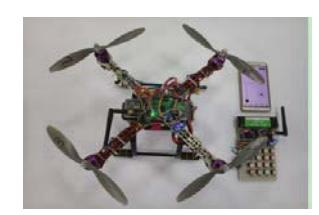

*Keywords—micro quad-rotor UAV; flight control; quaternion; PID controls; android mobile phone*

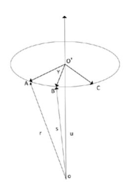

# , ,1752'8&7,21

\$WSUHVHQWWKHPLFURTXDGURWRU8\$9EHFDXVHRILWVVLPSOH VWUXFWXUH ORZ FRVW DQG HDV\ WR PDLQWDLQ LW KDV EHHQ IRXQG D ZLGH UDQJH RI DSSOLFDWLRQ LQ PDQ\ ILHOGV OLNH PLOLWDU\ HQYLURQPHQW KD]DUGV PRQLWRULQJ DQG VFLHQWLILF UHVHDUFK >@ \$WWLWXGHHVWLPDWLRQLVWKHNH\SDUWRIWKH8\$9 FRQWUROV\VWHP DWWLWXGH PHDVXUHPHQW V\VWHP E\ UHDGLQJ WKH YDOXH RI WKH DWWLWXGH VHQVRU WKURXJK WKH DSSURSULDWH DWWLWXGH DOJRULWKP PHWKRG EDVHG RQ TXDWHUQLRQ DQG FRPSOHPHQWDU\ ILOWHU ZKHUHE\ JHWWKH UROO DQJOH SLWFK DQJOH DQG \DZ DQJOH RIWKH 8\$9 \$OWKRXJK WKH XVH RI D VLQJOH PLFURPHFKDQLFDO J\URVFRSHVFDQPHDVXUHWKHDWWLWXGHDQJOHVEXWLWVDFFXUDF\LV GLIILFXOW WR EH DVVXUHG VR WKDW RQO\ WKH J\URVFRSH LQ FRPELQDWLRQZLWKRWKHUDWWLWXGHVHQVRUVFDQPHDVXUHWKHORQJ WHUP UHOLDEOH DWWLWXGH DQJOH %DVHG RQ WKH TXDWHUQLRQ FRPSOHPHQWDU\ILOWHUDWWLWXGHDOJRULWKPPHWKRGVGHVFULEHGKHUH FDQ EH XVHG HIIHFWLYHO\ LQWHJUDWH WKH HUURU RI J\URVFRSH DQG DFFHOHURPHWHU ILQDOO\ HQVXUHWKHDFFXUDF\RIDWWLWXGHVROXWLRQ

# ,, 6<67(0+\$5':\$5(2)6758&785(

7KH KDUGZDUH VWUXFWXUH RI TXDGURWRU 8\$9 IOLJKW FRQWURO V\VWHPLVVKRZQLQ)LJLQFOXGLQJWKHPLFURTXDGURWRU8\$9 JURXQG FRPPXQLFDWLRQ VZLWFKLQJV\VWHP DQG \$QGURLG VPDUW PRELOH˖

4XDGURWRU 8\$9 LQFOXGHV SRZHU PRGXOH 670 0&8 DWWLWXGHVHQVRUV038XOWUDVRQLFVHQVRU86ZLUHOHVV WUDQVFHLYHUPRGXOH15)/HWF

\*URXQGFRPPXQLFDWLRQVZLWFKWHUPLQDOLQFOXGHV670

)LJ6\VWHPKDUGZDUHVWUXFWXUH

)LJ8\$9URWDWLRQDOPRYHPHQW

FRQWURO ERDUG D ZLUHOHVV WUDQVFHLYHU HQG 15)/ DQG %OXHWRRWK PRGXOH %OXHWRRWK DQG QHWZRUN HQDEOHG DQGURLG PRELOHSKRQH

# ,,, \$77,78'( (67,0\$7,212) 0,&5248\$'527258\$9

# *A. Quaternions and Euler Angles*

6XSSRVH 8\$9 DLUIUDPH FRRUGLQDWH D[HV E LV JHW E\ WKH JHRJUDSKLF FRRUGLQDWH V\VWHP J URWDWLQJ DURXQGLWVWKUHH D[HV ZKLFKDFFRUGLQJWR WKHRUGHU RI=D[LV<D[LV;D[LVDQGWKH URWDWLRQDQJOHDUH LQRUGHU*Įȕș*FRUUHVSRQGLQJWRUROODQJOH SLWFKDQJOHDQG\DZDQJOH >@

4XDWHUQLRQ4LVGHILQHGDV

*Q q q q q q qi q j qk*

7DNHDSRLQWRQWKH8\$9WRDQDO\VLVDVVKRZQLQ)LJ

:KHUH WKHSRLQW\$URWDWLRQDURXQGSRLQW22\$WKDW LVWKH LQLWLDO SRVLWLRQ YHFWRU DIWHU WKH HODSVHG WLPH W ZKLFK URWDWLRQ DQJOHLVȖ \$DQG%DUHLQWKHVDPHSODQH3URMHFWLRQYHFWRURIX LQWKHJHRJUDSKLFFRRUGLQDWHV\VWHPLV X >@*T g lmn*

7KHWUDQVIHUPDWUL[EHWZHHQFRRUGLQDWHD[HVEWRJFDQEH GHSLFWHGDVIROORZV

 VLQ  VLQ FRV VLQ VLQ FRV OQ VLQ VLQ FRV VLQ  VLQ VLQ FRV VLQ VLQ FRV OQ VLQ VLQ FRV VLQ  VLQ *g m n n lm m Cn lm l n l mn m l mn m l* JJ J J J J J JJ J J JJ J JJ J JJ J J ª º « » « » « » « » « « «¬ ¼ » 

)RXU HOHPHQWVRITXDWHUQLRQ4FDQEHZULWWHQDV

>@ FRV VLQ VLQ VLQ *T T qqqq l m n* ªº JJ J J «» ¬¼ 

7KHQ

*g b q q qq qq qq qq C qq qq q q qq qq qq qq qq qq q q* ªº «» ¬¼ 

:KHUH

 FRV  VLQ *Qq q q q l m n* JJ 

&RRUGLQDWHWUDQVIRUPDWLRQPDWUL[FDQEHUHSUHVHQWHGE\

FRV FRV VLQ FRV FRV VLQ VLQ VLQ VLQ FRV VLQ FRV VLQ FRV FRV FRV VLQ VLQ VLQ FRV VLQ VLQ VLQ FRV VLQ FRV VLQ FRV FRV *g Cb* D E DT D ET DT D ET D E DT D ET DT D ET EE T E T ª º « » « » « » ¬ ¼

7KH UHODWLRQVKLS EHWZHHQ WKH (XOHU DQJOHV DQG TXDWHUQLRQ RITXDGURWRU8\$9FDQEHH[SUHVVDVIROORZV

  DUFWDQ  DUFVLQ   DUFWDQ  *qq qq qq qq qq qq qq qq* T E D ªº «» ªº «» «» «» ¬¼ ¬¼ 

6R ZH QHHG FDOFXODWH WKH YDOXH RI *q q q q* WR JHW DWWLWXGHDQJOHVOLNH *Įȕș* WKHUHE\FRQWUROOLQJWKHPRYHPHQWRI WKH8\$9

# *B. Attitude Estimation Algorithm*

\$FFRUGLQJ WR WKH GHILQLWLRQ RI TXDWHUQLRQ 4 FDQ EH GHSLFWHGDVIROORZV

FRV VLQ VLQ VLQ FRV VLQ *g Q l im jn k u* JJ J J J J  VLQ FRV VLQ *g dQ g du u dt dt* JJ J J J

\$FFRUGLQJWRWKH&RULROLVWKHRUHP

*gb g gg bgb du du Cu dt dt* u Z

:KHUH X*g* LV SURMHFWLRQ YHFWRU RI X LQ WKH 8\$9 DLUIUDPH FRRUGLQDWH V\VWHP *g* Z*gb* WKH URWDWLRQ DQJOH RI WKH FRRUGLQDWH V\VWHP EWRWKH FRRUGLQDWH J XQGHUWKH JHRJUDSKLF FRRUGLQDWH V\VWHP J

*b gg gb du d u dt dt* J Z

6R

*g du dt*

VLQ FRV *dQ g u dt* JJ J J

FRV VLQ *dd d gg uQ u dt dt dt* J J J JJ 

*gg gb dQ d uQ Q dt dt* J Z

6LQFH WKH DQJXODU YHORFLW\ PHDVXUHG E\ DWWLWXGH VHQVRU LV HTXDOWRWKHDQJXODUYHORFLW\RIWKHERG\FRRUGLQDWHPRYHPHQW 6R

*gb* ZZ *gb QQ gb*

:KHUH *b* Z*gb* WKHURWDWLRQDQJOH RI WKHFRRUGLQDWHV\VWHPEWRWKH FRRUGLQDWHVJ XQGHU 8\$9DLUIUDPHFRRUGLQDWHD[HVE

*gb b gb gb gb dQ Q Q QQ Q dt* ZZ Z

\$SSO\LQJ TXDWHUQLRQ¶V PXOWLSOLFDWLRQ IRUPXOD TXDWHUQLRQV FDQEHREWDLQHGDV

 G G G G *xyz x zy yz x zy x q dt q q dt q q q dt q q dt* ZZZ Z ZZ ZZ Z ZZ Z ªº «» «» ªº ªº «» «»«» «» «» «» «» «» «» «» ¬¼¬¼ «» «» ¬¼ 

ZKHUH DQJXODU YHORFLW\ *Ȧx Ȧy Ȧz* DUH PHDVXUHG E\ DWWLWXGH VHQVRU *dq/dt* LV TXDWHUQLRQ V LQFUHPHQW LQ D VKRUW WLPH TXDWHUQLRQ FDQ REWDLQHG E\ LQWHJUDWLQJ DW D FHUWDLQ WLPH WKLV WLPH WR FDOFXODWH WKH 8\$9 DLUIUDPH (XOHU DQJOHV DQG WKHQ DFFRUGLQJWRWKH IRUPXOD  FDQFDOFXODWH8\$9 VDWWLWXGH DQJOHWKHUHE\FRQWUROOLQJWKHPRYHPHQWRIWKH8\$9 \$WWLWXGH HVWLPDWLRQVWUXFWXUHGLDJUDPLVVKRZQLQ)LJ

'XH WR WKH SUHVHQFH RI LQWHJUDO FDOFXODWLRQ LQ DWWLWXGH HVWLPDWLRQ ZKHQ DQJXODU YHORFLW\ H[LVW HUURUV PD\ LQFUHDVHV WKH LQWHJUDO HUURU LW FRXOG OHDG WR WKH REWDLQHG DQJOH VLJQDO GLVWRUWLRQ7KHQZHQHHGDJRRGORQJWHUPSHUIRUPDQFHRIWKH DFFHOHURPHWHUSURYLGHDQJOHVLJQDO

7KURXJKFRPSDUHWKHDFWXDO DFFHOHUDWLRQ JHW E\WKUHHD[LV RI ERG\ FRRUGLQDWHV D[HV E WR WKH DFFHOHUDWLRQ SURMHFWLRQ RQ WKUHH D[HV RI E DQG WKHQ JHW WKH FXUUHQW DWWLWXGH HUURU WR FRPSOHPHQWDU\ ILOWHU ZLWK GDWD REWDLQHG E\ J\UR &RPSOHPHQWDU\ILOWHUFRHIILFLHQWLVGHWHUPLQHGDFFRUGLQJWRWKH DFWXDOQHHG)LQDOO\ ZHFDQ REWDLQUHOLDEOH\$WWLWXGHDQJOH>@

# *C. UAV Control Algorithm Design*

7KHV\VWHPXVHV\$QGURLGSKRQHUHPRWHFRQWUROWKH8\$9 V IOLJKW OLNH YHUWLFDOWDNHRII DQG ODQGLQJIO\DURXQGKRYHUDWD

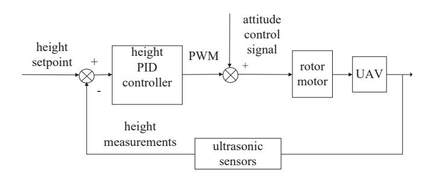

)LJ+HLJKW FRQWUROVWUXFWXUHGLDJUDP

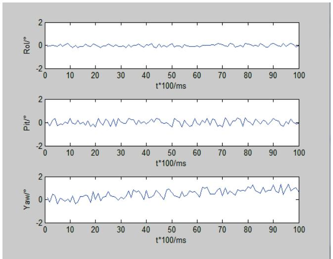

)LJ\$QJXODUYHORFLW\VLPXODWLRQ

KHLJKW HWF &RQWURO DOJRULWKP PDLQO\ LQFOXGHV 'RXEOHORRS 3,' DOJRULWKP KHLJKW FRQWURO DOJRULWKP GLJLWDO ILOWHULQJ DOJRULWKP>@

### x 'RXEOHORRS3,' &RQWURO

4XDGURWRU8\$9 VDWWLWXGHFRQWUROXVH'RXEOHORRS3,' FRQWUROOHU)LJLVD3,'FRQWUROVWUXFWXUHGLDJUDP RITXDG URWRU8\$9:KHUHLQWKHLQQHUORRS3,'FRQWUROORRSRQFH HYHU\PVPVRXWHUORRS3,'FRQWUROJDLQ

# x +HLJKW&RQWURO\$OJRULWKP

)LJLVKHLJKW FRQWUROVWUXFWXUHGLDJUDPRITXDGURWRU 8\$9

#### x 'LJLWDO)LOWHU\$OJRULWKP

'LJLWDO ILOWHULQJ DOJRULWKPV XVH ILUVWRUGHU ORZSDVV 5& ILOWHU VPDOO FDOFXODWLRQ DSSOLFDELOLW\:KHQWKHLQSXW YDULDEOH ORZIUHTXHQF\FKDQJHVWKLVILOWHULQJDOJRULWKPLVKLJKHIILFLHQW FDQIXOO\PHHWWKHFRQWUROV\VWHP UHTXLUHPHQWV

### ,9 6,08/\$7,21\$1\$/<6,6

# *A. Attitude angle Simulation*

,QDFFRUGDQFHZLWKWKHSULQFLSOHRIGRXEOHORRS3,'FRQWURO FRPPLVVLRQLQJLQQHU3,' SDUDPHWHUV ILUVWO\ >@:KHQ VHWWLQJ WKH DQJXODU YHORFLW\ WDUJHW YDOXH DV VLPXODWLRQ UHVXOWV LV VKRZQLQ)LJ

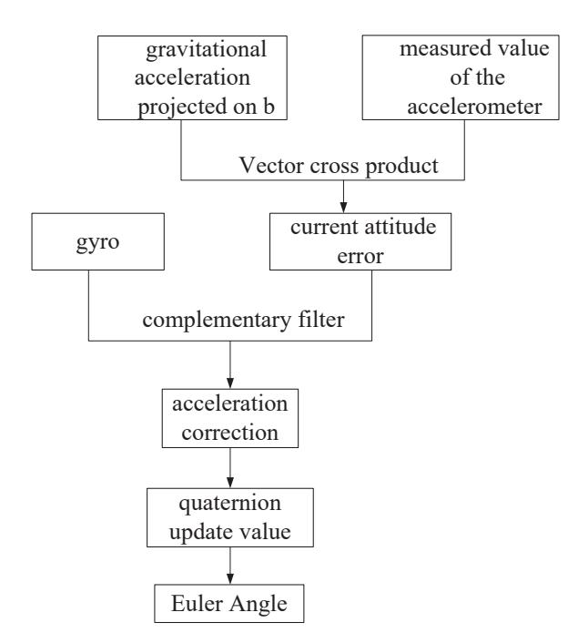

)LJ\$WWLWXGHHVWLPDWLRQVWUXFWXUHGLDJUDP

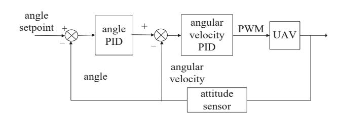

)LJ3,'FRQWUROVWUXFWXUHGLDJUDP

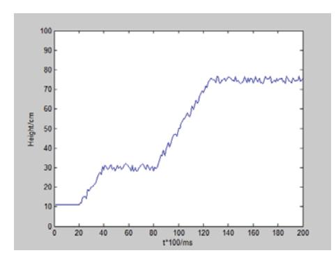

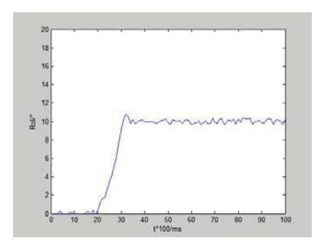

)LJ5ROODQJOHVLPXODWLRQ

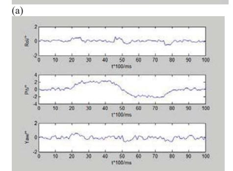

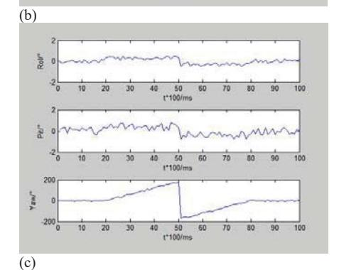

)LJ)OLJKWVLPXODWLRQD+RUL]RQWDOIOLJKWDQJOH VLPXODWLRQE +RUL]RQWDOIOLJKWDQJOH VLPXODWLRQF5RWDU\IOLJKWDQJOHVLPXODWLRQ

\$IWHUGHEXJJLQJLQQHUORRS3,'SDUDPHWHUVWKHQVLPXODWLRQ RXWHU 3,' SDUDPHWHUV LQ HYHU\ GLUHFWLRQ VHSDUDWHO\ 6HW WKH REWDLQ DQJOH DVWKUHH DQJOHV FDQTXLFNO\UHDFKWKHWDUJHW PHHWWKH UHTXLUHPHQWV DQGWKH VWHDG\VWDWHHUURULV VPDOO 6HW UROODQJOHDVH[DPSOHDVVKRZQLQ)LJ

)LJ3,'FRQWUROVWUXFWXUHGLDJUDP

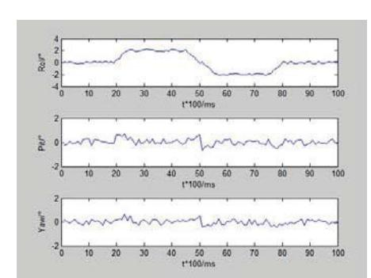

# *B. Flight Test and Simulation*

8VLQJ D PRELOH SKRQH IRU FRQWURO 8\$9 IOLJKWLQ GLIIHUHQW GLUHFWLRQV DV VKRZQLQ )LJ VKRZQWKH VLPXODWLRQ RI TXDG URWRU 8\$9 IO\LQJ DURXQG LQ KRUL]RQWDO ULJKW DQG OHIW ORQJLWXGLQDO IURQWDQGEDFN DQGURWDU\

# *C. Height Test and Simulation*

\$VVKRZQLQ)LJWKH8\$9 VLQLWLDOSRVLWLRQDWDKHLJKWRI FPDQGWKHQVHWWKHWDUJHWKHLJKWRIFPDQG FPLQRUGHU WKH8\$9UHDFKHVWKHVSHFLILHGKHLJKWWRPDLQWDLQDEDODQFHE\ SKRQH KHOGDKHLJKWHUURUDW SRVLWLYHDQG QHJDWLYH FPPHHW WKHFRQWUROUHTXLUHPHQWV

#### &21&/86,21

7HVW DQG VLPXODWLRQ GHPRQVWUDWH DQGURLG PRELOH SKRQH LV DEOHWRDFKLHYHVWDEOHDWWLWXGHFRQWURORIPLFURTXDGURWRU8\$9 FRPSOHWHG WKH WDVN DQG DFKLHYHG WKH GHVLUHG REMHFWLYHV 7KH LQWURGXFWLRQ RI DQGURLG VPDUW GHYLFHV SURYLGHV QHZ ZD\V WR FRQWUROWKH TXDGURWRU 8\$9 KDV D SRVLWLYH HIIHFWWR SUDFWLFDO DSSOLFDWLRQ RI PLFUR IRXUURWRU DLUFUDIW \$OVR WKHUH DUH PDQ\ SDUWVQHHGWREHLPSURYHPHQWLQIXWXUHVWXGLHV OLNHGHVLJQWKH PRUH HIILFLHQW V\VWHP FRQWUROOHU DQG GHYHORSPHQW WKH PRELOH SKRQH\$33

#### 5()(5(1&(6

>@ 33RXQGV50DKRQ\DQG3&RUNH0RGHOOLQJDQGFRQWURORIDTXDG URWRU URERW *in Australasian Conference on Robotics and Automation, Auckland*1HZ=HDODQGSS >@ <<4LQ *Inertial navigation*%HLMLQJ6FLHQFH3UHVV SS >@ 0(XVWRQ3&RRWH50DKRQ\DQG-.LP \$FRPSOHPHQWDU\ILOWHU IRU DWWLWXGH HVWLPDWLRQ RI D IL[HGZLQJ 8\$9 *in IEEE International Conference on Intelligent Robots and Systems*1LFH )UDQFH SS >@ \$ / 6DOLK 0 0RJKDYYHPL + \$ ) 0RKDPHG DQG . 6 \*HDLG )OLJKW3,'&RQWUROOHU'HVLJQIRUD8\$94XDGURWRU*Sci. Res. Essays.,* YROSS >@ - . /LX *Advanced PID control and MATLAB simulation*澿澳 *1st ed.* %HLMLQJ %HLMLQJ 8QLYHUVLW\ RI \$HURQDXWLFV DQG \$VWURQDXWLFV 3UHVV -DQXDU\ SS