# A Comparative Study Between a Classical and Optimal Controller for a Quadrotor

Prathamesh Saraf Department of Electrical & Electronics Engineering Birla Institute of Technology and Science – Pilani Hyderabad, India pratha1999@gmail.com

Manan Gupta Department of Electrical & Electronics Engineering Birla Institute of Technology and Science – Pilani Hyderabad, India f20170488@hyderabad.bitspilani.ac.in

Alivelu Manga Parimi Department of Electrical & Electronics Engineering Birla Institute of Technology and Science – Pilani Hyderabad, India alivelu@hyderabad.bitspilani.ac.in

*Abstract***— This paper presents a comparison between the Proportional Integral Derivative (PID), a classical controller, and Linear Quadratic Regulator (LQR), an optimal controller, acting on a quadrotor model to control its translational and rotational movements. The complicated dynamic model of a quadrotor based on Newtonian and Euler's laws and fundamental physics principles is simplified to derive a linear mathematical model. The derivation gives the equations that govern a quadrotor's motion concerning the body frame and the inertial frame in the state-space form. This linearized model is utilized to develop the controllers. The performance of the PID control and the optimal regulator established on LQR is compared in various conditions subjected to the Quadrotor model.**

*Keywords— Proportional Integral Derivative, Linear Quadratic Regulator, Quadrotor, Simulink*

# I. INTRODUCTION

 Quadrotors (or unmanned aerial vehicles powered by four rotors) are finding increasing applications in fields ranging from video surveillance to emergency response. They are required to fly in unknown environments and essentially with accurate control. Consequently, the controllers for quadrotors have been studied, researched, and improved over the period. Most controllers used on quadrotors utilize classical control, such as proportionalintegral-derivative (PID) control.

 However, classical control theory encompasses mostly linear time-invariant single-input single-output systems. The basis of control for these systems depends on how their behavior is modified using a feedback loop. On the other hand, the Linear Quadratic Regulator (LQR), a type of optimal control whose theory focuses on mathematical optimization of an objective cost function for a dynamic system and multi-input and multi-output systems and is expected to be more robust for a quadrotor. LQR focuses on non-linear models rather than the classical linear equation approach of PID. PID controllers' main drawback is that the actual system requires its linearization in every test and new condition. However, for LQR control, this step is eliminated, and system equations can be directly fed to the controller and acquire the desired response.

 Shahida et al. [1] had explored how PID controllers gave stability by bringing the closed-loop poles to the more negative side of the s-plane and compared to LQR controllers. Hayrettin et al. [2] tackled quadrotor control's problem by proposing an adaptive controller that is a hybrid of both PID and LQR controllers. Meera et al. [3] presented results on a PID controller coupled with a Kalman filter being applied to UAVs. Lucas et al. [4] worked on using LQR control to tune a PID controller, combining the control techniques to control the quadrotor.

 Existing research in the field has stated how PID has effectively been implemented for control in simulations and even real-world scenarios. However, when extended to scenarios with considerable disturbances to a quadrotor's flight or during starting up from no load, the PID controller gains have to be tuned continuously. This motivated to study and apply optimal control to comprehend it's effect on such uncertain circumstances.

 This study aims to apply both classical PID controller and optimal controller based on LQR for the quadrotor translational and rotational motions and compare their performances. This work can be extended to other unmanned aerial vehicles such as fixed-wing aircraft and vertical takeoff or landing (VTOL) vehicles, which opens up a wide avenue of applications.

 The following sections presents the modeling and simulation, followed by the results. Section II details the Quadrotor Model, i.e., the quadrotor's physical model and layouts the dynamic equations governing its motion. These equations are linearized, and a state-space model is developed in Section III. The IV and V sections follow up with a comprehensive study and observations of the PID and LQR controllers. The results section contains various cases for flight simulation using the two controllers. These are compared, and the conclusion is presented.

# II. QUADROTOR MODEL

 The position of a quadrotor in space can be specified using two reference frames: fixed and mobile. The fixed (inertial) coordinate system is one where Newton's laws are valid, and it is with respect to the Earth. The second frame is with respect to the quadrotor frame center, where the flight controller is positioned. The quadrotor has four Degrees of Freedom, namely Thrust, Roll, Pitch, and Yaw. The quadrotor's position and movement are controlled by varying the speeds and rotation direction, of the four motors (two diagonally opposite motors spin clockwise and the other two motors spin anti-clockwise). However, the quadrotor has four inputs (4 motors) and six outputs (three translational and

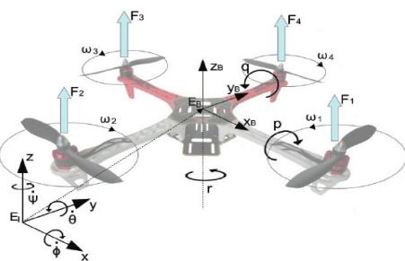

# IV. PROPORTIONAL INTEGRAL DERIVATIVE CONTROL

#### *A. Overview*

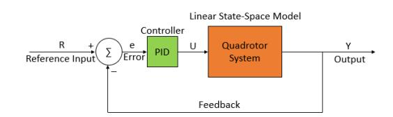

The PID controller is one of the standard classic models in control theory. The aim is to minimize the error by tuning the proportional, integral, and the derivative coefficients used in the controller equation. Error is defined as the difference between the setpoint value and the actual controller output at any particular instance. The proportional term increases/decreases the error by multiplying with a proportionality constant. The derivative term is used to estimate the controller's future response based on the error with respect to time. The derivative constant also accounts for the damping factor and needs to be tuned to minimize damping and obtain a smooth response. The integral term in the controller sums up all the past values, and the integral coefficient is used for assigning the weight to the integral term to obtain the desired output response in the shortest possible time. Thus, all three coefficients need to be tuned to obtain the setpoint value of the control system.

# *B. Equations*

The PID control equation uses the ����, ���� , and, ���� parameters and the error value to compute the controller response. The control equation is given below:

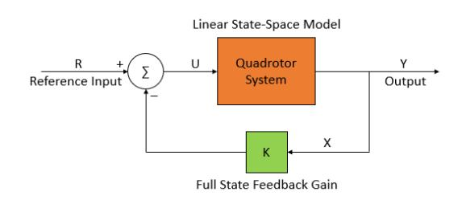

��(��) = ������(��) + ���� ∫ ��(��)���� �� 0 + ���� ����(��) ���� (18)

���� and ���� are defined as:

���� = �������� & ���� = ����/���� (19)

where ���� and ���� are the time periods for integral and derivative actions. The error value is defined as:

��(��) = ���������������� ���������� − ������������ ���������� (20)

# *C. Controller Design*

In the Quadrotor system, the state parameters need to be controlled so that it remains stable during the flight period. A small deviation in the quadrotor's setpoint values would create large variations in motion, which would lead to deviation from its desired trajectory and making it difficult for the user to control. Even if the main control lies in the hand of the user flying the quadrotor, unavoidable disturbances during the flight time will create instability and malfunction of the system. Thus, there is a need for an internal flight controller, which would autonomously adjust the rotor to a stable position. The four inputs thrust, roll, pitch, and yaw motion control the six-state parameters depending on the action. Thrust controls the �� parameter, roll controls the �� and the �� parameters, pitch controls �� and �� parameter and yaw controls the �� angle [6]. Thus, the sixstate parameters require 6 PID controllers with 1-2-2-1 controllers for thrust, roll, pitch, and yaw motion control, respectively. For roll and pitch motion, a cascaded PID loop is designed to have an inner and an outer feedback loop. The inner loop needs to be faster than the outer loop for an efficient response of the controller. Slowing the outer loop increases the overshoot but reduces the setting time for the rotational coordinates and their velocity and increases the time for the corresponding translational coordinate to attain the set point. The tuned PID controller parameters for optimal control are given in table 2 below.

TABLE II. PID CONTROLLER GAIN VALUES

After the successful implementation of the PID controller, the optimal LQR controller is designed for the linearized quadrotor model.

V. LINEAR QUADRATIC REGULATOR

#### *A. Overview*

As compared to the classic PID controller, the LQR controller involves a lot of mathematical computations to calculate the full state feedback matrix K. LQR controller uses an optimal control algorithm to minimize the cost function defined by the system equations. The cost function involves the state parameters and the input parameters to the system along with the Q and R matrices. The overall cost function needs to be minimum for optimal LQR solution. The Q and R matrices represent the weights assigned to the state parameters and the input parameters. By varying the values of the two matrices, the total value of the cost function can be adjusted according to the desired output. The two main quantities that need to be optimized for the quadrotor model are the power consumption and response speed. For a faster response of the controller, the Q matrix values need to be changed, whereas for minimizing the power consumption while achieving the desired setpoint without focusing on the time of response, the R matrix values need to be adjusted [8].

Fig.2: The closed loop quadrotor system with PID controller for stabilization

Fig.3: The closed loop quadrotor system with LQR controller for stabilization

# *B. Equations*

 The LQR optimization problem requires a linearized state-space model of the system. The cost function which needs to be optimized is given by:

�� = ∫ (�� ������ + �� ������)���� (21)

After tuning the matrices according to the desired output matrix, the Q and R matrices are used to solve the Algebraic Riccati Equation (ARE) to compute the full state feedback matrix, which is essentially the LQR controller.

�� ���� + ���� − ������ −1�� ���� + �� = 0 (22)

The S matrix obtained from the ARE is used to calculate the Full state feedback gain matrix K using the equation:

�� = �� −1�� ���� (23)

The final feedback control relation is then calculated as:

�� = −�� ∗ �� (24)

The tuned Q and R matrices which give the optimal response for the Quadrotor system parameters as defined before are:

�� = [ 500 0 0 0 0 0 0 0 0 0 0 0 0 200 0 0 0 0 0 0 0 0 0 0 0 0 1.71 0 0 0 0 0 0 0 0 0 0 0 0 500 0 0 0 0 0 0 0 0 0 0 0 0 200 0 0 0 0 0 0 0 0 0 0 0 0 3 0 0 0 0 0 0 0 0 0 0 0 0 10 0 0 0 0 0 0 0 0 0 0 0 0 10 0 0 0 0 0 0 0 0 0 0 0 0 10 0 0 0 0 0 0 0 0 0 0 0 0 0.25 0 0 0 0 0 0 0 0 0 0 0 0 10 0 0 0 0 0 0 0 0 0 0 0 0 1] (25)

�� = [ 1 0 0 0 0 0.001 0 0 0 0 0.001 0 0 0 0 0.001] (26)

and the Feedback gain matrix K is computed as:

�� = 10 ∗ [ 0 0 0.13 0 0 0.29 0 0 0 0 0 0 0 −44.7 0 0 −84.8 0 12.6 0 0 1.6 0 0 70.7 0 0 151.6 0 0 0 27.5 0 0 10 0 0 0 0 0 0 0 0 0 10 0 0 3.2 ] (27)

The next section presents the detailed comparative analysis of the two controllers tested for different input conditions.

## VI. RESULTS AND DISCUSSION

The PID and the LQR controller is designed for the quadrotor system in MATLAB as shown in Fig.2 and Fig.3. The simulation tests are divided into 3 cases that help verify the controller functionality in detail. Each case either uses different initial conditions or defines another set-point for a particular parameter of the system. The cases are defined as:

- 1. Pure thrust input with zero initial conditions
- 2. Pure thrust input with non-zero initial conditions
- 3. Thrust and Yaw input with zero initial conditions

Initial conditions define the Quadrotor state just before the controller action, and the set-point defines the desired final steady-state of the system. The detailed analysis of each case along with controlller response is given below:

# *A. Case 1*

the system input. In this case, only the vertical displacement (��) is expected and should reach a steady state position once the thrust force balances the gravitational force. The vertical velocity (��̇) increases rapidly in the beginning and slows down to zero as the rotor achieves steady position midair.

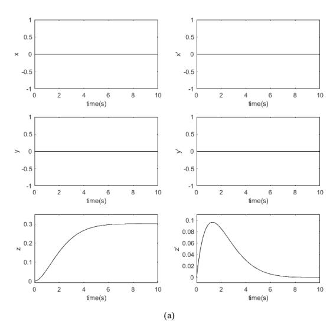

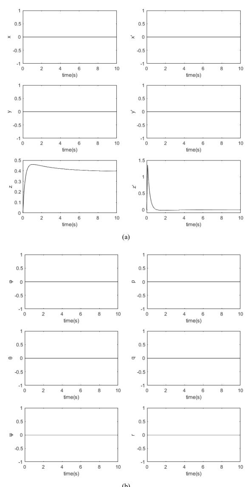

(b) Fig.4: The translational and rotational response of the quadrotor for a PID controller for case 1.

Fig.4 and Fig.5 shows the simulated response for PID and LQR controllers respectively. It can be seen that 'z' response for PID controller gives an overshoot of 0.5 units and settles at 0.45units with a settling time of 0.8 s whereas there is no overshoot in case of LQR controller and the value settles at 0.7 s at 0.34 units. There are no fluctuations observed about the set point indicating, LQR providing a stable output compared to PID controller.

#### *B. Case 2*

The initial conditions for the system are set as:

[1 1 0.2 1 1 0 1 1 1 1 1 1]

where each value defines the position of each of the state parameter. The input is again given as a pure thrust force. For this case, all the state parameters except 'z' should achieve the set point which is zero as no other input rotor action is desired. The initial conditions mentioned, show that the rotor is deviated from its set-point and thus the controller (a)

(b) Fig.7: The translational and rotational response of the quadrotor for an

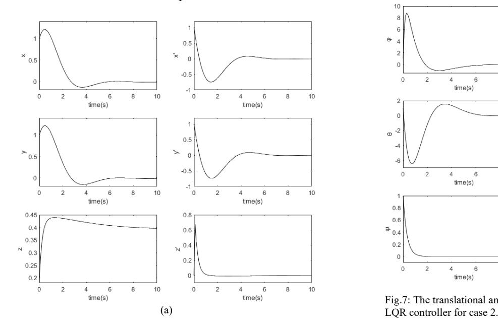

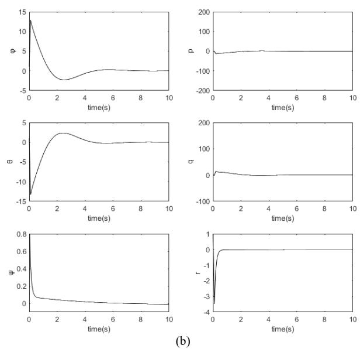

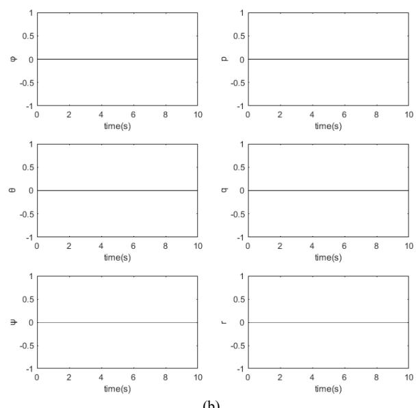

Fig.6: The rotational response of the quadrotor for a PID controller for case 2.

(b) Fig.5: The translational and rotational response of the quadrotor for an LQR controller for case 1.

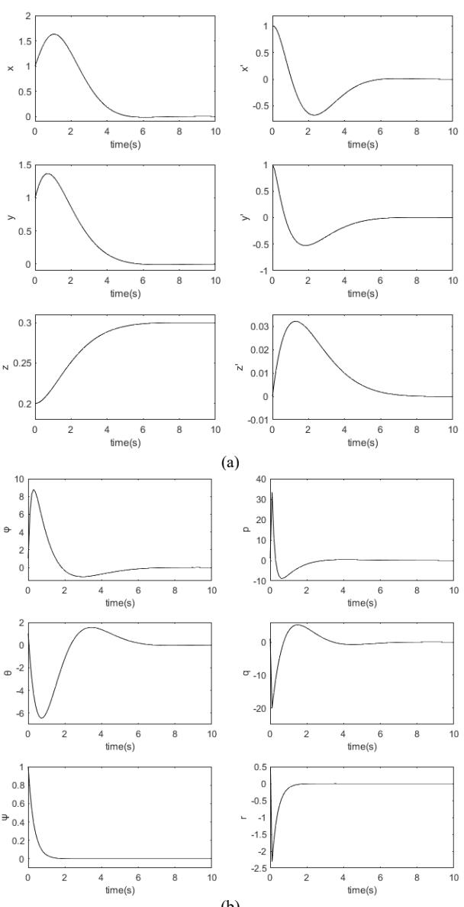

will act upon to bring the rotor back to its set-point-zero. The PID and LQR controller responses are shown in Fig. 6 and Fig. 7

Both the controllers show similar settling time of 7 secs for all the state parameters. Although, the 1st overshoot of PID controller (1.2 units) is lesser than LQR controller (1.6 units) for x and y parameters, the PID controllers gives 2nd overshoot in its response in most of the state parameters as opposed to a single overshoot peak in case of an LQR controller. More the number of overshoot peaks, lesser is the stability. Thus, LQR response is more stable and robust as compared to the PID controller.

#### *C. Case 3*

The initial conditions are set to zero and a thrust force along with a yaw motion is given as an input to both the controllers. A desired yaw angle value is given as a set point to the controller. In this case, along with achieving the yaw angle, only the rotor's vertical motion is expected. The simulated response for PID and LQR controller is shown in Fig.8 and Fig.9 respectively. The settling time for yaw angle for the PID controller is 1.6 sec and that of LQR is 1.8sec making PID response faster. However, PID controller shows a high overshoot of 0.02 in velocity curve and takes almost 10 secs to settle down whereas the LQR response is a gradually decreasing curve settling around 1.8sec. This behavior of PID would create instability which is undesired. Lesser the overshoot, lesser the fluctuation and more the stability.

#### VII. CONCLUSION

 The two controllers show similar response with respect to settling time to achieve the desired response. However, there are some points which give the optimal controller an advantage over the classical control method. In all the cases, 2 overshoot peaks can be seen in the PID controller output whereas only a single overshoot peak is obtained in the LQR

response. This means that the PID controller shows aggressive behavior as compared to the LQR controller response. Secondly, all the 6 PID controllers need to be tuned to obtain an efficient response which makes it a tedious work whereas only 2 matrices need to be tuned in case of the LQR controller. PID controller requires 6 feedback loops making the computation complex than the single control loop in case of an LQR controller. Thus, it can be concluded that LQR controller is better suited for Quadrotor control mechanism than the classical PID controller in terms of output, complexity, and, computation time.

#### ACKNOWLEDGMENT

 The authors would like to express their gratitude towards the staff of the Control Systems Laboratory at BITS Pilani, Hyderabad Campus for their assistance in making this project a reality.

#### REFERENCES

[1] S. Khatoon, D. Gupta and L. K. Das, "PID & LQR control for a quadrotor: Modeling and simulation," 2014 International Conference on Advances in Computing, Communications and Informatics (ICACCI), New Delhi, 2014, pp. 796-802, doi: 10.1109/ICACCI.2014.6968232. [2] H. Yavuz and S. İkizoğlu, "Hyperbolic Tangent Adaptive LQR+PID Control of a Quadrotor," 2018 6th International Conference on Control Engineering & Information Technology (CEIT), Istanbul, Turkey, 2018, pp. 1-6, doi: 10.1109/CEIT.2018.8751878. [3] M. P. Nair and R. Harikumar, "Longitudinal dynamics control of UAV," 2015 International Conference on Control Communication & Computing India (ICCC), Trivandrum, 2015, pp. 30-35, doi: 10.1109/ICCC.2015.7432865. [4] L. M. Argentim, W. C. Rezende, P. E. Santos and R. A. Aguiar, "PID, LQR and LQR-PID on a quadcopter platform," 2013 International Conference on Informatics, Electronics and Vision (ICIEV), Dhaka, 2013, pp. 1-6, doi: 10.1109/ICIEV.2013.6572698. [5] Dhewa, Oktaf & Dharmawan, Andi & Priyambodo, Tri. (2017). Model of Linear Quadratic Regulator (LQR) Control Method in Hovering State of Quadrotor. Journal of Telecommunication, Electronic and Computer Engineering (JTEC). 9. 135-143. [6] Q. Jiao, J. Liu, Y. Zhang and W. Lian, "Analysis and design the controller for quadrotors based on PID control method," 2018 33rd Youth Academic Annual Conference of Chinese Association of Automation (YAC), Nanjing, 2018, pp. 88-92, doi: 10.1109/YAC.2018.8406352. [7] D. Kucherov, A. Kozub and A. Rasstrygin, "Setting the PID Controller for Controlling Quadrotor Flight: a Gradient Approach," 2018 IEEE 5th International Conference on Methods and Systems of Navigation and Motion Control (MSNMC), Kiev, 2018, pp. 90-93, doi: 10.1109/MSNMC.2018.8576294. [8] Islam, Maidul & Okasha, Mohamed & Sulaeman, E. & Fatai, S. & Legowo, Ari. (2019). Performance evaluation of linear quadratic regulator and linear quadratic gaussian controllers on quadrotor platform. International Journal of Recent Technology and Engineering. 7. 191-195.

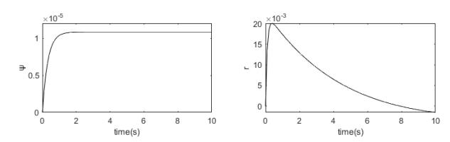

Fig. 8: PID controller response for yaw motion

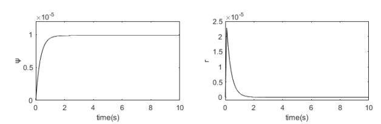

Fig. 9: LQR response for yaw motion