# Modelling, Identification and Control of a Quadrotor UAV

Mizouri Walid *University of Gabes National Engineering School of Gabes, Tunisia TN* mizouri.walid@gmail.com

Najar Slaheddine *University of Gabes National Engineering School of Gabes, Tunisia TN* slaheddine.najar@gmail.com

Aoun Mohamed *University of Gabes National Engineering School of Gabes, Tunisia TN* mohamed.aoun@gmail.com

Bouabdallah Lamjed *University of Gabes National Engineering School of Gabes, Tunisia TN* drbouabadallah@gmail.com

*Abstract***—In this paper mathematical model of quadrotor Unmanned Aerial Vehicle UAV was developed using Euler-Lagrange approach, then model parameters was identified using calculations and experimental tests. In order to validate the estimated model a PID controller for attitude stabilisation was designed and tested by several simulation and experimental step responses. Finally a flight test was successfully accomplished providing the adequacy of the model.**

*Index Terms***—Quadrotor, Modelling, Identification, PID control.**

## I. INTRODUCTION

Quadrotor is a Vertical Take-Off and Landing VTOL aircraft consists on four motors placed on the extremities of its arms as is shown in Fig 1. Motion of quadrotor helicopter is controlled through motors speed variation. In fact changing simultaneous the speed of all motors with the same average produces vertical motion. Rotation around yB axis (Pitch) is provided by adjusting speed of motor (1) or (3), which results a forward/backward motion. Roll motion is a rotation around xB axis obtained by varying motor (2) or (4) speeds, thus a right/left translational motion is acquired. Rotation around zB axis (Yaw) is given by changing velocity of motor (1) and (3) against (2) and (4). Quadrotor rotor-craft reached to a variety of application field such as security, delivery, military and scientific research. This is due to technological advances in flight control system, sensors with the Micro Electro-Mechanical System (MEMS) technology, Radio controllers, motors and battery storage. For this reason modeling and control of quadrotor UAV becomes more challenging and attract many researchers. In fact reference [1] used Newton-Euler and Euler-Lagrange approaches for quadrotor modelling. In [2] quadrotor UAV non linear mathematical model was presented then unknown parameters was experimentally identified using test bench. Reference [3] an ARMAX model describing the quadrotor system was obtained basing on closed loop identification method. Author of [4] proposed a modeling and attitude stabilization method provided by free ight tests. In [5] quadrotor linear model was obtained using frequency domain identification method. Pitch loop was estimated as first order plus time-delay system then a fractional order FOPID and Integer Order IOPID controllers for pitch angle control [6]. An identification method and control system for translational dynamic with an open source Mikrokopter quadrotor was presented in [7]. A PID and LQR control strategies has been compared and implemented to a quadrotor prototype OS4 in [8]. Quadrotor transfer function was obtained by linear parameter estimation and a PID controller was designed and validated with outdoor flight test in [9]. [10] proposed a PD controller and Backstepping-based PID non linear controller for quadrotor position and attitude. The motivation of this work is the modelling and identification of home-made quadrotor prototype. This paper is organised as follows: quadrotor dynamic model was developed in Section II. Quadrotor prototype was presented in Section III. Model parameters identification was described in Section IV. Section V a PID attitude controller was designed. Simulation and experimental results was detailed is Section VI. Finally conclusion and future work are given in Section VII.

#### II. MATHEMATICAL MODELLING

This section describes the quadrotor mathematical model developed using Euler-Lagrange formalism.

Denoting q the generalized coordinates of the quadrotor

q = (x, y, z, φ, θ, ψ) ∈ ℜ6 (1)

where ξ = (x, y, z) is the positions of the quadrotor center of mass relative to the fixed inertial frame *E*, the orientation of the quadrotor are expressed by ϑ = (φ, θ, ψ), where φ is the roll angle around the xB axis, θ is the pitch angle around the yB axis and ψ is the yaw angle around the zB axis. The transformation matrix from inertial frame *E* to the body frame *B* is given by

R = cψ cθ cψ sθ sφ − sψ cφ cψ sθ cφ + sψ sφ sψ cθ sψ sθ sφ + cψ cφ sψ sθ cφ − sφ cψ −sθ cθ sφ cθ cφ (2)

where sθ = sin(θ) and cθ = cos(θ).

Lagrangian equation is defined as follow

L(q, q˙) = *E*p − *E*c (3)

where *E*c and *E*p are respectively the potential and kinetic energy. (

*E*c = mgz *E*p = m ˙ξ T ˙ξ + 1 υ˙ T Iυ˙ (4)

Fig. 1. Quadrotor UAV coordinate system

where I is the inertia matrix, m is the total mass of the quadrotor and g is the gravity acceleration.

Euler-Lagrange formulas is

d dt( δL δq˙ ) − δL δq = F τ (5)

where F is the force of translation, τ is the total torque. Let's start with the rotational dynamic of the quadrotor. The total torques can be written

τ = τ1 + τ2 (6)

where τ1 is the roll, pitch and yaw torques and τ2 is the gyroscopic effects produced by the quadrotor motors given by

τ1 = bl (Ω2 2 − Ω 4 ) bl (Ω2 1 − Ω 3 ) d (Ω2 1 − Ω 2 2 + Ω2 3 − Ω 4 ) (7)

τ2 = ˙θIrotorΩg φI˙ rotorΩg 0 (8)

where

Ωg = (Ω1 − Ω2 + Ω3 − Ω4) (9)

where b is the thrust coefficient, d is the drag coefficient, Ωi is the angular speed of the i th motor, *l* is the distance between the motors and the quadrotor center of gravity, and Irotor is the rotor inertia moment.

The generalized moments are

 d dt( δL δφ˙ ) − δL δφ = Ixxφ¨ + (Izz − Iyy) ˙θψ˙ d dt( δL δ ˙θ ) − δL δθ = Iyy ¨θ + (Ixx − Izz)φ˙ψ˙ d dt( δL δψ˙ ) − δL δψ = Izz ¨θ + (Iyy − Ixx)φ˙ ˙θ (10)

where I is the inertia matrix of quadrotor around (x, y, z) axis

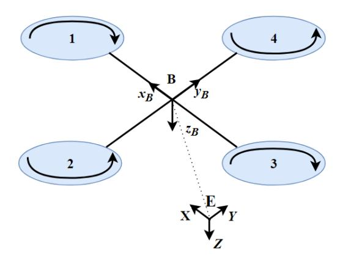

I = Ixx 0 0 0 Iyy 0 0 0 Izz 

The rotational dynamic equations can obtained from (7), (8) and (10)

 φ¨ = ˙θψ˙( Iyy − Izz Ixx ) + Irotor ˙ θΩg Ixx + 1 Ixx U2 ¨θ = φ˙ψ˙( Izz − Ixx Iyy ) + IrotorφΩ˙ g Iyy + 1 Iyy U3 ψ¨ = φ˙ ˙θ( Ixx − Iyy Izz ) + 1 Izz U4 (11)

where (U1, U2, U3, U4) are the model inputs which given by following system equation

 U1 = b (Ω2 1 + Ω2 2 + Ω2 3 + Ω2 4 ) U2 = bl (Ω2 2 − Ω 2 4 ) U3 = bl (Ω2 1 − Ω 2 3 ) U4 = d (Ω2 1 − Ω 2 2 + Ω2 3 − Ω 4 ) (12)

 The translation dynamic describes the linear displacement of the quadrotor along the (X, Y, Z) axis.

From equation (5)

d dt( δL δ ˙ξ ) − δL δξ = F (13)

where F is the translational force acting on the quadrotor described as follow

F = R(φ, θ, ψ) 0 0 P 4 i=0 fi (14)

where fi = b Ω i , fi the thrust produced by the i th motor. In the other hand from (4) we can write

d dt( δL δ ˙ξ ) − δL δξ = m¨ξ + 0 0 −mg (15)

Equations (14) and (15) gives

m x¨ y¨ z¨ = 0 0 −mg + R(φ, θ, ψ) 0 0 P i=0 fi (16)

The translational dynamic are given by the following equations

 x¨ = cos φ sin θ cosψ + sin φ sin ψ m U1 y¨ = cos φ sin θ sin ψ + sin φ cosψ m U1 z¨ = −g + cos φ cos θ m U1 (17)

The obtained model is a non linear six degrees of freedom under-actuated system, composed of rotational (10) and translational dynamic (17) shown in Fig. 2.

Fig. 2. Quadrotor system architecture

In order to reduce complexity of calculus, we supposed that the quadrotor was in a hovering position thereby the attitude angular rate is null (φ˙ = 0, ˙θ = 0, ψ˙ = 0) thus the gyroscopic effects and moments of inertia terms can be neglected. Thus the motion equation in (11) becomes

 φ¨ = Ixx U2 ¨θ = 1 Iyy U3 ψ¨ = 1 Izz U4 (18)

# III. QUADROTOR PROTOTYPE

In this paper a quadrotor prototype is used as a test platform named Sunbird shown in Fig. 3. Sunbird is a home-made quadrotor platform designed at Modelling Analysis and Control of System MACS research laboratory. Sunbird quadrotor

Fig. 3. Sunbird quadrotor prototype

is composed as follows

- An Arduino DUE card used as flight controller. It is based on a 32-bit ARM core micro-controller with a 84 MHz clock. It contains 12 analog inputs, 2 analog output and 54 digital Input/Output.
- A FlySky 2.4 Ghz Radio Control RC with 4 channels used to remotely control the quadrotor.
- The rotor is composed with Hextronik DT750 brushless DC motor, 10 × 4.5 propellers and Electronic Speed Controller ESC 30A operating with Pulse Width Modulation (PWM) signal generated by Arduino Due card.

- An ultrasonic sensor HC-SR 05 for altitude measuring with a 4.5 meter of measurement range.
- Measurement Processing Unit MPU6050 is used to estimate attitude. MPU-6050 is a six axis IMU sensor containing 3 axis gyroscope ITG 3200 giving the angular velocities (φ,˙ ˙θ, ψ˙) and 3 axis accelerometer ADXL 345 measuring linear accelerations (Ax, Ay, Az). In fact Arduino Due receives data from MPU-6050 via I2C-bus. Then a complementary filter is used to compensate the drifts affecting gyroscope measurements and attenuate high frequency signals affecting accelerometer like vibration. Denoting φacc, φGyr, φComp as the roll angle estimated respectively using accelerometer, gyroscope and complementary filter. Using accelerometer we can estimate the quadrotor orientation relative to the fixed inertial frame E as follow

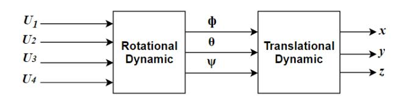

φacc = arctan Ax q A2 y + A2 z (19)

where (Ax, Ay, Az) data raw given by accelerometer. Gyroscope estimated angle is given by simple integration of angular rate φ˙

φGyr = φGyr + φ˙ × dt (20)

The complementary filter is combination between accelerometer and gyroscope measurements

φComp = α ∗ (φComp + φ˙ × dt) + (1 − α) ∗ φacc (21)

where α ∈ [0, 1] used to tune the complementary filter and dt is the sample time.

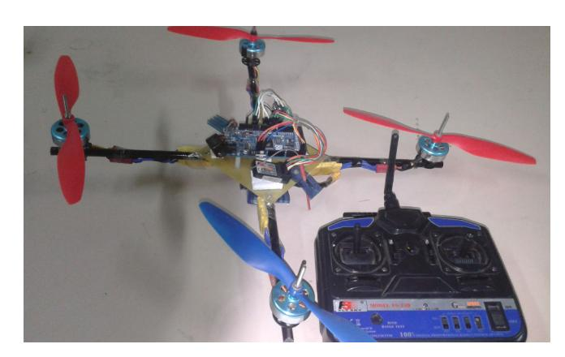

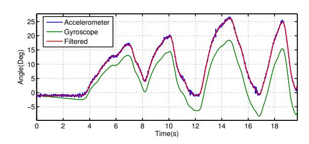

Fig. 4. Comparison of accelerometer ,gyroscope and complementary filter estimated roll angle

Fig. 4 shows the estimation of roll angle using accelerometer, gyroscope and complementary filter. It can be clearly seen the robustness of the used filter however the gyroscope estimated angle is drifting whenver the acceleromter estimation is very sensitive to vibrations.

The composition of quadrotor prototype is summarised in Fig. 5.

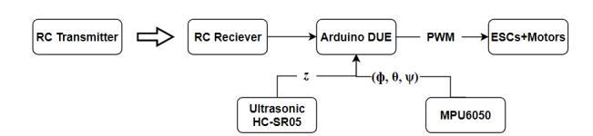

Fig. 5. Sunbird quadrotor prototype architecture

#### IV. PARAMETERS IDENTIFICATION

In this section the parameters of the quadrotor model was identified. The method was based experimental tests or mathematical calculations.

#### *A. Moment of inertia*

To estimate the moment of inertia quadrotor system can be decomposed into several parts. Using the formulas (22) we can calculate the inertia moments of each part relative to his center of mass.

I = Z x dm (22)

The moment of each parts relative to the quadrotor center of gravity is given by Huygens-Steiner theorem (23)

Icog = I + m × d 2 (23)

where d is the distance between quadrotor and the part center of gravity. The moment of inertia of the quadrotor system was obtained by adding all inertia moments.

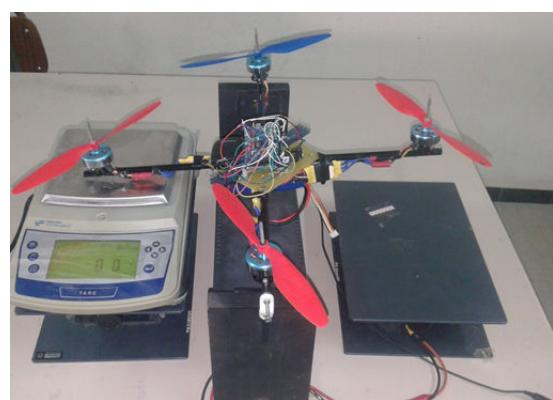

## *B. Rotor dynamic*

In this subsection characteristics of Hextronik DT750 brushless DC motor was estimated. In fact the motor was operating with a Pulse Width Modulation (PWM) signal. PWM is a periodic signal with variable pulse width between [1000, 2000] microseconds (µs). Thereby the motor Speed controller ESC was excited by series of PWM step signal generated by Arduino Due. Then the corresponding motor speed was measured using a home made Infra-red sensor shown in Fig. 6. Using

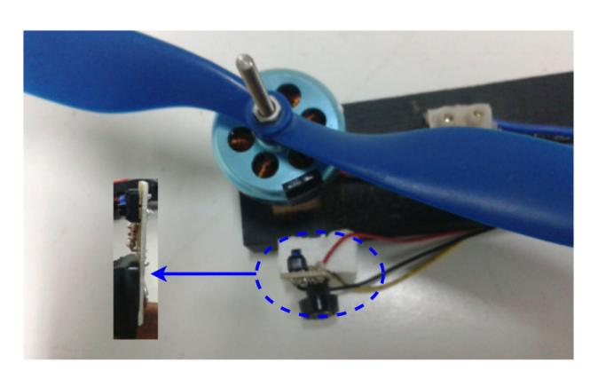

Fig. 6. Infra-Red sensor used for the motor speed measuring

"polyf it" Matlab function the motor characteristics can be expressed by the following second order equation

PWM = a2Ω + a1Ω + a0 (24)

where a2 = 1.2093 10−5 , a1 = 6.5776 10−2 and a0 = 948.2. Fig. 7 illustrates the measured and estimated characteristics of PWM signal according to the motor speed.

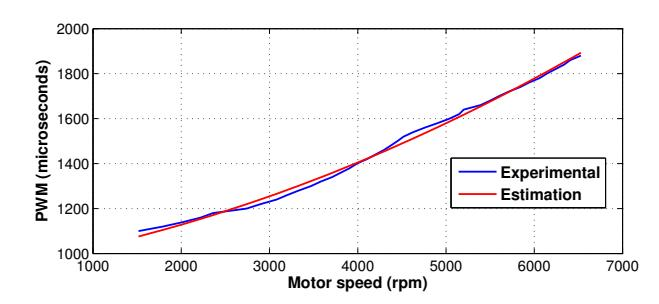

Fig. 7. Measured and approximated PWM signal and motor speed characteristics

#### *C. Thrust coefficient*

Basing on the relation between the thrust force the square of the angular rate Ft = bΩ , the thrust factor can be estimated. The method consists on varying the motor speed and measuring the produced thrust force Ft using electronic balance with the test bench in Fig. 8.

Fig. 8. Test bench to measure the thrust force of rotor

Fig. 9 shows the plot of the measured and estimated characteristic of the thrust force over the squared motor speed.

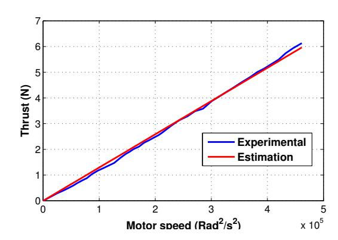

Fig. 9. Estimation and experimental of the thrust force relative to the square of motor velocity

#### *D. Drug coefficient*

The Yaw torque is proportional to the square of the angular rate of the motor τ = d Ω . Similarly to the thrust factor using a test bench in Fig. 10 the drug factor can be identified.

#### Fig. 10. Test bench used for drug factor identification

The plot of the yaw torque over the squared motor speed is shown in Fig. 11

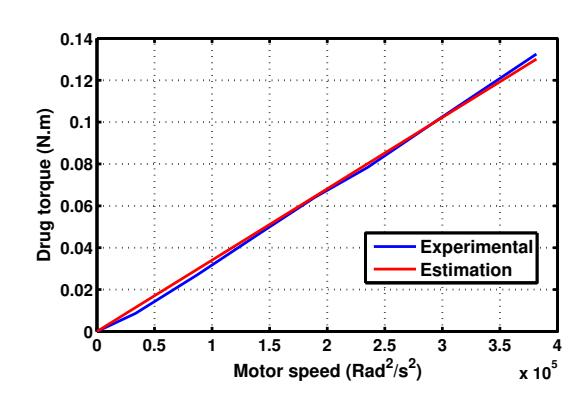

Fig. 11. Measured and approximated of drug moment relative to the square of the motor speed

The parameter used on the quadrotor dynamic model are listed in the Tabel IV-D.

## V. ATTITUDE CONTROL DESIGN

In this section we interested on attitude control synthesis. Fig. 12 shows the structure of attitude control loop.

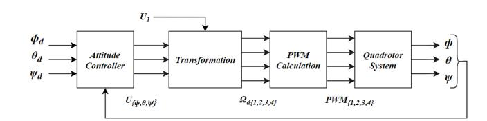

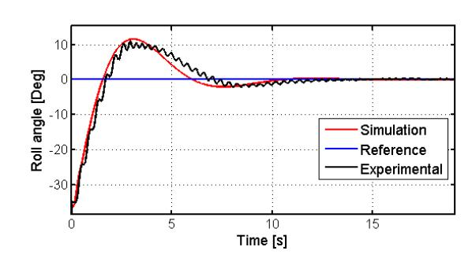

Fig. 12. Control architecture of the quadrotor system

In this paper a PID controller was proposed

C(s) = kp + ki s + kds (25)

|   |    |   |      |       | value |    |     |   |   |
|---|----|---|------|-------|-------|----|-----|---|---|
|   | b  |   | 1    | 1487  |       | 10 | −   | 5 |   |
|   | d  |   |      | 2 69  | 10    |    | − 8 |   |   |
| I | xx | 1 | 2035 | 10    | −     | 5  | Kg  | m | 2 |
| I | yy | 1 | 1923 | 10    | −     | 5  | Kg  | m | 2 |
| I | zz | 2 | 3149 | 10    | −     | 5  | Kg  | m | 2 |
|   | m  |   |      | 0 960 |       | Kg |     |   |   |
|   | l  |   |      | 0     | 24    | m  |     |   |   |

TABLE I NUMERICAL VALUES OF QUADROTOR IDENTIFIED PARAMETERS

Where attitude controller is used to pursuit the desired orientations (φd, θd, ψd). The output of attitude controllers (Uφ, Uθ, Uψ) are given by

 Uφ = kpφεφ + kiφ R εφdt + kdφ dεφ dt Uθ = kpθεθ + kiθ R εφdt + kdθ dεθ dt Uψ = kpψεψ + kiψ R εψdt + kdψ dεψ dt (26)

where (εφ, εθ, εψ) are the errors between setpoint and output attitude and (kp, ki , kd) are respectively the proportional, integral and derivative coefficients. U1 is adjusted by user to change the altitude of the quadrotor.

The transformation bloc calculates the desired motor speed (Ωd1, Ωd2, Ωd3, Ωd4) deducing from the equations (12), thus the expressions of motors speed are calculated by

 Ωd1 = q U1 4b + Uθ 2bl + Uψ 4d Ωd2 = q U1 4b + Uφ 2bl − Uψ 4d Ωd3 = q U1 4b − Uθ 2bl + Uψ 4d Ωd4 = q U1 4b − Uφ 2bl − Uψ 4d (27)

PWM calculation bloc computes the adequate PWM signals for each motor relative to the desired motor speed obtained above. PWM signal is obtained using the second order polynomial equation (24). Finally the PWM signals is applied to the motor ESC to move quadrotor system.

## VI. RESULTS AND DISCUSSION

To evaluate the efficiency of the quadrotor modelling and proposed control method, the designed control system was implemented into Arduino DUE board executing with a rate of 100 Hz. The task consists on stabilizing roll, pitch and yaw angle on 0 ◦ using test benches used above. The controller parameters are tuned experimentally. Fig. 13 illustrates simu-

Fig. 13. Comparison of simulated and experimental roll angle step response with (kp = 0.35, ki = 0.28, kd = 0.46)

lated and measured roll angle responses with initial angle of −35◦ . We can see that rising and settling time of the two responses are nearly the same. Fig. 14 and 15 shows the results of pitch and yaw loop responses with θ0 = 25◦ and ψ0 = 28◦ . Simulation of the estimated model and experiment responses are approximately close. Fig. 16 shows roll loop response while tracking perfectly a sine setpoint. Basing on the attitude responses above the estimated dynamic model can be validated. In addition the quadrotor prototype was tested in outdoor flight test. this experiment was successfully achieved.

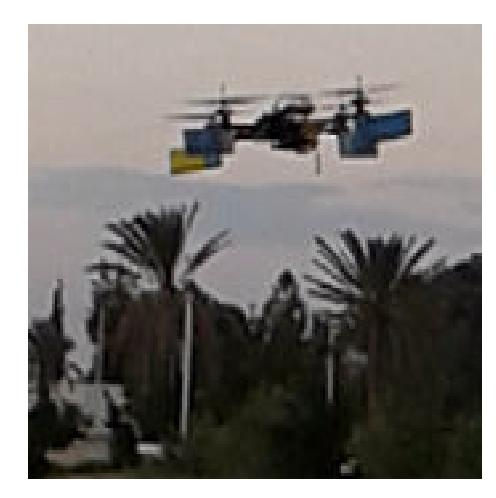

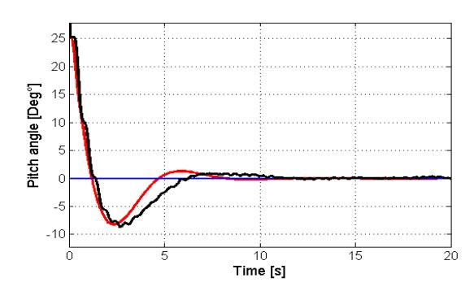

Fig. 14. Simulated and experimental pitch angle step response using the following controllers coefficients (kp = 0.3, ki = 0.29, kd = 0.28)

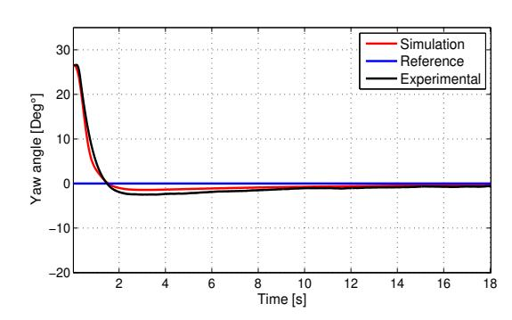

Fig. 15. Yaw angles compared estimated and measured step response with PID controller parameters (kp = 0.086, ki = 0.006, kd = 0.25)

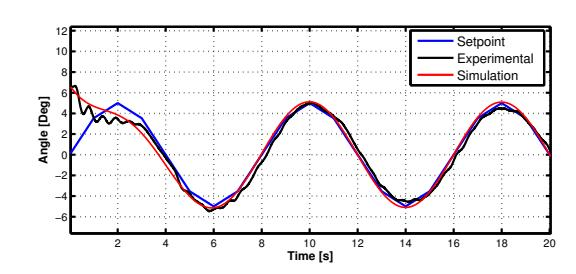

Fig. 16. Tracking of roll sine setpoint simulation and experimental responses

# VII. CONCLUSION

In this paper a quadrotor dynamic model was presented. a description of the quadrotor identification prototype used in this work was detailed. Then Identification of quadrotor characteristics and model parameters was detailed. Thereafter a control system based on PID controller is proposed to stabilize quadrotor angles. Finally this work was finalized by simulations and experimental step responses and outdoor flight

Fig. 17. Outdoor flight test of the quadrotor prototype using the designed control system

test to provide the performances of the proposed modelling and control methods.

#### REFERENCES

[1] L. R. G. Carrillo, A. E. D. L ´opez, R. Lozano, and C. P´egard, "Modeling the quad-rotor mini-rotorcraft," in *Quad Rotorcraft Control*. Springer, 2013, pp. 23–34. [2] A. Chovancov´a, T. Fico, L. Chovanec, and P. Hubinsk, "Mathematical modelling and parameter identification of quadrotor (a survey)," *Procedia Engineering*, vol. 96, pp. 172–181, 2014. [3] R. Schreurs, S. Weiland, H. Tao, Q. Zhang, J. Zhu, Y. Zhu, and C. Xu, "Open loop system identification for a quadrotor helicopter system," in *Control and Automation (ICCA), 2013 10th IEEE International Conference on*. IEEE, 2013, pp. 1702–1707. [4] R. Goel, S. M. Shah, N. K. Gupta, and N. Ananthkrishnan, "Modeling , Simulation and Flight Testing of an Autonomous Quadrotor," 2009. [5] P. Niermeyer, T. Raffler, and F. Holzapfel, "Open-loop quadrotor flight dynamics identification in frequency domain via closed-loop flight testing," *AIAA Guidance, Navigation, and Control Conference*, vol. 118, pp. 21–26, 2015. [6] J. Han, L. Di, C. Coopmans, and Y. Chen, "Pitch loop control of a vtol uav using fractional order controller," *Journal of Intelligent & Robotic Systems*, vol. 73, no. 1-4, pp. 187–195, 2014. [7] I. Sa and P. Corke, "System identification, estimation and control for a cost effective open-source quadcopter," in *Robotics and automation (icra), 2012 ieee international conference on*. IEEE, 2012, pp. 2202– 2209. [8] S. Bouabdallah, A. Noth, and R. Siegwart, "Pid vs lq control techniques applied to an indoor micro quadrotor," in *Intelligent Robots and Systems, 2004.(IROS 2004). Proceedings. 2004 IEEE/RSJ International Conference on*, vol. 3. IEEE, 2004, pp. 2451–2456. [9] W. Dong, G.-Y. Gu, X. Zhu, and H. Ding, "Modeling and control of a quadrotor uav with aerodynamic concepts," in *Proceedings of World Academy of Science, Engineering and Technology*, no. 77, 2013, p. 437. [10] A. A. Mian and W. Daobo, "Modeling and backstepping-based nonlinear control strategy for a 6 dof quadrotor helicopter," *Chinese Journal of Aeronautics*, vol. 21, no. 3, pp. 261–268, 2008.