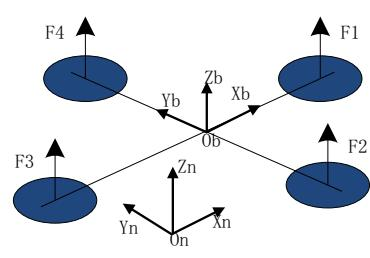
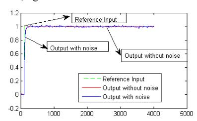
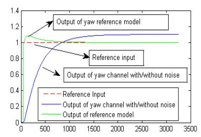
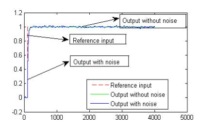
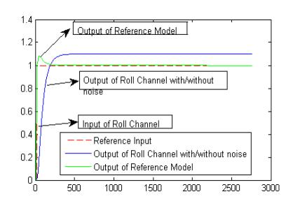
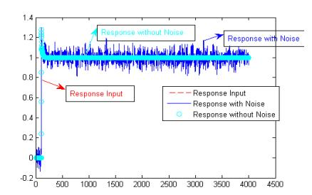
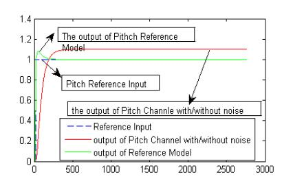

\$EVWUDFW Attitude is the key parameters for a Quadrotor. This paper designed a Proportional Integral Differential (PID) controller and a Model Reference Adaptive Control (MRAC) controller for a Quadrotor. At the end, a simulation was introduced. The simulation result told that MRAC controller had the ability to avoid the noise with the power such as 0.01.

.H\ZRUGV: Quadrotor, PID, MRAC.

## I. INTRODUCTION

Recently, the MEMS techniques make the development of unmanned aerial vehicle (UAV) possible[1]; and many scholars distribute themselves to the study of an unmanned aerial vehicle called Quadrotor. Quadrotor is a helicopter with four rotor wings which give the lift force to the helicopter. One example is show in Figure 1.The Quadrotor has the helicopter's characteristics such as vertical taking-off and vertical landing. The important characteristics of quadrotor are light and micro. Now Quadrotor is making an important role in rescue act, remote inspect task.

Erdinc Altug[2] studied the controller with visual feedback to quadrotor's attitude. Samir Bouadballah[3] gave the differences between PID controller and LQ controller in an indoor micro quadrotor. T. Madani and A. Benallegue[4] use Back-stepping controller to control quadrotor's attitude and position. Mehmet Onder Efe[5] use sliding models to design a robust controller to quadrotor. This study is to explore the differences between PID controller and MRAC controller to quadrotor's attitude.

In section 2 the quadrotor's dynamics and model is showed. The PID controller and MRAC controller are displayed in section 3.In the last section a simulation is described. The differences between PID and MRAC are described in section 4.

# II. QUADROTOR MODEL

Quadrotor which has four fix angle rotors to make the lift force is different from common helicopter. Quadrotor has two flying styles one called X style and the other called + style.

This study is to describe the + style's attitude controller. On + style, rotor 1 and 3 determine the pitch moment; rotor 2 and 4 determine the roll moment. The four rotors determine the yaw moment.

# '\QDPLFVRI4XDGURWRU

On the assumption that the frame which fixed on the quadrotor's body is E(xb, yb, zb); axis xb is on the line which is fixed by rotor 1 and 3; axis yb is on the line which is determined by rotor 2 and 4; and the zb axis is perpendicular to the plane which is configured by axis xb and yb. If the speed of rotor 1 is great than the speed of rotor 3, the pitch angle is positive. The roll angle is positive when the speed of rotor 2 is great than rotor 4.If the sum of rotor 1's and rotor 3's speed is great than the sum of rotor 2 and rotor 4, yaw angle is positive.

The body coordinate frame and navigation coordinate frame are described in figure 1. This study assumes these:

- 1. Quadrotor is rigid body, the center of gravity is the same as geometric center.
- 2. The rotors of quadrotor are fixed and unreformed.

On the assumption in up contents, the equation of motion of quadrotor is described as next:

# **PID vs. MRAC Control Techniques Applied to a Quadrotor's**

**Attitude**

Yong Zeng, Qiang Jiang, Qiang Liu, Hua Jing School of Aeronautics and Astronautics, UESTC

Chengdu, China

E-mail :zengyong5868@126.com, jiangqiang871108@126.com

*f J FJ R RS vm RF v* - )( (1)

ε is the position vector; ν is the velocity vector; the rotation array is R; m is the mass of quadrotor; S(Ω) is an anti-symmetric matrix for Ω which is the angular velocity vector. J is the moment of inertia. Ff is the input torque on the body frame.

On the assumption that the quadrotor is rigid body, the rotation array R can be described like equation 2.

R=  - - *CCSCCSSSSCSC SCCCSSSCSSSC CC CS S* (2)

In equation 2, C(.) is the same as cos(.); S(.) is the same as sin(.).

The moment of inertia is described as matrix like equation 3.

*yy I I I J* 00 00 00 (3)

This study assume that F1, F2, F3, F4 is the force output of motor 1, motor 2, motor 3 and motor 4. The roll moment is U2; U3 is the pitch moment; the yaw moment is U4. Equation 4 is described the relation of the moments and the forces.

( ) )( )( 4 4321 313 2 42 *U cl FFFF FFlU FFlU* - (4)

In Equation 4ˈ*l* is the arm of force, *c* is a const. According to equation 1 and equation 4:

4 3 )( )( )( *UIII UIII UIII zz yyxx yy zz xx xx yy zz* - -- (5)

#### SUREOHPV

navigation controller often contains the man control, also can use another navigation control technique.

According to equation 5, the model of quadrotor's attitude is nonlinear. In order to design an controller to quadrotor via linear theories, there are many methods which can make the nonlinear system be linear such as feedback linearization[7], approach linearization. In order to design controller easily, approach linearization is the linearization method of this study, so assume that

*s s s s s s* 10 / 10 / 10 / 10 / 10 / 10 / 180 180 25 25 25 25 - - - - - - ˄6˅

III. DESIGN OF PID AND MRAC CONTROLLER

## OLQHDUTXDGURWRUÿVPRGHO

On the Equation 6 described control needs, this study makes the quadrotor's attitude model be linear as equation 7.

44 33 22 - - - *UI UI UI yy xx*

In equation 7, ε2 replaces the noise of roll; ε3 is noise of pitch; ε4 replaces the noise of yaw.

Assuming the states as equation 8; the study can describe the quadrotor in states space style as equation 9.

 5 6 5 34 3 1 2 1 *xx x xx x xx x* (8)

Let X=[x1, x2, x3, x4, x5, x6], then

-  *zz yy I U x I U x I U x UXfX* 6 4 2 2 ),( ˄9˅

In equation 9, ε=[0, ε2/Ixx, 0, ε3/Iyyˈ0, ε4/Izz].

# 'HVLJQRI3,'FRQWUROOHU

The Laplace Transform of equation 7 like equation 10.

)()()( )()()( )()()( 4 4 3 3 2 2 *ssUssI ssUssI ssUssI yy xx* - --˄10˅

Equation 10 displays that the pole points of quadrotor's pitch roll and yaw channel are zero; so these three channels are not stability.

In order to come true stable pitch channel, roll channel and yaw channel; this study use PD controllers like equation 11 describing.

*dt d ku k dt d ku k dt d ku k cmd fdk p cmd fdk d cmd fdk p cmd fdk d cmd fdk p cmd fdk d* )( )( )( )( )( )( 4 3 2 - - - (11)

In equation 11, u2 is the output of roll PD controller; the output of pitch PD controller is u3;u4 is the output of yaw PD controller. The roll proportional gain is kpΦ , differential gain kdΦ .The pitch proportional gain is kpθ , differential gain is kd θ . The yaw proportional gain is kpψ , differential gain is kdψ .The roll pitch and yaw reference inputs are Φ cmd,θ cmd, ψ cmd. And the feedbacks of roll pitch and yaw channel are Φ fdk, θ fdk, ψ fdk.

# 'HVLJQRI05\$&FRQWUROOHU

MRAC controller design is a method which uses a model to design an adaptive controller[8]. MRAC controller can make the states or outputs of object approach to the states or outputs of the model. This study select three model described in equation 12, equation 13 and equation 14 for pitch roll and yaw channel.

dx1 dt dx2 dt = 01 −10 −10x1 x2 +0 1 u2 (12) dx3 dt dx4 dt = 01 −10 −10x3 x4 +0 1 u3 (13) dx5 dt dx6 dt = 01 −10 −10x5 x6 +0 1 u4 (14)

According to Lyapunov's law and states feedback, design a MRAC controller. Select Lyapunov function as equation 15.

V= 1 2 eTPe + tr(∅TT1 −1∅+φTT2 −1φ) (15)

In equation 15, ∅=F −Fˈφ=K −K; F is the desire feedback gain, F is the feedback gain. K is the desire feedback gain, K is the feedback gain.

According to Lyapunov's law, get the feedback gain F and feed-forward gain K.

F(t) = ∫ T1(BmK −1)TPexp T t 0 dτ + F(0) (16)

K(t) = ∫ T2(BmK −1)T t 0 PerTdτ + K(0) (17)

In equation 16 and equation 17, P, T1, T2 are positive definite symmetric matrix; Bm K −1 =Bp˗ e=xm −xp.

## IV. SIMULATIONS AND CONCLUSION

These simulations use the parameters from the reference paper 3. Let Ixx =Iyy = 0.0075N/m2 , Izz = 0.0013N/m2 . And let kp∅ =kpθ = 5 , kd∅ =kdθ =1 ; kpφ =2 ; kdφ = 1.8 ; H∅ =Hθ =1ˈHφ = 200. Let the noise power be 0.01. The simulation which use PD controller to quadrotor's attitude control is displayed in figure 2 , figure 3, figure 4.

Figure 2 Roll channel simulation of PD

Figure 3 Pitch channel simulation of PD

Figure 4 Yaw channel simulation of PD

According to equation 11, 12, 13, 14, 15,16,17, let P=[3,1; 1,1], T1=T2=1 and F(0)=K(0)=0; let the noise's power be 0.01. The simulations which use MRAC controller are showed like figure 5, figure 6 and figure 7.

Figure 5 Pitch channel simulation of MRAC

Figure 6 Roll channel simulation of MRAC

According the simulations, this study has this conclusion: PID controller is very easy to design but if there are some noises such as a noise whose power is 0.01, PID controller can't avoid the influence of the noise. MRAC controller is

Figure 7 Yaw channel simulation of MRAC

difficult but this method has robust. MRAC is good method when controller designer want the controller can avoid the influence of noise from the object insert or exterior.

## REFERENCES

[1] Samir Bouabdallah, Pierpaolo Murrieri, Roland Siegwart. "Design and Control of an Indoor Micro Quadrotor". Proceedings of the 2004 IEEE International Conference on Robotics & Automation, New Orleans, LA, April 2004, pp. 4393-4398

[2] Erdinc Altug, James P. Ostrowski. "Control of a Quadrotor Helicopter Using Visual Feedback". Proceedings of the 2002 IEEE International Conference on Robotics & Automation Washington DC, May, 2002 , pp. 72-77

[3] Samir Bouabdallah, Andre Noth and Roland Siegwart. "PID vs. LQ Control Techniques Applied to an Indoor Micro Quadrotor". Proceedings of 2004 IEEE/RSJ International Conference on Intelligent Robots and Systems, Sendai, Japan, October, 2004, pp. 2451-2456.

[4] Tarek Madani and Adbelaziz Benallegue. "Backstepping Control for a Quadrotor Helicopter". Proceedings of the 2006 IEEE/RSJ International Conference on Intelligent Robots and Systems, Beijing, China, October,2006, pp. 3255-3260

[5] Mehmet Onder Efe. "Robust Low Altitude Behavior Control of a Quadrotor Rotorcraft through Sliding Modes". 2007 Mediterranean Conference on Control and Automation, Athens, Greece, July, 2007, pp. 1009-1014

[6] Su Jingya, Fanpenghui, Cai Kaiyuan. "Attitude control of quadrotor aircraft via nonlinear PID". Journal of Beijing University of Aeronautics and Astronautics, Vol.37, No.9, September, 2011.

[7] A. Benallegue, A. Mokhtari, L. Fridman. "Feedback Linearization and High Order Sliding Mode Observer For A Quadrotor UAV". Proceeding of the 2006 International Workshop on Variable Structure Systems, Alghero, Italy, June, 2006, pp. 365-372.

[8] Li Yanjun, Zhang Ke. The theory and application of Adaptive control. Press of Northwest Industry University. 2005, pp. 40-59.