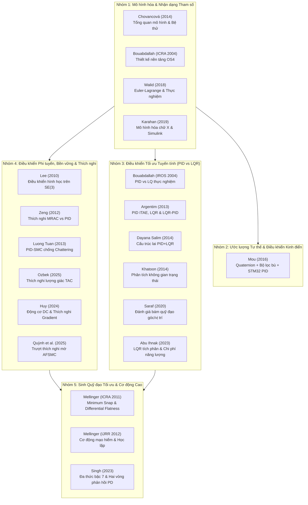

# TÀI LIỆU NGHIÊN CỨU & CHỈ MỤC BÀI BÁO KHOA HỌC VỀ QUADROTOR UAV
> **Chủ đề:** Mô hình hóa Động lực học, Nhận dạng Tham số, Chiến lược Điều khiển (PID, LQR, SMC, MRAC, Geometric SE(3), Thích nghi) và Quy hoạch Quỹ đạo Tối ưu (Minimum Snap).  
> **Thư mục lưu trữ:** `docs/references/papers/`  
> **Tệp trích dẫn BibTeX:** [`references.bib`](./references.bib)  
> **Dữ liệu trích xuất (Markdown & Hình ảnh):** [`papers_md/`](./papers_md/)  

---

## MỤC LỤC TỔNG QUAN

1. [Bảng Chỉ mục Nhanh 20 Bài báo Khoa học](#1-bảng-chỉ-mục-nhanh-20-bài-báo-khoa-học)
2. [Cây Tri thức & Bản đồ Phân loại Nghiên cứu](#2-cây-tri-thức--bản-đồ-phân-loại-nghiên-cứu)
3. [Phần I: Mô hình hóa Động lực học & Nhận dạng Tham số](#phần-i-mô-hình-hóa-động-lực-học--nhận-dạng-tham-số)
   - [1.1. Chovancová et al. (2014) - Mô hình hóa và nhận dạng tham số Quadrotor (Survey)](#11-chovancová-et-al-2014---mô-hình-hóa-và-nhận-dạng-tham-số-quadrotor-survey)
   - [1.2. Bouabdallah et al. (ICRA 2004) - Thiết kế và điều khiển Micro Quadrotor trong nhà OS4](#12-bouabdallah-et-al-icra-2004---thiết-kế-và-điều-khiển-micro-quadrotor-trong-nhà-os4)
   - [1.3. Walid et al. (SSD 2018) - Mô hình hóa Euler-Lagrange, nhận dạng thực nghiệm và điều khiển](#13-walid-et-al-ssd-2018---mô-hình-hóa-euler-lagrange-nhận-dạng-thực-nghiệm-và-điều-khiển)
   - [1.4. Karahan & Kasnakoglu (ECAI 2019) - Mô hình hóa và mô phỏng Quadrotor cấu hình chữ X](#14-karahan--kasnakoglu-ecai-2019---mô-hình-hóa-và-mô-phỏng-quadrotor-cấu-hình-chữ-x)
4. [Phần II: Điều khiển Tuyến tính Kinh điển & Ước lượng Tư thế](#phần-ii-điều-khiển-tuyến-tính-kinh-điển--ước-lượng-tư-thế)
   - [2.1. Mou et al. (YAC 2016) - Điều khiển bay Micro Quadrotor dùng PID và Quaternion/Bộ lọc bù](#21-mou-et-al-yac-2016---điều-khiển-bay-micro-quadrotor-dùng-pid-và-quaternionbộ-lọc-bù)
5. [Phần III: Điều khiển Tối ưu Tuyến tính & Nghiên cứu So sánh (PID vs. LQR)](#phần-iii-điều-khiển-tối-ưu-tuyến-tính--nghiên-cứu-so-sánh-pid-vs-lqr)
   - [3.1. Bouabdallah et al. (IROS 2004) - So sánh kỹ thuật PID và LQ trên Quadrotor OS4](#31-bouabdallah-et-al-iros-2004---so-sánh-kỹ-thuật-pid-và-lq-trên-quadrotor-os4)
   - [3.2. Argentim et al. (ICIEV 2013) - So sánh PID (ITAE), LQR và LQR-PID](#32-argentim-et-al-iciev-2013---so-sánh-pid-itae-lqr-và-lqr-pid)
   - [3.3. Dayana Salim et al. (ICIT 2014) - Điều khiển tư thế kết hợp PID + LQR cho Hexarotor](#33-dayana-salim-et-al-icit-2014---điều-khiển-tư-thế-kết-hợp-pid--lqr-cho-hexarotor)
   - [3.4. Khatoon et al. (ICACCI 2014) - Mô hình hóa và mô phỏng so sánh PID & LQR](#34-khatoon-et-al-icacci-2014---mô-hình-hóa-và-mô-phỏng-so-sánh-pid--lqr)
   - [3.5. Saraf et al. (INDICON 2020) - So sánh bộ điều khiển kinh điển PID và tối ưu LQR](#35-saraf-et-al-indicon-2020---so-sánh-bộ-điều-khiển-kinh-điển-pid-và-tối-ưu-lqr)
   - [3.6. Abu Ihnak & Edardar (ICSC 2023) - Đánh giá hiệu quả và phân tích chi phí LQR vs PID](#36-abu-ihnak--edardar-icsc-2023---đánh-giá-hiệu-quả-và-phân-tích-chi-phí-lqr-vs-pid)
6. [Phần IV: Điều khiển Phi tuyến, Bền vững & Thích nghi](#phần-iv-điều-khiển-phi-tuyến-bền-vững--thích-nghi)
   - [4.1. Lee et al. (CDC 2010) - Điều khiển bám hình học trên nhóm Lie SE(3)](#41-lee-et-al-cdc-2010---điều-khiển-bám-hình-học-trên-nhóm-lie-se3)
   - [4.2. Zeng et al. (IMCCC 2012) - So sánh PID và Điều khiển Thích nghi Mô hình Mẫu (MRAC)](#42-zeng-et-al-imccc-2012---so-sánh-pid-và-điều-khiển-thích-nghi-mô-hình-mẫu-mrac)
   - [4.3. Luong Tuan & Won (ICCAS 2013) - Bộ điều khiển trượt dựa trên PID (PID-SMC) chống Chattering](#43-luong-tuan--won-iccas-2013---bộ-điều-khiển-trượt-dựa-trên-pid-pid-smc-chống-chattering)
   - [4.4. Ozbek & Burkan (Springer 2025) - Điều khiển thích nghi lượng giác (TAC) với tham số biến thiên](#44-ozbek--burkan-springer-2025---điều-khiển-thích-nghi-lượng-giác-tac-với-tham-số-biến-thiên)
   - [4.5. Hoàng Văn Huy (HaUI 2024) - Mô phỏng hệ điều khiển Quadrotor dùng động cơ DC với bộ điều khiển thích nghi](#45-hoàng-văn-huy-haui-2024---mô-phỏng-hệ-điều-khiển-quadrotor-dùng-động-cơ-dc-với-bộ-điều-khiển-thích-nghi)
   - [4.6. Trần Thúy Quỳnh et al. (HaUI 2025) - Thiết kế bộ điều khiển thích nghi cho Quadrotor dựa trên phương pháp trượt (AFSMC)](#46-trần-thúy-quỳnh-et-al-haui-2025---thiết-kế-bộ-điều-khiển-thích-nghi-cho-quadrotor-dựa-trên-phương-pháp-trượt-afsmc)
7. [Phần V: Sinh Quỹ đạo Tối ưu & Chuyển động Cơ động Cao](#phần-v-sinh-quỹ-đạo-tối-ưu--chuyển-động-cơ-động-cao)
   - [5.1. Mellinger & Kumar (ICRA 2011) - Sinh quỹ đạo Minimum Snap và điều khiển phi tuyến](#51-mellinger--kumar-icra-2011---sinh-quỹ-đạo-minimum-snap-và-điều-khiển-phi-tuyến)
   - [5.2. Mellinger et al. (IJRR 2012) - Sinh quỹ đạo và điều khiển cơ động mạo hiểm chính xác](#52-mellinger-et-al-ijrr-2012---sinh-quỹ-đạo-và-điều-khiển-cơ-động-mạo-hiểm-chính-xác)
   - [5.3. Singh & Kumar (Springer 2023) - Điều khiển tư thế/vị trí với quy hoạch Minimum Snap đa thức bậc 7](#53-singh--kumar-springer-2023---điều-khiển-tư-thếvị-trí-với-quy-hoạch-minimum-snap-đa-thức-bậc-7)
8. [Bảng So sánh & Tổng hợp Kỹ thuật giữa các Phương pháp Điều khiển](#8-bảng-so-sánh--tổng-hợp-kỹ-thuật-giữa-các-phương-pháp-điều-khiển)

---

## 1. BẢNG CHỈ MỤC NHANH 20 BÀI BÁO KHOA HỌC

| STT | Tệp PDF bài báo | Tiêu đề tóm tắt | Tác giả chính | Năm | Phân loại chính | Thuật toán / Trọng tâm |
|:---:|:---|:---|:---|:---:|:---|:---|
| 01 | [`10.1016@j.proeng.2014.12.139.pdf`](./10.1016@j.proeng.2014.12.139.pdf) | Mathematical Modelling & Parameter Identification (Survey) | A. Chovancová et al. | 2014 | Nhóm 1: Mô hình hóa | Body/Inertial Frame, Quaternions, Hover, Bệ thử đo tham số |
| 02 | [`bouabdallah2004.pdf`](./bouabdallah2004.pdf) | Design and Control of an Indoor Micro Quadrotor (OS4) | S. Bouabdallah et al. | 2004 | Nhóm 1: Mô hình hóa | Thiết kế cơ khí, Mô hình Newton-Euler, Điều khiển bay trong nhà |
| 03 | [`walid2018.pdf`](./walid2018.pdf) | Modelling, Identification and Control of a Quadrotor UAV | M. Walid et al. | 2018 | Nhóm 1: Mô hình hóa | Euler-Lagrange, Nhận dạng thực nghiệm, PID ổn định tư thế |
| 04 | [`karahan2019.pdf`](./karahan2019.pdf) | Modeling and Simulation of Quadrotor UAV Using PID Controller | M. Karahan et al. | 2019 | Nhóm 1: Mô hình hóa | Mô hình phi tuyến 6-DoF chữ X, Bộ mô phỏng Simulink, PID |
| 05 | [`mou2016.pdf`](./mou2016.pdf) | The Flight Control of Micro Quad-Rotor UAV Based on PID | Y. Mou et al. | 2016 | Nhóm 2: Điều khiển kinh điển | Quaternion + Complementary Filter, STM32, PID, Bluetooth |
| 06 | [`bouabdallah2004-pidlqr.pdf`](./bouabdallah2004-pidlqr.pdf) | PID vs LQ Control Techniques Applied to Micro Quadrotor | S. Bouabdallah et al. | 2004 | Nhóm 3: So sánh PID & LQR | So sánh thực nghiệm PID tách kênh và LQR không gian trạng thái |
| 07 | [`argentim2013.pdf`](./argentim2013.pdf) | PID, LQR and LQR-PID on a Quadcopter Platform | L. M. Argentim et al. | 2013 | Nhóm 3: So sánh PID & LQR | Tinh chỉnh ITAE PID, LQR cổ điển, Cấu trúc lai LQR-PID |
| 08 | [`dayanasalim2014.pdf`](./dayanasalim2014.pdf) | PID Plus LQR Attitude Control for Hexarotor MAV | N. D. Salim et al. | 2014 | Nhóm 3: So sánh PID & LQR | Cấu trúc hai vòng PID+LQR cho Hexarotor, Cải thiện đáp ứng quá độ |
| 09 | [`khatoon2014.pdf`](./khatoon2014.pdf) | PID & LQR Control for a Quadrotor: Modeling & Simulation | S. Khatoon et al. | 2014 | Nhóm 3: So sánh PID & LQR | Mô hình 6-DoF, Cân chỉnh ma trận Q, R của LQR đối chiếu PID |
| 10 | [`saraf2020.pdf`](./saraf2020.pdf) | Comparative Study: Classical (PID) vs Optimal (LQR) | P. Saraf et al. | 2020 | Nhóm 3: So sánh PID & LQR | Tuyến tính hóa quanh Hover, Phân tích bám vị trí và góc quay |
| 11 | [`Comparing-LQR-and-PID...pdf`](./Comparing-LQR-and-PID-Controllers-for-Quadcopter-Control-Effectiveness-and-Cost-Analysis.pdf) | Comparing LQR and PID: Effectiveness & Cost Analysis | M. S. Abu Ihnak et al. | 2023 | Nhóm 3: So sánh PID & LQR | LQR tích phân (LQI) vs PID, Đánh giá chi phí năng lượng và nhiễu |
| 12 | [`lee2010.pdf`](./lee2010.pdf) | Geometric Tracking Control of a Quadrotor UAV on SE(3) | T. Lee et al. | 2010 | Nhóm 4: Phi tuyến & Thích nghi | Điều khiển hình học vi phân trên SE(3), Triệt tiêu Gimbal Lock, Tự lật ngược |
| 13 | [`zeng2012.pdf`](./zeng2012.pdf) | PID vs. MRAC Control Techniques Applied to Attitude | Y. Zeng et al. | 2012 | Nhóm 4: Phi tuyến & Thích nghi | Thích nghi theo mô hình mẫu (MRAC) triệt tiêu nhiễu đo lường |
| 14 | [`luongtuan2013.pdf`](./luongtuan2013.pdf) | PID Based Sliding Mode Controller Design (PID-SMC) | L. Tuan Long et al. | 2013 | Nhóm 4: Phi tuyến & Thích nghi | Mặt trượt PID + Hàm bão hòa triệt tiêu Chattering, Bền vững với nhiễu |
| 15 | [`Adaptive-trajectory-tracking...pdf`](./Adaptive-trajectory-tracking-control-of-quadrotors-based-on-trigonometric-parameter-estimation.pdf) | Adaptive Trajectory Tracking Based on Trigonometric Law | C. Ozbek et al. | 2025 | Nhóm 4: Phi tuyến & Thích nghi | Luật thích nghi lượng giác (TAC), Bù tham số biến thiên, Ổn định Lyapunov |
| 16 | [`mellinger2011.pdf`](./mellinger2011.pdf) | Minimum Snap Trajectory Generation and Control | D. Mellinger et al. | 2011 | Nhóm 5: Sinh quỹ đạo tối ưu | Vi phân phẳng (Differential Flatness), Tối ưu Snap (QP), Bay Slalom tốc độ cao |
| 17 | [`mellinger2012.pdf`](./mellinger2012.pdf) | Trajectory Generation & Control for Aggressive Maneuvers | D. Mellinger et al. | 2012 | Nhóm 5: Sinh quỹ đạo tối ưu | Bay cơ động mạo hiểm qua khe hẹp thẳng đứng, Bám đậu (Perching), Học lặp |
| 18 | [`Attitude-and-position-control...pdf`](./Attitude-and-position-control-with-minimum-snap-trajectory-planning-for-quadrotor-UAV.pdf) | Attitude & Position Control with Minimum Snap Planning | B. K. Singh et al. | 2023 | Nhóm 5: Sinh quỹ đạo tối ưu | Đa thức bậc 7 Euler-Lagrange, Hai vòng PD bám quỹ đạo Helical/Số 8 |
| 19 | [`huy2024.pdf`](./huy2024.pdf) | Mô phỏng ĐK Quadrotor dùng động cơ DC với bộ ĐK thích nghi | H. V. Huy | 2024 | Nhóm 4: Phi tuyến & Thích nghi | Động cơ DC RS-555PH, Thích nghi Gradient/MIT, Tuyến tính hóa phản hồi, Tối ưu modul |
| 20 | [`quynh2025.pdf`](./quynh2025.pdf) | Thiết kế bộ điều khiển thích nghi cho Quadrotor dựa trên SMC | T. T. Quỳnh et al. | 2025 | Nhóm 4: Phi tuyến & Thích nghi | Trượt thích nghi mờ (AFSMC), 2 bộ giám sát mờ FMC1 & FMC2, Ổn định Lyapunov, Giảm Chattering |

---

## 2. CÂY TRI THỨC & BẢN ĐỒ PHÂN LOẠI NGHIÊN CỨU

Hệ thống tài liệu nghiên cứu trong thư mục được cấu trúc thành 5 mảng chuyên môn kế thừa và bổ trợ lẫn nhau trong kỹ thuật điều khiển Quadrotor UAV:

---

## PHẦN I: MÔ HÌNH HÓA ĐỘNG LỰC HỌC & NHẬN DẠNG THAM SỐ
*(System Modeling, Hardware Design & Parameter Identification)*

---

### 1.1. Chovancová et al. (2014) - Mô hình hóa và nhận dạng tham số Quadrotor (Survey)
- **Tệp tài liệu:** [`10.1016@j.proeng.2014.12.139.pdf`](./10.1016@j.proeng.2014.12.139.pdf)
- **Thư mục dữ liệu trích xuất:** [`papers_md/10.1016@j.proeng.2014.12.139/`](./papers_md/10.1016@j.proeng.2014.12.139/)
- **Tiêu đề gốc:** *Mathematical Modelling and Parameter Identification of Quadrotor (a survey)*
- **Tác giả:** Anežka Chovancová, Tomáš Fico, Ľuboš Chovanec, Peter Hubinský
- **Công bố tại:** *Procedia Engineering (MMaMS 2014)*, Vol. 96, pp. 172–181, Elsevier, 2014. DOI: `10.1016/j.proeng.2014.12.139`.

#### Tóm tắt (Abstract)
- **Nguyên bản:**
  > *"The paper focuses on mathematical modelling of a quadrotor and identification of parameters used in presented models. There are several models of the quadrotor that can be used to design a controller. The nonlinear model is presented with respect to the body-fixed frame and also to the inertial frame. The next model is defined in terms of quaternions. The last presented mathematical model is a model near a hover position, where some forces and moments can be neglected. Model parameters can be obtained via experimental identification, calculations or the combination of both ways. These parameters are arm length, total mass of the quadrotor, inertia matrix, friction coefficients, thrust coefficient and drag coefficient. Experimental identification of an actuator usually required the usage of a test bed."*
- **Bản dịch tiếng Việt:**
  > Bài báo tập trung vào việc mô hình hóa toán học cho máy bay bốn cánh (quadrotor) và nhận dạng các tham số sử dụng trong các mô hình này. Có nhiều dạng mô hình quadrotor khác nhau có thể ứng dụng để thiết kế bộ điều khiển. Mô hình phi tuyến được thiết lập đối với cả hệ quy chiếu gắn trên thân vật thể (body-fixed frame) và hệ quy chiếu quán tính (inertial frame). Dạng mô hình tiếp theo được định nghĩa thông qua đại số Quaternion. Dạng mô hình toán học cuối cùng được giới thiệu là mô hình hoạt động lân cận điểm bay treo (hover), nơi một số lực và mô-men có thể được giản lược. Các tham số mô hình có thể thu được qua nhận dạng thực nghiệm, tính toán lý thuyết hoặc kết hợp cả hai phương pháp. Các tham số này gồm: chiều dài cánh tay đòn, tổng khối lượng drone, ma trận quán tính, hệ số ma sát khí động, hệ số lực nâng và hệ số lực cản cánh quạt. Việc nhận dạng thực nghiệm cho cơ cấu chấp hành thường đòi hỏi phải sử dụng bệ thử nghiệm chuyên dụng.

#### Mở đầu (Introduction) - Trích đoạn & Dịch nghĩa
- **Bối cảnh & Đặt vấn đề:**
  Trong những năm gần đây, drone bốn cánh trở nên rất phổ biến nhờ kích thước nhỏ gọn, cơ cấu cơ khí đơn giản, tính cơ động cao và khả năng mang tải ngày càng tăng. Chúng đóng vai trò quan trọng trong kiểm tra công trình, cứu nạn thảm họa, giám sát nông nghiệp và thay thế con người ở những khu vực nguy hiểm có nồng độ bức xạ cao.
- **Thành phần phần cứng cốt lõi:**
  Hệ thống bay gồm khung thân, ESC, động cơ BLDC, cánh quạt, pin LiPo, bo mạch điều khiển và khối đo quán tính IMU (gia tốc kế 3 trục + con quay hồi chuyển 3 trục). Tác giả nhấn mạnh vấn đề trôi (drift) tích phân của con quay hồi chuyển và giải pháp kết hợp cảm biến qua bộ lọc bù (Complementary filter) hoặc bộ lọc Kalman để tạo thành khối AHRS.
- **Đóng góp chính:**
  1. Tổng hợp và so sánh 4 dạng mô hình toán học: (i) Mô hình hệ trục vật thể; (ii) Mô hình hệ trục quán tính Euler; (iii) Mô hình Quaternion loại bỏ kỳ dị góc; (iv) Mô hình xấp xỉ tuyến tính tại điểm bay treo.
  2. Hệ thống hóa quy trình nhận dạng thực nghiệm các thông số vật lý then chốt bằng bệ thử chuyên dụng (test stand) để phục vụ tổng hợp bộ điều khiển.

---

### 1.2. Bouabdallah et al. (ICRA 2004) - Thiết kế và điều khiển Micro Quadrotor trong nhà OS4
- **Tệp tài liệu:** [`bouabdallah2004.pdf`](./bouabdallah2004.pdf)
- **Thư mục dữ liệu trích xuất:** [`papers_md/bouabdallah2004/`](./papers_md/bouabdallah2004/)
- **Tiêu đề gốc:** *Design and Control of an Indoor Micro Quadrotor*
- **Tác giả:** Samir Bouabdallah, Pierpaolo Murrieri, Roland Siegwart
- **Công bố tại:** *Proceedings of the 2004 IEEE International Conference on Robotics and Automation (ICRA 2004)*, Vol. 5, pp. 4393–4398, IEEE, 2004. DOI: `10.1109/ROBOT.2004.1302409`.

#### Tóm tắt (Abstract)
- **Nguyên bản:**
  > *"Recent progress in sensor technology, data processing and integrated actuators has made the development of miniature flying robots fully possible. Micro VTOL systems represent a useful class of flying robots because of their strong capabilities for small-area monitoring and building exploration. In this paper we describe the approach that our lab has taken to micro VTOL evolving towards full autonomy, and present the mechanical design, dynamic modelling, sensing, and control of our indoor VTOL autonomous robot OS4."*
- **Bản dịch tiếng Việt:**
  > Những bước tiến gần đây trong công nghệ cảm biến, xử lý dữ liệu và cơ cấu chấp hành tích hợp đã biến việc phát triển robot bay siêu nhỏ thành hiện thực. Các hệ thống bay cất hạ cánh thẳng đứng siêu nhỏ (Micro VTOL) đại diện cho một phân lớp robot hữu ích nhờ khả năng giám sát không gian hẹp và thám hiểm bên trong các tòa nhà. Trong bài báo này, chúng tôi mô tả phương pháp tiếp cận của phòng thí nghiệm trong việc phát triển phương tiện Micro VTOL hướng tới khả năng tự hành hoàn toàn, đồng thời trình bày chi tiết về thiết kế cơ khí, mô hình hóa động lực học, hệ thống cảm biến và thuật toán điều khiển của robot tự hành trong nhà OS4.

#### Mở đầu (Introduction) - Trích đoạn & Dịch nghĩa
- **Bối cảnh & Đặt vấn đề:**
  Robot bay tự hành mở ra tiềm năng thương mại và quân sự khổng lồ nhờ sự xuất hiện của pin mật độ năng lượng cao (LiPo), cảm biến vi cơ điện tử MEMS và động cơ thu nhỏ. Trong các cấu hình bay siêu nhỏ (cánh bằng như Black Widow, cánh vỗ sinh học MFI), cấu hình 4 cánh quạt (quadrotor) nổi trội nhờ khả năng cất hạ cánh thẳng đứng, đứng yên tại chỗ (hovering) mà không cần hệ cơ khí khớp nối phức tạp (như đĩa nghiêng swashplate của trực thăng truyền thống).
- **Đóng góp chính:**
  1. Thiết kế cơ khí hoàn chỉnh nền tảng OS4: trọng lượng siêu nhẹ với khung sợi carbon, cụm động cơ BLDC kết hợp hộp giảm tốc và cánh quạt tối ưu.
  2. Thiết lập mô hình động lực học Newton-Euler hoàn chỉnh tích hợp hiệu ứng khí động học và hiệu ứng con quay hồi chuyển cánh quạt (gyroscopic effect).
  3. Xây dựng cấu trúc điều khiển phân tầng và thử nghiệm bước đầu khả năng tự ổn định tư thế trong nhà.

---

### 1.3. Walid et al. (SSD 2018) - Mô hình hóa Euler-Lagrange, nhận dạng thực nghiệm và điều khiển
- **Tệp tài liệu:** [`walid2018.pdf`](./walid2018.pdf)
- **Thư mục dữ liệu trích xuất:** [`papers_md/walid2018/`](./papers_md/walid2018/)
- **Tiêu đề gốc:** *Modelling, Identification and Control of a Quadrotor UAV*
- **Tác giả:** Mizouri Walid, Najar Slaheddine, Aoun Mohamed, Bouabdallah Lamjed
- **Công bố tại:** *15th International Multi-Conference on Systems, Signals & Devices (SSD 2018)*, pp. 1017–1022, IEEE, 2018. DOI: `10.1109/ssd.2018.8570512`.

#### Tóm tắt (Abstract)
- **Nguyên bản:**
  > *"In this paper mathematical model of quadrotor Unmanned Aerial Vehicle UAV was developed using Euler-Lagrange approach, then model parameters was identified using calculations and experimental tests. In order to validate the estimated model a PID controller for attitude stabilisation was designed and tested by several simulation and experimental step responses. Finally a flight test was successfully accomplished providing the adequacy of the model."*
- **Bản dịch tiếng Việt:**
  > Trong bài báo này, mô hình toán học của phương tiện bay không người lái Quadrotor UAV được xây dựng dựa trên phương pháp Euler-Lagrange, sau đó các tham số của mô hình được nhận dạng thông qua tính toán lý thuyết và các thử nghiệm thực nghiệm. Nhằm kiểm chứng mô hình ước lượng, một bộ điều khiển PID dùng để ổn định tư thế đã được thiết kế và kiểm tra thông qua nhiều đáp ứng bước nhảy mô phỏng và thực tế. Cuối cùng, một chuyến bay thử nghiệm đã được thực hiện thành công, chứng minh tính chuẩn xác và phù hợp của mô hình toán học.

#### Mở đầu (Introduction) - Trích đoạn & Dịch nghĩa
- **Bối cảnh & Đặt vấn đề:**
  Nguyên lý bay của quadrotor dựa trên sự chênh lệch vận tốc quay giữa 4 cánh quạt: thay đổi đồng thời vận tốc 4 động cơ tạo chuyển động nâng hạ độ cao ($z$); thay đổi vi sai vận tốc giữa cặp động cơ (1, 3) tạo mô-men Pitch; cặp động cơ (2, 4) tạo mô-men Roll; và chênh lệch phản lực mô-men quay giữa cặp quay thuận và cặp quay nghịch tạo mô-men Yaw.
- **Đóng góp chính:**
  1. Ứng dụng hình thức giải tích cơ học Euler-Lagrange để suy diễn phương trình vi phân chuyển động 6-DoF.
  2. Xác định thực nghiệm mô-men quán tính ($I_{xx}, I_{yy}, I_{zz}$) bằng phương pháp con lắc dây kép (bifilar pendulum) và bệ đo lực đẩy động cơ.
  3. Thiết kế bộ điều khiển PID số và đối chiếu đáp ứng bước giữa mô phỏng và bay thực tế trên phần cứng.

---

### 1.4. Karahan & Kasnakoglu (ECAI 2019) - Mô hình hóa và mô phỏng Quadrotor cấu hình chữ X
- **Tệp tài liệu:** [`karahan2019.pdf`](./karahan2019.pdf)
- **Thư mục dữ liệu trích xuất:** [`papers_md/karahan2019/`](./papers_md/karahan2019/)
- **Tiêu đề gốc:** *Modeling and Simulation of Quadrotor UAV Using PID Controller*
- **Tác giả:** Mehmet Karahan, Cosku Kasnakoglu
- **Công bố tại:** *2019 11th International Conference on Electronics, Computers and Artificial Intelligence (ECAI 2019)*, pp. 1–4, IEEE, 2019. DOI: `10.1109/ecai46879.2019.9042043`.

#### Tóm tắt (Abstract)
- **Nguyên bản:**
  > *"Recent developments in sensor technology, actuators and energy storage devices provides opportunities for development of micro flying robots. This paper provides information about modeling and control of a Quadrotor. Proportional Integral Derivative (PID) controller is designed for altitude and attitude control of Quadrotor. Various simulations were performed and it could be interpreted that the PID controller is capable of tracking the desired reference values. Finally, the last section is devoted for discussing the results of each simulation."*
- **Bản dịch tiếng Việt:**
  > Những bước phát triển gần đây trong công nghệ cảm biến, cơ cấu chấp hành và thiết bị tích trữ năng lượng đã mang lại nhiều cơ hội phát triển cho các robot bay siêu nhỏ. Bài báo này cung cấp chi tiết về mô hình hóa và điều khiển một máy bay bốn cánh Quadrotor. Bộ điều khiển tỉ lệ - tích phân - vi phân (PID) được thiết kế cho việc điều khiển độ cao và tư thế của Quadrotor. Nhiều kịch bản mô phỏng đã được thực hiện và kết quả cho thấy bộ điều khiển PID hoàn toàn có khả năng bám theo các giá trị tham chiếu mong muốn. Cuối cùng, phần kết luận thảo luận chi tiết về các kết quả mô phỏng thu được.

#### Mở đầu (Introduction) - Trích đoạn & Dịch nghĩa
- **Bối cảnh & Đặt vấn đề:**
  Ứng dụng ngày càng rộng rãi trong công nghiệp quốc phòng và dân sự (tìm kiếm cứu nạn, vận chuyển hàng hóa, tuần tra cháy rừng, nông nghiệp) thúc đẩy nhu cầu xây dựng các mô hình mô phỏng có độ tin cậy cao trước khi nạp mã điều khiển vào phần cứng thực tế.
- **Đóng góp chính:**
  1. Thiết lập phương trình phi tuyến 6 bậc tự do cho cấu hình chữ X (cross configuration - $\times$), phân tích ma trận trộn tín hiệu (mixer matrix) giữa lực đẩy cơ cấu chấp hành và lực điều khiển tổng.
  2. Xây dựng môi trường mô phỏng hoàn chỉnh trên MATLAB/Simulink dựa trên thông số nền tảng OS4, kiểm chứng chất lượng bám điểm đặt của các vòng điều khiển PID độc lập (Roll, Pitch, Yaw, Altitude).

---

## PHẦN II: ĐIỀU KHIỂN TUYẾN TÍNH KINH ĐIỂN & ƯỚC LƯỢNG TƯ THẾ
*(Classical Control & Attitude Estimation)*

---

### 2.1. Mou et al. (YAC 2016) - Điều khiển bay Micro Quadrotor dùng PID và Quaternion/Bộ lọc bù
- **Tệp tài liệu:** [`mou2016.pdf`](./mou2016.pdf)
- **Thư mục dữ liệu trích xuất:** [`papers_md/mou2016/`](./papers_md/mou2016/)
- **Tiêu đề gốc:** *The Flight Control of Micro Quad-Rotor UAV Based on PID*
- **Tác giả:** Yihong Mou, Qingyong Zhang, Shilin Liu, Ketian Liang
- **Công bố tại:** *2016 31st Youth Academic Annual Conference of Chinese Association of Automation (YAC 2016)*, pp. 353–356, IEEE, 2016. DOI: `10.1109/yac.2016.7804918`.

#### Tóm tắt (Abstract)
- **Nguyên bản:**
  > *"Attitude estimation is the key part of the flight control system of micro quadrotor UAV. To begin with, quaternion and complementary filter attitude algorithm is designed to reduce the operation quantity of attitude estimation. And then using the PID control algorithm work out the attitude control. Finally use the android mobile phone via Bluetooth control the flight status of UAV. The simulation results demonstrate that the PID control system is well to maintain stable flight of the aircraft."*
- **Bản dịch tiếng Việt:**
  > Ước lượng tư thế là bộ phận then chốt trong hệ thống điều khiển bay của micro quadrotor UAV. Đầu tiên, thuật toán ước lượng tư thế kết hợp giữa Quaternion và bộ lọc bù (Complementary filter) được thiết kế nhằm giảm thiểu khối lượng tính toán. Tiếp theo, thuật toán điều khiển PID được áp dụng để thực thi việc điều khiển tư thế. Cuối cùng, điện thoại di động Android thông qua kết nối Bluetooth được sử dụng để điều khiển trạng thái bay của UAV. Kết quả mô phỏng và thực nghiệm chứng minh rằng hệ thống điều khiển PID duy trì tốt trạng thái bay ổn định cho máy bay.

#### Mở đầu (Introduction) - Trích đoạn & Dịch nghĩa
- **Bối cảnh & Đặt vấn đề:**
  Bộ đo tư thế dựa trên cảm biến IMU vi cơ học giá rẻ chịu ảnh hưởng nặng nề bởi hiện tượng trôi dạt tích phân của gyroscope và nhiễu rung cơ học cao tần của accelerometer. Trên các vi điều khiển nhúng công suất tính toán thấp (như dòng ARM Cortex-M STM32), việc chạy bộ lọc Kalman mở rộng (EKF) đầy đủ có thể chiếm quá nhiều tài nguyên chu kỳ xung nhịp và bộ nhớ.
- **Đóng góp chính:**
  1. Ứng dụng biểu diễn đại số Quaternion kết hợp thuật toán bộ lọc bù (Complementary Filter), dung hòa tín hiệu tần số thấp của gia tốc kế và tín hiệu tần số cao của con quay hồi chuyển, giảm đáng kể thời gian thực thi lệnh.
  2. Thiết kế phần cứng chuyến bay hoàn chỉnh trên vi điều khiển STM32 kết hợp cảm biến MPU-6050, cảm biến siêu âm đo độ cao, và truyền nhận dữ liệu điều khiển qua Bluetooth từ smartphone Android.
  3. Cài đặt vòng lặp điều khiển PID ổn định góc tư thế theo thời gian thực.

---

## PHẦN III: ĐIỀU KHIỂN TỐI ƯU TUYẾN TÍNH & NGHIÊN CỨU SO SÁNH (PID VS. LQR)
*(Optimal Linear Control & Comparative Studies)*

---

### 3.1. Bouabdallah et al. (IROS 2004) - So sánh kỹ thuật PID và LQ trên Quadrotor OS4
- **Tệp tài liệu:** [`bouabdallah2004-pidlqr.pdf`](./bouabdallah2004-pidlqr.pdf)
- **Thư mục dữ liệu trích xuất:** [`papers_md/bouabdallah2004-pidlqr/`](./papers_md/bouabdallah2004-pidlqr/)
- **Tiêu đề gốc:** *PID vs LQ Control Techniques Applied to an Indoor Micro Quadrotor*
- **Tác giả:** Samir Bouabdallah, André Noth, Roland Siegwart
- **Công bố tại:** *Proceedings of the 2004 IEEE/RSJ International Conference on Intelligent Robots and Systems (IROS 2004)*, Vol. 3, pp. 2451–2456, IEEE, 2004. DOI: `10.1109/IROS.2004.1389776`.

#### Tóm tắt (Abstract)
- **Nguyên bản:**
  > *"The development of miniature flying robots has become a reachable dream thanks to the new sensing and actuating technologies. Micro VTOL systems represent a useful class of flying robots because of their strong abilities for small-area monitoring and building exploration. In this paper, we present the results of two model-based control techniques applied to an autonomous four-rotor micro helicopter called Quadrotor. A classical approach (PID) assuming a simplified dynamics and a modern technique (LQ), based on a more complete model. Various simulations were performed and several tests on the bench validate the control laws. Finally, we present the results of the first test in flight with the helicopter released. These developments are part of the OS4 project in our lab."*
- **Bản dịch tiếng Việt:**
  > Sự phát triển của các robot bay thu nhỏ đã trở thành hiện thực nhờ các công nghệ cảm biến và cơ cấu chấp hành mới. Các hệ thống Micro VTOL đại diện cho một lớp robot bay hữu ích bởi khả năng giám sát không gian nhỏ và thám hiểm tòa nhà. Trong bài báo này, chúng tôi trình bày kết quả của hai kỹ thuật điều khiển dựa trên mô hình áp dụng cho máy bay trực thăng siêu nhỏ bốn cánh tự hành mang tên Quadrotor: Phương pháp cổ điển (PID) giả định động học đơn giản hóa, và kỹ thuật hiện đại (LQ - Linear Quadratic) dựa trên mô hình đầy đủ hơn. Nhiều mô phỏng đã được thực hiện và các thử nghiệm trên bệ thử đã kiểm chứng tính đúng đắn của các luật điều khiển. Cuối cùng, chúng tôi công bố kết quả của chuyến bay thử nghiệm tự do đầu tiên khi máy bay được thả rời bệ đỡ.

#### Mở đầu (Introduction) - Trích đoạn & Dịch nghĩa
- **Bối cảnh & Đặt vấn đề:**
  Sự phát triển của pin năng lượng cao 180 W/kg và cảm biến MEMS tích hợp đã mở đường cho các robot bay thương mại. Tuy nhiên, quadrotor là hệ thống phi tuyến cao, thiếu dẫn động (under-actuated, 4 ngõ vào cho 6 bậc tự do), có sự liên kết ghép kênh mạnh giữa các trục. Bài toán đặt ra là: Liệu một bộ điều khiển PID kinh điển đơn giản có đủ đáp ứng, hay bắt buộc phải dùng kỹ thuật điều khiển không gian trạng thái tối ưu LQ?
- **Đóng góp chính:**
  1. Xây dựng và đối chiếu chi tiết giữa bộ điều khiển PID tách kênh (decoupled PID) và bộ điều khiển hồi tiếp trạng thái LQR dựa trên mô hình không gian trạng thái được tuyến tính hóa.
  2. Kiểm chứng thực nghiệm trên bệ thử nghiệm 3-DoF và thực hiện chuyến bay tự do (untethered flight) thành công đầu tiên của dự án OS4.
  3. Đưa ra kết luận thực tiễn: PID dễ cài đặt và ổn định tốt khi góc nghiêng nhỏ, nhưng LQR xử lý tương tác ghép kênh và triệt tiêu dao động vượt trội hơn khi hệ thống chịu nhiễu động lớn.

---

### 3.2. Argentim et al. (ICIEV 2013) - So sánh PID (ITAE), LQR và LQR-PID
- **Tệp tài liệu:** [`argentim2013.pdf`](./argentim2013.pdf)
- **Thư mục dữ liệu trích xuất:** [`papers_md/argentim2013/`](./papers_md/argentim2013/)
- **Tiêu đề gốc:** *PID, LQR and LQR-PID on a Quadcopter Platform*
- **Tác giả:** Lucas M. Argentim, Willian C. Rezende, Paulo E. Santos, Renato A. Aguiar
- **Công bố tại:** *2013 International Conference on Informatics, Electronics and Vision (ICIEV 2013)*, pp. 1–6, IEEE, 2013. DOI: `10.1109/iciev.2013.6572698`.

#### Tóm tắt (Abstract)
- **Nguyên bản:**
  > *"This paper aims to present a comparison between different controllers to be used in a dynamic model of a quadcopter platform. The controllers assumed in this work are an ITAE tuned PID, a classic LQR controller and a PID tuned with a LQR loop. The results were obtained through simulations for 10 different attitudes of the quadcopter, however, in this paper simulation results will be presented for the vertical attitude only (the remainder are analogous and were omitted for brevity)."*
- **Bản dịch tiếng Việt:**
  > Bài báo này nhằm trình bày sự so sánh giữa các bộ điều khiển khác nhau được áp dụng trên mô hình động lực học của một nền tảng quadcopter. Các bộ điều khiển được khảo sát trong nghiên cứu này gồm: bộ điều khiển PID tinh chỉnh theo chỉ số ITAE, bộ điều khiển LQR kinh điển và bộ điều khiển PID được tinh chỉnh thông qua vòng lặp LQR (LQR-PID). Các kết quả được thu thập qua mô phỏng cho 10 trạng thái tư thế khác nhau của quadcopter, tuy nhiên trong khuôn khổ bài báo này, kết quả mô phỏng được thể hiện chi tiết cho trạng thái thẳng đứng (các trường hợp còn lại có tính chất tương tự và được lược giản để ngắn gọn).

#### Mở đầu (Introduction) - Trích đoạn & Dịch nghĩa
- **Bối cảnh & Đặt vấn đề:**
  Quadrotor có mô-men quán tính nhỏ và 6 bậc tự do, chuyển động rất nhạy và dễ mất ổn định. Việc tinh chỉnh hệ số điều khiển đóng vai trò quyết định đến độ ổn định và tiêu hao năng lượng. Các phương pháp dò thông số thủ công thường không đạt tối ưu toàn cục.
- **Đóng góp chính:**
  1. Triển khai phương pháp tối ưu hóa chỉ số tích phân sai số nhân thời gian ITAE ($\int t |e(t)| dt$) để tìm bộ hệ số $K_p, K_i, K_d$ tối ưu cho PID.
  2. Thiết lập bài toán tối ưu LQR qua phương trình đại số Riccati (ARE) với hàm mục tiêu bậc hai $J = \int (x^T Q x + u^T R u) dt$.
  3. Đề xuất cấu trúc điều khiển lai LQR-PID: khai thác lời giải ma trận tối ưu của LQR để tự động quy đổi thành các trọng số khuếch đại PID.
  4. Đánh giá chi tiết cho thấy cấu trúc LQR-PID kết hợp hài hòa ưu điểm triệt tiêu sai số xác lập của PID và khả năng giảm độ vọt lố (overshoot), rút ngắn thời gian xác lập của LQR.

---

### 3.3. Dayana Salim et al. (ICIT 2014) - Điều khiển tư thế kết hợp PID + LQR cho Hexarotor
- **Tệp tài liệu:** [`dayanasalim2014.pdf`](./dayanasalim2014.pdf)
- **Thư mục dữ liệu trích xuất:** [`papers_md/dayanasalim2014/`](./papers_md/dayanasalim2014/)
- **Tiêu đề gốc:** *PID Plus LQR Attitude Control for Hexarotor MAV in Indoor Environments*
- **Tác giả:** Nurul Dayana Salim, Dafizal Derawi, Shahrum Shah Abdullah, Saiful Amri Mazlan, Hairi Zamzuri
- **Công bố tại:** *2014 IEEE International Conference on Industrial Technology (ICIT 2014)*, pp. 85–90, IEEE, 2014. DOI: `10.1109/icit.2014.6894977`.

#### Tóm tắt (Abstract)
- **Nguyên bản:**
  > *"The aim of this paper is to propose an optimum linear control algorithm that is able to stabilize the attitude of a hexarotor micro aerial vehicle (MAV) in indoor environment. The work will then compare it with the classical control PID (proportional-integral-derivative) and optimal control LQR (linear quadratic regulator) techniques. The proposed attitude controller is based on an outer-inner loop structure PID plus LQR (PID+LQR) control method where the controller combines the positive features of each sub-controller (PID and LQR). The key contribution of this work is the proposed attitude controller can improve robustness and transient response thus leads to faster response in indoor flying environment. The attitude tracking errors are proven to be ultimately bounded with specified boundaries. Simulation results on the hexarotor demonstrate the effectives of the proposed attitude controller."*
- **Bản dịch tiếng Việt:**
  > Mục tiêu của bài báo này là đề xuất một thuật toán điều khiển tuyến tính tối ưu có khả năng ổn định tư thế của phương tiện bay siêu nhỏ sáu cánh (hexarotor MAV) trong môi trường trong nhà. Nghiên cứu sau đó so sánh thuật toán này với các kỹ thuật điều khiển kinh điển PID và điều khiển tối ưu LQR. Bộ điều khiển tư thế đề xuất dựa trên cấu trúc vòng ngoài - vòng trong kết hợp PID cộng LQR (PID+LQR), trong đó bộ điều khiển tích hợp các đặc tính ưu việt của từng bộ điều khiển thành phần. Đóng góp trọng tâm của nghiên cứu là bộ điều khiển đề xuất cải thiện độ bền vững và đáp ứng quá độ, mang lại đáp ứng nhanh hơn trong môi trường bay trong nhà. Sai số bám tư thế được chứng minh toán học là bị chặn tiệm cận (ultimately bounded) trong các biên xác định. Kết quả mô phỏng trên mô hình hexarotor chứng minh tính hiệu quả vượt trội của thuật toán đề xuất.

#### Mở đầu (Introduction) - Trích đoạn & Dịch nghĩa
- **Bối cảnh & Đặt vấn đề:**
  Phương tiện nhiều cánh loại 6 động cơ (Hexarotor) có độ an toàn và tải trọng cao hơn quadrotor nhờ tính dự phòng động lực (redundancy). Tuy nhiên, bay trong không gian hẹp chịu tác động khí động học phức tạp từ luồng gió phản xạ từ tường và trần nhà. Bộ điều khiển PID thông thường dễ bị dao động kéo dài, trong khi LQR đơn thuần khó triệt tiêu hoàn toàn sai số tĩnh khi có gió quẩn.
- **Đóng góp chính:**
  1. Thiết kế cấu trúc điều khiển phân tầng: Vòng ngoài PID đảm nhận việc triệt tiêu sai số xác lập và bám điểm đặt góc, vòng trong LQR đóng vai trò dập tắt dao động nhanh và tối ưu hóa năng lượng điều khiển.
  2. Chứng minh chặt chẽ tính ổn định Lyapunov và tính chất bị chặn của sai số bám trong không gian trạng thái.
  3. Giảm thiểu thời gian xác lập (settling time) và độ vọt lố so với cả PID độc lập và LQR độc lập.

---

### 3.4. Khatoon et al. (ICACCI 2014) - Mô hình hóa và mô phỏng so sánh PID & LQR
- **Tệp tài liệu:** [`khatoon2014.pdf`](./khatoon2014.pdf)
- **Thư mục dữ liệu trích xuất:** [`papers_md/khatoon2014/`](./papers_md/khatoon2014/)
- **Tiêu đề gốc:** *PID & LQR Control for a Quadrotor: Modeling and Simulation*
- **Tác giả:** Shahida Khatoon, Dhiraj Gupta, L. K. Das
- **Công bố tại:** *2014 International Conference on Advances in Computing, Communications and Informatics (ICACCI 2014)*, pp. 796–802, IEEE, 2014. DOI: `10.1109/icacci.2014.6968232`.

#### Tóm tắt (Abstract)
- **Nguyên bản:**
  > *"This paper aims to present a comparison between various controllers to be used in dynamic model of a quadrotor platform. The controllers assumed in this work are conventional PID and a classic LQR controller. The PID controller is chosen for quadrotor model because of its versatility and facile implementation, while also providing a good response for the model dynamics attitudes. The LQR controller seemed to be a good comparative controller due to its great performance and robustness in the plant. In this study, it is accomplished that both the controllers provide satisfactory feedback for quadrotor stabilization."*
- **Bản dịch tiếng Việt:**
  > Bài báo này nhằm trình bày sự so sánh giữa các bộ điều khiển khác nhau áp dụng trên mô hình động lực học của nền tảng quadrotor. Các bộ điều khiển được nghiên cứu gồm PID truyền thống và LQR kinh điển. Bộ điều khiển PID được lựa chọn nhờ tính linh hoạt và dễ dàng triển khai thực tế, đồng thời mang lại đáp ứng tốt cho động học tư thế của mô hình. Bộ điều khiển LQR là một đối tượng so sánh sáng giá nhờ hiệu năng cao và độ bền vững đối với đối tượng điều khiển. Trong nghiên cứu này, kết quả chỉ ra rằng cả hai bộ điều khiển đều cung cấp tín hiệu phản hồi thỏa đáng để ổn định hóa quadrotor.

#### Mở đầu (Introduction) - Trích đoạn & Dịch nghĩa
- **Bối cảnh & Đặt vấn đề:**
  Bộ điều khiển PID là cơ chế phản hồi phổ biến nhất trong công nghiệp: P phản ứng với sai số hiện tại, I tích lũy sai số quá khứ để loại bỏ sai lệch tĩnh, D dự báo xu hướng tương lai. Tuy nhiên, việc tinh chỉnh hệ số PID cho hệ phi tuyến liên kết mạnh như quadrotor rất phức tạp vì các thông số hoạt động tốt ở trạng thái đầy tải có thể hoạt động kém ở trạng thái khác. LQR giải quyết bài toán này thông qua tối ưu hóa toàn diện không gian trạng thái.
- **Đóng góp chính:**
  1. Xây dựng mô hình 6 bậc tự do với đầy đủ phương trình động lực học góc quay Euler (Roll, Pitch, Yaw).
  2. Hướng dẫn chi tiết phương pháp lựa chọn các ma trận đường chéo $Q$ và $R$ trong LQR nhằm cân bằng giữa tốc độ đáp ứng và công suất động cơ.
  3. Mô phỏng so sánh phản hồi bước nhảy của góc Roll, Pitch, Yaw giữa PID và LQR trên MATLAB/Simulink.

---

### 3.5. Saraf et al. (INDICON 2020) - So sánh bộ điều khiển kinh điển PID và tối ưu LQR
- **Tệp tài liệu:** [`saraf2020.pdf`](./saraf2020.pdf)
- **Thư mục dữ liệu trích xuất:** [`papers_md/saraf2020/`](./papers_md/saraf2020/)
- **Tiêu đề gốc:** *A Comparative Study Between a Classical and Optimal Controller for a Quadrotor*
- **Tác giả:** Prathamesh Saraf, Manan Gupta, Alivelu Manga Parimi
- **Công bố tại:** *2020 IEEE 17th India Council International Conference (INDICON 2020)*, pp. 1–6, IEEE, 2020. DOI: `10.1109/INDICON49873.2020.9342485`.

#### Tóm tắt (Abstract)
- **Nguyên bản:**
  > *"This paper presents a comparison between the Proportional Integral Derivative (PID), a classical controller, and Linear Quadratic Regulator (LQR), an optimal controller, acting on a quadrotor model to control its translational and rotational movements. The complicated dynamic model of a quadrotor based on Newtonian and Euler's laws and fundamental physics principles is simplified to derive a linear mathematical model. The derivation gives the equations that govern a quadrotor's motion concerning the body frame and the inertial frame in the state-space form. This linearized model is utilized to develop the controllers. The performance of the PID control and the optimal regulator established on LQR is compared in various conditions subjected to the Quadrotor model."*
- **Bản dịch tiếng Việt:**
  > Bài báo này trình bày sự so sánh giữa bộ điều khiển kinh điển Tỉ lệ - Tích phân - Vi phân (PID) và bộ điều khiển tối ưu Điều chỉnh Toàn phương Tuyến tính (LQR), tác động lên mô hình quadrotor nhằm điều khiển cả chuyển động tịnh tiến và quay. Mô hình động học phức tạp của quadrotor dựa trên các định luật Newton, Euler và nguyên lý vật lý cơ bản được đơn giản hóa để dẫn xuất mô hình toán học tuyến tính. Quá trình biến đổi đưa ra các phương trình chuyển động của quadrotor đối với hệ quy chiếu thân và hệ quy chiếu quán tính dưới dạng không gian trạng thái. Mô hình tuyến tính hóa này được sử dụng để phát triển các bộ điều khiển. Hiệu năng của PID và LQR được so sánh trong nhiều điều kiện thử nghiệm khác nhau.

#### Mở đầu (Introduction) - Trích đoạn & Dịch nghĩa
- **Bối cảnh & Đặt vấn đề:**
  Ứng dụng của quadrotor trong giám sát video và cứu hộ khẩn cấp đòi hỏi khả năng bay ổn định chính xác trong môi trường chưa biết trước. Đa phần lý thuyết điều khiển kinh điển áp dụng cho hệ SISO tuyến tính bất biến theo thời gian, trong khi quadrotor là hệ MIMO ghép kênh phi tuyến. Tuyến tính hóa hệ thống quanh điểm cân bằng cho phép áp dụng cả PID đa vòng và LQR toàn trạng thái.
- **Đóng góp chính:**
  1. Tuyến tính hóa giải tích đầy đủ hệ phương trình vi phân chuyển động 12 biến trạng thái ($x, y, z, u, v, w, \phi, \theta, \psi, p, q, r$).
  2. Thiết kế bộ điều khiển PID phân luồng cho từng trục và bộ điều khiển LQR giải phương trình Riccati đồng thời trên không gian trạng thái.
  3. Phân tích định lượng về độ vọt lố, thời gian đáp ứng và năng lượng tiêu thụ dưới các dạng tín hiệu đặt khác nhau.

---

### 3.6. Abu Ihnak & Edardar (ICSC 2023) - Đánh giá hiệu quả và phân tích chi phí LQR vs PID
- **Tệp tài liệu:** [`Comparing-LQR-and-PID-Controllers-for-Quadcopter-Control-Effectiveness-and-Cost-Analysis.pdf`](./Comparing-LQR-and-PID-Controllers-for-Quadcopter-Control-Effectiveness-and-Cost-Analysis.pdf)
- **Thư mục dữ liệu trích xuất:** [`papers_md/Comparing-LQR-and-PID-Controllers-for-Quadcopter-Control-Effectiveness-and-Cost-Analysis/`](./papers_md/Comparing-LQR-and-PID-Controllers-for-Quadcopter-Control-Effectiveness-and-Cost-Analysis/)
- **Tiêu đề gốc:** *Comparing LQR and PID Controllers for Quadcopter Control Effectiveness and Cost Analysis*
- **Tác giả:** Mahmoud S. Abu Ihnak, Mohamed M. Edardar
- **Công bố tại:** *2023 IEEE 11th International Conference on Systems and Control (ICSC 2023)*, pp. 754–759, IEEE, 2023. DOI: `10.1109/icsc58660.2023.10449763`.

#### Tóm tắt (Abstract)
- **Nguyên bản:**
  > *"Quadcopters, a type of Unmanned Arial Vehicle, have gained a major area of interest due to their various applications, small size, low cost, and maneuverability. The flight principle of a quadcopter regulates its thrust and moments to control movements. This paper investigates linear controllers for non-linear systems based on linearized systems, comparing PID and LQR with integral control, examining input/output disturbance effects, and comparing cost and performance. The results of this investigation show that the LQR controller outperforms the PID controller in controlling quadcopters with satisfactory performance and cost results. It offers a balance between performance and cost, handling constant disturbances efficiently. In the non-linear model, there is a minimal difference in performance and controllers' costs due to the strong coupling between system states and constant disturbances."*
- **Bản dịch tiếng Việt:**
  > Máy bay bốn cánh Quadcopter, một dạng phương tiện bay không người lái, đã trở thành tâm điểm thu hút lớn nhờ các ứng dụng đa dạng, kích thước nhỏ, chi phí thấp và độ linh hoạt cao. Nguyên lý bay của quadcopter là điều tiết lực nâng và các mô-men để điều khiển chuyển động. Bài báo này nghiên cứu các bộ điều khiển tuyến tính áp dụng cho hệ thống phi tuyến dựa trên mô hình tuyến tính hóa, so sánh giữa PID và LQR có tích hợp thành phần tích phân (LQI), khảo sát ảnh hưởng của nhiễu đầu vào/đầu ra, đồng thời so sánh chi phí năng lượng và chất lượng điều khiển. Kết quả khảo sát chỉ ra rằng bộ điều khiển LQR vượt trội hơn bộ điều khiển PID trong việc điều khiển quadcopter với chất lượng đáp ứng và mức chi phí thỏa đáng. LQR mang lại sự cân bằng giữa hiệu năng và chi phí, xử lý hiệu quả các nhiễu hằng số. Trên mô hình phi tuyến, sự khác biệt về hiệu năng và chi phí giữa hai bộ điều khiển là không lớn do ảnh hưởng ghép kênh mạnh giữa các biến trạng thái và tác động của nhiễu hằng số.

#### Mở đầu (Introduction) - Trích đoạn & Dịch nghĩa
- **Bối cảnh & Đặt vấn đề:**
  Phần lớn các nghiên cứu trước đây chỉ so sánh đáp ứng tín hiệu (thời gian xác lập, độ vọt lố) mà bỏ qua khía cạnh **chi phí điều khiển** (control cost / năng lượng tiêu thụ của động cơ) và khả năng kháng nhiễu hằng số ở ngõ vào và ngõ ra. Một bộ điều khiển bám rất nhanh nhưng đòi hỏi tín hiệu điều khiển $u(t)$ biến thiên dữ dội sẽ làm nóng ESC và cạn kiệt pin nhanh chóng.
- **Đóng góp chính:**
  1. Đưa hàm chi phí tích phân toàn phương $J$ vào làm thước đo định lượng để so sánh công bằng giữa PID và LQR.
  2. Bổ sung trạng thái tích phân vào cấu trúc LQR (Linear Quadratic Integral - LQI) để giải quyết triệt để vấn đề sai số xác lập khi xuất hiện tải trọng gió hoặc sai lệch mô hình.
  3. Kiểm tra kiểm chứng trên cả mô hình toán tuyến tính và mô hình mô phỏng phi tuyến 6-DoF hoàn chỉnh có ghép kênh trạng thái.

---

## PHẦN IV: ĐIỀU KHIỂN PHI TUYẾN, BỀN VỮNG & THÍCH NGHI
*(Nonlinear, Robust & Adaptive Control)*

---

### 4.1. Lee et al. (CDC 2010) - Điều khiển bám hình học trên nhóm Lie SE(3)
- **Tệp tài liệu:** [`lee2010.pdf`](./lee2010.pdf)
- **Thư mục dữ liệu trích xuất:** [`papers_md/lee2010/`](./papers_md/lee2010/)
- **Tiêu đề gốc:** *Geometric Tracking Control of a Quadrotor UAV on SE(3)*
- **Tác giả:** Taeyoung Lee, Melvin Leok, N. Harris McClamroch
- **Công bố tại:** *49th IEEE Conference on Decision and Control (CDC 2010)*, pp. 5420–5425, IEEE, 2010. DOI: `10.1109/cdc.2010.5717652`.

#### Tóm tắt (Abstract)
- **Nguyên bản:**
  > *"This paper provides new results for the tracking control of a quadrotor unmanned aerial vehicle (UAV). The UAV has four input degrees of freedom, namely the magnitudes of the four rotor thrusts, that are used to control the six translational and rotational degrees of freedom, and to achieve asymptotic tracking of four outputs, namely, three position variables for the vehicle center of mass and the direction of one vehicle body-fixed axis. A globally defined model of the quadrotor UAV rigid body dynamics is introduced as a basis for the analysis. A nonlinear tracking controller is developed on the special Euclidean group SE(3) and it is shown to have desirable closed loop properties that are almost global. Several numerical examples, including an example in which the quadrotor recovers from being initially upside down, illustrate the versatility of the controller."*
- **Bản dịch tiếng Việt:**
  > Bài báo này cung cấp những kết quả mới cho bài toán điều khiển bám quỹ đạo của phương tiện bay không người lái Quadrotor UAV. Phương tiện UAV có bốn bậc tự do điều khiển ở ngõ vào (độ lớn lực đẩy của 4 cánh quạt), được sử dụng để điều khiển sáu bậc tự do tịnh tiến và quay, nhằm đạt được khả năng bám tiệm cận cho bốn ngõ ra (ba biến tọa độ vị trí trọng tâm và hướng của một trục gắn trên thân). Một mô hình động lực học vật rắn được xác định toàn cục được giới thiệu làm cơ sở phân tích. Một bộ điều khiển bám phi tuyến được phát triển trực tiếp trên nhóm Euclid đặc biệt SE(3) và được chứng minh sở hữu các đặc tính mạch kín mong muốn gần như toàn cục (almost global). Nhiều ví dụ số mô phỏng, bao gồm kịch bản quadrotor tự phục hồi cân bằng khi bị thả ở tư thế lộn ngược ban đầu (upside down), minh họa cho tính linh hoạt và mạnh mẽ vượt trội của bộ điều khiển.

#### Mở đầu (Introduction) - Trích đoạn & Dịch nghĩa
- **Bối cảnh & Điểm yếu chí tử của các phương pháp cũ:**
  Các bộ điều khiển tuyến tính (PID, LQR) hoặc phi tuyến dựa trên góc Euler cổ điển ($\phi, \theta, \psi$) đều gặp phải **kỳ dị động học** (Gimbal Lock khi góc Pitch $\theta = \pm 90^\circ$). Khi drone thực hiện các thao tác bay nhào lộn cơ động cao (aggressive flip, roll 360 độ), các phương pháp biểu diễn tọa độ cục bộ này bị sụp đổ hoàn toàn do ma trận quay bị suy biến.
- **Đóng góp đột phá:**
  1. Xây dựng lý thuyết điều khiển hình học (Geometric Control) biểu diễn ma trận quay trực tiếp trên nhóm Lie $SO(3)$ và chuyển động không gian trên $SE(3) = \mathbb{R}^3 \rtimes SO(3)$, hoàn toàn không có kỳ dị tọa độ.
  2. Chứng minh tính ổn định tiệm cận gần như toàn cục (Almost Global Asymptotic Stability) qua hàm Lyapunov hình học trên đa tạp vi phân.
  3. Khả năng tự động lấy lại trạng thái cân bằng từ tư thế úp ngược $180^\circ$ mà không bị mất dấu hay phân kỳ thuật toán điều khiển.

---

### 4.2. Zeng et al. (IMCCC 2012) - So sánh PID và Điều khiển Thích nghi Mô hình Mẫu (MRAC)
- **Tệp tài liệu:** [`zeng2012.pdf`](./zeng2012.pdf)
- **Thư mục dữ liệu trích xuất:** [`papers_md/zeng2012/`](./papers_md/zeng2012/)
- **Tiêu đề gốc:** *PID vs. MRAC Control Techniques Applied to a Quadrotor's Attitude*
- **Tác giả:** Yong Zeng, Qiang Jiang, Qiang Liu, Hua Jing
- **Công bố tại:** *2012 Second International Conference on Instrumentation, Measurement, Computer, Communication and Control (IMCCC 2012)*, pp. 1086–1089, IEEE, 2012. DOI: `10.1109/imccc.2012.256`.

#### Tóm tắt (Abstract)
- **Nguyên bản:**
  > *"Attitude is the key parameter for a Quadrotor. This paper designed a Proportional Integral Differential (PID) controller and a Model Reference Adaptive Control (MRAC) controller for a Quadrotor. At the end, a simulation was introduced. The simulation result told that MRAC controller had the ability to avoid the noise with the power such as 0.01."*
- **Bản dịch tiếng Việt:**
  > Tư thế là tham số then chốt đối với máy bay Quadrotor. Bài báo này thiết kế một bộ điều khiển Tỉ lệ - Tích phân - Vi phân (PID) và một bộ điều khiển Thích nghi theo Mô hình Mẫu (MRAC) cho Quadrotor. Cuối cùng, kết quả mô phỏng được giới thiệu. Kết quả mô phỏng chỉ ra rằng bộ điều khiển MRAC có khả năng triệt tiêu và chống chịu tốt trước nhiễu ngẫu nhiên có công suất nhiễu ở mức 0.01.

#### Mở đầu (Introduction) - Trích đoạn & Dịch nghĩa
- **Bối cảnh & Đặt vấn đề:**
  Công nghệ MEMS cho phép chế tạo các quadrotor siêu nhỏ gọn đóng vai trò lớn trong cứu hộ và giám sát từ xa. Tuy nhiên, khi hoạt động ngoài trời hoặc trong môi trường gió nhiễu, các tham số khí động của drone thay đổi liên tục. Bộ điều khiển PID truyền thống có hệ số cố định nên khi gặp nhiễu tạp âm cảm biến hoặc tải trọng thay đổi sẽ xuất hiện sai số lớn hoặc mất ổn định.
- **Đóng góp chính:**
  1. Ứng dụng cấu trúc thích nghi theo mô hình tham chiếu MRAC (dựa trên quy tắc MIT hoặc định lý Lyapunov) để tự động cập nhật độ lợi điều khiển theo thời gian thực.
  2. Mô hình hóa cho quadrotor cấu hình chữ thập (+ style) với các trục mô-men riêng biệt.
  3. Chứng minh khả năng kháng nhiễu vượt trội của MRAC so với PID khi tín hiệu đo góc tư thế bị bao phủ bởi tạp âm ngẫu nhiên.

---

### 4.3. Luong Tuan & Won (ICCAS 2013) - Bộ điều khiển trượt dựa trên PID (PID-SMC) chống Chattering
- **Tệp tài liệu:** [`luongtuan2013.pdf`](./luongtuan2013.pdf)
- **Thư mục dữ liệu trích xuất:** [`papers_md/luongtuan2013/`](./papers_md/luongtuan2013/)
- **Tiêu đề gốc:** *PID Based Sliding Mode Controller Design for the Micro Quadrotor*
- **Tác giả:** Luong Tuan Long, Sangchul Won
- **Công bố tại:** *2013 13th International Conference on Control, Automation and Systems (ICCAS 2013)*, pp. 1860–1865, ICROS/IEEE, 2013. DOI: `10.1109/iccas.2013.6704244`.

#### Tóm tắt (Abstract)
- **Nguyên bản:**
  > *"In this paper, a PID based sliding mode controller is implemented on a micro quadrotor. The micro quadrotor is a nonlinear, underactuated and interconnected system, thus it should be regulated by an appropriate control technique. The advantages of the proposed controller are to remain the robustness characteristics to disturbances and to solve the chattering phenomenon of the conventional sliding mode control (SMC). Therefore, it can prevent the unexpected instability, decrease the energy consumption and improve the operation of the micro quadrotor. The effectiveness of the proposed controller is demonstrated through simulation results."*
- **Bản dịch tiếng Việt:**
  > Trong bài báo này, một bộ điều khiển trượt dựa trên PID (PID-SMC) được triển khai trên máy bay micro quadrotor. Micro quadrotor là một hệ thống phi tuyến, thiếu cơ cấu chấp hành và có sự liên kết ghép kênh giữa các trục, do đó cần được điều tiết bởi kỹ thuật điều khiển thích hợp. Ưu điểm nổi bật của bộ điều khiển đề xuất là vừa duy trì được đặc tính bền vững trước nhiễu động, vừa giải quyết triệt để hiện tượng rung giật (chattering) của điều khiển trượt truyền thống (SMC). Nhờ đó, nó ngăn ngừa hiện tượng mất ổn định ngoài dự kiến, giảm tiêu hao năng lượng và cải thiện chất lượng vận hành của micro quadrotor. Hiệu quả của bộ điều khiển được minh chứng qua các kết quả mô phỏng.

#### Mở đầu (Introduction) - Trích đoạn & Dịch nghĩa
- **Bối cảnh & Đặt vấn đề:**
  Điều khiển trượt (Sliding Mode Control - SMC) nổi tiếng với tính bền vững tuyệt đối trước bất định mô hình và nhiễu ngoại cảnh. Tuy nhiên, bản chất của SMC truyền thống sử dụng hàm dấu $\text{sgn}(s)$ dẫn đến hiện tượng chuyển mạch tần số cực cao (chattering). Trên thực tế, hiện tượng chattering làm nóng động cơ BLDC, mòn bạc đạn cơ khí, tiêu tốn năng lượng pin nghiêm trọng và kích thích các mode dao động bậc cao của khung thân drone.
- **Đóng góp chính:**
  1. Thiết kế mặt trượt tích hợp cấu trúc PID: $s(t) = c_1 e(t) + c_2 \int e(\tau) d\tau + c_3 \dot{e}(t)$, giúp loại bỏ sai số xác lập ngay trên mặt trượt.
  2. Thay thế hàm dấu gián đoạn bằng hàm bão hòa liên tục $\text{sat}(s / \epsilon)$ với lớp biên điều hòa mượt (boundary layer), triệt tiêu hoàn toàn hiện tượng rung giật chattering.
  3. Đảm bảo tính ổn định tiệm cận theo tiêu chuẩn Lyapunov trong khi vẫn giữ vững khả năng kháng nhiễu gió mạnh.

---

### 4.4. Ozbek & Burkan (Springer 2025) - Điều khiển thích nghi lượng giác (TAC) với tham số biến thiên
- **Tệp tài liệu:** [`Adaptive-trajectory-tracking-control-of-quadrotors-based-on-trigonometric-parameter-estimation.pdf`](./Adaptive-trajectory-tracking-control-of-quadrotors-based-on-trigonometric-parameter-estimation.pdf)
- **Thư mục dữ liệu trích xuất:** [`papers_md/Adaptive-trajectory-tracking-control-of-quadrotors-based-on-trigonometric-parameter-estimation/`](./papers_md/Adaptive-trajectory-tracking-control-of-quadrotors-based-on-trigonometric-parameter-estimation/)
- **Tiêu đề gốc:** *Adaptive Trajectory Tracking Control of Quadrotors Based on Trigonometric Parameter Estimation Law*
- **Tác giả:** Cengiz Ozbek, Recep Burkan
- **Công bố tại:** *Journal of the Brazilian Society of Mechanical Sciences and Engineering*, Vol. 47, Article 132, Springer, 2025. DOI: `10.1007/s40430-025-05447-7`.

#### Tóm tắt (Abstract)
- **Nguyên bản:**
  > *"This paper proposes a trigonometric adaptive control (TAC) approach for quadrotors in order to obtain remarkable trajectory tracking performance in the presence of time-varying parameters. The stability of proposed controller is guaranteed by using Lyapunov stability theory. A square trajectory for way-point tracking and a 6-DoF under-actuated nonlinear quadrotor model with time-varying parameters have been used for numerical analysis. To better assess the performance of proposed adaptive controller on trajectory tracking, the results have been compared with those of a similar previous adaptive controller. The effectiveness of proposed adaptive controller has been provided highlighting that the lateral x and y position errors have been reduced by 75.18% and 71.86%, respectively, while the attitude (pitch, roll and yaw) errors have been reduced by 75.87%, 74.72% and 98.32%, respectively. Additionally, the altitude (z) error has been minimised by 37.89%. The most remarkable result to emerge from this study is that better trajectory tracking performance has been obtained by proposed adaptive controller without causing chattering phenomenon. Furthermore, the results demonstrate that the attenuation of disturbance inputs on the responses has been achieved."*
- **Bản dịch tiếng Việt:**
  > Bài báo này đề xuất phương pháp tiếp cận điều khiển thích nghi lượng giác (Trigonometric Adaptive Control - TAC) cho quadrotor nhằm đạt được hiệu năng bám quỹ đạo vượt trội khi có sự hiện diện của các tham số biến thiên theo thời gian. Tính ổn định của bộ điều khiển đề xuất được đảm bảo thông qua lý thuyết ổn định Lyapunov. Một quỹ đạo hình vuông cho bài toán bám điểm nút (way-point) và mô hình quadrotor phi tuyến thiếu cơ cấu chấp hành 6-DoF với các tham số biến thiên theo thời gian đã được sử dụng để phân tích số. Để đánh giá chuẩn xác hiệu năng, các kết quả được so sánh đối chiếu với một bộ điều khiển thích nghi tương tự trước đó. Hiệu quả của bộ điều khiển TAC đề xuất được minh chứng rõ rệt: sai số vị trí mặt phẳng ngang x và y lần lượt giảm 75.18% và 71.86%; sai số góc tư thế (pitch, roll và yaw) lần lượt giảm 75.87%, 74.72% và 98.32%; ngoài ra sai số độ cao z được giảm thiểu 37.89%. Kết quả đáng chú ý nhất từ nghiên cứu này là hiệu năng bám quỹ đạo tốt hơn đạt được mà không gây ra bất kỳ hiện tượng rung giật (chattering) nào. Hơn nữa, các kết quả chứng minh rằng khả năng suy giảm và triệt tiêu tác động của nhiễu ngoại vi đã được hiện thực hóa trọn vẹn.

#### Mở đầu (Introduction) - Trích đoạn & Dịch nghĩa
- **Bối cảnh & Đặt vấn đề:**
  Trong thực tế vận hành drone, các thông số vật lý không bao giờ cố định: khối lượng thay đổi khi thả hàng cứu trợ hoặc phun thuốc nông nghiệp, điện áp pin sụt giảm liên tục, lực cản khí động học phụ thuộc vận tốc gió. Các luật thích nghi cổ điển thường hội tụ chậm hoặc bị phân kỳ khi tín hiệu kích thích không đủ giàu (lack of persistent excitation).
- **Đóng góp chính:**
  1. Đề xuất luật cập nhật tham số dựa trên hàm lượng giác (Trigonometric Estimation Law), mang lại tốc độ hội tụ nhanh hơn luật tích phân thông thường nhưng không sinh xung đột biến.
  2. Chứng minh độ ổn định toàn cục mạch kín thông qua hàm Lyapunov chứa các số hạng phi tuyến.
  3. Cắt giảm đột phá sai số góc quay Yaw tới 98.32% và sai số vị trí mặt phẳng ngang trên 70% trên mô hình thực nghiệm số có nhiễu tham số biến thiên liên tục.

---

### 4.5. Hoàng Văn Huy (HaUI 2024) - Mô phỏng hệ điều khiển Quadrotor dùng động cơ DC với bộ điều khiển thích nghi
- **Tệp tài liệu:** [`huy2024.pdf`](./huy2024.pdf)
- **Thư mục dữ liệu trích xuất:** [`papers_md/huy2024/`](./papers_md/huy2024/)
- **Tiêu đề gốc:** *Mô phỏng hệ điều khiển quadrotor sử dụng động cơ chấp hành một chiều với bộ điều khiển thích nghi* (English: *Simulation of Quadrotor Control System Using Engine One Way with Adaptive Controller*)
- **Tác giả:** Hoàng Văn Huy
- **Công bố tại:** *Tạp chí Khoa học & Công nghệ - Đại học Công nghiệp Hà Nội (HaUI Journal of Science and Technology)*, Vol. 60, No. 9, pp. 111–117, 09/2024. DOI: `10.57001/huih5804.2024.303`.

#### Tóm tắt (Abstract)
- **Nguyên bản tiếng Việt:**
  > Bài báo này trình bày việc xây dựng một mô hình động lực học đầy đủ của quadrotor khi kể đến cơ cấu chấp hành là động cơ điện một chiều với bộ điều khiển thích nghi. Các bộ điều khiển vị trí, tốc độ của quadrotor sẽ được thiết kế theo phương pháp tối ưu modul, tuyến tính hóa phản hồi và kết quả được kiểm chứng bằng phần mềm Matlab-Simulink.
- **Bản dịch tiếng Anh (Abstract):**
  > *"This article presents the construction of a full dynamic model of a quadrotor considering that the actuator is a DC electric motor with an adaptive controller. The position and speed controllers of the quadrotor will be designed according to the modular optimization method, feedback linearization and the results will be verified using Matlab-Simulink software."*

#### Mở đầu (Introduction) - Trích đoạn & Đặt vấn đề
- **Bối cảnh & Khoảng trống nghiên cứu:**
  Hầu hết các nghiên cứu mô hình hóa quadrotor cổ điển xem tốc độ động cơ $\Omega_i$ hoặc lực đẩy $F_i$ là các biến vào lý tưởng tức thời, bỏ qua hoàn toàn động học phần điện và quán tính cơ khí của cơ cấu chấp hành động cơ điện. Trên thực tế, động cơ điện một chiều mang tính trễ điện cảm ($L_u$), quán tính rotor ($J_P$), và chịu mô-men cản khí động học phi tuyến mạnh của cánh quạt ($M_c = M_0 + B\Omega + d\Omega^2 / \eta N$). Việc bỏ qua động học động cơ khiến các bộ điều khiển lý thuyết dễ bị mất ổn định hoặc sai lệch đáp ứng quá độ khi triển khai phần cứng.
- **Đóng góp chính:**
  1. **Mô hình hóa động lực học tích hợp động cơ DC:** Xây dựng hệ phương trình Newton-Euler 6-DoF đầy đủ ghép nối trực tiếp với phương trình cân bằng điện áp phần ứng $U_u = R_u i + L_u \frac{di}{dt} + K_E \omega$ và động lực học cơ khí rotor $J_P \frac{d\omega}{dt} = M_{dc} - M_c$.
  2. **Vòng điều khiển động cơ đa tầng thích nghi:** 
     - Vòng dòng điện: Thiết kế tỷ lệ tích phân PI theo tiêu chuẩn tối ưu modul (Modul Optimum) $W_{\text{đi}} = K_i + 1/(T_n p)$.
     - Vòng tốc độ động cơ: Áp dụng thuật toán thích nghi Gradient (luật MIT) bám theo mô hình tham chiếu bậc 2 mong muốn $G_m(p) = \frac{1}{p^2 + 0.5p + 1}$, tự động cập nhật hệ số khuếch đại thích ứng $\frac{dk}{dt} = -\gamma (y - y_m)\frac{p+ap}{p^2+ap+1}u$, triệt tiêu biến thiên của tham số tải cánh quạt.
  3. **Tuyến tính hóa phản hồi (Feedback Linearization) & Ổn định Lyapunov cho góc Euler ($C_1$):** Chuyển đổi các biến điều khiển phi tuyến $(U_2, U_3, U_4)$ thành các biến tuyến tính ảo, chứng minh ổn định tiệm cận toàn cục qua hàm Lyapunov $V = 0.5(x_7^2 + x_8^2 + x_9^2)$ với $\dot{V} = \sum \lambda_i x_i^2 < 0$.
  4. **Điều khiển vị trí ($C_3$) & vận tốc ($C_2$):** Thiết kế bộ điều khiển vị trí PID theo phương pháp nhận dạng và tối ưu modul, nghịch đảo động học xác định góc nghiêng Euler mong muốn $\phi_d, \theta_d$. Kiểm chứng mô phỏng Matlab/Simulink cho thấy quadrotor bám chính xác các nấc độ cao $Z_d = [10, 15, 40, 25, 5]\text{ m}$ và tọa độ ngang $X_d = 15\text{ m}, Y_d = 10\text{ m}$ với độ êm ái cao.

---

### 4.6. Trần Thúy Quỳnh et al. (HaUI 2025) - Thiết kế bộ điều khiển thích nghi cho Quadrotor dựa trên phương pháp trượt (AFSMC)
- **Tệp tài liệu:** [`quynh2025.pdf`](./quynh2025.pdf)
- **Thư mục dữ liệu trích xuất:** [`papers_md/quynh2025/`](./papers_md/quynh2025/)
- **Tiêu đề gốc:** *Thiết kế bộ điều khiển thích nghi cho quadrotor dựa trên phương pháp trượt* (English: *Adaptive Controller Design for a Quadrotor Based on Sliding Mode Control*)
- **Tác giả:** Trần Thúy Quỳnh, Vũ Tiến Mạnh, Trần Thị Hồng Thắm, Nguyễn Hữu Hải, Ngô Mạnh Tùng
- **Công bố tại:** *Tạp chí Khoa học & Công nghệ - Đại học Công nghiệp Hà Nội (HaUI Journal of Science and Technology)*, Vol. 61, No. 11, pp. 35–41, 11/2025. DOI: `10.57001/huih5804.2025.378`.

#### Tóm tắt (Abstract)
- **Nguyên bản tiếng Việt:**
  > Thiết bị không người lái (UAV), đặc biệt là quadrotor, trong quá trình vận hành chịu nhiều tác động từ môi trường bên ngoài trong việc duy trì sự ổn định do tính phi tuyến của động lực học và yếu tố bất định như nhiễu gió hoặc thay đổi tải trọng. Bộ điều khiển trượt (Sliding Mode Control - SMC) là một phương pháp phổ biến để xử lý các hệ thống phi tuyến, trong đó tác động của nhiễu bên ngoài còn ảnh hưởng nhiều tới sai lệch đầu ra. Để khắc phục vấn đề này, bộ điều khiển thích nghi mờ - trượt (Adaptive Fuzzy Sliding Mode Controller - AFSMC) được đề xuất được thiết kế dựa trên bộ SMC kết hợp kỹ thuật logic mờ để cải thiện hiệu suất và tính ổn định của UAV. Thành phần logic mờ có vai trò xác định các tham số của bộ điều khiển đề xuất, tăng khả năng thích nghi với các thay đổi môi trường và tính bất định mô hình. Thuật toán điều khiển AFSMC áp dụng hàm Lyapunov để chứng minh tính ổn định của bộ điều khiển đề xuất.
- **Bản dịch tiếng Anh (Abstract):**
  > *"Unmanned aerial vehicles (UAVs), particularly quadrotors, face significant challenges in maintaining stability during operation due to their inherent nonlinear dynamics and environmental uncertainties such as wind disturbances or payload variations. Sliding Mode Control (SMC) is a widely adopted method for addressing nonlinear systems; however, it often suffers from high-frequency chattering and requires careful selection of control parameters. To overcome these limitations, an Adaptive Fuzzy Sliding Mode Controller (AFSMC) is proposed. This controller is designed by integrating fuzzy logic with SMC to enhance the performance and stability of UAVs. The fuzzy logic component plays a crucial role in determining the parameters of the proposed controller, thereby increasing its adaptability to environmental changes and model uncertainties. The stability of the proposed AFSMC algorithm is rigorously proven using Lyapunov stability analysis."*

#### Mở đầu (Introduction) - Trích đoạn & Đặt vấn đề
- **Bối cảnh & Hạn chế của SMC truyền thống:**
  Điều khiển chế độ trượt (Sliding Mode Control - SMC) sở hữu đặc tính kháng nhiễu trực tiếp và bền vững cao trước sai lệch tham số mô hình. Tuy nhiên, hai rào cản cốt tử khi triển khai SMC là:
  1. Hiện tượng rung giật tần số cao (**Chattering**) sinh ra từ thành phần đóng cắt gián đoạn $\eta \text{sgn}(s)$, gây tổn hại cơ cấu chấp hành và kích thích các mode dao động ký sinh.
  2. Các thông số điều khiển (hệ số độ dốc mặt trượt $\lambda$ và biên độ đóng cắt $\eta$) rất khó hiệu chỉnh tối ưu bằng thực nghiệm thủ công, đặc biệt khi điều kiện môi trường và tải trọng biến thiên theo thời gian thực.
- **Đóng góp chính:**
  1. **Cấu trúc thích nghi mờ - trượt 2 tầng (Dual Fuzzy Supervisory):**
     - Bộ giám sát mờ **FMC1:** Đầu vào là sai số $e_i$ và đạo hàm sai số $\dot{e}_i$, đầu ra hiệu chỉnh trực tuyến hệ số mặt trượt $\lambda_i$, giúp quỹ đạo trạng thái nhanh chóng tiến vào mặt trượt.
     - Bộ giám sát mờ **FMC2:** Đầu vào là khoảng cách mặt trượt $s_i$ và đạo hàm $\dot{s}_i$, đầu ra tự thích ứng hệ số đóng cắt $\eta_i$. Khi ở xa mặt trượt, $\eta_i$ được đẩy lên cao để hội tụ nhanh; khi đã ở sát mặt trượt ($s_i \to 0$), $\eta_i$ được tự động hạ nhỏ để **triệt tiêu hoàn toàn hiện tượng chattering**.
  2. **Chứng minh ổn định Lyapunov mạch kín:** Thiết lập hàm Lyapunov $V = \frac{1}{2} s_i^2$ và chứng minh $\dot{V} = s_i \dot{s}_i \le 0$ cho cả 4 kênh độc lập ($z, \phi, \theta, \psi$), đảm bảo tính ổn định tiệm cận toàn cục.
  3. **Kiểm chứng kháng nhiễu gió vượt trội:** Mô phỏng kịch bản cất cánh lên $4\text{ m}$ và bám góc đặt phức tạp, kết hợp kích hoạt nhiễu gió ngoại sinh dọc trục $y$ từ giây thứ 5. Kết quả cho thấy AFSMC đạt ổn định nhanh hơn SMC từ **2 đến 3 giây**, đồng thời cắt giảm biên độ rung lắc góc Roll từ **10% đến 16%** so với bộ điều khiển SMC truyền thống.

---

## PHẦN V: SINH QUỸ ĐẠO TỐI ƯU & CHUYỂN ĐỘNG CƠ ĐỘNG CAO
*(Trajectory Generation, Planning & Aggressive Maneuvers)*

---

### 5.1. Mellinger & Kumar (ICRA 2011) - Sinh quỹ đạo Minimum Snap và điều khiển phi tuyến
- **Tệp tài liệu:** [`mellinger2011.pdf`](./mellinger2011.pdf)
- **Thư mục dữ liệu trích xuất:** [`papers_md/mellinger2011/`](./papers_md/mellinger2011/)
- **Tiêu đề gốc:** *Minimum Snap Trajectory Generation and Control for Quadrotors*
- **Tác giả:** Daniel Mellinger, Vijay Kumar (GRASP Laboratory, University of Pennsylvania)
- **Công bố tại:** *IEEE International Conference on Robotics and Automation (ICRA 2011)*, pp. 2520–2525, IEEE, 2011. DOI: `10.1109/ICRA.2011.5980409`.

#### Tóm tắt (Abstract)
- **Nguyên bản:**
  > *"We address the controller design and the trajectory generation for a quadrotor maneuvering in three dimensions in a tightly constrained setting typical of indoor environments. In such settings, it is necessary to allow for significant excursions of the attitude from the hover state and small angle approximations cannot be justified for the roll and pitch. We develop an algorithm that enables the real-time generation of optimal trajectories through a sequence of 3-D positions and yaw angles, while ensuring safe passage through specified corridors and satisfying constraints on velocities, accelerations and inputs. A nonlinear controller ensures the faithful tracking of these trajectories. Experimental results illustrate the application of the method to fast motion (5-10 body lengths/second) in three-dimensional slalom courses."*
- **Bản dịch tiếng Việt:**
  > Chúng tôi giải quyết bài toán thiết kế bộ điều khiển và sinh quỹ đạo cho một quadrotor cơ động trong không gian 3 chiều dưới các điều kiện ràng buộc chặt chẽ điển hình của môi trường trong nhà. Trong các bối cảnh như vậy, việc cho phép góc tư thế lệch lớn khỏi trạng thái bay treo là bắt buộc và các giả định xấp xỉ góc nhỏ cho Roll và Pitch không còn giá trị. Chúng tôi phát triển một thuật toán cho phép sinh quỹ đạo tối ưu theo thời gian thực đi qua một chuỗi các vị trí 3D và góc Yaw, đồng thời đảm bảo đường bay an toàn qua các hành lang chỉ định và thỏa mãn các ràng buộc về vận tốc, gia tốc cùng giới hạn ngõ vào cơ cấu chấp hành. Một bộ điều khiển phi tuyến đảm bảo việc bám chính xác tuyệt đối các quỹ đạo này. Các kết quả thực nghiệm minh họa việc ứng dụng phương pháp cho chuyển động tốc độ cao (5 đến 10 lần chiều dài thân/giây) trong các sa bàn bay uốn lượn (slalom) 3 chiều.

#### Mở đầu (Introduction) - Trích đoạn & Dịch nghĩa
- **Bối cảnh & Đột phá lý thuyết:**
  Phần lớn các nghiên cứu trước đây chỉ tuyến tính hóa quanh điểm cân bằng hover (góc nhỏ $< 10^\circ$). Để bay nhanh và cơ động trong không gian chật hẹp, drone phải nghiêng góc lên tới $60^\circ - 80^\circ$. Đóng góp lịch sử của bài báo là chứng minh tính chất **Vi phân phẳng (Differential Flatness)** của động học Quadrotor:
  Bốn ngõ ra phẳng bao gồm tọa độ vị trí 3D và góc yaw $\sigma = [x, y, z, \psi]^T$. Toàn bộ trạng thái 12 chiều (vị trí, vận tốc, ma trận quay, vận tốc góc) và 4 tín hiệu điều khiển ngõ vào (tổng lực nâng và 3 mô-men quay) đều có thể được biểu diễn tường minh hoàn toàn dưới dạng hàm giải tích của các ngõ ra phẳng này và các đạo hàm thời gian của chúng:
  - Vị trí: $\mathbf{r}$
  - Vận tốc: $\dot{\mathbf{r}}$
  - Gia tốc: $\ddot{\mathbf{r}}$ (xác định phương véc-tơ lực nâng và hướng nghiêng)
  - Giật (Jerk): $\mathbf{r}^{(3)}$ (xác định vận tốc góc thân $\boldsymbol{\omega}$)
  - Đập giật (Snap): $\mathbf{r}^{(4)}$ (xác định gia tốc góc và đạo hàm lực đẩy động cơ)
- **Đóng góp chính:**
  1. Chứng minh việc tối ưu hóa đạo hàm bậc 4 của vị trí (Snap) tương đương trực tiếp với việc tối ưu hóa điện năng và giảm thiểu tối đa gia tốc góc của động cơ.
  2. Chuyển hóa bài toán sinh quỹ đạo mượt qua chuỗi điểm nút (waypoints) và hành lang an toàn (safe corridor constraints) thành bài toán Quy hoạch Toàn phương (Quadratic Program - QP) giải được theo thời gian thực.
  3. Hiện thực hóa các chuyến bay slalom tốc độ cực cao trong nhà với hệ thống camera VICON.

---

### 5.2. Mellinger et al. (IJRR 2012) - Sinh quỹ đạo và điều khiển cơ động mạo hiểm chính xác
- **Tệp tài liệu:** [`mellinger2012.pdf`](./mellinger2012.pdf)
- **Thư mục dữ liệu trích xuất:** [`papers_md/mellinger2012/`](./papers_md/mellinger2012/)
- **Tiêu đề gốc:** *Trajectory Generation and Control for Precise Aggressive Maneuvers with Quadrotors*
- **Tác giả:** Daniel Mellinger, Nathan Michael, Vijay Kumar (GRASP Lab, UPenn)
- **Công bố tại:** *The International Journal of Robotics Research (IJRR)*, Vol. 31, No. 5, pp. 664–674, SAGE Publications, 2012. DOI: `10.1177/0278364911434236`.

#### Tóm tắt (Abstract)
- **Nguyên bản:**
  > *"We study the problem of designing dynamically feasible trajectories and controllers that drive a quadrotor to a desired state in state space. We focus on the development of a family of trajectories defined as a sequence of segments, each with a controller parameterized by a goal state or region in state space. Each controller is developed from the dynamic model of the robot and then iteratively refined through successive experimental trials in an automated fashion to account for errors in the dynamic model and noise in the actuators and sensors. We show that this approach permits the development of trajectories and controllers enabling such aggressive maneuvers as flying through narrow, vertical gaps and perching on inverted surfaces with high precision and repeatability."*
- **Bản dịch tiếng Việt:**
  > Chúng tôi nghiên cứu bài toán thiết kế các quỹ đạo khả thi về mặt động học và các bộ điều khiển đưa quadrotor tới một trạng thái mong muốn trong không gian trạng thái. Chúng tôi tập trung phát triển một họ quỹ đạo được định nghĩa như một chuỗi các phân đoạn liên tiếp, mỗi phân đoạn đi kèm một bộ điều khiển được tham số hóa bởi một trạng thái mục tiêu hoặc một vùng trong không gian trạng thái. Mỗi bộ điều khiển được phát triển từ mô hình động lực học của robot và sau đó được tinh chỉnh lặp lại qua các thử nghiệm thực nghiệm liên tiếp một cách tự động nhằm bù đắp sai số trong mô hình động học cùng tạp âm trong cơ cấu chấp hành và cảm biến. Chúng tôi chứng minh phương pháp tiếp cận này cho phép phát triển các quỹ đạo và bộ điều khiển hiện thực hóa các động tác cơ động mạo hiểm như: bay xuyên qua các khe hẹp thẳng đứng và bám đậu (perch) trên các bề mặt úp ngược với độ chính xác và độ lặp lại rất cao.

#### Mở đầu (Introduction) - Trích đoạn & Dịch nghĩa
- **Bối cảnh & Thách thức kỹ thuật:**
  Bay cơ động mạo hiểm (Aggressive maneuvers) đòi hỏi drone khai thác tối đa công suất giới hạn của động cơ và chuyển động ở vùng phi tuyến cực đoan, nơi các hiệu ứng khí động học phức tạp (ground effect, blade flap, rotor drag) không thể mô hình hóa giải tích chính xác hoàn toàn. Để bay lọt qua một khe hẹp thẳng đứng chỉ rộng hơn sải cánh vài cm, drone phải nghiêng góc gần $90^\circ$, bay không trọng lực theo quỹ đạo đường đạn (ballistic trajectory) và tự lật thăng bằng trở lại ngay sau khi thoát khỏi khe.
- **Đóng góp chính:**
  1. Phân đoạn quỹ đạo phức tạp thành các pha điều khiển lai (hybrid control modes): Tiếp cận $\rightarrow$ Tăng tốc mạo hiểm $\rightarrow$ Phóng đường đạn qua khe $\rightarrow$ Phục hồi ổn định $\rightarrow$ Bám đậu.
  2. Thuật toán học lặp thực nghiệm tự động (Iterative Learning / Automated Refinement): Tự động đo đạc sai lệch thực tế sau mỗi lần bay để hiệu chỉnh lại tham số đầu vào cho lần thử tiếp theo mà không cần can thiệp thủ công.
  3. Trình diễn thực tế ấn tượng: Quadrotor bay xuyên qua khe hẹp nghiêng và đáp bám dính thành công lên trần nhà (inverted perching) sử dụng chân bám velcro.

---

### 5.3. Singh & Kumar (Springer 2023) - Điều khiển tư thế/vị trí với quy hoạch Minimum Snap đa thức bậc 7
- **Tệp tài liệu:** [`Attitude-and-position-control-with-minimum-snap-trajectory-planning-for-quadrotor-UAV.pdf`](./Attitude-and-position-control-with-minimum-snap-trajectory-planning-for-quadrotor-UAV.pdf)
- **Thư mục dữ liệu trích xuất:** [`papers_md/Attitude-and-position-control-with-minimum-snap-trajectory-planning-for-quadrotor-UAV/`](./papers_md/Attitude-and-position-control-with-minimum-snap-trajectory-planning-for-quadrotor-UAV/)
- **Tiêu đề gốc:** *Attitude and Position Control with Minimum Snap Trajectory Planning for Quadrotor UAV*
- **Tác giả:** Brajesh Kumar Singh, Awadhesh Kumar
- **Công bố tại:** *International Journal of Dynamics and Control*, Vol. 11, pp. 2342–2353, Springer, 2023. DOI: `10.1007/s40435-022-01111-3`.

#### Tóm tắt (Abstract)
- **Nguyên bản:**
  > *"In this paper, the Quadrotor attitude control and the problem of trajectory tracking has been addressed with minimum snap trajectory generation algorithm. The control system has been designed using proportional plus derivative (PD) control with two feedback loops. The attitude and position controllers have been designed in inner and outer loop, respectively. The designed controller is first tested for helical, infinity shaped trajectory and then for a minimum snap trajectory, which is generated from specified waypoints in three-dimensional space. The Euler–Lagrange equation has been used to obtain minimum snap trajectory condition, which results in a seventh order polynomial. The coefficients of the polynomials are obtained by applying enough constraints on velocity, acceleration, and higher derivatives. The trajectory generation with designed controller has been implemented in MATLAB environment. The controller shows efficient performance and good trajectory tracking for all the trajectories with minimum tracking error."*
- **Bản dịch tiếng Việt:**
  > Trong bài báo này, bài toán điều khiển tư thế và bám quỹ đạo của Quadrotor được giải quyết thông qua thuật toán sinh quỹ đạo Minimum Snap. Hệ thống điều khiển được thiết kế bằng phương pháp Tỉ lệ cộng Vi phân (PD) với hai vòng phản hồi: bộ điều khiển tư thế được đặt ở vòng trong và bộ điều khiển vị trí được đặt ở vòng ngoài. Bộ điều khiển thiết kế trước tiên được kiểm nghiệm với quỹ đạo xoắn ốc (helical), quỹ đạo hình số 8 vô cực (infinity shaped), và sau đó là quỹ đạo Minimum Snap được sinh ra từ các điểm nút chỉ định trong không gian 3 chiều. Phương trình Euler–Lagrange được sử dụng để tìm điều kiện tối ưu độ giật snap, dẫn đến đa thức bậc 7. Các hệ số của đa thức được xác định bằng cách áp đặt đầy đủ các ràng buộc về vận tốc, gia tốc và các đạo hàm bậc cao hơn. Quá trình sinh quỹ đạo cùng bộ điều khiển thiết kế được triển khai trong môi trường MATLAB. Bộ điều khiển thể hiện hiệu năng xuất sắc và khả năng bám chính xác cho tất cả các quỹ đạo với sai số bám nhỏ nhất.

#### Mở đầu (Introduction) - Trích đoạn & Dịch nghĩa
- **Bối cảnh & Đặt vấn đề:**
  Để một drone tự hành thực hiện các nhiệm vụ phức tạp, việc chỉ điều khiển ổn định tại chỗ là chưa đủ; nó phải di chuyển trơn tru qua không gian mà không làm giật rung cơ cấu chấp hành. Nếu hàm quỹ đạo không khả vi liên tục đến bậc cao, gia tốc và mô-men động cơ sẽ bị gián đoạn đột ngột (infinite jerk/snap), gây rung lắc mạnh và quá tải nhiệt động cơ.
- **Đóng góp chính:**
  1. Giải bài toán biến phân Euler-Lagrange để chứng minh hàm tối ưu hóa tích phân bình phương độ đập giật $\int (\mathbf{r}^{(4)})^2 dt$ chính là họ đường cong đa thức bậc 7:  
     $$p(t) = a_0 + a_1 t + a_2 t^2 + a_3 t^3 + a_4 t^4 + a_5 t^5 + a_6 t^6 + a_7 t^7$$
  2. Xác lập hệ phương trình đại số tuyến tính tìm 8 hệ số ẩn cho từng phân đoạn thời gian dựa trên các điều kiện biên: vị trí, vận tốc, gia tốc và jerk tại các điểm nút đầu cuối.
  3. Thiết kế cấu trúc điều khiển phân tầng PD 2 vòng phản hồi (vòng trong tần số cao điều khiển góc, vòng ngoài tần số thấp điều khiển tọa độ không gian) bám mượt mà các quỹ đạo xoắn ốc 3D phức tạp.

---

## 8. BẢNG SO SÁNH & TỔNG HỢP KỸ THUẬT GIỮA CÁC PHƯƠNG PHÁP ĐIỀU KHIỂN

Bảng tổng hợp đối chiếu toàn diện các giải pháp điều khiển xuất hiện trong 20 bài báo nghiên cứu:

| Phương pháp điều khiển | Loại mô hình áp dụng | Bậc tự do kiểm soát | Độ phức tạp tính toán | Kháng nhiễu / Biến thiên tham số | Nguy cơ bất lợi | Khả năng chạy trên MCU (STM32/ESP32) | Bài báo tiêu biểu |
|:---|:---|:---|:---:|:---:|:---|:---:|:---|
| **PID truyền thống** | Tuyến tính hóa quanh Hover | Tách kênh (Roll, Pitch, Yaw, z) | Rất thấp $O(1)$ | Kém trước nhiễu gió lớn và phi tuyến | Dễ mất ổn định khi góc nghiêng $> 30^\circ$ | Rất dễ (vài $\mu s$) | Bouabdallah (2004), Karahan (2019) |
| **LQR (Hồi tiếp trạng thái tối ưu)** | Tuyến tính hóa không gian trạng thái | MIMO liên kết (Toàn bộ 12 trạng thái) | Trung bình (Nhân ma trận tĩnh $K$) | Khá, tối ưu hóa năng lượng động cơ | Nhạy cảm với sai lệch tham số mô hình tĩnh | Dễ dàng (chỉ nhân ma trận tĩnh) | Bouabdallah (2004), Argentim (2013), Saraf (2020) |
| **LQR tích phân (LQI) / LQR-PID** | Tuyến tính hóa + Trạng thái phụ | MIMO + Triệt tiêu sai số tĩnh | Trung bình | Tốt trước nhiễu hằng số và tải trọng | Cần chỉnh ma trận trọng số $Q, R$ cẩn thận | Rất khả thi | Dayana Salim (2014), Abu Ihnak (2023) |
| **Điều khiển trượt (PID-SMC)** | Mô hình phi tuyến 6-DoF | Tư thế & Vị trí | Trung bình | Rất cao, kháng nhiễu cực tốt | Chattering (rung giật) nếu dùng hàm sgn | Khả thi (khi dùng hàm bão hòa sat) | Luong Tuan & Won (2013) |
| **Thích nghi mô hình mẫu (MRAC)** | Phi tuyến + Bất định | Góc tư thế | Trung bình - Cao | Tự bù sai lệch mô hình và tạp âm | Nguy cơ trôi tham số khi thiếu kích thích | Khả thi trên Cortex-M4/M7 | Zeng et al. (2012) |
| **Thích nghi lượng giác (TAC)** | Phi tuyến 6-DoF under-actuated | Bám quỹ đạo đầy đủ | Cao | Cực cao, bù tham số biến thiên theo thời gian | Cần đo đủ vận tốc và gia tốc | Cần MCU tốc độ cao hoặc Companion PC | Ozbek & Burkan (2025) |
| **Thích nghi động cơ DC + Tuyến tính hóa phản hồi** | Mô hình 6-DoF + Động cơ DC RS-555PH | Độ cao, góc Euler & Vận tốc động cơ | Trung bình - Khá | Tốt trước biến thiên mô-men cản cánh quạt | Cần nhận dạng thông số điện cảm/điện trở | Khả thi trên STM32 (vòng dòng/tốc độ PWM) | Hoàng Văn Huy (2024) |
| **Trượt thích nghi mờ (AFSMC)** | Mô hình phi tuyến 6-DoF có nhiễu gió | Độ cao và 3 góc Euler | Khá | Cực cao, kháng nhiễu gió ngoại sinh (biên độ dao động giảm 10-16%, đáp ứng nhanh hơn 2s) | Cần bảng luật mờ và giải mờ trọng tâm | Hoàn toàn khả thi trên STM32/ESP32 | Trần Thúy Quỳnh et al. (2025) |
| **Điều khiển hình học SE(3)** | Phi tuyến toàn cục trên đa tạp Lie | Bám tư thế góc lớn & Vị trí | Trung bình - Khá | Tuyệt vời cho nhào lộn góc lớn ($360^\circ$) | Không thể tuyến tính hóa đơn giản | Hoàn toàn khả thi trên STM32F4/F7 | Taeyoung Lee et al. (2010) |
| **Quy hoạch Minimum Snap (QP)** | Vi phân phẳng (Differential Flatness) | Sinh quỹ đạo $x, y, z, \psi$ mượt | Cao (Giải QP hoặc hệ đa thức bậc 7) | Sinh quỹ đạo khả thi cho cơ cấu chấp hành | Đòi hỏi giải QP nếu hành lang va chạm phức tạp | Thường giải trên Companion PC (ROS) | Mellinger (2011, 2012), Singh (2023) |

---

> **Lưu ý khai thác dữ liệu:**  
> - Toàn bộ mã nguồn LaTeX/BibTeX của 20 bài báo được lưu trữ tại [`references.bib`](./references.bib).  
> - Các tài liệu đã được bóc tách định dạng Markdown cùng toàn bộ sơ đồ/hình vẽ nguyên bản chất lượng cao nằm trong từng thư mục con tại [`papers_md/`](./papers_md/).
