<!-- Generated by tools/sync_papers.py; manual edits are protected. -->
# huy2024-262

PDF nguồn: [huy2024-262.pdf](../../huy2024-262.pdf)

> Trích xuất tự động bằng pdftotext (layout) và pdfimages.
> Văn bản được giữ theo trang; chưa khôi phục công thức LaTeX hoặc bảng.
> Hình nhúng được liệt kê theo trang, chưa gán nhãn hay vị trí trong văn bản.

## Trang 1

```text
    KHOA HỌC CÔNG NGHỆ                                                                  https://jst-haui.vn P-ISSN 1859-3585     E-ISSN 2615-9619


    THIẾT KẾ BỘ ĐIỀU KHIỂN VỊ TRÍ THIẾT BỊ BAY
    KHÔNG NGƯỜI LÁI QUADROTOR
    BẰNG PHƯƠNG PHÁP TUYẾNTÍNH HÓA PHẢN HỒI
    DESIGN OF A QUADROTOR POSITION CONTROLLER USING FEEDBACK LINEARIZED METHOD

                                                                                                                               Hoàng Văn Huy1,*


    DOI: http://doi.org/10.57001/huih5804.2024.262

    TÓM TẮT                                                                             PID       Proportional Integral Derivative
                                                                                                  (Vi tích phân tỷ lệ)
        Bài báo trình bày phương pháp thiết kế bộ điều khiển thiết bị bay không
    người lái (UAV) quadrotor phi tuyến, dựa trên sự phân chia mô hình động lực         LQR       linear quadratic regulator
    học của quadrotor thành các hệ con có cấu trúc phụ thuộc nhau và sử dụng                      (Điều khiển tối ưu tuyến tính bậc hai)
    tuyến tính hóa phản hồi. Trên cơ sở các bộ điều khiển tổng hợp được, tiến hành
    mô phỏng hệ điều khiển vị trí quadrotor bằng Matlab-Simulink. Các kết quả        1. GIỚI THIỆU
    mô phỏng chứng minh tính đúng đắn của thuật toán và cách tiếp cận khi tổng           Trong những năm gần đây, việc nghiên cứu các thiết
    hợp bộ điều khiển phức tạp của quadrotor.                                        bị bay không người lái UAV đặc biệt được quan tâm của
       Từ khóa: Mô hình quadrotor, điều khiển, mô hình động học, tuyến tính hóa      nhiều nhà khoa học trong và ngoài nước, do thiết bị này
    phản hồi.                                                                        có thể thay thế con người trong những công việc nguy
                                                                                     hiểm như do thám, khảo sát địa hình địa vật, chụp ảnh,
    ABSTRACT                                                                         giám sát hoặc quan trắc, giám sát núi lửa, cháy rừng, kiểm
        This article presents a method for designing a nonlinear quadrotor           tra đường dây điện, tìm kiếm người thất lạc, cứu hộ thiên
    Unmanned Aerial Vehicle (UAV) controller, based on dividing the quadrotor's      tai,... Một trong các thiết bị có thể đáp ứng được các
    dynamic model into structurally dependent subsystems and using routes.           nhiệm vụ trên là quadrotor, bởi các ưu điểm nổi bật là cất
    feedback calculation. Based on the synthesized controllers, simulate the         và hạ cánh thẳng đứng dễ dàng, kích thước nhỏ gọn, kết
    quadrotor position control system using Matlab-Simulink. The simulation          cấu cơ khí đơn giản [6, 7]. Tuy nhiên, quadrotor với mô
    results demonstrate the correctness of the algorithm and approach when           hình động lực học có tính phi tuyến mạnh, tải trọng nhỏ
    synthesizing the complex controller of the quadrotor.                            và khả năng xử lý của các thiết bị điện tử trên thiết bị này
        Keywords: Model quadrotor, control, dynamic model, feedback linearization.   cũng bị hạn chế. Vì vậy, việc điều khiển ổn định và chính
                                                                                     xác vị trí quadrotor vẫn là một trong những lĩnh vực
    1
     Trường Đại học Công nghiệp Hà Nội                                               nghiên cứu quan trọng [8]. Cho đến nay, nhiều nhà
    *
    Email: huyhv@haui.edu.vn                                                         nghiên cứu đã phát triển một số lượng đáng kể các
                                                                                     phương pháp điều khiển quadrotor, bao gồm bộ điều
    Ngày nhận bài: 08/3/2024
                                                                                     khiển vi tích phân tỷ lệ (PID), bộ điều khiển LQR [9], bộ
    Ngày nhận bài sửa sau phản biện: 25/4/2024
                                                                                     điều khiển chế độ trượt phi tuyến [10, 11], bộ điều khiển
    Ngày chấp nhận đăng: 27/8/2024
                                                                                     logic mờ, mạng nơ ron [12, 13],… Tuy nhiên, các bộ điều
                                                                                     khiển được đề xuất trong các công trình nghiên cứu đòi
        CHỮ VIẾT TẮT                                                                 hỏi mức độ tính toán lớn.
        UAV          Unmanned Aerial Vehicle                                            Vì vậy, bài báo này trình bày phương pháp tổng hợp
                     (Máy bay không người lái)                                       bộ điều khiển vị trí quadrotor bằng phương pháp phân


42 Tạp chí Khoa học và Công nghệ Trường Đại học Công nghiệp Hà Nội                                                             Tập 60 - Số 8 (8/2024)
```

## Trang 2

```text
P-ISSN 1859-3585 E-ISSN 2615-9619 https://jst-haui.vn                                                          SCIENCE - TECHNOLOGY

chia chuyển động. Cụ thể, phân chia cấu trúc hệ điều         “trước”. Tốc độ cánh quạt "trái" và "phải" giữ không đổi.
khiển quadrotor thành 3 vòng. Vòng trong là vòng điều        Quá trình này được điều khiển bởi đại lượng U3. Hình 3
khiển và ổn định trạng thái các góc Euler, vòng thứ 2 là     biểu diễn sự thay đổi góc pitch.
vòng điều khiển tốc độ, vòng ngoài cùng là vòng điều
khiển vị trí và sử dụng phương pháp tổng hợp hệ thống                                                    
nhiều vòng với các vòng điều khiển lệ thuộc để tổng hợp
hệ thống. Bằng cách phân chia chuyển động này, cho
phép việc tổng hợp bộ điều khiển sẽ đơn giản đi rất nhiều.
2. MÔ HÌNH ĐỘNG HỌC CỦA QUADROTOR
   Cấu trúc đơn giản của quadrotor gồm bốn động cơ              Hình 3. Thay đổi góc pitch
gắn trong một cấu trúc hình chữ thập với 04 cánh quạt:
Cánh quạt “trước - sau” quay ngược chiều kim đồng hồ;
cánh quạt “phải - trái” quay cùng chiều kim đồng hồ.
Điều này là cần thiết để tạo sự làm việc ổn định cho
quadrotor [7].
   * Thay đổi độ cao (U1 [N])
                                                                Hình 4. Thay đổi góc yaw
   Điều khiển thay đổi độ cao của quadrotor thực hiện
                                                                * Thay đổi góc yaw (U4 [Nm])
bằng cách tăng hoặc giảm tốc độ của tất cả các cánh quạt
cùng một lượng ΔA. Quá trình này được điều khiển bởi             Điều khiển thay đổi góc yaw của quadrotor được thực
đại lượng U1. Hình 1 biểu diễn sự điều khiển thay đổi độ     hiện bằng tăng (hoặc giảm) tốc độ của cặp cánh quạt “trái”
cao của quadrotor.                                           và “phải” đồng thời giảm (hoặc tăng) tốc độ của cặp cánh
                                                             quạt trước và sau, quá này được điều khiển bởi đại lượng
                                                             U4. Hình 4 biểu diễn sự thay đổi góc yaw.
                                                                 Cấu trúc của quadrotor với các hệ tọa độ như hình 5.
                                                             Trong đó, hệ quy chiếu gắn với trái đất có hệ tọa độ OExEyEzE
                                                             và hệ quy chiếu gắn với vật (quadroto) có tọa độ OBxByBzB,
                                                             gốc tọa độ được chọn trùng với trọng tâm của quadrotor. Fi,
                                                             Mi, Ωi là các lực, mô men và tốc độ tương ứng được tạo ra từ
   Hình 1. Thay đổi độ cao của quadrotor
                                                             các cánh quạt [5, 6, 7].
                                                             Vị trí chuyển động của khối tâm quadrotor ΓE [m]
                                                             được xác định bởi vector tọa độ giữa gốc của hệ tọa độ
                                                             OB và gốc của hệ tọa độ OE [7] theo biểu thức (1).
                                                                ΓE  [ X Y Z ]                                                         (1)
                                                                Trong đó: X[m], Y[m], Z[m] vị trí chuyển động của
   Hình 2. Thay đổi góc roll                                 khối tâm quadrotor dọc theo các trục xE, yE, zE của hệ quy
   * Thay đổi góc roll (U2 [Nm])                             chiếu OE.
                                                                                                                      F1 , M 1 , 1
   Điều khiển thay đổi góc roll của quadrotor được thực                    F4 , M 4 ,  4

hiện bằng cách tăng (hoặc giảm) tốc độ cánh quạt “trái”                       Trái                       zB            Trước
đồng thời giảm (hoặc tăng) tốc độ cánh quạt “phải”. Tốc                                                         xB
                                                                                                    yB
độ cánh quạt "trước" và "sau" giữ không đổi. Quá trình này            F3 , M 3 ,  3                                  F2 , M 2 ,  2
được điều khiển bởi đại lượng U2. Hình 2 biểu diễn sự thay
                                                                           Sau
đổi của góc roll.                                                                                                       Phải
                                                                                                  E
   * Thay đổi góc pitch (U3 [Nm])                                             zE
                                                                      yE
   Điều khiển thay đổi góc pitch của quadrotor được                                         xE

                                                                                   OE
thực hiện bằng cách tăng (hoặc giảm) tốc độ cánh quạt
“sau” đồng thời giảm (hoặc tăng) tốc độ cánh quạt               Hình 5. Mô hình cấu trúc của quadrotor


Vol. 60 - No. 8 (Aug 2024)                                                                       HaUI Journal of Science and Technology 43
```

### Hình nhúng

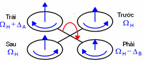

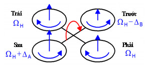

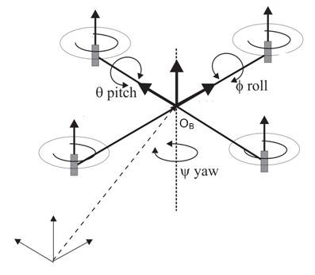


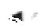

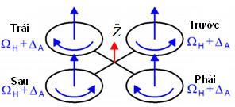

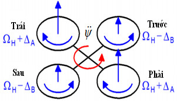

## Trang 3

```text
    KHOA HỌC CÔNG NGHỆ                                                       https://jst-haui.vn P-ISSN 1859-3585                  E-ISSN 2615-9619

        Vị trí góc của quadrotor ΘE được xác định bởi hướng                  Trong đó: c là một hằng số không đổi và l là khoảng
    của hệ tọa độ OB so với hệ quy chiếu OE. Điều này được                cách từ khối tâm của quadrotor đến tâm của động cơ lai
    thực hiện bởi ba phép quay liên tiếp xung quanh các trục              cánh quạt.
    xB, yB, zB.                                                              Hai mô men được tạo ra do sự hồi chuyển là: Sự
          E
        Θ  [ θ ψ ]                                                (2)   chuyển động của các cánh quạt và hình dáng của
                                                                          quadrotor.
       Trong đó:  là góc quay quanh trục xB (góc roll); θ là                         4
    góc quay quanh trục yB (góc pitch); ψ là góc quay quanh                          E  0,0, J ( 1)i1   T
                                                                             Mp                                                              (9)
                                                                                                p          i
                                                                                     i 1
    trục zB (góc yaw).
                                                                                   E  I
                                                                             Mb        E                                                    (10)
       Các góc này được giới hạn như sau: 90o    90o ;
                                                                             Trong đó:     E là vector tốc độ góc trong hệ quy chiếu
    90o  θ  90o ; 180o  ψ  90o
                                                                          OE và I  diag[IXX ,IYY ,IZZ ] ma trận quán tính của quadrotor;
       Mỗi động cơ Đi (i = 1, 2, 3 và 4) của quadrotor sẽ tạo ra
    một lực Fi tỷ lệ với bình phương tốc độ cánh quạt Ω và                IXX ,IYY và IZZ mô men quán tính của quadrotor quanh trục
    luôn có giá trị dương.                                                X, Y và Z; Jp [Nms2 ] mô men quán tính của rotor quay
      Hướng của quadrotor được tạo ra bởi ma trận quay                    quanh trục của cánh quạt.
     : OE  OB phụ thuộc vào các góc Euler ( ,θ,ψ) và                     Đầu vào điều khiển quadrotor được xác định như sau:
    được xác định như sau:
                                                                               U1   F   b  b b b   12 
               cψ c θ    sψ c  cψ sθ s   sψ s  cψ sθ c               U  M   0 lb 0 lb   2 
                                                                             2 φ                 2                                (11)
            sψ c θ    cψ c  sψ sθ sφ    cψ s  sψ sθ c    (3)       U3  Mθ   lb 0 lb 0   23 
               s θ           c θ s               c θ c                                         2 
                                                                            U4  Mψ   d d d d  4 
       Trong đó: cn = cosn, sn = sinn                                         Trong đó: b > 0 và d > 0 là hai tham số phụ thuộc vào
                                                                          mật độ không khí, hình dạng cánh quạt. Hệ số lực đẩy, hệ
       Khi bay, quadrotor phải chịu các lực tác động từ bên
                                                                          số lực cản của cánh quạt được đưa ra trong phương trình
    ngoài như: Lực hấp dẫn, ma sát nhớt, lực cản không khí và
                                                                          (4), (5). 1 , 2 , 3 ,  4 là tốc độ của bốn cánh quạt.
    các lực khác (lực đẩy, lực kéo).
                                                                             Từ phương trình (11), ta thấy đầu vào U1 là tổng lực
       Lực tạo ra bởi các cánh quạt ith :
                                                                          đẩy tác động lên khung quadrotor dọc theo trục Z, đầu
       Fi  0.5ρC T r 2 i2  bi2                                 (4)   vào U2, U3 và U4 là mô men của góc roll, góc pitch và góc
                                                                          yaw.
       Trong đó: ρ là mật độ không khí; r và  là bán kính và
                                                                             Sử dụng phương pháp Newton - Euler ta có được các
    thiết diện của cánh quạt, CT là hệ số lực đẩy khí động lực
                                                                          phương trình chuyển động của quadrotor [6, 7], như
    học.
                                                                          phương trình (12).
       Mô men cản của khí động học, gây ra bởi lực cản tại các
                                                                              m E  F  F  F
    cánh quạt:                                                                            t   d   g
                                                                                                                                               (12)
                                                                                 E
                          2
        δi  0.5ρCDr   d  2       2
                                                                    (5)        I  M  Mp  Mb  Mc
                              i       i

                                                                                                             4           T
       Trong đó: CD là hệ số lực cản của khí động học.                                                         
                                                                             Ở đây: Ft  R  ( ,θ,ψ) 0,0 Fi  tổng lực đẩy các cánh
        Mô men tạo ra góc pitch tỷ lệ thuận với hiệu của hai                                              i 1 

    lực (F3 - F1), mô men tạo ra góc roll tỷ lệ thuận với hiệu của                                    T
                                                                          quạt; F  diag(n ,n ,n ) lực cản không khí chống lại sự
                                                                                 d               1   2    3
    hai lực (F4 - F2) và góc yaw là tổng của các cặp lực đối nhau
                                                                          chuyển động của quadrotor; Fg  [0,0,mg]T lực hấp dẫn;
    tạo ra bởi bốn cánh quạt. Mô men tạo ra các góc roll, pitch
    và yaw được xác định như sau:                                         M  [M ,Mθ ,Mψ ]T tổng mô men của các góc roll, pitch và
       Mθ  l(F3  F1 )                                             (6)   yaw;    Mp        và       Mb       các   mô       men     hồi   chuyển;
                                                                                                                    T
                                                                                                 .2            
       M  l(F4  F2 )                                             (7)   Mc  diag(n4 ,n5 ,n6 )  ,θ 2 ,ψ 2  mô men sinh ra từ ma sát
                                                                                                               
       Mψ  c(F1  F2  F3  F4 )                                   (8)
                                                                          khí động học; n1 ,n2 ,...,n6 các hệ số lực cản và dương.


44 Tạp chí Khoa học và Công nghệ Trường Đại học Công nghiệp Hà Nội                                                            Tập 60 - Số 8 (8/2024)
```

## Trang 4

```text
P-ISSN 1859-3585 E-ISSN 2615-9619 https://jst-haui.vn                                                                          SCIENCE - TECHNOLOGY

    Thay thế vector vị trí và các thành phần lực vào                                - Hệ con thứ 2 (S2) gồm các phương trình vi phân mô
phương trình 1 của (12), ta có được phương trình động                            tả động lực học điều khiển chuyển động tịnh tiến của
lực học chuyển động tịnh tiến của quadrotor như sau:                             quadrotor với các thông tin đầu vào là các góc Euler và
    X  (cos cosψsinθ  sin sinψ)U / m                                      biến U1.
                                        1
                                                                                  x 1  (cosx 4 cos x 6 sinx 5  sinx 4 sinx 6 )U1 / m
     Y   (cos  sinψsinθ  cosψsin )U1 /m       (13)
                                                                                 
                                                                                     x 2  (cosx 4 sinx 5 sinx 6  cosx 6 sinx 4 )U1 / m              (18)
    Z  ( g  cos cosθ)U1 / m                                                     x  ( g  cosx cosx )U / m
                                                                                     3                  4       5   1
   Thay thế các thành phần mô men vào phương trình 2
của (12), ta được phương trình động lực học chuyển động                             Việc phân chia chuyển động sẽ giúp cho việc tổng hợp
quay của quadrotor như sau [6, 7]:                                               bộ điều khiển sẽ đơn giản rất nhiều.
    ..                                                          .2              3. THIẾT KẾ BỘ ĐIỀU KHIỂN
             YY  IZZ ) / IXX  JP θ  / IXX  U2 / IXX  n4  / IXX
     ψθ(I                                                                        Dựa trên việc phân chia chuyển động như đã trình bày
           .                         .
    
      θ  ψ(IZZ  IXX ) / IYY  JP   / IYY  U3 / IYY  n5θ 2 / IYY (14)   ở phần trên, bài báo này trình bày việc sử dụng phương
          .                                                                     pháp tổng hợp hệ thống nhiều vòng điều khiển lệ thuộc
            I ) / I  U / I  n ψ2 / I
      ψ   θ(IXX    YY      ZZ     4    ZZ     6     ZZ                         để tổng hợp hệ thống điều khiển quadrotor. Hệ thống
    
                                                                                 điều khiển quadrotor theo cấu trúc phân chia chuyển động
    Đầu vào là tốc độ cánh quạt được đưa ra theo phương                          bao gồm 3 vòng. Vòng trong là vòng điều khiển và ổn định
trình (15):                                                                      trạng thái các góc Euler; vòng thứ 2 là vòng điều khiển tốc
   U1  b( 12  22  23  24 )                                              độ; vòng ngoài cùng là vòng điều khiển vị trí X, Y, Z của
               2    2                                                           quadrotor. Với cấu trúc này thì vòng bên trong phải có
   U2  lb(4  2 )
               2    2                                                           tính tác động nhanh hơn so với vòng ngoài. Cấu trúc
   U3  lb(3  1 )                                                   (15)
                                                                                 phân chia chuyển động được biểu diễn trong hình 6.
              2    2      2    2
   U4  d(1  2  3  4 )
     1  2  3  4
   
   Mô hình này có thể viết dưới dạng dạng không gian
trạng thái với biến trạng thái:
                        .
   XT      , 
       (X,Y,Z,            có dạng như sau:
                  ,θ,θ,ψ,ψ)
    x 1  (cosx 4 cosx 6 sinx 5  sinx 4 sinx 6 )U1 / m
   
    x 2  (cosx 4 sinx 5 sinx 6  cosx 6 sinx 4 )U1 / m
    x 3  ( g  cosx 4 cosx 5 )U1 / m                                            Hình 6. Sơ đồ khối các vòng điều khiển quadrotor
   
    x 4  x 7                                                                     a) Tổng hợp Bộ điều khiển và ổn định các góc Euler C1
   
    x 5  x 8                                                         (16)        Để tổng hợp bộ điều khiển và ổn định các góc Euler,
    x  x                                                                      trong bài báo sử dụng phương pháp tuyến tính hóa phản
    6        9

    x 7  x 8 x 9 (IYY  IZZ ) / IXX  x 8 JP   / IXX  U2 / IXX             hồi [5, 6]. Nội dung của phương pháp này là chuyển đổi
                                                                                một hệ thống phi tuyến thành hoặc xấp xỉ một hệ thống
    x 8  x7 x 9 (IZZ  IXX ) / IYY  x7 JP   / IYY  U3 / IYY
    x  x x (I  I ) / I  U / I                                               tuyến tính theo các phép biến đổi.
    9        7 8 XX        YY      ZZ     4    ZZ
                                                                                    Hệ con S1 là các phương trình vi phân mô tả động lực
   Phương trình không gian trạng thái này có thể tách                            học trạng thái các góc Euler với các biến đầu vào U2, U3, U4.
thành các hệ con [5, 6], bao gồm:
                                                                                     x 7  x 8 x 9 (IYY  IZZ ) / IXX  x 8 JP  / IXX  U2 / IXX
   - Hệ con thứ nhất (S1): Mô tả động lực học trạng thái các                        
góc Euler với các biến đầu vào U2, U3, U4 được thể hiện thông                        x 8  x7 x 9 (IZZ  IXX ) / IYY  x7 JP  / IYY  U3 / IYY     (19)
                                                                                     x  x x (I  I ) / I  U / I
qua hệ phương trình vi phân (17).                                                    9        7 8 XX        YY      ZZ     4    ZZ

    x 7  x 8 x 9 (IYY  IZZ ) / IXX  x 8 JP   / IXX  U2 / IXX                Sử dụng phương pháp tuyến tính hóa phản hồi, các
   
    x 8  x7 x 9 (IZZ  IXX ) / IYY  x7 JP   / IYY  U3 / IYY      (17)     biến đầu vào điều khiển U2 ,U3 ,U4 sẽ được biến đổi thành
    x  x x (I  I ) / I  U / I
    9        7 8 XX        YY      ZZ     4    ZZ                               các biến đầu vào điều khiển mới U ,U ,U .    2   3    4


Vol. 60 - No. 8 (Aug 2024)                                                                                    HaUI Journal of Science and Technology 45
```

### Hình nhúng

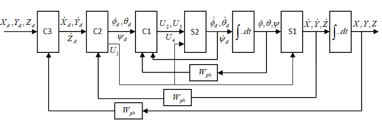

## Trang 5

```text
    KHOA HỌC CÔNG NGHỆ                                                                 https://jst-haui.vn P-ISSN 1859-3585               E-ISSN 2615-9619

        U 2  U2  x 8 x 9 (IYY  IZZ ) / IXX  x 8 JP   / IXX                      Wđk  0,5β22 Wph IXX  0,5β32 Wph IXX / s                     (26)
        
         U 3  U3  x7 x 9 (IZZ  IXX ) / IYY  x7 JP   / IYY                      Bằng cách tổng hợp tương tự, ta có được hàm truyền
                                                                                  điều khiển các góc θ và ψ như phương trình (27), (28).
         U4  U4  x7 x 8 (IXX  IYY ) / IZZ
           U 2  U2  λ 20  λ 21  U2  λ 2                                          Wđkθ  0,5β32 WphθIYY  0,5β33 WphθIYY / s                       (27)
           
       hay U 3  U3  λ 30  λ 31  U3  λ 3                             (20)         Wđkθψ  0,5β24 WphψIZZ  0,5β34 WphψIZZ / s                      (28)
           
           U4  U4  λ 40  λ11  U4  λ 4                                            b) Tổng hợp Bộ điều khiển tốc độ của quadrotor C2
       Khi đó phương trình (20) được viết lại như sau:                                 Với giả thiết, vòng điều khiển và ổn định các góc Euler
                                                                                    bên trong là đủ nhanh so với vòng điều khiển tốc độ dài
        U2  U 2  λ2
                                                                                   quadrotor bên ngoài [6]. Khi ấy, giá trị mong muốn của
        U3  U 3  λ 3                                                   (21)
                                                                                    các góc roll, pitch và yaw x 4d ,x 5d ,x 6d xác lập và gửi tới hệ
              
        U4  U4  λ 4                                                              con S2. Hệ phương trình động lực học của quadrotor theo
                                                                                    3 tọa độ X, Y, Z có dạng như sau:
       Như vậy, với biến đầu vào điều khiển mới U 2 ,U 3 ,U 4 .
    Để có được một hệ tuyến tính cần phải thỏa mãn điều                                  x 1  (sinx 4d sinx 6d  cosx 4 d sinx 5d cos x 6d )U1 / m
                                                                                        
    kiện sau:                                                                            x 2  (cosx 4d sinx 5d sinx 6d  sinx 4d cosx 6d )U1 / m       (29)
                                                                                         x  g  (cosx cosx )U / m
        β2 x7  x 8 x 9 (IYY  IZZ ) / IXX  JP x 8   / IXX  λ2 / IXX                3                   4d      5d   1

        
        β3 x 8  x 9 x7 (IZZ  IXX ) / IYY  JP x 7   / IYY  lbλ 3 / IYY (22)      Ở đây, các góc x 4d , x 5d , x 6d và U1 là các biến điều
        β x  x x (I  I ) / I  dλ / I
         4 9       7 8 XX       YY      ZZ       4    ZZ                           khiển. Với giả thiết tồn tại ba biến đầu vào mới Uˆ ,Uˆ ,Uˆ      1   2   3

       Trong đó: β2 ,β3 ,β 4 là các hằng số chưa biết cần xác                       độc lập, khi đó phương trình (29) được viết dưới dạng sau:
    định. Ta rút λ2 , λ3 , λ 4 trong phương trình (22), sử dụng                         x 1  γ1(x 4d ,x 5d ,x 6d ,U1 )  Uˆ 1
    phương trình (21) và thay vào phương trình (19), sau khi biến                       x  γ (x , x ,x ,U )  ˆU
                                                                                         2       2   4d    5d          6d       1   2                    (30)
    đổi ta thu được:                                                                    x 3  γ 3 (x 4d ,x 5d ,U1 )  Uˆ 3
         x 7  β2 x 7  U 2 / IXX
                                                                                      Với các biến đầu vào mới ˆU1 ,Uˆ 2 ,Uˆ 3 thì việc điều khiển
         x 8  β3 x 8  lbU 3 / IYY                                     (23)
                                                                                    sẽ đơn giản hơn rất nhiều, có thể lựa chọn bộ điều khiển
                            
         x 9  β 4 x 9  dU4 / IZZ                                                 dưới dạng tỷ lệ.
       Để xác định các hệ số β2 ,β3 ,β 4 , ta sử dụng hàm                               Û1  n1(x1d  x1 )  (X d  X)
                                                                                                                       ; Û  n (x  x )  (Y  Y)
                                                                                                                            2   2  2d  2       d
                                                                                                                                                   ;
    Lyapunov. Lựa chọn hàm Lyapunov có dạng [4], như sau:                               Û  n (x  x )  (Z  Z)
                                                                                          3      3   3d        3                d
                     2     2     2
        V  0,5(x  x  x )
                     7     8     9                                         (24)        Trong đó, n1 ,n2 ,n3 là tham số bộ điều khiển và được
       Lấy đạo hàm V ta thu được:                                                  chọn sao cho vòng trong nhanh hơn vòng ngoài. Từ các
        V  (x7 x 7  x 8 x 8  x 9 x 9 )  β x  β x  β4 x
                                               2         2           2              biến đầu vào Uˆ ,Uˆ ,Uˆ , việc xác định các biến đầu vào
                                                                                                           1       2        3
                                             2 7       3 8           9
                                                                                    thực x4d, x5d và U1 được thực hiện bằng cách giải phương
        V  0 nếu β2 ,β3 ,β 4  0 , khi đó hệ thống tuyến tính
                                                                                    trình (29) với x 6d  ψd  0 .
    hóa phản hồi ổn định tiệm cận.
       Từ phương trình (23), ta có   x 4 . Do đó, ta có được                          Û1  cosx 4 d sinx 5dU1 / m
                                                                                        
    hàm truyền đạt kênh điều khiển góc  khi có tính đến cơ                              Û2  sinx 4 dU1 / m                                           (31)
    cấu phản hồi là:                                                                     
                                                                                         Û3  g  cosx 4 d cosx 5dU1 / m
        W  x 4 / U 2  Wph / T2 s(T1 s  1)                          (25)        Ta thu được các nghiệm như sau:
       Trong đó: T1  1/ β2 ; T2  β2IXX
                                                                                        U1  m (Uˆ 12 / (  ˆU3m)2 )  Uˆ 22                             (32)
       Sử dụng tiêu chuẩn tối ưu modul [3], ta tổng hợp được
    bộ điều khiển góc  có dạng PI:                                                     x 4d  d  arcsin(Uˆ 2m / U1 );                                 (33)


46 Tạp chí Khoa học và Công nghệ Trường Đại học Công nghiệp Hà Nội                                                                      Tập 60 - Số 8 (8/2024)
```

## Trang 6

```text
P-ISSN 1859-3585 E-ISSN 2615-9619 https://jst-haui.vn                                                                SCIENCE - TECHNOLOGY

    900  d  900                                                 (34)      Các hằng số của bộ điều khiển và ổn định các góc
                                                                           Euler β2 ,β3 ,β 4 được chọn theo tiêu chuẩn Lyapunov với
    x 5d  θd  arcsin(1/ (Uˆ 3  g / Uˆ 1 )2  1) ;
                                                                           các giá trị β2  65 ; β3  80 ; β 4  95 ; hàm truyền của
    900  θd  900                                                 (35)   cơ cấu đo chọn bằng Wph  1 ; Tham số của bộ điều khiển
    x 6d  ψd  0                                                   (36)   tốc độ được tính toán và lựa chọn như sau:
   c) Tổng hợp Bộ điều khiển vị trí của quadrotor C3                       n1  1,4; n2  n3  0,6 . Khi đó bộ điều khiển tốc độ dài của
    Bộ điều khiển vị trí C3 được tổng hợp theo phương                      quadrotor có dạng Û1  1,4(x1d  x1 ) ; Û2  0,6(x2d  x2 ) ;
pháp nhận dạng [1]. Hàm truyền bộ điều khiển có dạng                       Û3  0,6(x 3d  x 3 ) . Các tham số của bộ điều khiển vị trí
tỷ lệ vi phân PD.
                                                                           được tính toán và lựa chọn với các giá trị K P  0,5 ;
4. MÔ PHỎNG HỆ ĐIỀU KHIỂN QUADROTOR
                                                                           K D  0,1.
   Các thông số của quadrotor được cho trong bảng 1.
                                                                              * Kết quả mô phỏng:
   Bảng 1. Thông số của của quadrotor và của bộ điều khiển
                                                                               Trường hợp 1: Khảo sát hệ thống điều khiển
              Thông số                 Ký hiệu     Giá trị    Đơn vị       quadrotor trong trường hợp quadrotor cất cánh theo
 Hệ số nâng                               b       54,2.106     Ns2         phương thẳng đứng. Vị trí chuyển động dài của
 Hệ số kéo                                d        1,1.10-6    Ns2         quadrotor theo phương X, Y và Z được đặt tại các giá trị:
                                                                           Xd = 0 [m]; Yd = 0 [m]; Zd = 37 [m]
 Mô men quán tính                         J         0,089     Nms2
 Khối lượng quadrotor                     m             1      kg
 Mômen quán tính trục x                   IXX      0,0081     Nms2
 Mômen quán tính trục y                   IYY      0,0081     Nms2
 Mômen quán tính trục z                   IZZ      0,0142     Nms2
 Gia tốc trọng trường                     g            9.81   m/s-2
 KC từ tâm quadrotor đến tâm của ĐC        l           0.24     m
                                                                                                     Thời gian (s)


   Hình 7. Mô hình mô phỏng hệ thống điều khiển quadrotor


Vol. 60 - No. 8 (Aug 2024)                                                                         HaUI Journal of Science and Technology 47
```

### Hình nhúng

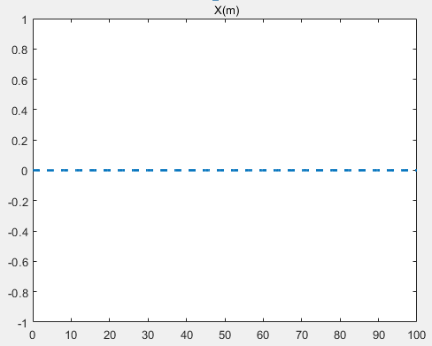

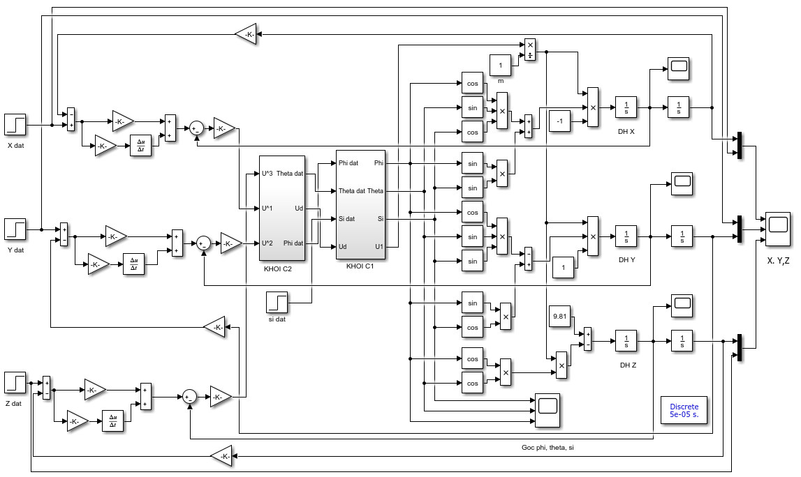

## Trang 7

```text
    KHOA HỌC CÔNG NGHỆ                                                           https://jst-haui.vn P-ISSN 1859-3585     E-ISSN 2615-9619

                                                                                 Trường hợp 2: Khảo sát hệ thống điều khiển
                                                                              quadrotor trong trường hợp quadrotor thực hiện di
                                                                              chuyển theo phương X, Y (Xd = 3,5[m], Yd = 4 [m]), kết hợp
                                                                              cất cánh đến độ cao Zd = 15 [m].


                                 Thời gian (s)


                                                                                                      Thời gian (s)


                                 Thời gian (s)


                                                                                                      Thời gian (s)


                                 Thời gian (s)


                                                                                                      Thời gian (s)


                                 Thời gian (s)


                                                                                                      Thời gian (s)


                                 Thời gian (s)
        Hình 8. Vị trí và các góc Euler trong trường hợp quadrotor cất cánh
    thẳng đứng                                                                                         Thời gian (s)


48 Tạp chí Khoa học và Công nghệ Trường Đại học Công nghiệp Hà Nội                                                      Tập 60 - Số 8 (8/2024)
```

### Hình nhúng

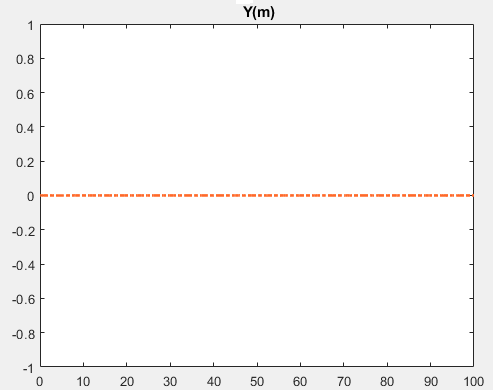

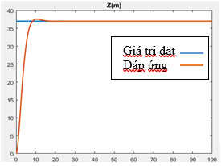

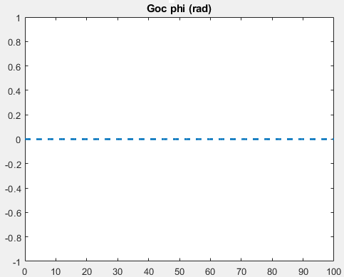

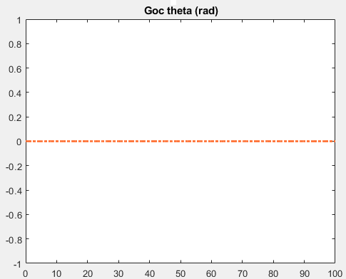

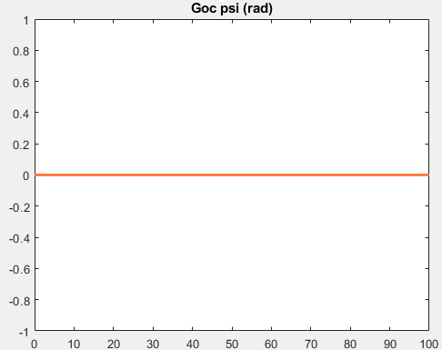

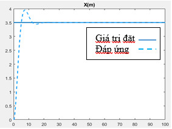

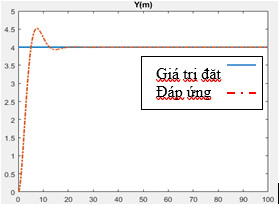

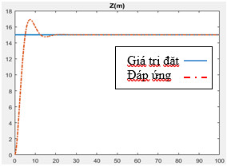

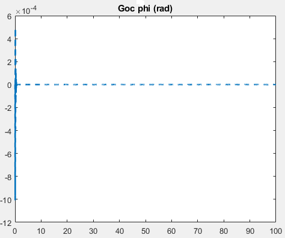

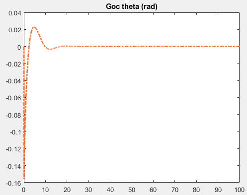

## Trang 8

```text
P-ISSN 1859-3585 E-ISSN 2615-9619 https://jst-haui.vn                                                                              SCIENCE - TECHNOLOGY

                                                                                        [9]. Farrell M., Jackson J., Nielsen J., Bidstrup C., McLain T., “Error-State
                                                                                    LQR Control of a Multirotor UAV,” In Proceedings of the 2019 International
                                                                                    Conference on Unmanned Aircraft Systems (ICUAS), Atlanta, GA, USA, 704-711,
                                                                                    11-14 June 2019.
                                                                                        [10]. Guerrero-Sánchez M., Lozano R., Castillo P., Hernández-González O.,
                                                                                    García-Beltrán C., Valencia-Palomo G., “Nonlinear control strategies for a UAV
                                                                                    carrying a load with swing attenuation,” Appl. Math. Model., 91, 709-722,
                                                                                    2021.
                                   Thời gian (s)                                       [11]. Xiong J. J., Zheng E. H., “Position and attitude tracking control for a
    Hình 9. Vị trí và các góc Euler trong trường hợp quadrotor di chuyển            quadrotor UAV,” ISA Trans., 53, 725-731, 2014.
5. KẾT LUẬN                                                                              [12]. Gu W., Alavanis K. P., Rutherford M. J., Rizzo A., “UAV Model-based
    Bài báo này tập trung nghiên cứu xây dựng và tổng                               Flight Control with Artificial Neural Networks: A Survey,” J.Intell. Robot. Syst.,
hợp bộ điều khiển vị trí quadrotor với mô hình phi tuyến                            100, 1469-1491, 2020.
bằng phương pháp tuyến tính hóa phản hồi. Để chứng                                      [13]. Jinjun Rao, Bo Li, Zhen Zhang, Dongdong Chen, Wojciech Giernacki,
minh tính đúng đắn của phương pháp tiếp cận, tác giả đã                             “Position Control of Quadrotor UAV Based on Cascade Fuzzy Neural Network,”
mô phỏng hệ điều khiển vị trí của quadrotor bằng công                               Energies, 15, 1763, 2022.
cụ Matlab - Simulink với hai trường hợp: Trường hợp 1,
quadrotor thực hiện cất cánh thắng đứng và trường hợp
2, quadrotor di chuyển kết hợp cất cánh. Kết quả thu được
                                                                                        AUTHOR INFORMATION
cho thấy quadrotor đã di chuyển đến đúng các vị trí đặt
mong muốn, các góc Euler đổi rất ít, điều đó chứng tỏ                                   Hoang Van Huy
quadrotor không bị dung lắc trong quá trình cất cánh và                                 Hanoi University of Industry, Vietnam
di chuyển. Điều này chứng tỏ bộ điều khiển tổng hợp
được đã đáp ứng tốt với các đầu vào mong muốn.


    TÀI LIỆU THAM KHẢO
    [1]. Nguyen Doan Phuoc, Fundamentals of linear control theory. Bach khoa
Publishing House, Hanoi, 2016. (in Vietnamese)
    [2]. Nguyen Phung Quang, Matlab & Simulink for automatic control
engineers. Science and Technics Publishing House, Hanoi, 2006.
     [3]. Dao Hoa Viet, Example exercises and practice of automatic control of
electric drives. Military Technical Academy, Hanoi, 2011.
    [4]. Utkin V. I., Sliding Modes in control Optimization. Springer Verlag, New
York, 1992.
   [5]. H. Voos, “Nonlinear State-Dependent Riccati Equation Control of a
Quadrotor UAV,” in Proc. of the IEEE Conference on Control Applications,
Munich, Germany, 2006.
     [6] H. Voos, “Nonlinear and Neural Network-based Control of a Small
Four-Rotor Aerial Robot,” in Proc. of the IEEE/ASME Int. Conference on Advanced
Intelligent Mechatronics, Zurich, CH, 2007.
     [7]. Bresciani T., Modelling, Identification and Control of a Quadrotor
Helicopter. Department of Automatic Control, Lund University,2008.
    [8]. Mo H., Farid G., “Nonlinear and adaptive intelligent control
techniques for quadrotor uav-A survey,” Asian J. Control, 21, 989-1008, 2019.


Vol. 60 - No. 8 (Aug 2024)                                                                                         HaUI Journal of Science and Technology 49
```

### Hình nhúng

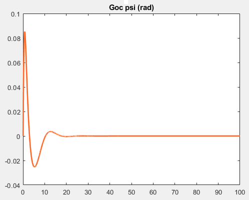
