# MÔ PHỎNG HỆ ĐIỀU KHIỂN QUADROTOR SỬ DỤNG ĐỘNG CƠ CHẤP HÀNH MỘT CHIỀU VỚI BỘ ĐIỀU KHIỂN THÍCH NGHI
## SIMULATION OF QUADROTOR CONTROL SYSTEM USING ENGINE ONE WAY WITH ADAPTIVE CONTROLLER

**Hoàng Văn Huy¹\***  
*¹ Trường Đại học Công nghiệp Hà Nội (HaUI)*  
*\* Email: huyhv@haui.edu.vn*  
*Tạp chí Khoa học & Công nghệ - Đại học Công nghiệp Hà Nội (HaUI Journal of Science and Technology)*  
*Vol. 60 - No. 9 (Sep 2024), pp. 111–117*  
*DOI: [http://doi.org/10.57001/huih5804.2024.303](http://doi.org/10.57001/huih5804.2024.303)*  
*P-ISSN: 1859-3585, E-ISSN: 2615-9619*

---

### TÓM TẮT
Bài báo này trình bày việc xây dựng một mô hình động lực học đầy đủ của quadrotor khi kể đến cơ cấu chấp hành là động cơ điện một chiều với bộ điều khiển thích nghi. Các bộ điều khiển vị trí, tốc độ của quadrotor sẽ được thiết kế theo phương pháp tối ưu modul, tuyến tính hóa phản hồi và kết quả được kiểm chứng bằng phần mềm Matlab-Simulink.

**Từ khóa:** Mô hình quadrotor, mô hình động học, điều khiển.

### ABSTRACT
This article presents the construction of a full dynamic model of a quadrotor considering that the actuator is a DC electric motor with an adaptive controller. The position and speed controllers of the quadrotor will be designed according to the modular optimization method, feedback linearization and the results will be verified using Matlab-Simulink software.

**Keywords:** Model quadrotor, Dynamic model, Control.

---

### CHỮ VIẾT TẮT
- **UAV:** Unmanned Aerial Vehicle (Máy bay không người lái)
- **PID:** Proportional Integral Derivative (Vi tích phân tỷ lệ)

---

## 1. ĐẶT VẤN ĐỀ
UAV quadrotor là một loại máy bay không có người lái gồm bốn động cơ lai bốn cánh quạt được gắn lên một khung hình chữ thập [7]. Cách thức điều khiển UAV quadrotor như sau:

- **Điều khiển độ cao:** Điều khiển độ cao quadrotor bằng việc cùng giảm hoặc cùng tăng một lượng $\Delta\Omega$ tốc độ của bốn cánh quạt. Đầu vào điều khiển là $U_1$ (Hình 1).
- **Điều khiển góc roll:** Điều khiển góc roll quadrotor thực hiện bằng việc điều chỉnh giảm (hoặc tăng) tốc độ cánh quạt “trái” và tăng (hoặc giảm) tốc độ cánh quạt “phải”. Tốc độ cặp cánh quạt "trước" và "sau" điều chỉnh không đổi. Đầu vào điều khiển là $U_2$ (Hình 2).
- **Điều khiển góc pitch:** Điều khiển góc pitch quadrotor thực hiện bằng việc điều chỉnh giảm (hoặc tăng) tốc độ cánh quạt “sau” và tăng (hoặc giảm) tốc độ cánh quạt “trước”. Tốc độ cặp cánh quạt "trái" và "phải" điều chỉnh không đổi. Đầu vào điều khiển là $U_3$ (Hình 3).
- **Điều khiển góc yaw:** Điều khiển góc yaw quadrotor thực hiện bằng việc điều chỉnh giảm (hoặc tăng) tốc độ cặp cánh quạt “trái - phải” và tăng (hoặc giảm) tốc độ cặp cánh quạt “trước - sau”. Đầu vào điều khiển là $U_4$ (Hình 4).

| 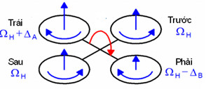 | 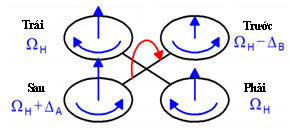 |
| :---: | :---: |
| **Hình 1.** Điều khiển độ cao quadrotor | **Hình 2.** Điều khiển góc roll |

| 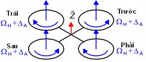 | 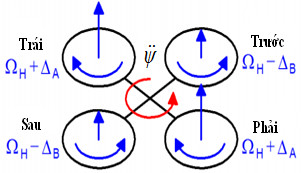 |
| :---: | :---: |
| **Hình 3.** Điều khiển góc pitch | **Hình 4.** Điều khiển góc yaw |

---

## 2. MÔ HÌNH ĐỘNG HỌC CỦA QUADROTOR

Mô hình cấu trúc đơn giản và các hệ trục tọa độ gắn với quadrotor được biểu diễn trong Hình 5. Trong đó, $O_E x_E y_E z_E$ là hệ trục tọa độ quán tính, $O_B x_B y_B z_B$ là hệ trục tọa độ gắn với vật (Quadrotor). Gốc hệ trục tọa độ $O_B x_B y_B z_B$ đặt trùng với tâm của quadrotor. $F_i$ là các lực, $M_i$ là các mô men, $\Omega_i$ tốc độ của bốn cánh quạt [3, 6-8].

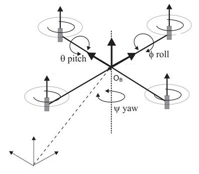  
*Hình 5. Mô hình đơn giản của quadrotor*

$\Gamma_E = [X \; Y \; Z]^T$ là vị trí của quadrotor được tạo thành bởi gốc $O_B$ và gốc $O_E$ của hệ trục tọa độ:
$$\Gamma_E = [X \; Y \; Z]^T \tag{1}$$

$\Xi$ là vị trí góc quadrotor được tạo bởi hướng của hệ trục tọa độ $O_B$ so với hệ trục tọa độ quán tính $O_E$:
$$\Xi = [\phi \; \theta \; \psi]^T \tag{2}$$

Trong đó: $\phi, \theta, \psi$ lần lượt là các góc quay quanh các trục tọa độ $x_B, y_B, z_B$ và có giới hạn:
$$-90^\circ < \phi < 90^\circ, \quad -90^\circ < \theta < 90^\circ, \quad -180^\circ < \psi < 180^\circ \tag{3}$$

Các ma trận quay cơ bản:
$$\text{Rot}(x, \phi) = \begin{bmatrix} 1 & 0 & 0 \\ 0 & c\phi & -s\phi \\ 0 & s\phi & c\phi \end{bmatrix}, \quad \text{Rot}(y, \theta) = \begin{bmatrix} c\theta & 0 & s\theta \\ 0 & 1 & 0 \\ -s\theta & 0 & c\theta \end{bmatrix}, \quad \text{Rot}(z, \psi) = \begin{bmatrix} c\psi & -s\psi & 0 \\ s\psi & c\psi & 0 \\ 0 & 0 & 1 \end{bmatrix} \tag{4}$$

Hướng quadrotor được xác định bởi ma trận quay $R : O_B \to O_E$:
$$R = \begin{bmatrix} c\theta c\psi & s\phi s\theta c\psi - c\phi s\psi & c\phi s\theta c\psi + s\phi s\psi \\ c\theta s\psi & s\phi s\theta s\psi + c\phi c\psi & c\phi s\theta s\psi - s\phi c\psi \\ -s\theta & s\phi c\theta & c\phi c\theta \end{bmatrix} \tag{5}$$
*(với $c\alpha = \cos\alpha, s\alpha = \sin\alpha$)*

Lực đẩy tổng của các cánh quạt:
$$F = \sum_{i=1}^4 F_i, \quad F_i = 0.5 \rho \Lambda C_T r^2 \Omega_i^2 = b \Omega_i^2 \tag{6}$$

Khí động học sinh ra mô men cản:
$$M_i = d \Omega_i^2, \quad \text{với } d = 0.5 \rho \Lambda C_D r^3 \tag{7}$$

Mô men tác động theo các trục:
$$M_\theta = l(F_3 - F_1) = lb(\Omega_3^2 - \Omega_1^2) \tag{8}$$
$$M_\phi = l(F_4 - F_2) = lb(\Omega_4^2 - \Omega_2^2) \tag{9}$$
$$M_\psi = d(\Omega_1^2 - \Omega_2^2 + \Omega_3^2 - \Omega_4^2) \tag{10}$$

Mô men hồi chuyển do chuyển động quay của 4 rotor:
$$M_g = \sum_{i=1}^4 \dot{\Xi} \wedge [0, 0, J_r (-1)^{i+1} \Omega_i]^T \tag{11}$$
$$M_r = \dot{\Xi} \wedge I \dot{\Xi} \tag{12}$$

Tín hiệu điều khiển $U_1, U_2, U_3, U_4$:
$$\begin{bmatrix} U_1 \\ U_2 \\ U_3 \\ U_4 \end{bmatrix} = \begin{bmatrix} b & b & b & b \\ 0 & -lb & 0 & lb \\ -lb & 0 & lb & 0 \\ d & -d & d & -d \end{bmatrix} \begin{bmatrix} \Omega_1^2 \\ \Omega_2^2 \\ \Omega_3^2 \\ \Omega_4^2 \end{bmatrix} \tag{13}$$

Phương trình động lực học tổng quát theo Newton - Euler:
$$m \ddot{\Gamma}_E = F_T - F_d - F_g \tag{14a}$$
$$I \ddot{\Xi} = M_T - M_g - M_r - M_a \tag{14b}$$

Hệ phương trình vi phân chuyển động tịnh tiến:
$$\ddot{X} = (\cos\phi \sin\theta \cos\psi + \sin\psi \sin\phi)\frac{U_1}{m} - K_1 \dot{X}$$
$$\ddot{Y} = (\cos\phi \sin\theta \sin\psi - \sin\phi \cos\psi)\frac{U_1}{m} - K_2 \dot{Y} \tag{15}$$
$$\ddot{Z} = (\cos\phi \cos\theta)\frac{U_1}{m} - g - K_3 \dot{Z}$$

Hệ phương trình vi phân chuyển động quay:
$$\ddot{\phi} = \dot{\theta}\dot{\psi}\frac{I_{yy} - I_{zz}}{I_{xx}} - \frac{J_r}{I_{xx}}\dot{\theta}\Omega_r - \frac{h_4}{I_{xx}}\dot{\phi} + \frac{U_2}{I_{xx}}$$
$$\ddot{\theta} = \dot{\phi}\dot{\psi}\frac{I_{zz} - I_{xx}}{I_{yy}} + \frac{J_r}{I_{yy}}\dot{\phi}\Omega_r - \frac{h_5}{I_{yy}}\dot{\theta} + \frac{U_3}{I_{yy}} \tag{16}$$
$$\ddot{\psi} = \dot{\phi}\dot{\theta}\frac{I_{xx} - I_{yy}}{I_{zz}} - \frac{h_6}{I_{zz}}\dot{\psi} + \frac{U_4}{I_{zz}}$$
*(với $\Omega_r = \Omega_1 - \Omega_2 + \Omega_3 - \Omega_4$)*

Phương trình không gian trạng thái với $X = [\dot{X}, \dot{Y}, \dot{Z}, \phi, \theta, \psi, \dot{\phi}, \dot{\theta}, \dot{\psi}, X, Y, Z]^T$:
$$\begin{cases}
\dot{x}_1 = (\cos x_4 \sin x_5 \cos x_6 + \sin x_6 \sin x_4)\frac{U_1}{m} - K_1 x_1 \\
\dot{x}_2 = (\cos x_4 \sin x_5 \sin x_6 - \sin x_4 \cos x_6)\frac{U_1}{m} - K_2 x_2 \\
\dot{x}_3 = -g + (\cos x_4 \cos x_5)\frac{U_1}{m} - K_3 x_3 \\
\dot{x}_4 = x_7 \\
\dot{x}_5 = x_8 \\
\dot{x}_6 = x_9 \\
\dot{x}_7 = x_8 x_9\frac{I_{yy} - I_{zz}}{I_{xx}} - \frac{J_r}{I_{xx}} x_8 \Omega_r - \frac{h_4}{I_{xx}} x_7 + \frac{U_2}{I_{xx}} \\
\dot{x}_8 = x_7 x_9\frac{I_{zz} - I_{xx}}{I_{yy}} + \frac{J_r}{I_{yy}} x_7 \Omega_r - \frac{h_5}{I_{yy}} x_8 + \frac{U_3}{I_{yy}} \\
\dot{x}_9 = x_7 x_8\frac{I_{xx} - I_{yy}}{I_{zz}} - \frac{h_6}{I_{zz}} x_9 + \frac{U_4}{I_{zz}} \\
\dot{x}_{10} = x_1 \\
\dot{x}_{11} = x_2 \\
\dot{x}_{12} = x_3
\end{cases} \tag{18}$$

---

## 3. TỔNG HỢP CÁC BỘ ĐIỀU KHIỂN

Sơ đồ cấu trúc điều khiển phân tầng với 3 vòng (Hình 6):
- **Vòng ngoài ($C_3$):** Điều khiển vị trí $X, Y, Z$.
- **Vòng giữa ($C_2$):** Điều khiển vận tốc.
- **Vòng trong ($C_1$):** Điều khiển góc Euler $(\phi, \theta, \psi)$.
- **Vòng chấp hành:** Điều khiển động cơ điện DC.

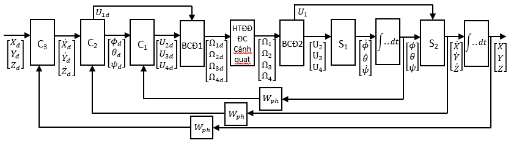  
*Hình 6. Sơ đồ khối các vòng điều khiển quadrotor*

### 3.1. Tổng hợp bộ điều khiển động cơ điện một chiều

Mô hình động cơ điện một chiều:
$$U_u = R_u i + L_u \frac{di}{dt} + K_E \omega \tag{19}$$
$$J_P \frac{d\omega}{dt} = M_{dc} - M_c \tag{20}$$

Mô-men cản tải khí động của cánh quạt:
$$M_c = M_0 + B\Omega + \frac{d\Omega^2}{\eta N} \tag{21}$$

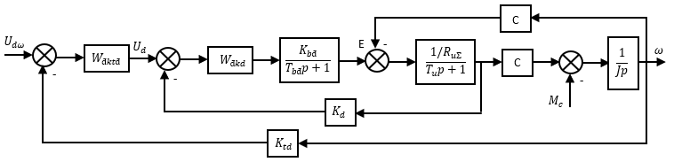  
*Hình 7. Sơ đồ khối hệ điều khiển động cơ điện một chiều*

- **Vòng dòng điện:** Thiết kế theo tiêu chuẩn tối ưu modul (Modul Optimum):
  $$W_{đ i} = K_i + \frac{1}{T_n p} \tag{22}$$
  Hàm truyền đạt vòng kín dòng điện: $W_{k i} = \frac{1}{K_i (2T_b p + 1)}$ (23).

- **Vòng tốc độ:** Bộ điều khiển thích nghi theo phương pháp Gradient (luật MIT):
  Mô hình tham chiếu bậc 2 mong muốn:
  $$G_m(p) = \frac{Y_m(p)}{U_m(p)} = \frac{1}{p^2 + 0.5p + 1} \tag{25}$$

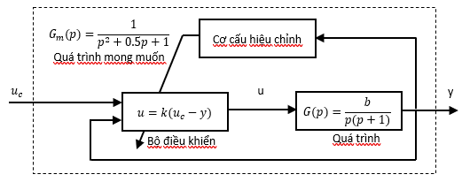  
*Hình 8. Sơ đồ hệ thống điều khiển thích nghi tốc độ động cơ*

Luật cập nhật tham số thích nghi:
$$\frac{dk}{dt} = -\gamma (y - y_m)\frac{p + ap}{p^2 + ap + 1} u \tag{35}$$

### 3.2. Tổng hợp bộ điều khiển góc Euler ($C_1$)
Áp dụng phương pháp **Tuyến tính hóa phản hồi (Feedback Linearization)** cho hệ con trạng thái góc Euler:
Biến đổi các biến điều khiển:
$$\begin{cases}
U_2 = U_2^* - x_8 x_9(I_{yy} - I_{zz}) - J_r x_8 \Omega_r - h_4 x_7 \\
U_3 = U_3^* - x_7 x_9(I_{zz} - I_{xx}) + J_r x_7 \Omega_r - h_5 x_8 \\
U_4 = U_4^* - x_7 x_8(I_{xx} - I_{yy}) - h_6 x_9
\end{cases} \tag{37}$$

Chứng minh ổn định tiệm cận qua hàm Lyapunov:
$$V = 0.5(x_7^2 + x_8^2 + x_9^2) \tag{40}$$
$$\dot{V} = \lambda_1 x_7^2 + \lambda_2 x_8^2 + \lambda_3 x_9^2 < 0 \quad (\text{khi } \lambda_1, \lambda_2, \lambda_3 < 0)$$

Tổng hợp bộ điều khiển góc PI theo tiêu chuẩn tối ưu modul:
$$W_{đ\phi} = 0.5\lambda_1 W_{fb} I_{xx} - \frac{0.5\lambda_1 W_{fb} I_{xx}}{p} \tag{42}$$

### 3.3. Tổng hợp bộ điều khiển tốc độ ($C_2$)
Giả thiết vòng $C_1$ đáp ứng rất nhanh. Từ các biến gia tốc điều khiển ảo $U_x, U_y, U_z$, tính toán góc đặt mong muốn và lực đẩy tổng:
$$U_1 = m\sqrt{U_x^2 + U_y^2 + (U_z + g)^2} \tag{48}$$
$$\phi_d = \arcsin\left(\frac{m U_y}{U_1}\right) \tag{49}$$
$$\theta_d = \arcsin\left(\frac{1}{\sqrt{((U_z + g)/U_x)^2 + 1}}\right) \tag{50}$$
$$\psi_d = 0 \tag{51}$$

### 3.4. Tổng hợp bộ điều khiển vị trí ($C_3$)
Bộ điều khiển vị trí PID được thiết kế bằng phương pháp nhận dạng và tối ưu modul:
$$W_{đ} = \frac{4T_1 + T_2}{8T_1 K} + \frac{1}{8T_1 K p} + \frac{T_1 T_2 p}{2T_1 K} \tag{52}$$

---

## 4. MÔ PHỎNG HỆ THỐNG

### Bảng thông số mô phỏng
| Thông số | Ký hiệu | Giá trị | Đơn vị |
|:---|:---:|:---:|:---:|
| Động cơ DC RS-555PH | $U_u, I_u$ | 24; 0.21 | V, A |
| Điện trở, điện cảm phần ứng | $R_u, L_u$ | 0.6; $15 \cdot 10^{-3}$ | $\Omega$, H |
| Khối lượng quadrotor | $m$ | 1.0 | kg |
| Quán tính $I_x, I_y, I_z$ | $I_x, I_y, I_z$ | 0.008; 0.008; 0.010 | $\text{N}\cdot\text{m}\cdot\text{s}^2$ |
| Hệ số lực nâng, lực cản | $b, d$ | $54.2 \cdot 10^{-6}; 1.1 \cdot 10^{-6}$ | $\text{N}\cdot\text{s}^2$ |
| Cánh tay đòn | $l$ | 0.5 | m |

### Kết quả mô phỏng
Kịch bản bay: Điều khiển tịnh tiến vị trí đặt $X_d = 15\text{ m}, Y_d = 10\text{ m}$, và độ cao thay đổi theo các nấc $Z_d = [10, 15, 40, 25, 5]\text{ m}$.

| 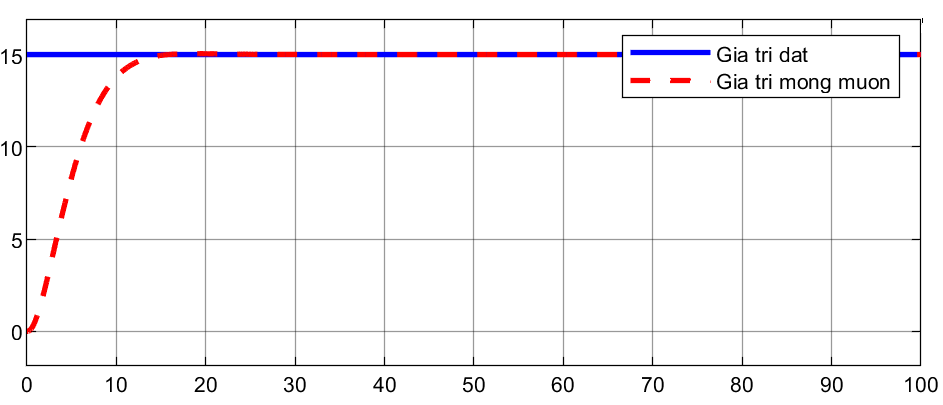 | 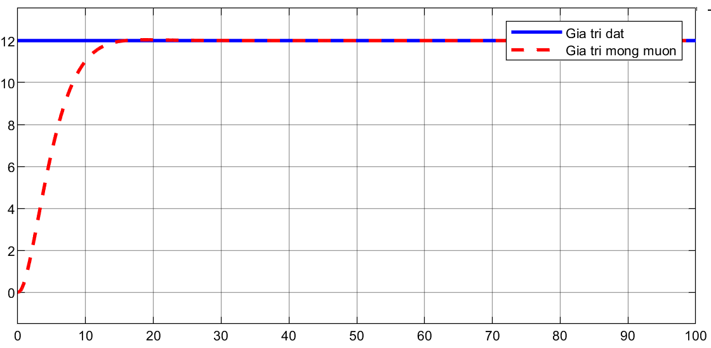 | 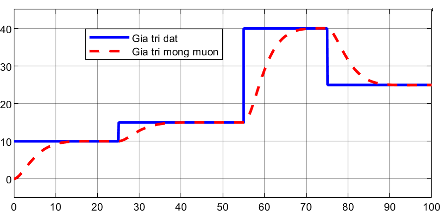 |
| :---: | :---: | :---: |
| Đáp ứng vị trí trục X | Đáp ứng vị trí trục Y | Đáp ứng độ cao trục Z |

| 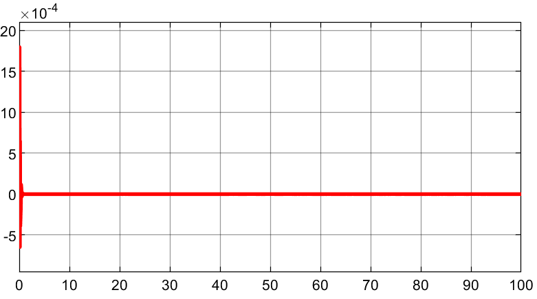 | 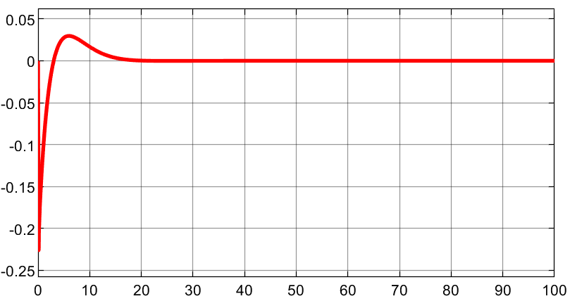 | 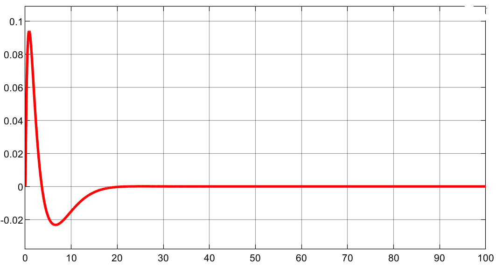 |
| :---: | :---: | :---: |
| Góc Roll $\phi$ | Góc Pitch $\theta$ | Góc Yaw $\psi$ |

*Hình 9. Kết quả mô phỏng hệ thống điều khiển Quadrotor trên Matlab/Simulink.*

---

## 5. KẾT LUẬN
Bài báo đã xây dựng thành công mô hình động lực học phi tuyến 6-DoF đầy đủ của quadrotor kết hợp với động học cơ cấu chấp hành động cơ điện một chiều. Bộ điều khiển thích nghi tốc độ động cơ giúp bám mô hình tham chiếu bất chấp biến thiên tải cánh quạt; phương pháp tuyến tính hóa phản hồi kết hợp hàm Lyapunov mang lại độ ổn định vững chắc cho vòng tư thế góc Euler. Kết quả mô phỏng Matlab-Simulink xác nhận quadrotor chuyển động êm ái, bám chính xác các tọa độ đặt không gian và nấc độ cao.

---

## TÀI LIỆU THAM KHẢO
1. Nguyen Thi Phuong Ha, *Modern control theory*, VNU-HCM Press, 2007.
2. Nguyen Doan Phuoc, *Fundamentals of linear control theory*, Bach khoa Publishing House, Hanoi, 2016.
3. Pham Quoc Phuong, *Research and application of the quadrotor model in surveillance and rescue*, Master's Thesis, HCMUT, 2012.
4. Nguyen Phung Quang, *Matlab & Simulink for automatic control engineers*, Science and Technics Publishing House, Hanoi, 2006.
5. Dao Hoa Viet, *Example exercises and practice of automatic control of electric drives*, Military Technical Academy, 2011.
6. J. Rao, B. Li, Z. Zhang, D. Chen, W. Giernacki, "Position Control of Quadrotor UAV Based on Cascade Fuzzy Neural Network," *Energies*, 15, 1763, 2022.
7. T. Bresciani, *Modelling, Identification and Control of a Quadrotor Helicopter*, Lund University, 2008.
8. W. Gu, K. P. Alavanis, M. J. Rutherford, A. Rizzo, "UAV Model-based Flight Control with Artificial Neural Networks: A Survey," *J. Intell. Robot. Syst.*, 100, 1469-1491, 2020.
9. H. Voos, "Nonlinear State-Dependent Riccati Equation Control of a Quadrotor UAV," in *Proc. IEEE CCA*, Munich, Germany, 2006.
10. H. Voos, "Nonlinear and Neural Network-based Control of a Small Four-Rotor Aerial Robot," in *Proc. IEEE/ASME AIM*, Zurich, 2007.
