# THIẾT KẾ BỘ ĐIỀU KHIỂN THÍCH NGHI CHO QUADROTOR DỰA TRÊN PHƯƠNG PHÁP TRƯỢT
## ADAPTIVE CONTROLLER DESIGN FOR A QUADROTOR BASED ON SLIDING MODE CONTROL

**Trần Thúy Quỳnh¹, Vũ Tiến Mạnh², Trần Thị Hồng Thắm², Nguyễn Hữu Hải², Ngô Mạnh Tùng²\***  
*¹ Khoa Điện - Tự động hóa, Trường Đại học Kinh tế - Kỹ thuật Công nghiệp (UNETI)*  
*² Trường Điện - Điện tử, Trường Đại học Công nghiệp Hà Nội (HaUI)*  
*\* Email liên hệ: tung_nm.haui@gmail.com*  
*Tạp chí Khoa học & Công nghệ - Đại học Công nghiệp Hà Nội (HaUI Journal of Science and Technology)*  
*Vol. 61 - No. 11 (Nov 2025), pp. 35–41*  
*DOI: [https://doi.org/10.57001/huih5804.2025.378](https://doi.org/10.57001/huih5804.2025.378)*  
*P-ISSN: 1859-3585, E-ISSN: 2615-9619*

---

### TÓM TẮT
Thiết bị không người lái (UAV), đặc biệt là quadrotor, trong quá trình vận hành chịu nhiều tác động từ môi trường bên ngoài trong việc duy trì sự ổn định do tính phi tuyến của động lực học và yếu tố bất định như nhiễu gió hoặc thay đổi tải trọng. Bộ điều khiển trượt (Sliding Mode Control - SMC) là một phương pháp phổ biến để xử lý các hệ thống phi tuyến, trong đó tác động của nhiễu bên ngoài còn ảnh hưởng nhiều tới sai lệch đầu ra. Để khắc phục vấn đề này, bộ điều khiển thích nghi mờ - trượt (Adaptive Fuzzy Sliding Mode Controller - AFSMC) được đề xuất được thiết kế dựa trên bộ SMC kết hợp kỹ thuật logic mờ để cải thiện hiệu suất và tính ổn định của UAV. Thành phần logic mờ có vai trò xác định các tham số của bộ điều khiển đề xuất, tăng khả năng thích nghi với các thay đổi môi trường và tính bất định mô hình. Thuật toán điều khiển AFSMC áp dụng hàm Lyapunov để chứng minh tính ổn định của bộ điều khiển đề xuất.

**Từ khóa:** Phương tiện không người lái (UAV), hệ thống phi tuyến, bộ điều khiển chế độ trượt (SMC), bộ điều khiển thích nghi mờ - trượt (AFSMC), hàm Lyapunov.

### ABSTRACT
Unmanned aerial vehicles (UAVs), particularly quadrotors, face significant challenges in maintaining stability during operation due to their inherent nonlinear dynamics and environmental uncertainties such as wind disturbances or payload variations. Sliding Mode Control (SMC) is a widely adopted method for addressing nonlinear systems; however, it often suffers from high-frequency chattering and requires careful selection of control parameters. To overcome these limitations, an Adaptive Fuzzy Sliding Mode Controller (AFSMC) is proposed. This controller is designed by integrating fuzzy logic with SMC to enhance the performance and stability of UAVs. The fuzzy logic component plays a crucial role in determining the parameters of the proposed controller, thereby increasing its adaptability to environmental changes and model uncertainties. The stability of the proposed AFSMC algorithm is rigorously proven using Lyapunov stability analysis.

**Keywords:** Unmanned Aerial Vehicle (UAV), nonlinear system, sliding mode controller, Fuzzy Sliding Mode Controller (AFSMC), Lyapunov function.

---

## 1. GIỚI THIỆU

Quadrotor là một dạng UAV đặc biệt gồm hệ thống bốn động cơ với bốn cánh quạt được sắp xếp theo hình chữ X. Công việc thiết kế hệ thống điều khiển gặp nhiều khó khăn do mô hình toán học có tính phi tuyến mạnh, liên kết chéo và chịu ảnh hưởng khó lường của nhiễu ngoại vi:
- **Bộ điều khiển PID cổ điển [5-8]:** Đơn giản, dễ cài đặt nhưng chất lượng giảm sút khi có nhiễu gió lớn hoặc góc nghiêng lệch xa điểm cân bằng.
- **Bộ điều khiển Mờ (Fuzzy Logic) [9, 10]:** Không phụ thuộc mô hình giải tích, song thiếu cơ sở chứng minh tính ổn định tiệm cận giải tích (như Lyapunov).
- **Mạng nơ-ron (Neural Networks) [11, 12]:** Tự học tham số tốt nhưng khối lượng tính toán quá lớn, khó đảm bảo ổn định toàn cục thời gian thực trên vi điều khiển nhúng.
- **Điều khiển chế độ trượt (Sliding Mode Control - SMC) [13, 14]:** Kháng nhiễu cực tốt trước sai số mô hình, nhưng gặp phải hiện tượng rung lắc tần số cao (**chattering**) do hàm chuyển mạch không liên tục `sgn`, đồng thời các hệ số mặt trượt $\lambda$ và độ lợi chuyển mạch $\eta$ rất khó chỉnh định thủ công tối ưu trong môi trường thay đổi.

**Đóng góp của bài báo:** Đề xuất bộ điều khiển **Adaptive Fuzzy Sliding Mode Controller (AFSMC)**:
1. Tích hợp 2 bộ giám sát mờ:
   - **FMC1:** Tự động điều chỉnh hệ số góc mặt trượt $\lambda_i$ dựa trên sai số $e_i$ và đạo hàm sai số $\dot{e}_i$.
   - **FMC2:** Tự động điều chỉnh biên độ đóng cắt $\eta_i$ dựa trên khoảng cách tới mặt trượt $s_i$ và đạo hàm $\dot{s}_i$.
2. Triệt tiêu rung giật (chattering) bằng cách giảm nhỏ $\eta_i$ khi hệ thống tiến sát mặt trượt và tăng lớn $\eta_i$ khi ở xa để kéo nhanh về mặt trượt.
3. Chứng minh ổn định mạch kín theo lý thuyết Lyapunov.
4. Kiểm chứng mô phỏng đối chiếu toàn diện với SMC cổ điển khi có nhiễu gió xung kích.

---

## 2. ĐỘNG LỰC HỌC QUADROTOR

Mô hình tọa độ quán tính Trái Đất $E(e_x, e_y, e_z)$ và tọa độ thân $B(e_{xb}, e_{yb}, e_{zb})$:

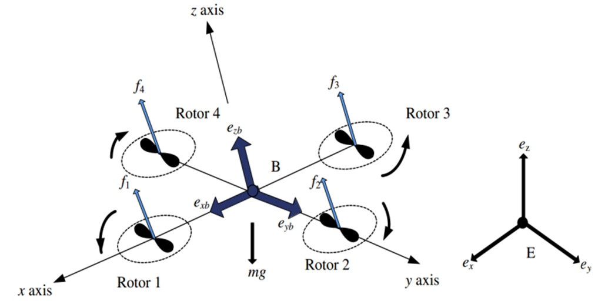  
*Hình 1. Hệ quy chiếu quán tính và hệ quy chiếu gắn với vật thể*

Quadrotor là hệ thống 6 bậc tự do (6-DoF) với biến trạng thái vị trí và góc Euler: $(X, Y, Z, \phi, \theta, \psi)$. Giới hạn các góc quay:
$$-\frac{\pi}{2} \le \phi \le \frac{\pi}{2}, \quad -\frac{\pi}{2} \le \theta \le \frac{\pi}{2}, \quad -\pi \le \psi \le \pi$$

Phương trình động lực học Newton-Euler:
$$\begin{cases}
\ddot{X} = [\sin\psi \sin\phi + \cos\psi \sin\theta \cos\phi]\frac{U_1}{m} \\
\ddot{Y} = [-\cos\psi \sin\phi + \sin\psi \sin\theta \cos\phi]\frac{U_1}{m} \\
\ddot{Z} = -g + \cos\theta \cos\phi \frac{U_1}{m} \\
\ddot{\phi} = \frac{I_{yy} - I_{zz}}{I_{xx}}\dot{\theta}\dot{\psi} - \frac{J_r}{I_{xx}}\Omega_r \dot{\theta} + \frac{d}{I_{xx}} U_2 \\
\ddot{\theta} = \frac{I_{zz} - I_{xx}}{I_{yy}}\dot{\phi}\dot{\psi} + \frac{J_r}{I_{yy}}\Omega_r \dot{\phi} + \frac{d}{I_{yy}} U_3 \\
\ddot{\psi} = \frac{I_{xx} - I_{yy}}{I_{zz}}\dot{\phi}\dot{\theta} + \frac{C_D}{I_{zz}} U_4
\end{cases} \tag{1}$$

Trong đó:
- $U_1$: Lực đẩy tổng cộng dọc trục $z_B$
- $U_2, U_3, U_4$: Mô-men điều khiển các góc Roll, Pitch, Yaw
- $m$: Khối lượng quadrotor, $d$: Khoảng cách từ tâm đến động cơ
- $\Omega_r = \omega_1 - \omega_2 + \omega_3 - \omega_4$: Tốc độ quay tương đối của 4 cánh quạt

---

## 3. THIẾT KẾ BỘ ĐIỀU KHIỂN

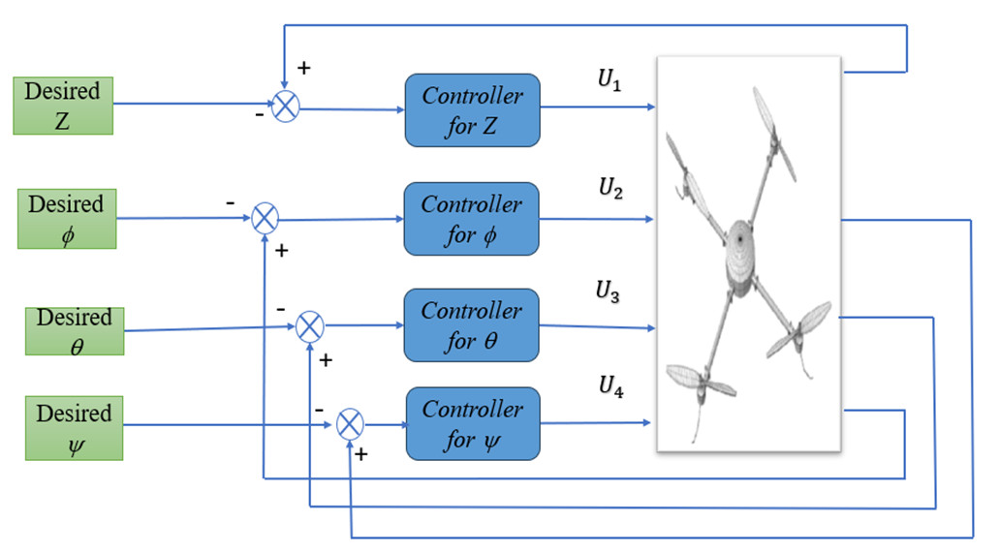  
*Hình 2. Sơ đồ cấu trúc của hệ thống điều khiển quadrotor*

Sai số theo dõi quỹ đạo:
$$e_z = z - z_d, \quad e_\phi = \phi - \phi_d, \quad e_\theta = \theta - \theta_d, \quad e_\psi = \psi - \psi_d \tag{2}$$

### 3.1. Bộ điều khiển trượt kinh điển (SMC)
Mặt trượt được định nghĩa:
$$s_i = \dot{e}_i + \lambda_i e_i, \quad i \in \{z, \phi, \theta, \psi\} \tag{3}$$

Luật điều khiển trượt:
$$\begin{cases}
U_1 = \frac{m}{\cos\phi \cos\theta}(g + \ddot{z}_d - \lambda_z \dot{e}_z - \eta_z \text{sgn}(s_z)) \\
U_2 = \frac{1}{b_1}(-a_1 x_4 x_6 - a_2 \Omega_r x_4 + \ddot{\phi}_d - \lambda_\phi \dot{e}_\phi - \eta_\phi \text{sgn}(s_\phi)) \\
U_3 = \frac{1}{b_2}(-a_3 x_2 x_6 - a_4 \Omega_r x_2 + \ddot{\theta}_d - \lambda_\theta \dot{e}_\theta - \eta_\theta \text{sgn}(s_\theta)) \\
U_4 = \frac{1}{b_3}(-a_5 x_2 x_4 + \ddot{\psi}_d - \lambda_\psi \dot{e}_\psi - \eta_\psi \text{sgn}(s_\psi))
\end{cases} \tag{5}$$

Chứng minh ổn định Lyapunov với $V = \frac{1}{2} s_z^2$:
$$\dot{V} = s_z \dot{s}_z = s_z \left(-\frac{\eta_z \cos\phi \cos\theta}{m}\text{sgn}(s_z)\right) = -\frac{\eta_z \cos\phi \cos\theta}{m} |s_z| \le 0$$
Hệ thống hội tụ tiệm cận về mặt trượt $s=0$.

### 3.2. Bộ điều khiển thích nghi mờ - trượt (AFSMC)

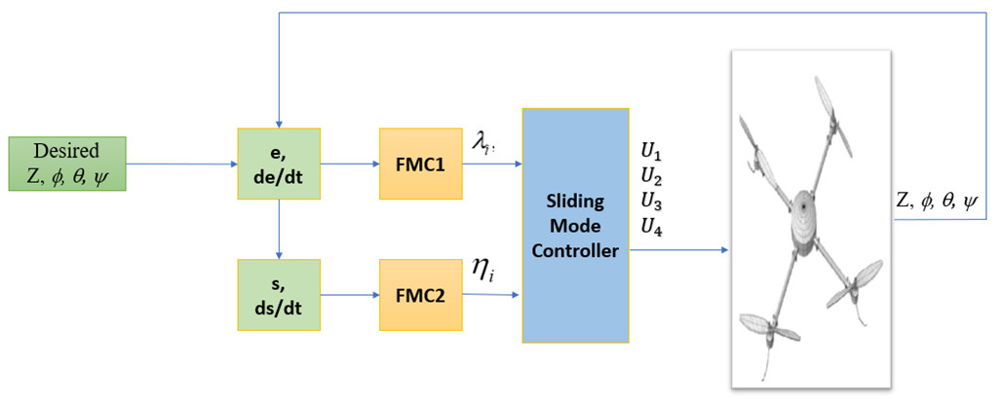  
*Hình 3. Cấu trúc bộ điều khiển thích nghi mờ - trượt AFSMC*

- **Bộ giám sát FMC1 (Hiệu chỉnh $\lambda_i$):**
  - Đầu vào: $e_i(t)$ và $\dot{e}_i(t)$. Đầu ra: $\lambda_i$.
  - Tập mờ: NB (Âm lớn), N (Âm), Z (Zero), P (Dương), PS (Dương nhỏ), PM (Dương vừa), PB (Dương lớn).
  - Phương pháp suy luận: Max-Min; giải mờ bằng phương pháp trọng tâm (Center of Gravity).

**Bảng 1. Luật điều khiển mờ cho $\lambda_i$**
| $e \backslash \dot{e}$ | NB | N | Z | P | PB |
|:---:|:---:|:---:|:---:|:---:|:---:|
| **NB** | Z | Z | Z | PS | PM |
| **N** | Z | PS | PS | PS | PM |
| **Z** | Z | PS | PS | PS | PM |
| **P** | PM | P | P | P | PB |
| **PB** | PM | P | PB | PB | PB |

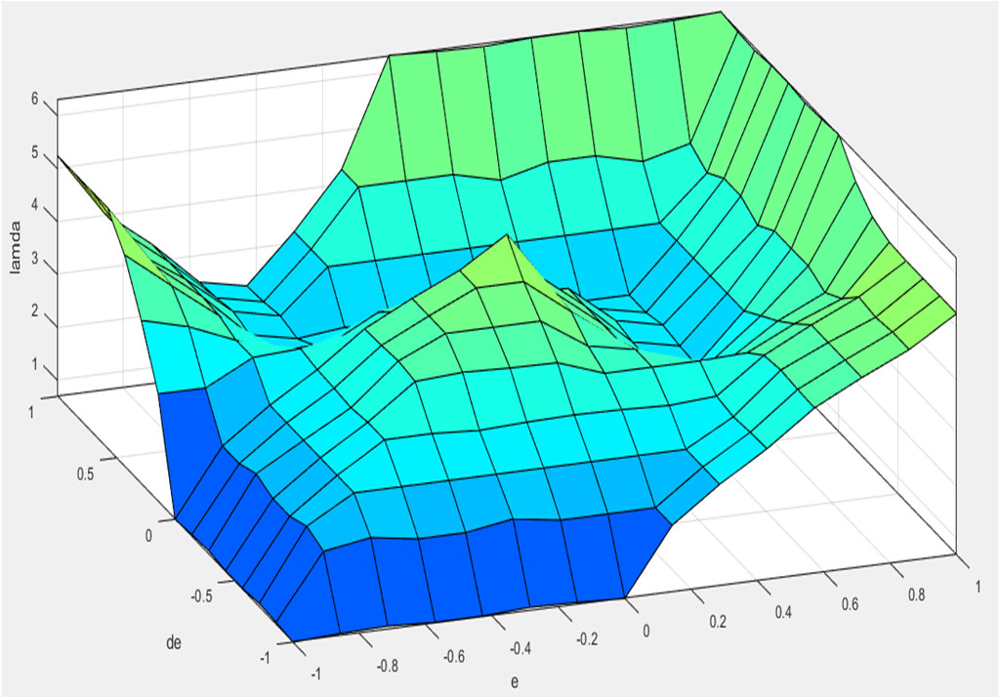  
*Hình 4. Bề mặt suy luận mờ cho tham số $\lambda_i$*

- **Bộ giám sát FMC2 (Hiệu chỉnh $\eta_i$):**
  - Đầu vào: $s_i(t)$ và $\dot{s}_i(t)$. Đầu ra: $\eta_i$.
  - Cơ chế thích ứng: Khi xa mặt trượt ($|s|$ lớn), tăng $\eta_i$ lên cực đại để kéo nhanh về mặt trượt. Khi đã ở rất sát mặt trượt ($|s| \approx 0$), giảm $\eta_i$ về mức tối thiểu để triệt tiêu hiện tượng Chattering.

**Bảng 2. Luật điều khiển mờ cho $\eta_i$**
| $s \backslash \dot{s}$ | Z | PS | PM | P | PB |
|:---:|:---:|:---:|:---:|:---:|:---:|
| **Z** | PB | PB | PB | P | PM |
| **PS** | PB | P | P | PM | PS |
| **PM** | P | P | PM | PS | PS |
| **P** | P | PM | PS | PS | Z |
| **PB** | PM | PS | Z | Z | Z |

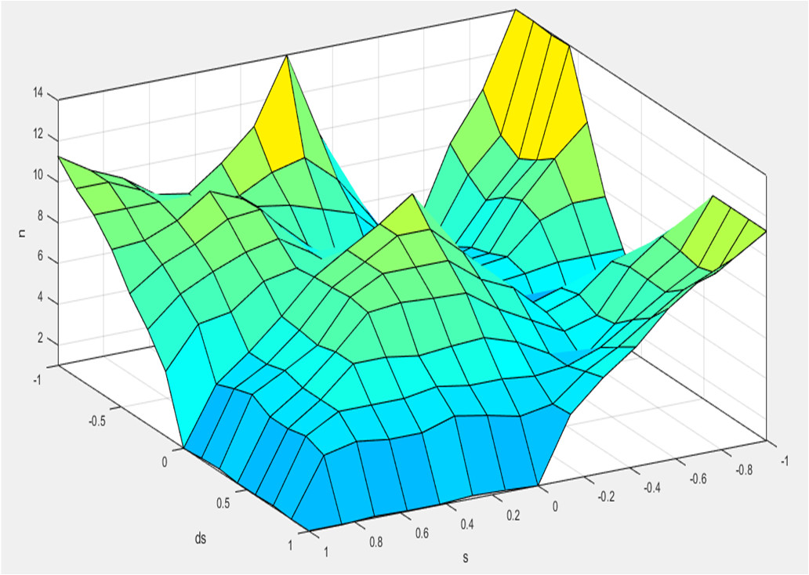  
*Hình 5. Bề mặt suy luận mờ cho tham số chuyển mạch $\eta_i$*

---

## 4. KẾT QUẢ MÔ PHỎNG

### Bảng thông số mô phỏng của Quadrotor
| Thông số | Ký hiệu | Giá trị | Đơn vị |
|:---|:---:|:---:|:---:|
| Chiều dài cánh tay đòn | $l$ | 0.25 | m |
| Mô men quán tính trục X | $I_{xx}$ | $3.8278 \cdot 10^{-3}$ | $\text{N}\cdot\text{m}/(\text{rad}/\text{s}^2)$ |
| Mô men quán tính trục Y | $I_{yy}$ | $3.8278 \cdot 10^{-3}$ | $\text{N}\cdot\text{m}/(\text{rad}/\text{s}^2)$ |
| Mô men quán tính trục Z | $I_{zz}$ | $7.6566 \cdot 10^{-3}$ | $\text{N}\cdot\text{m}/(\text{rad}/\text{s}^2)$ |
| Tổng mô men quán tính rotor | $J_r$ | $2.8385 \cdot 10^{-5}$ | $\text{N}\cdot\text{m}/(\text{rad}/\text{s}^2)$ |
| Khối lượng quadrotor | $m$ | 0.964 | kg |
| Gia tốc trọng trường | $g$ | 9.81 | $\text{m}/\text{s}^2$ |

Tham số SMC cố định sau nhiều lần thử nghiệm thực nghiệm: $\lambda_i = 2, \eta_i = 3$.

### Kịch bản 1: Cất cánh mặt đất và ổn định tư thế không nhiễu
Trạng thái ban đầu $[0, 0, 0]$, mục tiêu: cất cánh lên $Z_d = 4\text{ m}$, các góc đặt $[\phi_d, \theta_d, \psi_d] = [0.5, 0.5, 0.3]\text{ rad}$.

| 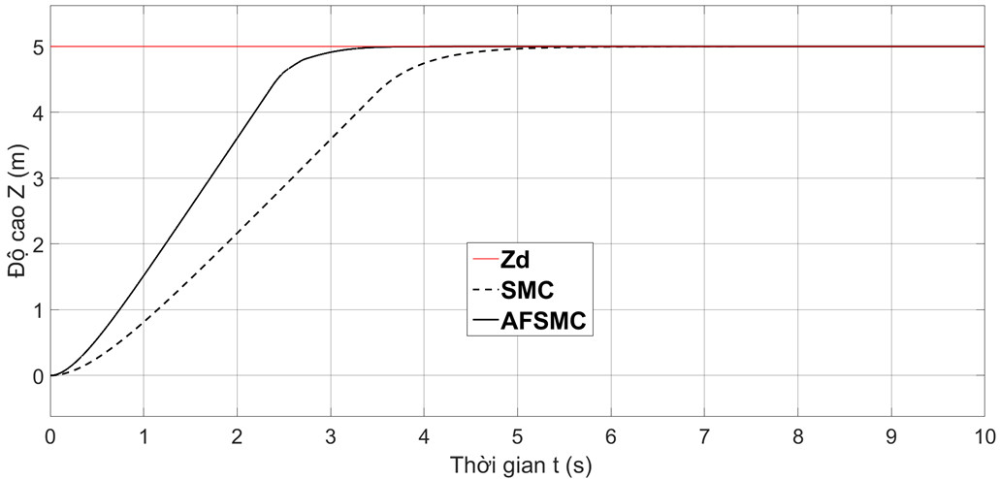 | 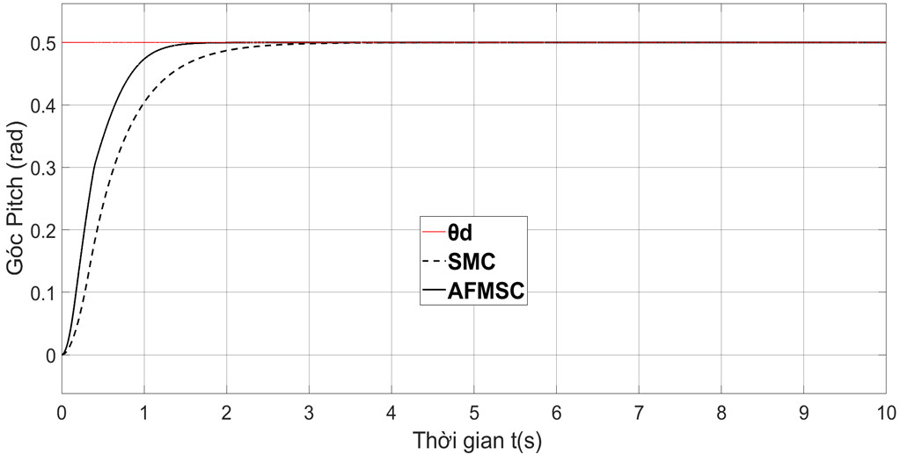 |
| :---: | :---: |
| **Hình 6.** Đáp ứng độ cao $Z$ (Trường hợp 1) | **Hình 7.** Đáp ứng góc Pitch $\theta$ (Trường hợp 1) |

| 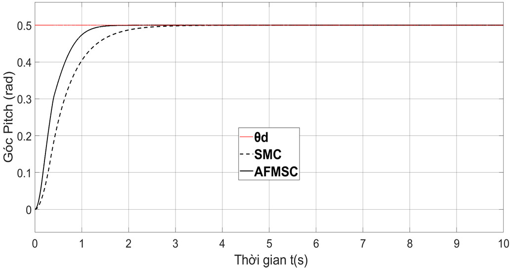 | 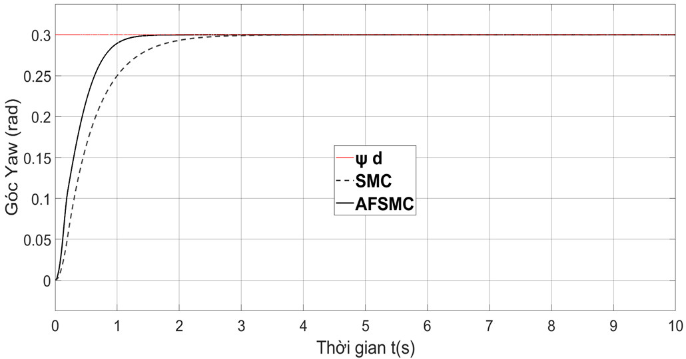 |
| :---: | :---: |
| **Hình 8.** Đáp ứng góc Roll $\phi$ (Trường hợp 1) | **Hình 9.** Đáp ứng góc Yaw $\psi$ (Trường hợp 1) |

**Nhận xét:** Cả hai bộ điều khiển đều bám giá trị đặt. Tuy nhiên, thời gian đáp ứng của SMC chậm hơn AFSMC từ 2 đến 3 giây. AFSMC nhờ cơ chế chỉnh tham số tự động nên triệt tiêu sai lệch nhanh và mượt hơn hẳn.

### Kịch bản 2: Thay đổi giá trị đặt và chịu nhiễu gió ngoại sinh
Giá trị đặt thay đổi: $[Z, \phi, \theta, \psi] = [4\text{ m}, 1.2\text{ rad}, 0.8\text{ rad}, 0.5\text{ rad}]$. Tại thời điểm $t = 5\text{ s}$, xuất hiện nhiễu gió ngoại sinh bất định tác động theo trục $y$ gây rung giật góc Roll.

| 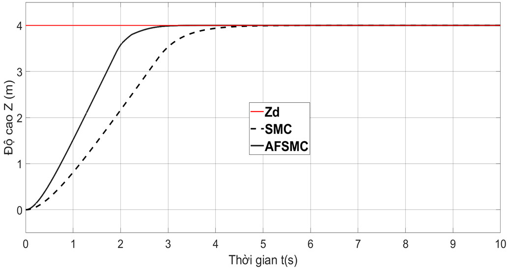 | 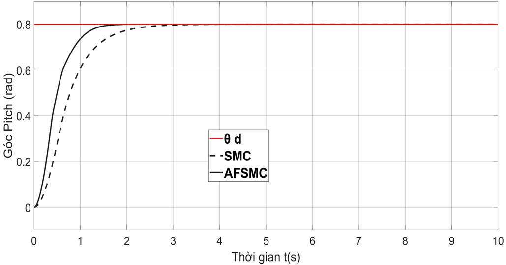 |
| :---: | :---: |
| **Hình 10.** Đáp ứng độ cao $Z$ (Trường hợp 2) | **Hình 11.** Đáp ứng góc Pitch $\theta$ (Trường hợp 2) |

| 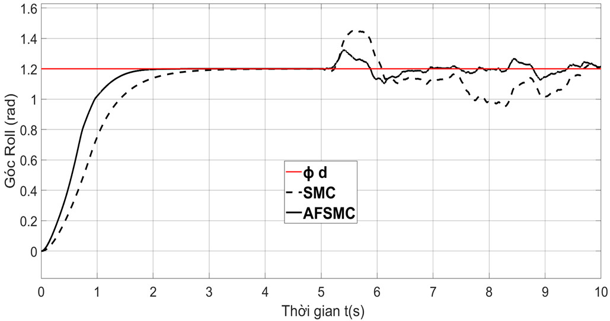 | 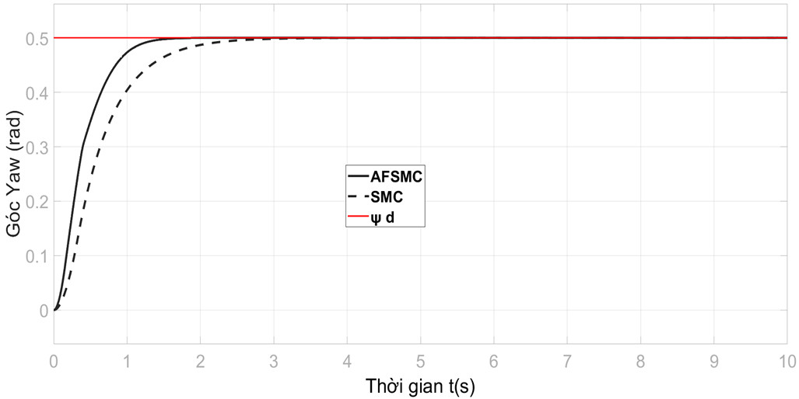 |
| :---: | :---: |
| **Hình 12.** Đáp ứng góc Roll $\phi$ khi có nhiễu gió từ $t=5\text{ s}$ | **Hình 13.** Đáp ứng góc Yaw $\psi$ (Trường hợp 2) |

**Nhận xét:**
- AFSMC đạt trạng thái xác lập nhanh hơn SMC khoảng 2 giây.
- Khi nhiễu gió tác động tại $t = 5\text{ s}$, góc Roll của bộ AFSMC dao động với biên độ nhỏ hơn SMC từ **10% đến 16%**, phục hồi trạng thái thăng bằng nhanh chóng và không sinh rung lắc tần số cao.

---

## 5. KẾT LUẬN
Bộ điều khiển thích nghi mờ - trượt (AFSMC) đề xuất đã giải quyết thành công hai thách thức lớn nhất của phương pháp SMC cổ điển: hiện tượng rung lắc (chattering) và khó khăn khi chỉnh định tham số thủ công. Việc kết hợp hai bộ giám sát mờ FMC1 và FMC2 cho phép tự động thích nghi trực tuyến độ nghiêng mặt trượt và biên độ đóng cắt theo thời gian thực. Kết quả mô phỏng khẳng định AFSMC rút ngắn thời gian xác lập từ 2-3s và giảm biên độ dao động khi có gió tạt từ 10-16% so với SMC truyền thống, hoàn toàn khả thi để ứng dụng trên hệ thống bay thực tế.

---

## TÀI LIỆU THAM KHẢO
1. R. Lozano (Ed.), *Unmanned Aerial Vehicles: Embedded Control*, John Wiley & Sons, 2013.
2. K. Nonami et al., *Autonomous Flying Robots: UAVs and MAVs*, Springer, 2010.
3. N. Ben Ammar et al., "Chattering Free Sliding Mode Controller Design for a Quadrotor UAV," *Springer*, pp. 61-79, 2017.
4. N. Ben Ammar et al., "Modeling and Sliding Mode Control of a Quadrotor UAV," in *Proc. ACECS*, pp. 834-840, 2016.
5. L. E. Romero et al., "Quadcopter stabilization by using PID controllers," *MASKANA*, pp. 180-185, 2014.
6. T. Luukkonen, *Modelling and control of quadcopter*, Aalto University, 2011.
7. A. A. Najm, I. K. Ibraheem, "Nonlinear PID controller design for a 6-DOF UAV quadrotor system," *ESTIJ*, pp. 1091-1095, 2019.
8. J. Li, Y. Li, "Dynamic analysis and PID control for a quadrotor," in *Proc. IEEE Conf.*, pp. 573-578, 2011.
9. J. F. Gomez, M. Jamshidi, "Fuzzy adaptive control for a UAV," *J. Intell. Robot. Syst.*, 62(2), pp. 271-293, 2011.
10. Z. Ali et al., "Fuzzy-based hybrid control algorithm for the stabilization of a tri-rotor UAV," *Sensors*, 16(5), 2016.
11. M. Shirzadeh et al., "Vision-based control of a quadrotor utilizing artificial neural networks," *Eng. Appl. Artif. Intell.*, 58:34-48, 2017.
12. B. M. Meghni et al., "A Second-order sliding mode and fuzzy logic control to Optimal Energy Management," *Neural Comput. & Applic.*, 2016.
13. H. Ahn et al., "Sliding-Mode Control for Flight Stability of Quadrotor Drone Using Adaptive Super-Twisting Reaching Law," *Drones*, 7(8), 522, 2023.
14. J. Chaoraingern et al., "Modified Adaptive Sliding Mode Control for Trajectory Tracking of Mini-drone," *IJIES*, 13(5), pp. 151-155, 2020.
15. T. Bresciani, *Modelling, Identification and Control of a Quadrotor Helicopter*, Lund University, 2008.
16. Duong Hoai Nghia, *Dieu khien he thong da bien*, VNU-HCM Press, 2011.
17. Nguyen Doan Phuoc, *Ly thuyet dieu khien phi tuyen*, Science and Technics Publishing House, Hanoi, 2006.
18. Nguyen Doan Phuoc, *Phan tich va dieu khien he phi tuyen*, 5th ed., Science and Technics Publishing House, Hanoi, 2012.
19. Nguyen Manh Tien, *Dieu khien Robot cong nghiep*, Science and Technics Publishing House, Hanoi, 2007.
