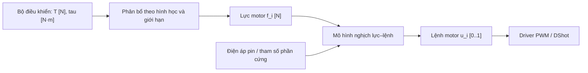

# Hai cách chuyển yêu cầu lực và mô-men thành lệnh PWM/DShot

**Ngày khảo sát:** 20/10/2026.  
**Phạm vi:** quadrotor với motor tạo lực một chiều; đối chiếu các bản mã nguồn trong `docs/external/repos/`.  
**Mục tiêu:** giải thích hai cách tổ chức giao diện điều khiển: giữ đơn vị vật lý đến bộ phân bổ, hoặc dùng yêu cầu điều khiển chuẩn hóa trước bộ phân bổ.

## 1. Vấn đề cần làm rõ

Bộ điều khiển có thể yêu cầu tổng lực đẩy theo Newton và mô-men theo N·m, trong khi ESC nhận độ rộng xung PWM hoặc một giá trị số qua DShot. Chuyển đổi giữa hai phía cần ba công việc:

1. **Phân bổ:** chia yêu cầu tổng lực/mô-men cho các motor theo hình học khung.
2. **Đổi lực thành lệnh motor:** dùng mô hình hoặc dữ liệu đo của cụm motor–cánh quạt–ESC.
3. **Tạo tín hiệu đầu ra:** ánh xạ lệnh sang miền giá trị của giao thức, rồi phát bằng driver.

Một dự án có thể đặt nhiều công việc trong cùng hàm mixer, nhưng về ý nghĩa vật lý chúng vẫn khác nhau. Chỉ nhân ma trận hình học không đủ để chuyển một lực có đơn vị N thành lệnh ESC.

Hai cách khảo sát là:

| Đặc điểm                        | Cách 1: giao diện vật lý                 | Cách 2: giao diện chuẩn hóa                                                          |
| ------------------------------- | ---------------------------------------- | ------------------------------------------------------------------------------------ |
| Đầu vào bộ phân bổ              | Tổng lực `T [N]`, mô-men `tau [N·m]`     | Yêu cầu thrust và roll/pitch/yaw đã scale                                            |
| Đầu ra phân bổ về mặt khái niệm | Lực từng motor `f_i [N]`                 | Mức lực đẩy/yêu cầu motor chuẩn hóa `t_i`                                            |
| Thông tin thang đo              | Khai báo bằng hình học và mô hình vật lý | Nằm trong hệ số mixer, quy tắc chuẩn hóa và gain điều khiển                          |
| Bước chuyển sang ESC            | Mô hình nghịch lực–lệnh, rồi driver      | Mô hình nghịch chuẩn hóa nếu sử dụng, rồi driver                                     |
| Ví dụ khảo sát                  | Nhánh force/torque của Crazyflie         | Luồng multicopter thông thường của PX4, ArduPilot; mixer throttle/PID của Betaflight |

**Chuẩn hóa không tự làm quan hệ lực–lệnh trở thành tuyến tính.** Cả hai cách đều cần quan tâm đến đặc tính tạo lực của phần cứng. Khi thrust linearization bị tắt, có thể hiểu hệ thống đang dùng giả thiết đơn giản hơn hoặc điều khiển trong miền lệnh motor với gain đã được tuning tương ứng.

## 2. Ký hiệu, đơn vị và ranh giới giữa các tầng

| Ký hiệu               | Ý nghĩa                                        | Đơn vị/miền giá trị               |
| --------------------- | ---------------------------------------------- | --------------------------------- |
| `T`                   | Tổng lực đẩy mong muốn                         | N                                 |
| `tau_x, tau_y, tau_z` | Mô-men mong muốn trên thân                     | N·m                               |
| `f_i`                 | Lực đẩy của motor thứ `i`                      | N                                 |
| `t_i`                 | Lực đẩy chuẩn hóa của motor                    | Không thứ nguyên, thường `[0, 1]` |
| `u_i`                 | Lệnh motor chuẩn hóa sau chuyển đổi đường cong | Không thứ nguyên, thường `[0, 1]` |
| `V_bat`               | Điện áp pin dưới tải                           | V                                 |
| `p_i`                 | Độ rộng xung điều khiển ESC PWM                | µs                                |
| `d_i`                 | Giá trị throttle trong gói DShot               | Số nguyên                         |

Đặc biệt, `t_i = 0.5` là yêu cầu 50% **lực đẩy theo mốc chuẩn hóa đã chọn**; `u_i = 0.5` là 50% **thang lệnh motor**. Hai giá trị chỉ bằng nhau nếu đường cong tương ứng tuyến tính hoặc đang được xấp xỉ như vậy.

Tên biến `thrust`, `motor`, `actuator` hay `pwm` không đủ để kết luận đơn vị. Cần xem định nghĩa giao diện, phép scale và tầng tiêu thụ tiếp theo. Ví dụ một giá trị 16 bit có thể đang mã hóa lực chuẩn hóa, chưa phải độ rộng xung tính bằng µs.

PWM điều khiển ESC được bàn ở đây là tín hiệu trên dây từ flight controller đến ESC. Nó khác PWM công suất mà ESC tạo ra để điều khiển các pha motor. Riêng motor chổi than được điều khiển trực tiếp, đầu ra timer có thể biểu diễn duty cycle công suất; không dùng lẫn công thức đó với độ rộng xung gửi ESC.

## 3. Cách 1: giữ đơn vị vật lý đến bộ phân bổ

### 3.1. Luồng dữ liệu



Tầng điều khiển cần tạo đúng đại lượng vật lý theo giao diện. Một đầu ra PID tốc độ góc chỉ có thể được gọi là mô-men N·m nếu mô hình và đơn vị gain được thiết kế tương ứng; không thể đổi tên biến PID thành `torque_Nm` rồi coi như đã có mô-men vật lý.

### 3.2. Phân bổ tổng lực và mô-men

Chọn hệ trục thân thuận tay phải: `x` về trước, `y` sang phải, `z` xuống dưới. Gọi `f_i >= 0` là độ lớn lực hướng lên của rotor, đặt tại `(x_i, y_i, 0)` so với trọng tâm. Khi đó:

$$
T = \sum_i f_i,\qquad
\tau_x = -\sum_i y_i f_i,\qquad
\tau_y = \sum_i x_i f_i,\qquad
\tau_z = \sum_i s_i\kappa_i f_i.
$$

Ở đây `T` là độ lớn lực hướng lên, còn thành phần lực theo trục `z` là `F_z = -T`. `s_i` là dấu mô-men phản lực yaw trên thân, còn `kappa_i` là tỉ số mô-men phản lực/lực đẩy, có đơn vị m. Dấu `s_i` phải xác định theo chiều quay và quy ước trục thực tế.

Viết dưới dạng ma trận:

$$
\mathbf w = A\mathbf f,\qquad
\mathbf w = [T,\tau_x,\tau_y,\tau_z]^T,
\qquad
A_i = [1,-y_i,x_i,s_i\kappa_i]^T.
$$

Với quad có `A` khả nghịch, nghiệm chưa xét giới hạn là `f = A^{-1} w`. Với cấu hình tổng quát hơn có thể dùng giả nghịch đảo hoặc bài toán tối ưu có ràng buộc.

Kiểm tra đơn vị ngay trong ma trận: hàng tổng lực nhân `f_i [N]` với hệ số không thứ nguyên; các hàng mô-men nhân `f_i [N]` với cánh tay đòn hoặc `kappa_i [m]`, cho ra N·m.

### 3.3. Đổi lực từng motor thành lệnh

Mô hình tổng quát là:

$$
f_i = g_i(u_i,V_{bat}),\qquad
u_i = g_i^{-1}(f_i,V_{bat}).
$$

Hàm `g_i` có thể là đa thức thực nghiệm, bảng tra nội suy hoặc mô hình gồm các tầng điện–cơ–khí động. Trong mô hình tĩnh đơn giản, tại một điện áp tham chiếu và lấy mốc lực bằng 0:

$$
t_i = \frac{f_i}{f_{ref,i}},\qquad
t_i = (1-\alpha_i)u_i + \alpha_i u_i^2.
$$

`f_ref,i` là lực tham chiếu ứng với đầu trên của đường cong đã hiệu chuẩn; không mặc định luôn bằng lực tối đa hiện có ở mọi điện áp pin. Nếu đường cong được đo từ một mốc lực khác 0, phải dùng phép chuẩn hóa có offset tương ứng.

Giải phương trình bậc hai để tìm `u_i`:

$$
u_i = \frac{-(1-\alpha_i)+\sqrt{(1-\alpha_i)^2+4\alpha_i t_i}}
{2\alpha_i},\quad 0<\alpha_i\leq 1.
$$

Trường hợp `alpha_i = 0`, dùng `u_i = t_i`. Khi triển khai có thể dùng dạng tương đương ít triệt tiêu số hơn hoặc xử lý riêng vùng tham số gần 0.

Quan hệ quen thuộc `f_i = k_T omega_i^2` mới chuyển lực sang tốc độ rotor. Nếu ESC nhận throttle PWM/DShot, còn thiếu quan hệ giữa throttle, điện áp pin và tốc độ rotor. Chỉ biết `k_T` chưa đủ tính lệnh ESC. Một đường cong đo trực tiếp từ lệnh ESC đến lực có thể bao hàm các tầng này mà không cần tính RPM ở giữa.

### 3.4. Ví dụ từ Crazyflie

Trong bản sao khảo sát, hàm `powerDistributionForceTorque()` nhận `control->thrustSi` và `control->torqueX/Y/Z`. Nó tính các phần đóng góp:

```c
const float arm = 0.707106781f * ARM_LENGTH;
const float rollPart = 0.25f / arm * control->torqueX;
const float pitchPart = 0.25f / arm * control->torqueY;
const float thrustPart = 0.25f * control->thrustSi; // N (per rotor)
const float yawPart = 0.25f * control->torqueZ / THRUST2TORQUE;
```

Sau khi cộng trừ các thành phần để có lực từng motor và xử lý lực âm, hàm mã hóa lực vào thang 16 bit:

```c
motorThrustUncapped->list[motorIndex] = motorForce / THRUST_MAX * UINT16_MAX;
```

**Tại dòng này, phép chia `THRUST_MAX` chỉ đổi thang biểu diễn lực. Nó chưa chứng minh rằng lệnh điện tỉ lệ tuyến tính với lực.**

Luồng tiếp theo trong `stabilizer.c` là:

```text
powerDistribution()
    → batteryCompensation()
    → powerDistributionCap()
    → setMotorRatios()
```

Khi bật `CONFIG_ENABLE_THRUST_BAT_COMPENSATED`, `motorsCompensateBatteryVoltage()` đổi thang lực 16 bit trở lại N, nghịch đảo một đa thức bậc ba lực–điện áp motor, rồi tính:

```text
ratio = motorVoltage / supplyVoltage
output = UINT16_MAX * ratio
```

Khi tùy chọn đó không bật, hàm trả nguyên giá trị đầu vào. Vì vậy phải đọc cả cấu hình build và bộ tham số nền tảng, không kết luận mọi cấu hình Crazyflie đều dùng cùng phép nghịch đảo. Tầng `motorsSetRatio()` tiếp tục chọn đường timer hoặc DShot tùy loại motor/cấu hình. Mô hình điện áp cho motor chổi than không được áp dụng nguyên xi cho một cụm brushless ESC khác.

Nguồn: [power_distribution_quadrotor.c](../external/repos/crazyflie-firmware/src/modules/src/power_distribution_quadrotor.c), `powerDistributionForceTorque()` dòng 95; [stabilizer.c](../external/repos/crazyflie-firmware/src/modules/src/stabilizer.c), `controlMotors()` dòng 255; [motors.c](../external/repos/crazyflie-firmware/src/drivers/src/motors.c), `motorsCompensateBatteryVoltage()` dòng 180 và `motorsSetRatio()` dòng 702.

## 4. Cách 2: dùng yêu cầu điều khiển chuẩn hóa trước bộ phân bổ

### 4.1. Luồng dữ liệu


Có hai tình huống khác nhau trong cách này:

- Bộ điều khiển có đại lượng SI ở bên trong rồi chuyển sang giao diện chuẩn hóa trước mixer.
- Bộ điều khiển được thiết kế/tuning để trực tiếp xuất yêu cầu điều khiển trong thang chuẩn hóa hoặc thang nội bộ. Khi đó không nhất thiết từng xuất hiện một biến mô-men N·m để đem chia.

Tình huống thứ hai giải thích vì sao nhiều firmware không cần biết chính xác mô-men quán tính hoặc lực cực đại để thực hiện ổn định tốc độ góc. Gain điều khiển được tuning trong thang đầu ra của hệ thống; điều đó không đồng nghĩa mô hình vật lý và giới hạn phần cứng đã biến mất.

### 4.2. Thang đo được đưa vào ma trận như thế nào?

#### 4.2.1. Chuẩn hóa là chọn một mốc rồi biểu diễn theo tỉ lệ

Với đại lượng `x` có đơn vị, chọn một mốc `x_ref > 0` cùng đơn vị và định nghĩa:

$$
\bar x=\frac{x}{x_{ref}},\qquad x=x_{ref}\bar x.
$$

Ví dụ `f = 2 N`, chọn `f_ref = 8 N` thì `t = 0.25`. Giá trị này có nghĩa **lực yêu cầu bằng 25% mốc lực 8 N**, chưa có nghĩa throttle 25% hay PWM 1250 µs. Nếu đổi mốc thành `10 N`, cùng lực `2 N` được biểu diễn bằng `0.2`; phần cứng không thay đổi chỉ vì đổi cách biểu diễn.

Phép chia làm mất đơn vị ở giá trị được truyền đi, nhưng thông tin đơn vị vẫn nằm trong mốc tham chiếu. Bên tạo yêu cầu và bên sử dụng phải thống nhất mốc đó. Đây là phép đổi thang với mốc đã định nghĩa, không phải lấy giá trị lớn nhất đang xuất hiện trong mỗi chu kỳ để chia; cách chia theo từng chu kỳ sẽ làm cùng một số chuẩn hóa mang ý nghĩa vật lý khác nhau theo thời gian.

Ba phép chuẩn hóa thường gặp trong luồng này cần được phân biệt:

| Đại lượng        | Ví dụ phép chuẩn hóa                                                | Ý nghĩa của giá trị `0.5`           |
| ---------------- | ------------------------------------------------------------------- | ----------------------------------- |
| Lực từng motor   | `t_i = f_i / f_ref,i`                                               | Một nửa lực tham chiếu của motor đó |
| Yêu cầu một trục | `r = tau_x / tau_ref,x`                                             | Một nửa mốc mô-men roll đã chọn     |
| Lệnh motor       | `u_i = (p_i - p_min) / (p_max - p_min)` trong ánh xạ PWM tuyến tính | Điểm giữa khoảng lệnh PWM đang xét  |

Dòng cuối là chuẩn hóa **lệnh**, còn hai dòng đầu chuẩn hóa **lực/mô-men**. Chúng có thể cùng là số không thứ nguyên nhưng không thể dùng thay cho nhau.

#### 4.2.2. Chọn mốc và xử lý offset

Với motor một chiều, cách dễ diễn giải là lấy lực bằng 0 làm gốc và lực tại đầu trên của đường cong hiệu chuẩn làm `f_ref`. Khi đó:

$$
t_i=\frac{f_i}{f_{ref,i}},\qquad f_i=f_{ref,i}t_i.
$$

Nếu chỉ hiệu chuẩn một khoảng vận hành có lực đầu dưới khác 0, phép đổi thang tương ứng là:

$$
t_i=\frac{f_i-f_{lo,i}}{f_{hi,i}-f_{lo,i}},\qquad
f_i=f_{lo,i}+(f_{hi,i}-f_{lo,i})t_i.
$$

Trong cách thứ hai, `t_i = 0` nghĩa là `f_i = f_lo,i`, có thể là motor vẫn đang quay và tạo lực. Trạng thái dừng/disarm phải được xử lý riêng. Không dùng đường cong có gốc lực bằng 0 cho một giá trị `t_i` được định nghĩa theo khoảng có offset mà chưa chuyển đổi.

Tương tự, `u_i = 0` phải được định nghĩa là đầu dưới của khoảng lệnh nào: khoảng toàn phần hay khoảng từ idle đến mức vận hành trên. Ví dụ cùng một PWM 1500 µs là `u = 0.5` trong khoảng 1000–2000 µs, nhưng là `u = 0.375` trong khoảng 1200–2000 µs. Đường cong lực–lệnh phải sử dụng đúng định nghĩa `u` đã dùng lúc đo.

Mốc lực tham chiếu và giới hạn lực hiện có là hai thông tin riêng. Chẳng hạn chọn cố định `f_ref = 8 N` tại điện áp tham chiếu, nhưng khi pin tụt chỉ còn đạt `6 N`, giới hạn chuẩn hóa khi đó là `t_max = 6/8 = 0.75`. Nếu vẫn cho phép `t = 1`, phép biểu diễn đang yêu cầu `8 N` dù phần cứng không đạt được. Có thể dùng mốc thay đổi theo điện áp, nhưng phải cập nhật đồng bộ phép scale yêu cầu, ma trận phân bổ và mô hình lực–lệnh.

#### 4.2.3. Đổi cả yêu cầu lẫn ma trận phân bổ

Để thấy quan hệ với cách 1, xét mô hình lý tưởng không có offset lực. Đặt:

$$
\mathbf f = D_f\mathbf t,\qquad
\mathbf w = D_w\bar{\mathbf w},
$$

trong đó `D_f` là ma trận chéo chứa lực tham chiếu từng motor, còn `D_w` chứa các thang tham chiếu tổng lực và mô-men. Thay vào `w = A f`:

$$
\bar{\mathbf w}=D_w^{-1}AD_f\mathbf t=C\mathbf t.
$$

`C` là ma trận hiệu lực trong hệ chuẩn hóa. Như vậy các thang đo vật lý đã được đưa vào hệ số ma trận hoặc quy tắc scale, thay vì được truyền dưới dạng N và N·m tại giao diện mixer.

Cụ thể:

$$
D_f=\operatorname{diag}(f_{ref,1},\ldots,f_{ref,n}),\qquad
D_w=\operatorname{diag}(T_{ref},\tau_{ref,x},\tau_{ref,y},\tau_{ref,z}).
$$

Các mốc trong `D_w` đều dương; dấu của yêu cầu mô-men nằm trong thành phần tương ứng của `w`. Với hệ vuông khả nghịch:

$$
\mathbf t=C^{-1}\bar{\mathbf w}
=D_f^{-1}A^{-1}D_w\bar{\mathbf w}.
$$

Đẳng thức này cho thấy không thể chỉ chia yêu cầu cho một mốc bất kỳ rồi giữ nguyên một mixer vốn được thiết kế cho mốc khác. Muốn cùng một yêu cầu vật lý cho cùng lực motor, phải đổi thang ở cả hai phía một cách nhất quán.

Nếu dùng offset lực ở mục 4.2.2, đặt `f = f_lo + D_delta t`, với `D_delta` chứa các khoảng `f_hi,i - f_lo,i`. Khi đó `w_lo = A f_lo` và công thức đúng là:

$$
D_w^{-1}(\mathbf w-\mathbf w_{lo})
=D_w^{-1}AD_\Delta\mathbf t.
$$

Không bỏ số hạng nền `w_lo`; nó biểu diễn lực và mô-men đã có tại đầu dưới của khoảng vận hành.

Với hệ vuông khả nghịch và chưa có bão hòa, hai biểu diễn cho kết quả tương đương khi dùng cùng mô hình và thang đo. Với bài toán dư cơ cấu chấp hành hoặc có giới hạn, còn phải chuyển đúng trọng số, hàm mục tiêu và thứ tự ưu tiên; đổi thang rồi dùng giả nghịch đảo/trọng số mặc định khác có thể cho nghiệm khác.

### 4.3. Vì sao có công thức `T ± R ± P ± Y`?

Xét quad X đối xứng với cách đánh số riêng cho ví dụ:

```text
                  Trước (+x)
            M4                 M1
         trước-trái        trước-phải

                     CG              Phải (+y)

            M3                 M2
          sau-trái           sau-phải
```

Chọn dấu mô-men phản lực yaw trên thân là `+` cho M1/M3, `-` cho M2/M4. Gọi `d` là khoảng cách chiếu của motor lên mỗi trục ngang và `kappa` là tỉ số mô-men phản lực/lực đẩy chung. Nếu mỗi motor có lực tham chiếu `f_ref`, định nghĩa:

$$
b=\frac{T}{4f_{ref}},\qquad
r=\frac{\tau_x}{4df_{ref}},\qquad
p=\frac{\tau_y}{4df_{ref}},\qquad
y=\frac{\tau_z}{4\kappa f_{ref}}.
$$

Phép phân bổ khi chưa chạm giới hạn trở thành:

```text
t1 = b - r + p + y
t2 = b - r - p - y
t3 = b + r - p + y
t4 = b + r + p - y
```

Các số hạng đều không thứ nguyên nên cộng trừ được. Các hệ số `1/(4d)` và `1/(4kappa)` không bị bỏ quên; chúng đã nằm trong định nghĩa `r/p/y` ở ví dụ này. Firmware thực tế có thể chọn thang khác, chuẩn hóa từng cột mixer hoặc đưa hệ số vào gain PID.

Đây là phép suy ra để giải thích đơn vị, không phải tuyên bố rằng cả bốn dự án đều dùng đúng cách đánh số, dấu và thang đo này. Các giới hạn tham chiếu của từng trục cũng không có nghĩa hệ thống đạt đồng thời mọi cực đại đó.

#### 4.3.1. Chọn mốc cụ thể cho quad X

Với cách định nghĩa ngay trên, các mốc là:

| Kênh     | Mốc được chọn               | Với `f_ref = 8 N`, `d = 0.1 m`, `kappa = 0.02 m` |
| -------- | --------------------------- | ------------------------------------------------ |
| Tổng lực | `T_ref = 4 f_ref`           | `32 N`                                           |
| Roll     | `tau_ref,x = 4 d f_ref`     | `3.2 N·m`                                        |
| Pitch    | `tau_ref,y = 4 d f_ref`     | `3.2 N·m`                                        |
| Yaw      | `tau_ref,z = 4 kappa f_ref` | `0.64 N·m`                                       |

Ví dụ `b = 0.25` là tổng lực `8 N`, còn `r = 0.125` là mô-men roll `0.4 N·m`. Cùng một con số `0.25` ở kênh thrust và kênh roll biểu diễn hai đại lượng vật lý khác nhau, nên phải biết đang đọc kênh nào.

Các mốc mô-men ở đây được chọn để mixer có hệ số cộng trừ bằng `1`; chúng **không phải mô-men cực đại khả thi**. Với `0 <= t_i <= 1`, roll thuần đạt nhiều nhất `r = 0.5` khi hai motor một bên ở `0`, hai motor bên kia ở `1`. Mô-men roll khi đó là `2 d f_ref = 1.6 N·m`, tại `b = 0.5`.

Nếu muốn biểu diễn mức roll này bằng một biến có giá trị `1`, có thể định nghĩa:

$$
\rho=\frac{\tau_x}{2df_{ref}}=2r.
$$

Nhưng mixer khi đó phải dùng `r = rho/2`, tức phần roll trong mỗi đầu ra là `±0.5 rho`, không còn là `±rho`. Đây là lý do cần đọc cả quy tắc scale đầu vào lẫn hệ số mixer khi gặp giao diện mô tả roll trong `[-1, 1]`.

#### 4.3.2. Khoảng chuẩn hóa không bảo đảm yêu cầu khả thi

Khi chỉ yêu cầu thrust và roll (`p = y = 0`), bốn motor nhận `b-r` hoặc `b+r`. Điều kiện đồng thời nằm trong `[0, 1]` là:

$$
0\leq b\leq 1,\qquad |r|\leq\min(b,1-b).
$$

Vì vậy khả năng tạo roll phụ thuộc lực nền: tại `b = 0.25`, chỉ có thể đạt `|r| <= 0.25` nếu giữ nguyên tổng lực. Tại `b = 1`, cả bốn motor đã ở mức trên nên không còn dư địa tạo roll mà vẫn giữ nguyên tổng lực đó.

Ví dụ yêu cầu `b = 0.25`, `r = 0.30` cho kết quả:

```text
t = [-0.05, -0.05, 0.55, 0.55]
```

Các đầu vào đều nằm trong những khoảng thường gọi là chuẩn hóa, nhưng hai motor bị yêu cầu lực âm. Với các mốc ở mục 4.3.1, yêu cầu gốc là `T = 8 N`, `tau_x = 0.96 N·m`. Nếu chỉ kẹp từng motor vào `[0, 1]`, kết quả `[0, 0, 0.55, 0.55]` lại tạo `T = 8.8 N`, `tau_x = 0.88 N·m`.

Nếu chính sách là giữ tổng lực và giảm roll xuống mức khả thi, có thể chọn `r = 0.25`, cho `[0, 0, 0.5, 0.5]`, tương ứng `T = 8 N`, `tau_x = 0.8 N·m`. Đây là một lựa chọn ưu tiên để minh họa; allocator thực tế có thể chọn ưu tiên khác. Khi có cả pitch/yaw, phải kiểm tra cả bốn bất đẳng thức `0 <= b ± r ± p ± y <= 1` với đúng tổ hợp dấu của mixer, không xét từng trục độc lập.

#### 4.3.3. Nếu PID xuất trực tiếp số chuẩn hóa thì chuẩn hóa ở đâu?

Nếu bộ điều khiển đã tính mô-men SI `tau_x`, việc tạo `r` là phép chia rõ ràng `r = tau_x / tau_ref,x`. Nhưng nếu PID được tuning để xuất trực tiếp `r`, phép scale đã nằm trong gain và các giới hạn đầu ra.

Ví dụ giữ nguyên định nghĩa sai số tốc độ góc `e` và dạng PID liên tục:

$$
\tau_x=K_P e+K_I\int e\,dt+K_D\frac{de}{dt}.
$$

Chia cả phương trình cho `tau_ref,x`:

$$
r=\frac{K_P}{\tau_{ref,x}}e
+\frac{K_I}{\tau_{ref,x}}\int e\,dt
+\frac{K_D}{\tau_{ref,x}}\frac{de}{dt}.
$$

Với cùng sai số, thời gian lấy mẫu và cách triển khai PID, các gain ở miền đầu ra chuẩn hóa bằng gain SI chia cho mốc mô-men. Giới hạn đầu ra, giới hạn phần tích phân và các số hạng feedforward cùng đơn vị đầu ra cũng phải đổi thang tương ứng. Nếu đồng thời đổi sai số từ rad/s sang deg/s hoặc đổi cách tích phân rời rạc, phải xét thêm các hệ số đó.

Ngược lại, một bộ gain được tuning trực tiếp để xuất `r` chưa tự xác định một thang N·m đáng tin cậy nếu chưa có mô hình hoặc hiệu chuẩn liên hệ mixer với phần cứng. Việc đặt tên đầu ra là “normalized torque” không đủ để suy ra `r = 0.2` tương ứng chính xác bao nhiêu N·m.

### 4.4. Đường cong lực đẩy vẫn nằm sau mixer

Sau khi có `t_i`, hệ thống có thể vẫn cần tính `u_i = h^{-1}(t_i)`. Nếu `h(u)` phi tuyến, phải áp dụng đường cong lên kết quả từng motor. Nói chung:

$$
h^{-1}(b+r)\ne h^{-1}(b)+h^{-1}(r).
$$

Do đó không thể đổi riêng từng thành phần lực/mô-men sang PWM bằng cùng một đường cong rồi cộng chúng tùy ý. Các bước bù throttle đặc thù của từng firmware cần được hiểu trong toàn bộ thuật toán.

Ví dụ đường cong `t = 0.5u + 0.5u²` với `f_ref = 8 N` cho các điểm:

| Lệnh `u` | Lực chuẩn hóa `t` | Lực `f = 8t` (N) |
| -------: | ----------------: | ---------------: |
|        0 |                 0 |                0 |
|     0.25 |           0.15625 |             1.25 |
|     0.50 |           0.37500 |             3.00 |
|     0.75 |           0.65625 |             5.25 |
|     1.00 |           1.00000 |             8.00 |

Muốn mỗi motor tạo `2 N`, trước hết chuẩn hóa lực thành `t = 2/8 = 0.25`, rồi nghịch đảo đường cong được `u ≈ 0.366025`. Với khoảng PWM minh họa 1000–2000 µs, lệnh tương ứng khoảng `1366 µs`. Nếu lấy ngay `t = 0.25` làm lệnh `u`, motor theo mô hình chỉ tạo `1.25 N`.

Như vậy có ba phép đổi khác nhau cần giữ rõ trong triển khai: **lực → lực chuẩn hóa** bằng mốc lực; **lực chuẩn hóa → lệnh chuẩn hóa** bằng mô hình nghịch; **lệnh chuẩn hóa → PWM/DShot** bằng ánh xạ giao thức và trạng thái motor. Chỉ phép đầu tiên là phép chia cho một mốc lực.

## 5. Đối chiếu cách 2 trong ba dự án

### 5.1. PX4: setpoint chuẩn hóa, mô hình nghịch và driver tách tầng

Các định nghĩa message trong bản sao khảo sát cho thấy:

- `VehicleThrustSetpoint.msg`: trường `xyz` có đơn vị `[-]`, miền `[-1, 1]`.
- `VehicleTorqueSetpoint.msg`: trường `xyz` được mô tả là torque setpoint chuẩn hóa.
- `ActuatorMotors.msg`: mô tả đầu ra là normalized thrust, được allocator xuất và các driver ESC tiêu thụ.

Trong luồng này, không đọc `vehicle_torque_setpoint.xyz = 0.2` thành `0.2 N·m`. Cấu hình hoặc nhánh khác cần được kiểm tra riêng, không khái quát rằng mọi chế độ phân bổ của PX4 đều dùng một thang duy nhất.

`ControlAllocator::publish_actuator_controls()` lấy setpoint đã phân bổ và xuất `actuator_motors.control[]`. `FunctionMotors::updateValues()` tiếp tục nghịch đảo mô hình:

$$
t=\alpha u^2+(1-\alpha)u,\qquad \alpha=\texttt{THR\_MDL\_FAC}.
$$

Sau đó, với motor không đảo chiều, hàm đổi `[0, 1]` thành `[-1, 1]` để phù hợp giao diện tầng output. `MixingOutput::output_limit_calc_single()` ánh xạ sang khoảng min/max của driver.

Trong bản sao này, lớp DShot sử dụng một miền giá trị nội bộ riêng; không lấy mọi con số nội bộ đó làm giá trị throttle cuối cùng trên dây. Cần lần đến tầng đóng gói giao thức nếu muốn kiểm tra từng bit thực tế.

Nguồn: [VehicleThrustSetpoint.msg](../external/repos/PX4-Autopilot/msg/VehicleThrustSetpoint.msg), [VehicleTorqueSetpoint.msg](../external/repos/PX4-Autopilot/msg/VehicleTorqueSetpoint.msg), [ActuatorMotors.msg](../external/repos/PX4-Autopilot/msg/versioned/ActuatorMotors.msg), [ControlAllocator.cpp](../external/repos/PX4-Autopilot/src/modules/control_allocator/ControlAllocator.cpp), `publish_actuator_controls()` dòng 736; [FunctionMotors.hpp](../external/repos/PX4-Autopilot/src/lib/mixer_module/functions/FunctionMotors.hpp), `updateValues()` dòng 81; [mixer_module.cpp](../external/repos/PX4-Autopilot/src/lib/mixer_module/mixer_module.cpp), `output_limit_calc_single()` dòng 540.

Tài liệu chính thức cũng mô tả cách đo và fit đường cong này: [PX4 — Thrust Curve](https://docs.px4.io/main/en/config_mc/pid_tuning_guide_multicopter#thrust-curve).

### 5.2. ArduPilot: thrust → actuator → giá trị đầu ra

Trong `AP_MotorsMatrix::output_to_motors()`, đường hoạt động bình thường đi qua:

```text
_thrust_rpyt_out[i]
    → thr_lin.thrust_to_actuator(...)
    → set_actuator_with_slew(...)
    → output_to_pwm(_actuator[i])
    → rc_write(...)
```

`Thrust_Linearization::thrust_to_actuator()` giới hạn đầu vào `[0, 1]`, áp dụng đường cong và bù điện áp, rồi đưa vào khoảng vận hành:

```c
return spin_min + (spin_max - spin_min)
    * apply_thrust_curve_and_volt_scaling(thrust_in);
```

Trong hàm phía sau, biểu thức căn bậc hai là nghiệm nghịch của mô hình lực đẩy, có thêm `curve_expo`, `lift_max` và điện áp lọc. Vì vậy đây không chỉ là phép nhân một hằng số PWM/N.

`AP_MotorsMulticopter::output_to_pwm()` khi motor đang ở trạng thái vận hành tính:

```c
pwm_output = get_pwm_output_min()
    + (get_pwm_output_max() - get_pwm_output_min()) * actuator;
```

Trạng thái shutdown được xử lý riêng. Giá trị mang tên PWM ở tầng này tiếp tục qua hệ thống output; giao thức phát ra phụ thuộc backend. Việc có hàm `output_to_pwm()` không có nghĩa mọi cấu hình đều phát xung PWM trên dây.

Nguồn: [AP_MotorsMatrix.cpp](../external/repos/ardupilot/libraries/AP_Motors/AP_MotorsMatrix.cpp), dòng 171 và 180; [AP_Motors_Thrust_Linearization.cpp](../external/repos/ardupilot/libraries/AP_Motors/AP_Motors_Thrust_Linearization.cpp), dòng 104 và 119; [AP_MotorsMulticopter.cpp](../external/repos/ardupilot/libraries/AP_Motors/AP_MotorsMulticopter.cpp), `output_to_pwm()` dòng 457; [AP_Motors_Class.cpp](../external/repos/ardupilot/libraries/AP_Motors/AP_Motors_Class.cpp), `rc_write()` dòng 96.

Tài liệu chính thức mô tả việc hiệu chỉnh bằng dữ liệu bàn thử lực: [ArduPilot — Motor Thrust Scaling](https://www.ardupilot.ardupilot.org/copter/docs/motor-thrust-scaling.html).

### 5.3. Betaflight: PID và throttle đã scale, rồi đổi sang miền output

`mixTable()` giới hạn tổng PID các trục và chia cho `PID_MIXER_SCALING` trước khi trộn. Đây là yêu cầu điều khiển trong thang nội bộ, không phải mặc định là mô-men N·m.

Trong `applyMixToMotors()`, chuỗi chính là:

```c
float motorOutput = motorOutputMixSign * motorMix[i]
    + throttle * activeMixer[i].throttle;
#ifdef USE_THRUST_LINEARIZATION
motorOutput = pidApplyThrustLinearization(motorOutput);
#endif
motorOutput = motorOutputMin + motorOutputRange * motorOutput;
```

Hàm còn xử lý giới hạn, failsafe và disarm. Khi dùng thrust linearization, đường throttle có bước bù riêng trước khi trộn để phối hợp với phép đổi ở từng motor.

Trong bản sao khảo sát, `pidApplyThrustLinearization()` dùng đa thức xấp xỉ, không dùng nguyên biểu thức căn bậc hai của PX4. Vì vậy có thể học cùng nguyên lý mô hình nghịch, nhưng không coi mọi tham số hoặc công thức giữa các phiên bản là thay thế trực tiếp được.

Nguồn: [mixer.c](../external/repos/betaflight/src/main/flight/mixer.c), `applyMixToMotors()` dòng 465 và `mixTable()` dòng 686; [pid.c](../external/repos/betaflight/src/main/flight/pid.c), `pidApplyThrustLinearization()` dòng 533.

## 6. Bước cuối: lệnh chuẩn hóa thành PWM hoặc DShot

### 6.1. PWM gửi ESC

Với khoảng lệnh vận hành `[p_min, p_max]`, phép ánh xạ đơn giản là:

$$
p_i=p_{min}+(p_{max}-p_{min})u_i.
$$

Ví dụ dùng khoảng 1000–2000 µs thì `u_i = 0.4` cho xung 1400 µs. Đây là ví dụ về ánh xạ thang lệnh; khoảng thực tế phải theo ESC và hiệu chuẩn. Idle, spin-up, slew rate, disarm và failsafe có thể làm đầu ra khác công thức vận hành đơn giản này.

### 6.2. DShot

Theo tài liệu giao thức, trường throttle DShot có 11 bit:

- `0`: dừng/disarm.
- `1–47`: các lệnh đặc biệt.
- `48–2047`: miền giá trị throttle.

Với một miền vận hành đã chọn, có thể minh họa phép ánh xạ:

$$
d_i=\operatorname{round}\left(d_{min}+(d_{max}-d_{min})u_i\right).
$$

Driver đóng gói throttle cùng bit yêu cầu telemetry và 4 bit kiểm tra thành khung 16 bit. Cách chọn idle và ánh xạ cụ thể tùy firmware; công thức trên không thay thế xử lý trạng thái motor và miền lệnh đặc biệt.

**DShot thông thường không có đơn vị lực hoặc RPM.** Phản hồi RPM qua telemetry cũng không tự biến đường throttle thành một vòng kín điều khiển lực. Đổi PWM sang DShot thay đổi cách truyền lệnh, còn đường cong lực–lệnh vẫn là vấn đề của cụm truyền động và thuật toán điều khiển.

Nguồn: [Betaflight — DShot frame structure](https://betaflight.com/docs/development/API/Dshot); [dshot.h trong bản sao Betaflight](../external/repos/betaflight/src/main/drivers/dshot.h).

## 7. Ví dụ số: hai cách cho cùng kết quả

### 7.1. Giả thiết

Đây là ví dụ tính toán, không phải dữ liệu phần cứng của đồ án:

- Quad X theo trục và thứ tự motor ở mục 4.3.
- `d = 0.1 m`, `kappa = 0.02 m`.
- Bốn motor giống nhau, `f_ref = 8 N/motor` tại điện áp tham chiếu.
- Yêu cầu `T = 8 N`, `tau_x = 0.4 N·m`, `tau_y = tau_z = 0`.
- Đường cong `t = 0.5u + 0.5u²`.
- Chưa xét idle, offset lực, bù pin, slew rate và bão hòa.
- PWM minh họa: 1000–2000 µs; DShot minh họa: ánh xạ toàn miền 48–2047.

### 7.2. Cách 1: phân bổ bằng SI

Phần lực nền và phần chênh để tạo roll:

$$
\frac{T}{4}=2\ N,\qquad
\frac{\tau_x}{4d}=1\ N.
$$

Suy ra:

$$
\mathbf f=[1,1,3,3]^T\ N.
$$

Kiểm tra lại tổng lực bằng `8 N`, mô-men roll bằng `0.1 × (-1 - 1 + 3 + 3) = 0.4 N·m`. Chuẩn hóa từng motor:

$$
\mathbf t=[0.125,0.125,0.375,0.375]^T.
$$

### 7.3. Cách 2: đưa thang đo vào yêu cầu trước mixer

$$
b=\frac{8}{4\times8}=0.25,\qquad
r=\frac{0.4}{4\times0.1\times8}=0.125,\qquad p=y=0.
$$

Mixer chuẩn hóa cho:

```text
t1 = t2 = b - r = 0.125
t3 = t4 = b + r = 0.375
```

Đây chính là kết quả cách 1. Giao diện đã khác đơn vị, còn yêu cầu vật lý được biểu diễn là như nhau.

### 7.4. Cùng đổi lực chuẩn hóa sang lệnh ESC

Với `alpha = 0.5`, mô hình nghịch rút gọn thành:

$$
u=\frac{-1+\sqrt{1+8t}}{2}.
$$

| Motor | Lực yêu cầu (N) | `t_i` | `u_i` sau mô hình nghịch | PWM làm tròn (µs) | Throttle DShot làm tròn |
| ----- | --------------: | ----: | -----------------------: | ----------------: | ----------------------: |
| M1    |               1 | 0.125 |                 0.207107 |              1207 |                     462 |
| M2    |               1 | 0.125 |                 0.207107 |              1207 |                     462 |
| M3    |               3 | 0.375 |                 0.500000 |              1500 |                    1048 |
| M4    |               3 | 0.375 |                 0.500000 |              1500 |                    1048 |

Nếu bỏ bước nghịch đảo và đặt `u_i = t_i`, lực thực theo mô hình sẽ chỉ là:

$$
\mathbf f_{actual}=[0.5625,0.5625,2.0625,2.0625]^T\ N.
$$

Tổng lực lúc này là `5.25 N`, mô-men roll là `0.3 N·m`, đều lệch so với yêu cầu. Một bộ điều khiển có phản hồi có thể bù được một phần sai lệch qua quá trình điều khiển, nhưng phép chuyển đổi tức thời này đã không còn thể hiện đúng lực được yêu cầu.

## 8. Hiệu chuẩn, giới hạn và những lỗi dễ mắc

### 8.1. Dữ liệu cần có

Với cách 1, cần thang đo lực tuyệt đối đủ tin cậy: vị trí rotor so với trọng tâm, quan hệ yaw/lực và mô hình lực–lệnh của bộ truyền động. Với cách 2, vẫn cần hình học tương đối, dấu mixer, đầu ra đúng miền và gain điều khiển phù hợp; có thể fit hình dạng đường cong chuẩn hóa mà không dùng lực cực đại tuyệt đối trong vòng tốc độ góc.

Muốn xây dựng đường cong, ghi các cặp lệnh ESC và lực đo được tại các điện áp có ý nghĩa; fit hàm đơn điệu hoặc dùng bảng tra, rồi kiểm tra khả năng nghịch đảo trên miền vận hành. Độ rộng xung, phần trăm throttle, RPM và lực là bốn đại lượng khác nhau, cần ghi rõ cột dữ liệu.

Điện áp tụt, bộ cánh khác hoặc ESC có sẵn đường cong tuyến tính hóa có thể làm mô hình thay đổi. Không áp dụng thêm một đường cong theo mặc định rồi coi hệ số từ một dự án khác là thông số của phần cứng hiện tại.

### 8.2. Bão hòa cần xử lý trong quá trình phân bổ

Yêu cầu phải thỏa giới hạn khả dụng `f_min,i <= f_i <= f_max,i`, hoặc giới hạn tương đương trong hệ chuẩn hóa. Đó là giới hạn phụ thuộc trạng thái và điều kiện vận hành, không luôn trùng với `[0, 1]` lý tưởng.

Nếu chỉ cắt PWM ở cuối, lực và mô-men tổng có thể lệch khỏi yêu cầu ban đầu. Bộ phân bổ cần chính sách giảm yêu cầu khi không khả thi, đồng thời phản hồi bão hòa cho anti-windup theo kiến trúc điều khiển. Kẹp giá trị ở driver vẫn cần như hàng rào đầu ra, nhưng không thay cho bài toán phân bổ.

### 8.3. Các nhầm lẫn cần tránh

| Nhầm lẫn                                       | Cách hiểu đúng                                                            |
| ---------------------------------------------- | ------------------------------------------------------------------------- |
| `thrust = 0.3` luôn là `0.3 N`                 | Phải xác định thang và giao diện cụ thể                                   |
| `t_i` và `u_i` cùng `[0, 1]` nên giống nhau    | Một giá trị là lực chuẩn hóa, một giá trị là lệnh motor                   |
| Chỉ cần chia lực cho lực cực đại rồi xuất PWM  | Còn cần mô hình nghịch nếu lực–lệnh phi tuyến                             |
| Có `f = k_T omega²` là tính được DShot         | Còn thiếu quan hệ giữa tốc độ rotor và lệnh ESC                           |
| DShot tự điều khiển đúng lực hoặc đúng RPM     | Giao thức throttle thông thường chỉ truyền giá trị lệnh                   |
| PID cũ giữ nguyên gain khi đổi đầu ra sang N·m | Đơn vị và thang đầu ra thay đổi, cần chuyển gain hoặc thiết kế/tuning lại |
| Một bộ hệ số mixer phù hợp mọi thứ tự motor    | Phải đối chiếu trục, vị trí, dấu yaw và thứ tự output                     |

## 9. Đề xuất tổ chức cho đồ án STM32

Với mục tiêu nối mô hình mô phỏng với firmware, có thể chọn giao diện SI tại ranh giới bộ phân bổ để dễ kiểm tra phương trình. Đây là đề xuất thiết kế, chưa phải tính năng đã triển khai trong repository.

```text
controller
    → wrench yêu cầu: T_N, tau_Nm[3]
allocator
    → lực yêu cầu từng motor: motor_force_N[4]
motor_model
    → lệnh chuẩn hóa: motor_command[4]
output_state + driver
    → PWM hoặc DShot theo trạng thái motor
```

Các lớp cần trao đổi giới hạn khả dụng và trạng thái bão hòa; sơ đồ trên chỉ mô tả đường lệnh chính. Hàm `motor_model` có thể dùng cách chuẩn hóa và mô hình bậc hai tương tự PX4/ArduPilot ở bên trong, trong khi giao diện allocator vẫn giữ N.

Nếu ưu tiên bắt đầu bằng điều khiển tốc độ góc và tuning trực tiếp trên phần cứng, có thể chọn giao diện chuẩn hóa. Khi đó cần định nghĩa rõ `thrust`, `roll`, `pitch`, `yaw` là yêu cầu ở thang nào; không ghi chúng là N/N·m nếu chưa có phép chuyển tương ứng.

Nên đặt tên biến thể hiện ý nghĩa như `force_N`, `torque_Nm`, `thrust_norm`, `command_norm`, `pulse_us`, `dshot_value`. Phần thuật toán độc lập có thể nằm trong `control/`, phần timer/DMA/HAL nằm trong `firmware/`, phù hợp quy ước hiện tại của repository.

Các phép kiểm tra phù hợp khi triển khai gồm: dựng lại `w = A f` khi chưa bão hòa; kiểm tra mô hình thuận/nghịch trên miền hiệu chuẩn; kiểm tra cùng yêu cầu vật lý cho kết quả tương đương giữa hai biểu diễn; và kiểm tra đầu ra riêng cho disarm, idle, vận hành, failsafe. Ví dụ trong báo cáo chỉ kiểm tra tính toán tĩnh, chưa xác nhận đặc tính motor thực tế.

## 10. Phạm vi xác minh và tài liệu liên quan

Các kết luận về hàm, biến và thứ tự gọi được đối chiếu từ bản sao mã nguồn cục bộ. Những thư mục tham khảo này chưa có thông tin commit upstream được xác nhận; báo cáo không mặc định chúng là bản phát hành mới nhất. Tên hàm và số dòng dùng để tra cứu tại thời điểm khảo sát.

Các công thức ma trận, phép đổi thang và ví dụ số là phần diễn giải của báo cáo. Ví dụ được tính lại bằng Python, chưa build firmware tham khảo, chạy SITL hay đo lực trên phần cứng.

Tài liệu đọc tiếp:

- [Khảo sát mixer từ các dự án](MIXER_NGHIEN_CUU_TU_CAC_DU_AN.md): thuật toán phân bổ và bão hòa rộng hơn.
- [Chi tiết các vòng điều khiển và input/output](control/01_CHI_TIET_CAC_VONG_DIEU_KHIEN_INPUT_OUTPUT.md): vị trí mixer trong chuỗi điều khiển.
- [Bitcraze — PWM to Thrust](https://www.bitcraze.io/documentation/repository/crazyflie-firmware/master/functional-areas/pwm-to-thrust/): cách đo lực, RPM, điện áp và lệnh motor.
- [Hướng dẫn các repo tham khảo](../external/README.md): phạm vi và cách lưu các bản sao mã nguồn.
