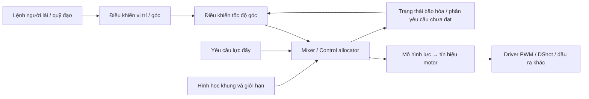

    # Bộ trộn motor (mixer): học từ PX4, ArduPilot, Betaflight và Crazyflie

**Ngày khảo sát:** 16/10/2026.  
**Nguồn:** mã nguồn đang có trong `docs/external/repos`.  
**Mục tiêu:** hiểu mixer có những tính năng gì, từng dự án triển khai ra sao và nên học phần nào khi tự xây dựng bộ điều khiển quadrotor.

**Gợi ý đọc:** mục 2–4 giải thích nền tảng; mục 5–8 đi sâu từng dự án; mục 9 đối chiếu các bản thử nghiệm; mục 10 so sánh tính năng; mục 11–12 tổng hợp cách thiết kế và kiểm tra. Các khối mã không ghi tên hàm là công thức hoặc mã giả minh họa, không phải đoạn mã có thể chép nguyên vào firmware.

## 1. Kết quả chính và phạm vi

Mixer nhận yêu cầu lực đẩy và mô-men từ bộ điều khiển, rồi chia chúng cho từng motor. Phần cộng trừ hệ số thường rất ngắn. Phần tạo nên khác biệt giữa các dự án là **cách xử lý khi motor không còn đủ khả năng thực hiện yêu cầu**: điều chỉnh throttle, giảm yaw, co dải điều khiển, phản hồi bão hòa về PID và chuyển yêu cầu lực thành tín hiệu motor.

Trong các bản mã nguồn ở thư mục này, bốn dự án đáng nghiên cứu sâu phục vụ những mục tiêu khác nhau:

| Dự án             | Điểm đáng học nhất                                                         | Cách triển khai cốt lõi                                                                  |
| ----------------- | -------------------------------------------------------------------------- | ---------------------------------------------------------------------------------------- |
| **PX4-Autopilot** | Kiến trúc phân bổ điều khiển tổng quát; tách mô hình khung khỏi thuật toán | Dựng ma trận hiệu lực từ vị trí/hướng rotor, tính giả nghịch đảo, giải bão hòa tuần tự   |
| **ArduPilot**     | Mixer multicopter gắn với giới hạn thực tế, dành biên yaw và quản lý motor | Hệ số theo khung, giới hạn yaw trước, co phần RPY rồi chọn throttle khả thi              |
| **Betaflight**    | Duy trì quyền điều khiển ở throttle thấp/cao và các tình huống bay acro    | Bảng hệ số, tính dải chênh motor, chuẩn hóa dải và dịch throttle; nhiều chính sách mixer |
| **Crazyflie**     | Mã ngắn, dễ nối lý thuyết với triển khai; có giao diện lực/mô-men SI       | Công thức quad cố định, ba loại đầu vào, bù pin rồi giảm đồng loạt khi vượt trần         |

“Đáng học” ở đây là đánh giá theo cấu trúc và tính năng quan sát được trong mã nguồn, không phải bảng xếp hạng hiệu năng bay. Không có benchmark giữa các dự án trong lần khảo sát này.

Ba dự án nhỏ `Arduino-Quadcopter`, `MonteQuadcopter` và `Quadcopter` được dùng để đối chiếu. Chúng giúp nhìn rõ phép trộn cơ bản và những phần còn thiếu so với bốn hệ thống trên.

### Giới hạn của kết luận

- Tài liệu mô tả **bản sao cục bộ**, không mặc định đó là bản phát hành hay mã upstream mới nhất. Một số chi tiết có thể là thay đổi riêng trong bản sao này.
- Các thư mục dự án không có `.git` riêng tại thời điểm khảo sát, nên không suy đoán commit upstream. Commit của repository chứa bộ sưu tập là `839ec40a5ce88c8c57ba68ffb53fd1d6fbaa7dbf`; dấu vân tay các tệp chính nằm ở phụ lục.
- Phạm vi chính là đường điều khiển multicopter/quadrotor. Tính năng VTOL, servo hay rotor nghiêng được đề cập khi giúp giải thích kiến trúc.
- Đây là nghiên cứu tĩnh mã nguồn. Chưa build firmware, chạy SITL hay kiểm thử trên phần cứng. Các ví dụ số trong tài liệu được kiểm tra riêng, không phải kết quả bay.

## 2. Mixer nằm ở đâu trong bộ điều khiển?



Sơ đồ là kiến trúc khái quát; không phải dự án nào cũng có đầy đủ đường phản hồi như hình.

Với quadrotor thông thường, mixer thường nhận:

| Đại lượng | Ý nghĩa                  | Không nên nhầm với                           |
| --------- | ------------------------ | -------------------------------------------- |
| `T`       | Mức lực đẩy chung        | Luôn là độ rộng xung PWM hoặc luôn là Newton |
| `R`       | Yêu cầu điều khiển roll  | Góc roll trực tiếp                           |
| `P`       | Yêu cầu điều khiển pitch | Góc pitch trực tiếp                          |
| `Y`       | Yêu cầu điều khiển yaw   | Góc hướng trực tiếp                          |

Trong giao diện chuẩn hóa, `R/P/Y` là đầu ra điều khiển đã được scale. Trong giao diện vật lý, chúng có thể là mô-men theo N·m. Hai loại giao diện cần hệ số khác nhau.

Đầu ra của mixer cũng chưa nhất thiết là PWM. PX4 xuất setpoint actuator qua uORB; ArduPilot tạo yêu cầu thrust rồi biến đổi sang actuator; Crazyflie có các bước thrust, bù pin và PWM tách riêng. Betaflight ghép nhiều bước này trong đường xử lý mixer.

**Ba khái niệm cần tách biệt:**

1. **Mixing/allocation:** yêu cầu lực và mô-men được chia cho motor nào, bao nhiêu.
2. **Mô hình motor:** cần tín hiệu điện bao nhiêu để tạo lực đó.
3. **Driver đầu ra:** truyền tín hiệu đến phần cứng bằng giao thức nào.

Thay PWM bằng DShot không tự làm thuật toán phân bổ tốt hơn.

## 3. Từ công thức cộng trừ đến ma trận

### 3.1. Ví dụ quad X với quy ước rõ ràng

Để minh họa, chọn trục thân `x` về trước, `y` sang phải, `z` xuống dưới; lực rotor hướng lên. Đánh số riêng cho ví dụ này:

```text
                     Trước (+x)

             M4                    M1
          trước-trái            trước-phải

                       CG                   Phải (+y)

             M3                    M2
           sau-trái              sau-phải
```

Chọn hệ số phản lực yaw trên thân là `+1` cho M1/M3 và `-1` cho M2/M4. Đây là quy ước của ví dụ; phải đối chiếu chiều quay và cách đánh số thực tế trước khi dùng cho một dự án cụ thể.

Phép trộn chuẩn hóa:

```text
m1 = T - R + P + Y
m2 = T - R - P - Y
m3 = T + R - P + Y
m4 = T + R + P - Y
```

Hay:

```text
    [m1]   [1  -1  +1  +1] [T]
    [m2] = [1  -1  -1  -1] [R]
    [m3]   [1  +1  -1  +1] [P]
    [m4]   [1  +1  +1  -1] [Y]
```

Trong ví dụ, `T` là mức chung trên mỗi motor. Tổng đầu ra bằng `4T` khi chưa bão hòa; không được đồng nhất `T` với tổng lực đẩy SI.

Các hệ số `±1` đã hấp thụ kích thước cánh tay đòn và scale điều khiển. Vì vậy không thể đưa trực tiếp mô-men N·m vào công thức này.

### 3.2. Ma trận hiệu lực và ma trận trộn là hai hướng khác nhau

Mô hình tổng quát:

```text
c = B u
```

- `u`: vector tác động của các actuator.
- `c`: vector lực/mô-men mà chúng tạo ra.
- `B`: ma trận hiệu lực, mô tả actuator tác động lên thân máy bay thế nào.

Mixer cần giải chiều ngược lại:

```text
u ≈ B⁺ c
```

`B⁺` là giả nghịch đảo. Với nhiều motor hơn số trục cần điều khiển, có thể có nhiều nghiệm. Giả nghịch đảo cho một nghiệm tuyến tính; nó **không tự bảo đảm giới hạn actuator**. Một bài toán bình phương tối thiểu có ràng buộc là bước khác, không nên gán cho mọi allocator dùng giả nghịch đảo.

PX4 dựng `B` từ hình học rồi tính ma trận trộn. ArduPilot và Betaflight thường khai báo trực tiếp các hệ số dùng để trộn. Crazyflie dùng công thức đóng cho quad.

Với một rotor ở vị trí `r`, trục lực đơn vị `a`, PX4 tính cột của `B` theo:

```text
force  = ct * a
moment = ct * (r × a) - ct * km * a
```

`ct` là hệ số thrust và `km` là tỷ lệ mô-men phản lực theo quy ước của PX4. Với `a = [0, 0, -1]`, phần cánh tay đòn cho roll tỷ lệ `-r_y`, pitch tỷ lệ `r_x`. Đây là nguồn gốc vật lý của các dấu cộng trừ.

Nguồn: [PX4 — dựng ma trận rotor](../external/repos/PX4-Autopilot/src/modules/control_allocator/VehicleActuatorEffectiveness/ActuatorEffectivenessRotors.cpp#L193).

## 4. Vấn đề quan trọng nhất: bão hòa motor

Giả sử đầu ra hợp lệ nằm trong `[0, 1]`. Khi yêu cầu điều khiển lớn, một motor có thể cần `1.15`, hoặc motor khác cần `-0.10`. Firmware phải quyết định phần yêu cầu nào được giữ lại.

### 4.1. Vì sao cắt riêng từng motor làm sai lệnh?

Dùng ma trận ví dụ ở mục 3 với:

```text
T = 0.90, R = 0.20, P = 0.10, Y = 0.05
```

Kết quả:

| Cách xử lý           |   M1 |   M2 |   M3 |   M4 |
| -------------------- | ---: | ---: | ---: | ---: |
| Yêu cầu ban đầu      | 0.85 | 0.55 | 1.05 | 1.15 |
| Cắt riêng từng motor | 0.85 | 0.55 | 1.00 | 1.00 |
| Giảm chung 0.15      | 0.70 | 0.40 | 0.90 | 1.00 |

Tính ngược theo ma trận ví dụ:

| Đại lượng | Yêu cầu | Sau cắt riêng | Sau giảm chung |
| --------- | ------: | ------------: | -------------: |
| `T`       |   0.900 |         0.850 |          0.750 |
| `R`       |   0.200 |         0.150 |          0.200 |
| `P`       |   0.100 |         0.075 |          0.100 |
| `Y`       |   0.050 |         0.075 |          0.050 |

Cắt riêng làm giảm roll/pitch và tăng yaw ngoài ý muốn. Giảm chung giữ được toàn bộ chênh lệch motor, đổi lại giảm lực nâng chung.

Nhận xét này giả sử quad đối xứng, các motor có cùng hiệu lực, và đang tính trong miền tuyến tính. Trừ cùng một lượng PWM sau phép biến đổi phi tuyến không bảo đảm giữ nguyên mô-men vật lý.

### 4.2. Khi dịch throttle vẫn chưa đủ

Đặt phần điều khiển chênh motor là `d_i`, với `m_i = T + d_i`. Muốn mọi motor nằm trong `[0, 1]`, cần:

```text
-min(d) ≤ T ≤ 1 - max(d)
```

Khoảng khả thi chỉ tồn tại khi:

```text
max(d) - min(d) ≤ 1
```

Nếu dải chênh lớn hơn 1, phải giảm yêu cầu mô-men hoặc bỏ bớt một thành phần. Ví dụ:

```text
d = [-0.8, -0.4, +0.4, +0.8]
range = 1.6
scale = 1 / 1.6 = 0.625
d_scaled = [-0.5, -0.25, +0.25, +0.5]
T = 0.5 → m = [0, 0.25, 0.75, 1]
```

Co chung giữ tỷ lệ giữa các thành phần mô-men nhưng giảm độ lớn. Một chính sách ưu tiên có thể giảm yaw trước để giữ roll/pitch nhiều hơn.

Hai công thức trên áp dụng cho miền `[0,1]`, hệ số throttle bằng nhau. Khung bất đối xứng, giới hạn riêng từng motor hoặc rotor nghiêng cần xét vector hiệu lực thực tế.

## 5. PX4: phân bổ điều khiển dựa trên hình học

### 5.1. Luồng thực thi

```text
vehicle_torque_setpoint + vehicle_thrust_setpoint
    → ControlAllocator::Run()
    → ActuatorEffectiveness cung cấp ma trận và cấu hình
    → ControlAllocation::allocate()
    → hiệu chỉnh theo loại phương tiện / motor dừng
    → giới hạn tốc độ thay đổi nếu được cấu hình
    → clipActuatorSetpoint()
    → actuator_motors / actuator_servos
    → lớp xuất tín hiệu
```

Allocator sử dụng vector sáu thành phần theo thứ tự:

```text
[torque_x, torque_y, torque_z, thrust_x, thrust_y, thrust_z]
```

Sáu thành phần trong giao diện không có nghĩa quad thông thường điều khiển độc lập được cả sáu. Quad với rotor thẳng đứng không trực tiếp tạo lực `x/y` độc lập.

Nguồn: [ControlAllocator::Run](../external/repos/PX4-Autopilot/src/modules/control_allocator/ControlAllocator.cpp#L378).

### 5.2. Những tính năng quan sát được

| Tính năng                           | Cách làm                                                                                              |
| ----------------------------------- | ----------------------------------------------------------------------------------------------------- |
| Khai báo hình học rotor             | Vị trí `PX/PY/PZ`, trục `AX/AY/AZ`, hệ số `CT`, `KM`; có liên kết rotor với cơ cấu nghiêng            |
| Nhiều kiểu phương tiện              | Tách các lớp `ActuatorEffectiveness` cho multirotor, fixed-wing, VTOL, rotor nghiêng và cấu hình khác |
| Lựa chọn thuật toán                 | `PSEUDO_INVERSE`, `SEQUENTIAL_DESATURATION`, hoặc `AUTO` theo đề xuất của loại phương tiện            |
| Giới hạn actuator                   | Min/max và slew rate; có hỗ trợ actuator đảo chiều theo cấu hình                                      |
| Phản hồi kết quả phân bổ            | `unallocated_torque`, `unallocated_thrust`, trạng thái đạt setpoint, bão hòa từng actuator            |
| Xử lý motor lỗi trong mô hình       | Khi lỗi đã được tiếp nhận, đặt cột tương ứng trong ma trận hiệu lực về 0                              |
| Xử lý trục gần phụ thuộc tuyến tính | Bản cục bộ có `dropDependentAxes()` để bỏ trục gần phụ thuộc trước khi tính giả nghịch đảo            |

Nguồn: [cấu hình rotor](../external/repos/PX4-Autopilot/src/modules/control_allocator/VehicleActuatorEffectiveness/ActuatorEffectivenessRotors.cpp#L46), [chọn thuật toán](../external/repos/PX4-Autopilot/src/modules/control_allocator/ControlAllocator.cpp#L140), [nguồn hiệu lực](../external/repos/PX4-Autopilot/src/modules/control_allocator/ControlAllocator.cpp#L208), [motor lỗi](../external/repos/PX4-Autopilot/src/modules/control_allocator/ControlAllocator.cpp#L559), [báo cáo kết quả](../external/repos/PX4-Autopilot/src/modules/control_allocator/ControlAllocator.cpp#L657).

### 5.3. Giả nghịch đảo: nghiệm tuyến tính trước, giới hạn sau

`ControlAllocationPseudoInverse` đánh dấu cần cập nhật khi ma trận thay đổi. `updatePseudoInverse()` gọi `matrix::geninv()` và chuẩn hóa ma trận khi cần. Nó không tính lại giả nghịch đảo ở mọi vòng lặp nếu cấu hình không đổi.

Công thức phân bổ:

```text
actuator_sp = actuator_trim + mix * (control_sp - control_trim)
```

Sau đó `ControlAllocator::Run()` mới giới hạn actuator. Vì vậy phương pháp này đơn giản nhưng khi clip có thể mất tính chính xác của lực/mô-men yêu cầu.

Chế độ thông thường có chuẩn hóa scale; không nên đọc tên `vehicle_torque_setpoint` rồi mặc định mọi giá trị đều là N·m. Mã cục bộ cũng có nhánh metric, nhưng đơn vị thực tế còn phụ thuộc đường điều khiển và cấu hình được sử dụng.

Nguồn: [updatePseudoInverse](../external/repos/PX4-Autopilot/src/lib/control_allocation/control_allocation/ControlAllocationPseudoInverse.cpp#L66), [allocate](../external/repos/PX4-Autopilot/src/lib/control_allocation/control_allocation/ControlAllocationPseudoInverse.cpp#L183).

### 5.4. Giải bão hòa tuần tự hoạt động thế nào?

PX4 lấy một vector `v` biểu diễn tác động lên motor của một trục, rồi hiệu chỉnh:

```text
u_new = u_old + k * v
```

Nếu `v` là cột thrust, hiệu chỉnh chủ yếu thay đổi lực đẩy chung. Nếu là cột yaw, hiệu chỉnh thành phần yaw. Đây là phiên bản tổng quát hơn của thao tác “trừ đều các motor”.

`computeDesaturationGain()` xét các actuator ngoài giới hạn, tính hệ số đưa chúng về biên, rồi trả về `k_min + k_max`. `desaturateActuators()` áp dụng một lượt đầy đủ và một lượt bổ sung với nửa gain. Các phần tử vector có độ lớn nhỏ hơn `0.2` bị bỏ qua trong tính gain để tránh khuếch đại quá lớn.

Đây là thủ tục tuần tự theo chính sách; không phải bộ giải tối ưu có ràng buộc toàn cục. Trường hợp cực đoan vẫn cần clip cuối cùng.

| `MC_AIRMODE`         | Trình tự chính                                                                               | Chính sách                                                                  |
| -------------------- | -------------------------------------------------------------------------------------------- | --------------------------------------------------------------------------- |
| `0` — tắt            | Trộn chưa có yaw → chỉ giảm thrust khi giải bão hòa → hiệu chỉnh roll/pitch → thêm yaw riêng | Không tăng thrust để cứu quyền điều khiển                                   |
| `1` — roll/pitch     | Trộn chưa có yaw → dịch thrust → thêm yaw riêng                                              | Cho phép tăng/giảm thrust để giữ roll/pitch; yaw không được làm tăng thrust |
| `2` — roll/pitch/yaw | Trộn đủ các trục → dịch thrust → giải bão hòa theo yaw                                       | Cho phép dịch thrust cho RPY; vẫn ưu tiên roll/pitch khi phải giảm yaw      |

Nhánh `mixYaw()` tạm nới trần tính toán bằng `MINIMUM_YAW_MARGIN = 0.15`, hiệu chỉnh yaw rồi giảm thrust để trở lại giới hạn. Đây là biên trong thuật toán, không phải cho phép đầu ra vật lý vượt 100%.

Chi tiết dễ đọc nhầm: tham số `increase_only` nghĩa là chỉ cộng theo **hướng vector giải bão hòa**. Với cột thrust Z âm của rotor hướng lên, cộng theo vector có thể làm giảm lệnh motor. Vì vậy không dịch tên biến thành “chỉ tăng lực nâng”.

Nguồn: [thuật toán giải bão hòa](../external/repos/PX4-Autopilot/src/lib/control_allocation/control_allocation/ControlAllocationSequentialDesaturation.cpp#L67), [các nhánh airmode](../external/repos/PX4-Autopilot/src/lib/control_allocation/control_allocation/ControlAllocationSequentialDesaturation.cpp#L121), [biên yaw](../external/repos/PX4-Autopilot/src/lib/control_allocation/control_allocation/ControlAllocationSequentialDesaturation.hpp#L61).

### 5.5. Phản hồi về bộ điều khiển và mô hình motor

Allocator tính phần yêu cầu chưa đạt từ setpoint trừ kết quả phân bổ theo mô hình. `MulticopterRateControl` đọc dấu của `unallocated_torque` để đánh dấu bão hòa theo chiều dương/âm cho từng trục. Cơ chế này cung cấp thông tin cho chống tích lũy sai số tích phân khi actuator đã hết khả năng đáp ứng.

Đây là phần dư **theo mô hình**, không phải lực/mô-men thực đo tại motor. Mô hình sai hoặc pin yếu vẫn có thể khiến lực thực khác dự báo.

Phép biến đổi đường cong thrust nằm ở lớp xuất motor: `FunctionMotors::updateValues()` đảo mô hình `rel_thrust = factor*x² + (1-factor)*x`, rồi đổi miền cho motor không đảo chiều. Tách bước này giúp allocator làm việc trong miền gần tuyến tính với lực đẩy.

Nguồn: [phản hồi đến rate controller](../external/repos/PX4-Autopilot/src/modules/mc_rate_control/MulticopterRateControl.cpp#L205), [biến đổi thrust](../external/repos/PX4-Autopilot/src/lib/mixer_module/functions/FunctionMotors.hpp#L81).

**Điều nên học:** giao diện rõ ràng giữa hình học, thuật toán phân bổ, giới hạn và driver; chỉ cập nhật ma trận khi cần; báo cáo yêu cầu chưa đạt. Cơ chế loại motor lỗi không bảo đảm mọi khung tiếp tục bay đủ các trục sau lỗi.

## 6. ArduPilot: hệ số theo khung và chính sách giữ quyền điều khiển

### 6.1. Cấu hình ma trận

Trong đường multicopter dùng `AP_MotorsMatrix`, mỗi motor có:

```text
roll_factor, pitch_factor, yaw_factor, throttle_factor
```

`setup_quad_matrix()` cùng các hàm cho hexa/octa/... khai báo bố trí. Có nhiều biến thể thứ tự motor, chẳng hạn X thông thường, BF_X, DJI_X. Vì thế “đều là quad X” chưa đủ để sao chép bảng hệ số giữa hai firmware.

`add_motor()` chuyển góc vị trí thành hệ số bằng cos; `add_motor_raw()` cho khai báo trực tiếp. `normalise_rpy_factors()` chuẩn hóa từng trục R/P/Y để độ lớn hệ số lớn nhất bằng **0.5**, còn hệ số throttle lớn nhất bằng 1 và không âm.

Điều này khác bảng `±1` minh họa và khác scale thường gặp ở Betaflight. Mang nguyên PID gain sang hệ khác có thể làm đổi độ mạnh điều khiển.

Nguồn: [khai báo motor](../external/repos/ardupilot/libraries/AP_Motors/AP_MotorsMatrix.cpp#L503), [quad X và các biến thể](../external/repos/ardupilot/libraries/AP_Motors/AP_MotorsMatrix.cpp#L575), [chuẩn hóa](../external/repos/ardupilot/libraries/AP_Motors/AP_MotorsMatrix.cpp#L1351).

### 6.2. Trình tự trong `output_armed_stabilizing()`

1. **Bù hiệu lực:** nhân roll/pitch/yaw, feed-forward và throttle với gain bù điện áp/mật độ không khí từ `thr_lin`.
2. **Áp giới hạn throttle:** xét trần thrust hiện có và trần throttle trung bình cho phép.
3. **Trộn roll/pitch trước:** tính đóng góp của hai trục trên từng motor.
4. **Tính chỗ còn lại cho yaw:** xét motor cần tăng hay giảm khi thêm yaw, lấy mức yaw có thể dùng; dành một mức headroom tối thiểu theo cấu hình.
5. **Giới hạn yaw:** nếu yêu cầu vượt khả năng đã tính, giảm yaw và đặt `limit.yaw`.
6. **Thêm yaw, tìm dải RPY:** lấy đầu ra thấp nhất/cao nhất của phần chênh motor.
7. **Co RPY nếu cần:** nếu dải lớn hơn 1 hoặc trần throttle trung bình không đủ cho phía thấp, giảm cùng tỷ lệ RPY đã trộn.
8. **Chọn throttle khả thi:** đưa throttle gần yêu cầu nhất trong biên cho phép, tạo đầu ra thrust cho từng motor và đặt các cờ giới hạn.

Công thức cuối có dạng:

```text
thrust_i = throttle_selected * throttle_factor_i
           + rpy_scale * (roll_i + pitch_i + yaw_limited_i)
```

Nguồn: [hàm trộn chính](../external/repos/ardupilot/libraries/AP_Motors/AP_MotorsMatrix.cpp#L213).

### 6.3. Những tính năng đáng chú ý

**Dành biên yaw.** `MOT_YAW_HEADROOM` được đổi scale bằng hệ số `0.001` trong phép tính này. Headroom bảo vệ một phần quyền yaw khi phải cạnh tranh với roll/pitch và throttle. Đây không phải cam kết mọi lệnh yaw đều thực hiện đủ; phần RPY vẫn có thể bị co ở bước sau.

**Cân bằng throttle với ổn định tư thế.** Nhóm `ATC_THR_MIX_MIN/MAX/MAN` nằm ở tầng attitude controller và ảnh hưởng mức throttle trung bình mà mixer được sử dụng. Nó giúp quyết định có thể nâng mức chung bao nhiêu khi throttle yêu cầu thấp. Không nên coi các tham số này là hệ số hình học motor.

**Thrust linearization và bù pin.** `Thrust_Linearization` có đường cong expo, giới hạn spin min/max, mô hình hiệu lực theo điện áp và bù mật độ không khí. `thrust_to_actuator()` biến yêu cầu lực chuẩn hóa thành lệnh actuator. Không chỉ nhân PWM với một hệ số cố định.

**Giới hạn dòng.** `AP_MotorsMulticopter` có hàm tính trần throttle theo dòng; chức năng phụ thuộc cấu hình và dữ liệu battery monitor, không mặc định luôn hoạt động.

**Quản lý chuyển trạng thái motor.** `output_to_motors()` phân biệt shutdown, ground idle, spooling up, hoạt động và spooling down. Lệnh thrust được biến đổi sang actuator, qua giới hạn slew rồi mới gửi đầu ra. Arm/disarm là phần của đường quản lý motor rộng hơn phép nhân ma trận.

**Thông tin giới hạn cho PID.** Các cờ `limit.roll/pitch/yaw` được truyền vào `update_all()` của rate PID. Đây là đường phản hồi chống windup cụ thể, thay vì để PID tiếp tục tăng yêu cầu không thể đạt.

Nguồn: [yaw headroom](../external/repos/ardupilot/libraries/AP_Motors/AP_MotorsMatrix.cpp#L300), [throttle mix](../external/repos/ardupilot/libraries/AC_AttitudeControl/AC_AttitudeControl_Multi.cpp#L306), [mô hình thrust](../external/repos/ardupilot/libraries/AP_Motors/AP_Motors_Thrust_Linearization.cpp#L103), [giới hạn dòng](../external/repos/ardupilot/libraries/AP_Motors/AP_MotorsMulticopter.cpp#L373), [spool và đầu ra](../external/repos/ardupilot/libraries/AP_Motors/AP_MotorsMatrix.cpp#L143), [cờ giới hạn vào PID](../external/repos/ardupilot/libraries/AC_AttitudeControl/AC_AttitudeControl_Multi.cpp#L472).

### 6.4. Xử lý motor lỗi: cần đọc đúng phạm vi

`check_for_failed_motor()` lọc yêu cầu thrust, so sánh đầu ra lớn nhất với trung bình để đánh giá mất cân bằng và xác định motor nghi ngờ. Khi thrust boost được kích hoạt, logic trộn có thể giảm ảnh hưởng motor đó trong việc tính giới hạn.

Trong bản khảo sát, điều kiện đánh dấu mất cân bằng yêu cầu **ít nhất 6 motor** và loại trừ một số khung co-rotating. Đây là suy luận từ lệnh motor, không phải tự nó là phép đo RPM xác nhận motor hỏng. Mã cũng nêu quad không đủ bậc tự do cho cơ chế xử lý mất motor này.

Nguồn: [kiểm tra mất cân bằng](../external/repos/ardupilot/libraries/AP_Motors/AP_MotorsMatrix.cpp#L414), [ghi chú giới hạn trên quad](../external/repos/ardupilot/libraries/AP_Motors/AP_MotorsMatrix.cpp#L263).

**Điều nên học:** chính sách yaw/throttle rõ ràng, phản hồi giới hạn về PID, và quản lý đầy đủ đường thrust → actuator → đầu ra. Không nên sao chép riêng hàm trộn mà bỏ những giới hạn do lớp cha và controller cung cấp.

## 7. Betaflight: bảng hệ số, dải motor và airmode

### 7.1. Mixer bắt đầu từ bảng hệ số

Bảng quad X trong bản khảo sát, theo thứ tự `(throttle, roll, pitch, yaw)`:

| Motor trong bảng | Throttle | Roll | Pitch | Yaw |
| ---------------- | -------: | ---: | ----: | --: |
| Sau-phải         |        1 |   -1 |    +1 |  -1 |
| Trước-phải       |        1 |   -1 |    -1 |  +1 |
| Sau-trái         |        1 |   +1 |    +1 |  +1 |
| Trước-trái       |        1 |   +1 |    -1 |  -1 |

Đây là bảng của Betaflight, khác thứ tự và quy ước ví dụ ở mục 3. Đặc biệt, `mixTable()` còn đổi dấu yaw theo `yaw_motors_reversed`. Không thể suy ra đầy đủ chiều quay vật lý chỉ bằng một cột của bảng.

Nguồn: [mixerQuadX](../external/repos/betaflight/src/main/flight/mixer_init.c#L84), [xử lý yaw](../external/repos/betaflight/src/main/flight/mixer.c#L723).

### 7.2. Luồng xử lý và cách giải bão hòa phổ biến

`mixTable()` giới hạn tổng PID theo từng trục, đổi scale bằng `PID_MIXER_SCALING`, rồi tính:

```text
motorMix_i = R * roll_factor_i
             + P * pitch_factor_i
             + Y * yaw_factor_i

motorMixRange = max(motorMix) - min(motorMix)
```

Với nhánh `MIXER_LEGACY` và airmode đang bật, về cơ bản:

```text
scale = 1 / max(1, motorMixRange)
motorMix_i *= scale
throttle = constrain(throttle,
                     -min(motorMix),
                     1 - max(motorMix))
```

Sau đó cộng phần throttle và ánh xạ ra miền đầu ra motor. Đây chính là hai bước ở mục 4: **co dải nếu không thể vừa**, rồi **dịch throttle để tránh clip**.

Nếu airmode tắt và throttle dưới 0.5, mã còn giảm quyền điều khiển bằng `airmodeTransitionPercent`, chuyển từ 0.5 ở throttle 0 lên 1 ở throttle 0.5. Vì vậy không thể áp công thức airmode bật cho mọi trạng thái.

Nguồn: [tính phần RPY](../external/repos/betaflight/src/main/flight/mixer.c#L776), [điều chỉnh legacy](../external/repos/betaflight/src/main/flight/mixer.c#L665), [cộng throttle và xuất motor](../external/repos/betaflight/src/main/flight/mixer.c#L465).

### 7.3. Các chính sách mixer trong bản cục bộ

| Chính sách        | Cách làm ở mức thuật toán                                                                                        |
| ----------------- | ---------------------------------------------------------------------------------------------------------------- |
| `MIXER_LEGACY`    | Chuẩn hóa dải chênh motor và giới hạn throttle theo khoảng còn lại                                               |
| `MIXER_LINEAR`    | Thêm một độ dịch chung phụ thuộc throttle và dải chênh, rồi chuẩn hóa và giới hạn throttle                       |
| `MIXER_DYNAMIC`   | Dùng cùng hàm với linear nhưng độ dịch phụ thuộc độ lớn của từng phần tử mix                                     |
| `MIXER_EZLANDING` | Tính biên theo throttle, độ lệch stick và tốc độ nếu có GPS; có thể giảm thêm phần mix để hỗ trợ hành vi hạ cánh |

Tên `LINEAR/DYNAMIC` ở bảng này nói về chính sách mixer trong Betaflight, không đồng nghĩa với phép tuyến tính hóa đường cong lực đẩy motor. Cần đọc hai chức năng riêng.

Nguồn: [linear/dynamic](../external/repos/betaflight/src/main/flight/mixer.c#L566), [EZ landing](../external/repos/betaflight/src/main/flight/mixer.c#L601), [chọn chính sách](../external/repos/betaflight/src/main/flight/mixer.c#L838).

### 7.4. Tính năng quanh đường mixer

- **Airmode:** cho phép dịch throttle để giữ quyền tạo mô-men khi người lái giảm ga. Mục tiêu là giữ khả năng xoay thân; lực nâng chung có thể đổi.
- **Dynamic idle:** dùng RPM motor thấp nhất để điều chỉnh mức đầu ra tối thiểu bằng các thành phần P/I/D. Phụ thuộc khả năng cung cấp RPM và cấu hình build.
- **3D/reversible:** chọn miền đầu ra và dấu trộn theo trạng thái quay thuận/ngược; có deadband quanh vùng chuyển chiều.
- **Crash flip:** đường xử lý riêng có thể kết thúc sớm `mixTable()`, không đi qua trộn bay bình thường.
- **Launch control và yaw spin recovery:** có thể thay bảng trộn hoạt động, giới hạn PID hoặc throttle trong các tình huống tương ứng.
- **Thrust linearization:** có hook ở đầu ra; tách biệt với các kiểu mixer nêu trên.
- **Giới hạn throttle và RPM:** có nhánh xử lý riêng khi được bật; không phải chức năng của phép nhân hệ số.
- **Disarm/failsafe/motor stop:** kiểm soát đầu ra cuối; miền đặc biệt của DShot được xét khi cần.

Nguồn: [endpoints và dynamic idle](../external/repos/betaflight/src/main/flight/mixer.c#L128), [crash flip](../external/repos/betaflight/src/main/flight/mixer.c#L694), [launch và yaw recovery](../external/repos/betaflight/src/main/flight/mixer.c#L701), [RPM limiter](../external/repos/betaflight/src/main/flight/mixer.c#L413), [đầu ra/disarm](../external/repos/betaflight/src/main/flight/mixer.c#L465), [motor stop](../external/repos/betaflight/src/main/flight/mixer.c#L857).

### 7.5. Phản hồi bão hòa: không suy diễn quá mức từ tên biến

Mixer cung cấp `getMotorMixRange()`; rate PID dùng nó trong phát hiện/phục hồi crash. Nhánh EZ landing cũng điều chỉnh giá trị này và có chú thích liên quan anti-windup.

Tuy nhiên, trong phần cập nhật tích phân đang khảo sát, `pid.c` trực tiếp giới hạn I-term bằng `itermLimit`/`itermLimitYaw`. Không nên suy từ chú thích EZ landing rằng bản này đã có đường phản hồi phần dư mô-men theo từng trục giống PX4. Hai giao diện không tương đương.

Nguồn: [range dùng trong crash recovery](../external/repos/betaflight/src/main/flight/pid.c#L773), [giới hạn tích phân](../external/repos/betaflight/src/main/flight/pid.c#L1416), [chú thích EZ landing](../external/repos/betaflight/src/main/flight/mixer.c#L650).

**Điều nên học:** giải bão hòa bằng min/max và scale rất gọn, dễ triển khai cho quad đối xứng; airmode và idle phải được thiết kế cùng nhau. Trong nhánh legacy, RPY được gộp rồi co chung; không có cùng quy trình dành headroom yaw riêng như ArduPilot.

## 8. Crazyflie: ba giao diện điều khiển và capping đơn giản

### 8.1. Ba loại đầu vào

`powerDistribution()` chọn đường xử lý theo `controlMode`:

| Chế độ                   | Đầu vào                                        | Cách chuyển sang lệnh từng motor                                    |
| ------------------------ | ---------------------------------------------- | ------------------------------------------------------------------- |
| `controlModeLegacy`      | `thrust`, `roll`, `pitch`, `yaw` theo scale cũ | Công thức cộng trừ cố định; roll/pitch chia 2 trước khi trộn        |
| `controlModeForceTorque` | Tổng thrust SI và mô-men ba trục               | Chia tổng lực cho 4, chia mô-men theo arm và hệ số thrust-to-torque |
| `controlModeForce`       | `normalizedForces[i]` cho từng motor           | Cắt từng giá trị vào `[0,1]`, scale sang miền số nguyên             |

Nhánh legacy:

```text
r = roll / 2
p = pitch / 2
m1 = thrust - r + p + yaw
m2 = thrust - r - p - yaw
m3 = thrust + r - p + yaw
m4 = thrust + r + p - yaw
```

Nhánh lực/mô-men:

```text
arm        = ARM_LENGTH / sqrt(2)
rollPart   = torqueX / (4 * arm)
pitchPart  = torqueY / (4 * arm)
thrustPart = thrustSi / 4
yawPart    = torqueZ / (4 * THRUST2TORQUE)

f1 = thrustPart - rollPart - pitchPart - yawPart
f2 = thrustPart - rollPart + pitchPart + yawPart
f3 = thrustPart + rollPart + pitchPart - yawPart
f4 = thrustPart + rollPart - pitchPart + yawPart
```

Lực âm được đưa về 0, rồi đổi sang thang thrust số nguyên bằng `force / THRUST_MAX * UINT16_MAX`. **Đây chưa phải phép nghịch đảo đường cong motor ra duty cuối cùng.** Chú ý dấu pitch/yaw giữa hai chế độ khác nhau; phải dùng đúng quy ước của controller tương ứng.

Nguồn: [ba chế độ power distribution](../external/repos/crazyflie-firmware/src/modules/src/power_distribution_quadrotor.c#L84).

### 8.2. Đường thrust → bù pin → giới hạn → motor

```text
powerDistribution()
    → batteryCompensation()
    → powerDistributionCap()
    → setMotorRatios()
```

Khi `CONFIG_ENABLE_THRUST_BAT_COMPENSATED` được bật, `motorsCompensateBatteryVoltage()` đảo một đường cong bậc ba giữa điện áp motor và thrust, sau đó chia điện áp cần thiết cho điện áp nguồn để tìm duty. Nếu tính năng tắt, hàm trả nguyên đầu vào.

Điểm đáng học là giữ các đầu ra chưa bị giới hạn trong cấu trúc trung gian, vì bù pin có thể làm giá trị vượt trần. Giới hạn sau đó mới quyết định kết quả gửi motor.

Nguồn: [controlMotors](../external/repos/crazyflie-firmware/src/modules/src/stabilizer.c#L255), [mô hình motor và pin](../external/repos/crazyflie-firmware/src/drivers/src/motors.c#L180).

### 8.3. Capping: trừ cùng một lượng khi vượt trần

`powerDistributionCap()` tìm lệnh lớn nhất. Nếu vượt `UINT16_MAX`, tính:

```text
reduction = highest - UINT16_MAX
output_i = max(input_i - reduction, idleThrust)
```

Nếu không motor nào vượt trần thì `reduction = 0`. Hàm trả `isCapped` khi có vượt trần trên; việc chạm sàn idle không tự đặt cờ này.

Với các đầu ra chưa chạm sàn, trừ chung giữ nguyên chênh lệch **trong miền tín hiệu tại bước đó**. Khi một motor chạm idle, chênh lệch bị thay đổi. Vì phép cap chạy sau bù pin/mô hình phi tuyến, không thể khẳng định nó giữ chính xác mô-men vật lý như thao tác trong miền lực tuyến tính.

Một chi tiết nữa: nhánh ForceTorque đã cắt lực âm trước khi cap; nhánh Force đã clip từng yêu cầu vào `[0,1]`. Do đó không phải mọi thông tin về yêu cầu ban đầu đều được bảo toàn đến bước giảm chung.

Nguồn: [powerDistributionCap](../external/repos/crazyflie-firmware/src/modules/src/power_distribution_quadrotor.c#L160).

### 8.4. Idle, supervisor và phản hồi

`powerDist.idleThrust` cấu hình mức idle. Logic trả idle về 0 khi chế độ arming không phù hợp. Trong vòng stabilizer, supervisor kiểm soát quyền cho motor chạy; nếu không được phép thì gọi `motorsStop()`.

Trong đường `controlMotors()` khảo sát, cờ `isCapped` được dùng để ghi cảnh báo nếu cấu hình cho phép. Không thấy tại đây giao diện trả phần dư mô-men theo từng trục về controller như PX4; không nên xem cảnh báo cap là một cơ chế anti-windup đầy đủ.

Nguồn: [idle](../external/repos/crazyflie-firmware/src/modules/src/power_distribution_quadrotor.c#L192), [supervisor kiểm soát motor](../external/repos/crazyflie-firmware/src/modules/src/stabilizer.c#L356).

**Điều nên học:** giao diện ForceTorque rõ đơn vị, công thức dễ kiểm tra và phân tách bước xử lý. Capping này đơn giản hơn chính sách ưu tiên theo trục của PX4/ArduPilot.

## 9. Ba dự án nhỏ: có gì và còn thiếu gì?

### 9.1. Arduino-Quadcopter

`Control.ino` trộn theo kiểu mỗi cặp motor phụ trách một trục:

```text
m0 = throttle + pid_pitch_out
m1 = throttle + pid_roll_out
m2 = throttle - pid_pitch_out
m3 = throttle - pid_roll_out
```

Yaw bị comment rõ là tắt để thử ổn định. Công thức đang hoạt động có dạng bố trí “+” theo vai trò motor. Có nhánh `SAFE` đưa tất cả motor về zero level khi throttle thấp.

Trong `control_update()` không có thuật toán giải bão hòa phối hợp; `update_motors()` chuyển các giá trị sang `Servo.writeMicroseconds()`. Giới hạn ở thư viện/driver nếu có cũng không thay thế một chính sách bảo toàn mô-men.

Nguồn: [control_update](../external/repos/Arduino-Quadcopter/Quadcopter/Control.ino#L2), [ghi motor](../external/repos/Arduino-Quadcopter/Quadcopter/Motors.ino#L24).

**Dùng để học:** đường từ PID đến motor và dấu cộng trừ cơ bản. **Chưa đủ để học:** mixer RPY hoàn chỉnh, ưu tiên trục và giải bão hòa.

### 9.2. MonteQuadcopter

Cần phân biệt hai phần mã trong repository:

- `src/MonteQuadcopter.ino` có `stabilise()` cộng/trừ roll và pitch lên bốn motor, chỉ chặn giá trị âm về 0 trong hàm này. Đường gọi tính `actSpeed`, nhưng lệnh `runIndividual(actSpeed)` ở sau đó đang bị comment; có lời gọi `runIndividual(targetSpeed)` ở trước. Vì vậy không thể chỉ nhìn hàm trộn rồi kết luận đầu ra ổn định đang được áp vào motor trong vòng lặp này.
- `lib/Quadcopter/Quadcopter.cpp` có `getStabilisedSpeed()` chặn từng motor trong `[0,255]`. Thứ tự dấu pitch của phần tử 2/3 khác bản `.ino`; không nên ghép hai bảng mà không kiểm tra motor mapping.

Không có thành phần yaw trong hai hàm trộn này. Đọc pin chỉ để đo/cảnh báo trong đoạn vòng lặp khảo sát, chưa phải đường bù hiệu lực thrust như Crazyflie.

Nguồn: [xuất targetSpeed](../external/repos/MonteQuadcopter/src/MonteQuadcopter.ino#L203), [gọi stabilise và lệnh xuất bị comment](../external/repos/MonteQuadcopter/src/MonteQuadcopter.ino#L270), [stabilise](../external/repos/MonteQuadcopter/src/MonteQuadcopter.ino#L326), [bản thư viện](../external/repos/MonteQuadcopter/lib/Quadcopter/Quadcopter.cpp#L83).

**Dùng để học:** phép trộn hai trục và lý do phải kiểm tra call path đến đầu ra thật. Đây là ví dụ thử nghiệm, không đủ bằng chứng để coi là mixer bay hoàn chỉnh.

### 9.3. Quadcopter trên STM32

`PIDControl()` có đủ bốn thành phần trong biểu thức trộn:

```text
m1 = clamp(expMode - pidRoll - pidPitch - pidYaw + pidThr, 1000, 2000)
m2 = clamp(expMode - pidRoll + pidPitch + pidYaw + pidThr, 1000, 2000)
m3 = clamp(expMode + pidRoll + pidPitch - pidYaw + pidThr, 1000, 2000)
m4 = clamp(expMode + pidRoll - pidPitch + pidYaw + pidThr, 1000, 2000)
```

Có điều kiện khóa/mở và dừng theo throttle/góc nghiêng; kết quả ghi trực tiếp vào thanh ghi `TIM3->CCR1..4`. Các con số ở đây là giá trị compare timer theo cấu hình của dự án, không tự động coi là microsecond chỉ vì giống thang 1000–2000.

Hai điểm cần lưu ý:

1. Dù biểu thức có `pidYaw`, các gain PID yaw trong `PID_Init()` đang bằng 0. Cần tách “có cột yaw” khỏi “yaw đang hoạt động”.
2. Giới hạn tích phân và đầu ra PID không phải giải bão hòa mixer. Bốn motor vẫn bị clip riêng, không có đường phản hồi phần dư từ mixer về PID trong đoạn này.

Mixer thực tế chạy từ `Task_Angel` qua `PIDControl()`, còn `Task_Motor` trong `main.c` là placeholder. Tên task không đủ để xác định nơi điều khiển motor.

Nguồn: [gain yaw](../external/repos/Quadcopter/Application/Algorithm/PID.c#L73), [trộn và ghi đầu ra](../external/repos/Quadcopter/Application/Algorithm/PID.c#L232), [call path trong task](../external/repos/Quadcopter/Application/Src/main.c#L190), [cấu hình timer](../external/repos/Quadcopter/Application/Peripheral/PWM.c#L51).

## 10. So sánh trực tiếp các tính năng

Bảng này chỉ nói về đường multicopter đã đọc. “Không thấy” có nghĩa chưa thấy trong đường đó, không khẳng định toàn bộ repository không có chức năng tương tự.

| Tiêu chí                   | PX4                                             | ArduPilot                                                    | Betaflight                                             | Crazyflie                                           |
| -------------------------- | ----------------------------------------------- | ------------------------------------------------------------ | ------------------------------------------------------ | --------------------------------------------------- |
| Biểu diễn hình học         | Vị trí, trục rotor, hệ số hiệu lực              | Góc/bảng hệ số và cấu hình khung                             | Bảng hệ số và custom mixer                             | Công thức quad cố định                              |
| Đầu vào chính              | Vector torque/thrust; có scale chuẩn hóa        | RPY/throttle chuẩn hóa, có feed-forward                      | Tổng PID được scale và throttle                        | Legacy, SI ForceTorque hoặc force từng motor        |
| Xử lý bão hòa              | Giả nghịch đảo + clip hoặc giải bão hòa tuần tự | Giới hạn yaw, co RPY, chọn throttle                          | Co dải và dịch throttle; nhiều chính sách              | Trừ chung khi vượt trần, rồi chặn sàn               |
| Ưu tiên riêng yaw          | Có trong sequential desaturation                | Có tính yaw allowance/headroom                               | Legacy co RPY chung; yaw có giới hạn PID riêng         | Không thấy giải bão hòa riêng yaw                   |
| Giữ điều khiển khi ga thấp | Tùy `MC_AIRMODE`                                | Theo throttle mix và giới hạn trung bình                     | Airmode và chính sách transition                       | Sàn idle; không thấy chính sách airmode tương đương |
| Mô hình thrust → tín hiệu  | Ở lớp output motor                              | `Thrust_Linearization`                                       | Hook thrust linearization                              | Mô hình motor/bù pin khi bật cấu hình               |
| Phản hồi đến controller    | Phần dư và bão hòa theo chiều/trục              | Cờ giới hạn từng trục                                        | Có range; PID có giới hạn I-term riêng                 | Cờ cap dùng cho cảnh báo trong đường đã đọc         |
| Quản lý motor lỗi          | Thay ma trận khi đã tiếp nhận lỗi               | Phát hiện mất cân bằng và logic boost, có điều kiện ≥6 motor | Không thấy tái phân bổ do mất motor trong đường đã đọc | Không thấy trong power distribution quad            |
| Mức độ tổng quát           | Cao: tách effectiveness/allocator/output        | Cao trong hệ AP_Motors, nhiều lớp khung                      | Rất nhiều chế độ quanh đường điều khiển motor          | Gọn, thuận tiện nghiên cứu quad                     |

Điểm chung đáng chú ý: cả bốn đều vượt xa một dòng `motor = throttle ± PID`. Tuy vậy, chúng đánh đổi khác nhau giữa lực nâng, mô-men, tính tổng quát và độ đơn giản tính toán.

## 11. Nên học và thiết kế mixer của mình như thế nào?

Các đề xuất dưới đây là tổng hợp thiết kế từ mã nguồn đã khảo sát, không phải cấu hình mặc định bắt buộc của bất kỳ dự án nào.

### 11.1. Lộ trình đọc mã

1. **Crazyflie:** đọc ba chế độ để phân biệt tín hiệu chuẩn hóa, lực SI và đầu ra trực tiếp từng motor.
2. **Betaflight:** đọc `applyMixerAdjustment()` để hiểu điều kiện khả thi của dải motor và việc dịch throttle.
3. **ArduPilot:** đọc `output_armed_stabilizing()` để hiểu yaw headroom, throttle trung bình và các cờ giới hạn.
4. **PX4:** đọc lớp hiệu lực rotor, giả nghịch đảo, sequential desaturation và đường phản hồi allocator status.

### 11.2. Kiến trúc cho một quad X tự phát triển

Có thể bắt đầu bằng ma trận cố định, nhưng nên giữ ranh giới các khối:

```text
ControlDemand
    → MixerGeometry
    → AllocationPolicy
    → MotorModel
    → OutputLimitsAndState
    → MotorDriver
```

| Khối                   | Trách nhiệm cần rõ                                  |
| ---------------------- | --------------------------------------------------- |
| `ControlDemand`        | Đơn vị, dấu, scale của R/P/Y và thrust              |
| `MixerGeometry`        | Số motor, vị trí, chiều quay, thứ tự motor logic    |
| `AllocationPolicy`     | Phân bổ và quyết định ưu tiên khi không đủ khả năng |
| `MotorModel`           | Chuyển lực sang tín hiệu, bù hiệu lực theo mô hình  |
| `OutputLimitsAndState` | Idle, slew, arm/disarm, giới hạn cuối               |
| `MotorDriver`          | Ánh xạ kênh và phát giao thức phần cứng             |

Giới hạn vật lý nên được allocator biết trước càng đầy đủ càng tốt. Lớp đầu ra vẫn cần chặn cuối; nếu bước mô hình hoặc slew làm thay đổi đáng kể kết quả thì thông tin phản hồi cũng cần phản ánh điều đó.

### 11.3. Các mức triển khai hợp lý

**Mức 1 — hiểu đúng mô hình:** ma trận quad X cố định; kiểm tra đúng thứ tự motor, dấu phản hồi và đơn vị. Clip cuối để giữ miền đầu ra nhưng ghi lại lúc clip xảy ra.

**Mức 2 — giải bão hòa phối hợp:** tính dải chênh motor, co dải và dịch throttle như nguyên lý Betaflight; quy định rõ có được tăng thrust ở ga thấp hay không.

**Mức 3 — ưu tiên và phản hồi:** giảm yaw khi cần giữ roll/pitch; báo cáo trục nào thiếu khả năng theo chiều nào. PID dùng thông tin đó để hạn chế tích phân theo hướng làm bão hòa nặng hơn, đồng thời vẫn cho phép tích phân hồi phục.

**Mức 4 — mô hình và quản lý motor:** thêm thrust curve, hiệu lực theo pin nếu có dữ liệu hiệu chuẩn, idle, spool và slew. Bắt đầu log yêu cầu, kết quả trước/sau giới hạn và phần dư.

**Mức 5 — hình học tổng quát:** chỉ chuyển sang ma trận hiệu lực/giả nghịch đảo khi cần khung bất đối xứng, nhiều loại actuator hoặc hình học biến đổi. Mỗi thay đổi cần được kiểm tra về hạng ma trận và khả năng điều khiển còn lại.

### 11.4. Giao diện đầu ra nên có

Ngoài lệnh motor, mixer có thể trả một cấu trúc như sau; đây là **giao diện đề xuất**, không phải API lấy nguyên từ các dự án:

```text
MixerResult:
    motor_command[N]
    achieved_control
    unallocated_control
    axis_limited_positive
    axis_limited_negative
    motor_at_lower_limit
    motor_at_upper_limit
    throttle_shift
    attitude_scale
```

`achieved_control` ở đây là ước tính theo mô hình sau các giới hạn được xét, không phải đo lực thực. Nếu dùng scale chuẩn hóa, phép tính ngược phải sử dụng đúng scale, trim và mô hình tương ứng; không lấy tùy tiện nghịch đảo của bảng minh họa.

## 12. Những tình huống cần kiểm tra khi tự triển khai

| Tình huống                                | Điều cần quan sát                                                                         |
| ----------------------------------------- | ----------------------------------------------------------------------------------------- |
| Chỉ thrust                                | Các motor bằng nhau đối với khung/motor đối xứng                                          |
| Chỉ roll, chỉ pitch, chỉ yaw              | Đúng nhóm motor tăng/giảm và đúng dấu mô-men                                              |
| Thrust cao + roll/pitch                   | Có dịch throttle hoặc giảm yêu cầu theo chính sách, tránh clip gây lệch trục ngoài ý muốn |
| Thrust thấp + roll/pitch                  | Khác biệt giữa cho phép và không cho phép nâng throttle để giữ điều khiển                 |
| Yaw lớn cùng roll/pitch                   | Trình tự giảm ưu tiên hoạt động đúng                                                      |
| Dải chênh lớn hơn biên actuator           | Mọi đầu ra nằm trong miền, trạng thái thiếu khả năng được phản ánh                        |
| Giới hạn riêng hoặc hệ số motor khác nhau | Không giả định phép dịch đều vẫn giữ nguyên mô-men                                        |
| Slew rate đang tác động                   | Phản hồi xét được quyền điều khiển giảm tạm thời                                          |
| Disarm, idle, spool                       | Chuyển trạng thái đúng, yêu cầu PID không vượt qua điều kiện cho phép motor               |
| Điện áp thay đổi                          | Phân biệt lệnh lực, tín hiệu điện và thời điểm chạm giới hạn                              |
| Ma trận gần suy biến                      | Không xuất gain lớn bất thường; báo các trục không còn độc lập                            |
| Bão hòa kéo dài rồi trở lại miền khả thi  | I-term hồi phục, không tích lũy vượt khả năng actuator                                    |

Trong mã nguồn đã đọc, PX4 có các test riêng cho collective thrust, RPY tại thrust cao/thấp, ba chế độ airmode, trục phụ thuộc và tình huống sau motor failure. Đây là nguồn tham khảo tốt để thiết kế ca kiểm tra.

ArduPilot có chương trình ví dụ `AP_Motors_test` và ví dụ kiểm tra nghịch đảo expo. Betaflight có `flight_mixer_wing_unittest.cc`; tệp `flight_mixer_unittest.cc.txt` cũng hiện diện nhưng hậu tố `.txt` không đủ bằng chứng nó được build/chạy như unit test thông thường. `powerDistributionTest()` của Crazyflie trong tệp quad chỉ trả `true`, vì vậy tên hàm không chứng minh thuật toán đã được kiểm tra đầy đủ.

Các test kể trên được nhận diện trong mã nguồn, **chưa được thực thi trong lần nghiên cứu này**.

Nguồn: [PX4 sequential desaturation tests](../external/repos/PX4-Autopilot/src/lib/control_allocation/control_allocation/ControlAllocationSequentialDesaturationTest.cpp#L136), [PX4 dependent axes tests](../external/repos/PX4-Autopilot/src/lib/control_allocation/control_allocation/ControlAllocationPseudoInverseTest.cpp#L165), [ArduPilot motor test](../external/repos/ardupilot/libraries/AP_Motors/examples/AP_Motors_test/AP_Motors_test.cpp), [Betaflight wing mixer tests](../external/repos/betaflight/src/test/unit/flight_mixer_wing_unittest.cc#L146), [Crazyflie powerDistributionTest](../external/repos/crazyflie-firmware/src/modules/src/power_distribution_quadrotor.c#L70).

## 13. Bản đồ mã nguồn để đọc tiếp

Đường dẫn trong bảng tương đối với `docs/external/repos/`.

| Dự án      | Tệp/hàm                                                                                                                       | Câu hỏi mà nó giải đáp                          |
| ---------- | ----------------------------------------------------------------------------------------------------------------------------- | ----------------------------------------------- |
| PX4        | `src/modules/control_allocator/ControlAllocator.cpp` — `Run()`                                                                | Đầu vào, thứ tự phân bổ/giới hạn và đầu ra      |
| PX4        | `src/modules/control_allocator/VehicleActuatorEffectiveness/ActuatorEffectivenessRotors.cpp` — `computeEffectivenessMatrix()` | Hình học rotor trở thành lực/mô-men như thế nào |
| PX4        | `src/lib/control_allocation/control_allocation/ControlAllocationPseudoInverse.cpp`                                            | Tính, chuẩn hóa và sử dụng giả nghịch đảo       |
| PX4        | `src/lib/control_allocation/control_allocation/ControlAllocationSequentialDesaturation.cpp`                                   | Ưu tiên airmode và giải bão hòa theo vector     |
| PX4        | `src/lib/mixer_module/functions/FunctionMotors.hpp`                                                                           | Thrust chuyển thành tín hiệu motor ra sao       |
| ArduPilot  | `libraries/AP_Motors/AP_MotorsMatrix.cpp`                                                                                     | Cấu hình khung, trộn RPY/throttle, yaw headroom |
| ArduPilot  | `libraries/AP_Motors/AP_MotorsMulticopter.cpp`                                                                                | Giới hạn dòng, spool, slew và ánh xạ đầu ra     |
| ArduPilot  | `libraries/AP_Motors/AP_Motors_Thrust_Linearization.cpp`                                                                      | Đường cong lực và bù hiệu lực                   |
| ArduPilot  | `libraries/AC_AttitudeControl/AC_AttitudeControl_Multi.cpp`                                                                   | Controller cấp lệnh và sử dụng cờ giới hạn      |
| Betaflight | `src/main/flight/mixer_init.c`                                                                                                | Bảng hệ số và khởi tạo cấu hình                 |
| Betaflight | `src/main/flight/mixer.c`                                                                                                     | Toàn bộ đường trộn, airmode, idle và đầu ra     |
| Betaflight | `src/main/flight/pid.c`                                                                                                       | Các giới hạn PID và cách dùng thông tin mixer   |
| Crazyflie  | `src/modules/src/power_distribution_quadrotor.c`                                                                              | Ba giao diện và thuật toán capping              |
| Crazyflie  | `src/modules/src/stabilizer.c` — `controlMotors()`                                                                            | Thứ tự distribution, bù pin, cap, ghi motor     |
| Crazyflie  | `src/drivers/src/motors.c` — `motorsCompensateBatteryVoltage()`                                                               | Mô hình lực/điện áp và duty                     |

## Phụ lục: nhận diện bản mã nguồn đã khảo sát

Các giá trị SHA-256 dưới đây giúp đối chiếu tệp khi bản sao cục bộ thay đổi. Chúng không thay thế commit upstream và không biểu thị firmware đã được kiểm thử.

| Tệp trong `docs/external/repos/`                                                                          | SHA-256                                                            |
| --------------------------------------------------------------------------------------------------------- | ------------------------------------------------------------------ |
| `PX4-Autopilot/src/modules/control_allocator/ControlAllocator.cpp`                                        | `4bc5a8ba318f4205cab9e98d2ed824ca6ad07a4ff07c305413198908dd71c758` |
| `PX4-Autopilot/src/lib/control_allocation/control_allocation/ControlAllocationSequentialDesaturation.cpp` | `07e60bc11a9948d41c99950fd99fff06368bb6203f05b79d64386a0a04351d7c` |
| `PX4-Autopilot/src/lib/control_allocation/control_allocation/ControlAllocationPseudoInverse.cpp`          | `646b13263af5f445a24baf2b023c930764b8b2627ccaac3f5413e95b1fbb5e4e` |
| `ardupilot/libraries/AP_Motors/AP_MotorsMatrix.cpp`                                                       | `54118f5782b699b890da825ac5bfe44bf11aa0d2db8a279fdd8786dbaf6f92b2` |
| `betaflight/src/main/flight/mixer.c`                                                                      | `01ff88196ec18accd1c6f5cd3a212fe359a17d3a72657ef2a61b52334714e5f3` |
| `crazyflie-firmware/src/modules/src/power_distribution_quadrotor.c`                                       | `07017878341e15cc2f70406f3a9cc5ea97cb77acf57aac369205154a3614b1d6` |
| `Arduino-Quadcopter/Quadcopter/Control.ino`                                                               | `c8038192b3bc9025aac054245ec33beec30248af4f091649388dfe630aa07db6` |
| `MonteQuadcopter/src/MonteQuadcopter.ino`                                                                 | `bad1c03ca3b62629aedf14898252b1c424034e219b43a68fbd0d65ac6106f0fe` |
| `Quadcopter/Application/Algorithm/PID.c`                                                                  | `d8a7998560d854a08ce9c9c9e404b9c0121b5667cc4e887a5e4453a705170f99` |
