# TỔNG QUAN KIẾN TRÚC ĐIỀU KHIỂN QUADROTOR TỪ CÁC DỰ ÁN MÃ NGUỒN MỞ

Tài liệu này phân tích và tổng hợp kiến trúc điều khiển bay của 7 dự án mã nguồn mở có trong thư mục `docs/external/repos`:

1. **Arduino-Quadcopter** (ATmega328P - Đơn giản nhất)
2. **MonteQuadcopter** (Arduino/Teensy - Cơ bản)
3. **Quadcopter** (STM32F4 + uCOS-II RTOS - PID xếp tầng kinh điển)
4. **crazyflie-firmware** (Bitcraze STM32F4 + FreeRTOS - Nghiên cứu học thuật, Micro-UAV)
5. **betaflight** (STM32 F4/F7/H7 - Drone đua FPV, acro tốc độ cao, xử lý tín hiệu tối tân)
6. **PX4-Autopilot** (Pixhawk/NuttX - Chuẩn công nghiệp & nghiên cứu bay tự chủ)
7. **ardupilot** (ArduCopter - Nền tảng bay tự động hoàn chỉnh, thương mại & quốc phòng)

---

## 1. Bảng so sánh tổng quan giữa các dự án

| Dự án                  | Số vòng điều khiển | Cấu trúc bộ điều khiển                                              | Biểu diễn tư thế                     | Xử lý Mixer & Bão hòa (Saturation)                                           | Tính năng nổi bật                                                 |
| :--------------------- | :----------------: | :------------------------------------------------------------------ | :----------------------------------- | :--------------------------------------------------------------------------- | :---------------------------------------------------------------- |
| **Arduino-Quadcopter** |       1 vòng       | Single PID (Góc trực tiếp ra PWM)                                   | Euler (Roll, Pitch, Yaw)             | Phép cộng/trừ cơ bản, không xử lý bão hòa                                    | Thích hợp làm quen khái niệm nhập môn                             |
| **MonteQuadcopter**    |       1 vòng       | Single PID (Góc ra tốc độ động cơ)                                  | Euler (Roll, Pitch)                  | Phép cộng/trừ cơ bản, kẹp giá trị [0, 255]                                   | Đơn giản, điều khiển qua Processing UI                            |
| **Quadcopter (STM32)** |       2 vòng       | Cascade PID (Vòng ngoài Góc $\to$ Vòng trong Vận tốc góc)           | Euler (Madgwick / Mahony AHRS)       | Phép cộng/trừ trực tiếp ra PWM [1000, 2000]                                  | Chuyển chế độ Yaw (Giữ góc vs Quay góc tự do)                     |
| **crazyflie-firmware** |       4 vòng       | Cascade PID / Mellinger SE(3) / INDI                                | Euler + Quaternion + Rotation Matrix | Capping giảm đều lực đẩy (Thrust Reduction) để ưu tiên tư thế                | Hỗ trợ nhiều bộ điều khiển hiện đại (Mellinger, INDI)             |
| **betaflight**         |      1-2 vòng      | 2-DOF Rate PID + FeedForward (Acro) / Cascade Angle (Angle mode)    | Euler (IMU complementary)            | **Airmode**: Tự động dời và co giãn dải ga (Throttle shifting/normalization) | Xử lý nhiễu cực mạnh (RPM filter, Dyn Notch, D_MAX, Anti-Gravity) |
| **PX4-Autopilot**      |       4 vòng       | Cascade: Pos P $\to$ Vel PID $\to$ Att Quat P $\to$ Rate PID        | Quaternion ($\mathbf{q}$)            | **Sequential Desaturation**: Ưu tiên Roll/Pitch $\to$ Thrust $\to$ Yaw       | Chuẩn hóa hướng đối tượng, tách biệt Control Allocation           |
| **ardupilot**          |       4 vòng       | Cascade: Pos Leash $\to$ Vel PID $\to$ Att Sqrt-P $\to$ Rate PID+FF | Quaternion + Rotation Matrix         | **AP_MotorsMatrix**: Dynamic Headroom + Throttle-RPY Mix                     | Ổn định công nghiệp, bù điện áp pin, chống rớt khi mất 1 motor    |

---

## 2. Phân loại các cấp độ kiến trúc điều khiển

```mermaid
flowchart TD
    subgraph Cap_1["Cấp độ 1: Single Loop PID (Arduino-Quadcopter, MonteQuadcopter)"]
        SP1["Góc mong muốn (Euler)"] --> PID1["PID Góc"]
        IMU1["Góc IMU thực tế"] --> PID1
        PID1 --> MIX1["Mixer cộng trừ đơn giản"]
        THR1["Ga (Throttle)"] --> MIX1
        MIX1 --> MOT1["4 Động cơ"]
    end

    subgraph Cap_2["Cấp độ 2: Dual Loop Cascade PID (Quadcopter STM32)"]
        SP2["Góc mong muốn"] --> OUT_PID["Vòng ngoài: Angle PID"]
        IMU_ANG["Góc thực tế"] --> OUT_PID
        OUT_PID -->|"Vận tốc góc mong muốn (deg/s)"| IN_PID["Vòng trong: Rate PID"]
        IMU_GYRO["Tốc độ con quay (Gyro)"] --> IN_PID
        IN_PID -->|"Mô-men điều khiển"| MIX2["Mixer cơ bản"]
        MIX2 --> MOT2["4 Động cơ"]
    end

    subgraph Cap_3["Cấp độ 3: High-Performance Acro / 2-DOF PID (Betaflight)"]
        RC_RATE["Tốc độ góc gậy điều khiển"] --> BF_FF["FeedForward (Đạo hàm tín hiệu gậy)"]
        RC_RATE --> BF_ERR["Tính sai số vận tốc góc"]
        GYRO_FILT["Gyro qua LPF + Bi-Quad + Dynamic Notch"] --> BF_ERR
        BF_ERR --> BF_PID["2-DOF PID (P + I-relax + D trên Gyro với D_MAX)"]
        BF_FF --> BF_SUM["Tổng hợp Moment"]
        BF_PID --> BF_SUM
        BF_SUM --> BF_AIRMODE["Airmode Mixer (Giải bão hòa bằng dịch chuyển Throttle)"]
        BF_AIRMODE --> MOT3["DShot / Động cơ"]
    end

    subgraph Cap_4["Cấp độ 4: Full Autonomous Cascade (PX4, ArduPilot, Crazyflie)"]
        P_SP["Vị trí mong muốn (X, Y, Z)"] --> POS_LOOP["1. Vòng Vị trí (Position P)"]
        POS_LOOP -->|"Vận tốc mong muốn"| VEL_LOOP["2. Vòng Vận tốc (Velocity PID)"]
        VEL_LOOP -->|"Gia tốc mong muốn / Vector Lực đẩy"| ACC_CONV["Chuyển đổi Lực sang Quaternion mong muốn"]
        ACC_CONV -->|"Quaternion mong muốn q_d"| ATT_LOOP["3. Vòng Tư thế (Attitude Quaternion P)"]
        ATT_LOOP -->|"Vận tốc góc mong muốn w_sp"| RATE_LOOP["4. Vòng Vận tốc góc (Angular Rate PID + FF)"]
        RATE_LOOP -->|"Torque Setpoint (Tx, Ty, Tz) + Thrust"| CA["Control Allocator / Dynamic Matrix Desaturation"]
        CA --> MOT4["Động cơ"]
    end
```

---

## 3. Bản chất vật lý tại sao cần vòng lặp lồng nhau (Cascade Control)?

1. **Bậc tương đối của hệ thống (Relative Degree)**:
   - Tốc độ quay của động cơ sinh ra **lực đẩy** $F_i = C_T \omega_i^2$ và **mô-men xoắn** $\tau_i = C_Q \omega_i^2$.
   - Hiệu lực động cơ tác động trực tiếp tạo ra **gia tốc góc** ($\ddot{\phi}, \ddot{\theta}, \ddot{\psi}$).
   - Do đó, quan hệ từ động cơ đến các đại lượng vật lý là một chuỗi tích phân:
     $$\text{Động cơ} \xrightarrow{\int} \text{Vận tốc góc } (p,q,r) \xrightarrow{\int} \text{Góc nghiêng } (\phi,\theta,\psi) \xrightarrow{\int} \text{Vận tốc } (u,v,w) \xrightarrow{\int} \text{Vị trí } (x,y,z)$$

2. **Tại sao điều khiển đơn vòng 1-PID (Arduino) bay rất kém hoặc khó bay?**
   - Đưa sai số góc trực tiếp vào PWM động cơ bỏ qua biến trạng thái động học trung gian là **vận tốc góc** ($\omega$).
   - Con quay hồi chuyển (Gyro) đo trực tiếp vận tốc góc với băng thông rất cao (hàng kHz, độ trễ cực nhỏ). Trong khi góc $\phi, \theta$ phải ước lượng qua bộ lọc (Complementary hoặc Madgwick/Kalman) nên luôn bị trễ pha (phase lag) và có nhiễu gia tốc.
   - Khi gặp gió giật (disturbance), nếu chỉ có vòng góc, drone phải đợi góc lệch đi rõ rệt mới phản ứng. Với vòng trong vận tốc góc (Rate loop), ngay mili-giây đầu tiên khi thân drone bị xoay, Gyro đã bắt được và Rate PID dập tắt nhiễu ngay lập tức trước khi góc bị trôi.

3. **Nguyên lý băng thông tần số (Time-scale separation)**:
   - Các vòng điều khiển lồng nhau hoạt động ổn định khi và chỉ khi vòng bên trong nhanh hơn vòng bên ngoài từ **3 đến 5 lần**:
     - **Rate Loop (Vòng vận tốc góc)**: Tần số nhanh nhất ($500\,\text{Hz} - 8\,\text{kHz}$), phản hồi động lực học motor và khử nhiễu nhanh.
     - **Attitude Loop (Vòng góc/tư thế)**: Tần số trung bình ($100\,\text{Hz} - 250\,\text{Hz}$).
     - **Velocity Loop (Vòng vận tốc)**: Tần số chậm hơn ($50\,\text{Hz} - 100\,\text{Hz}$).
     - **Position Loop (Vòng vị trí)**: Tần số ngoài cùng ($20\,\text{Hz} - 50\,\text{Hz}$).
