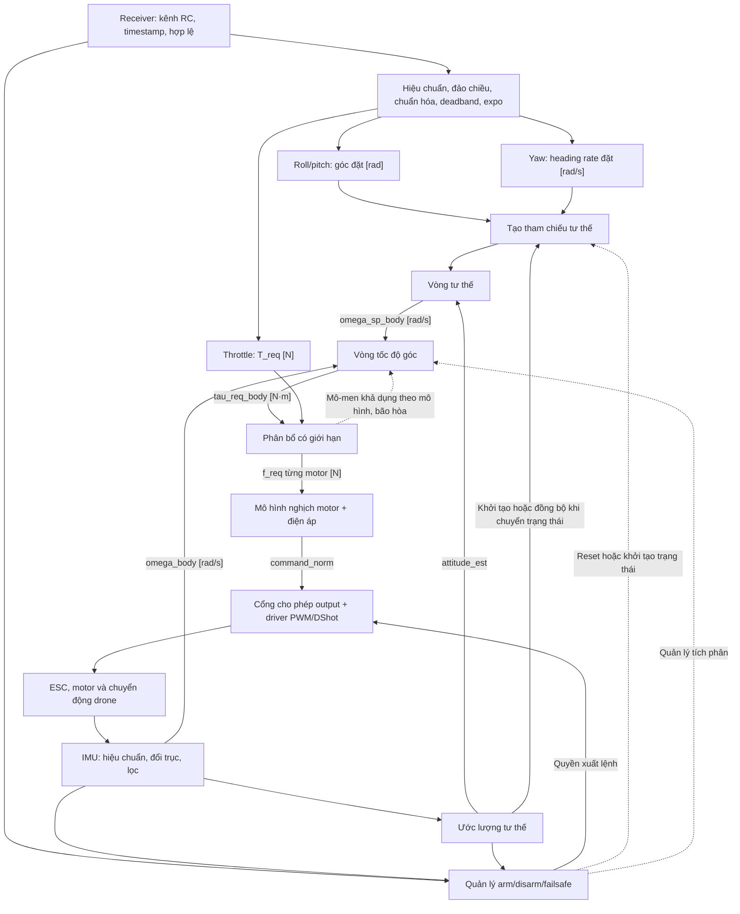

# Kiến trúc firmware drone

## Quyết định và phạm vi

Giữ cấu trúc `Core → App → BSP → Drivers` của khung tích hợp IMU hiện tại.
Đây là nền tảng để phát triển
điều khiển tư thế và tốc độ góc; chưa phải firmware điều khiển bay hoàn chỉnh.
Tài liệu này ghi quyết định tổ chức mã và hướng triển khai tiếp theo, không
xác nhận các module dự kiến đã được cài đặt hoặc kiểm chứng trên board.

| Thành phần                                                           | Trách nhiệm                                                           | Trạng thái                                      |
| -------------------------------------------------------------------- | --------------------------------------------------------------------- | ----------------------------------------------- |
| `Core/`                                                              | HAL, clock, peripheral và vector ngắt do CubeMX quản lý               | Có; khởi tạo GPIO, SPI1, USART1 và TIM4         |
| `App/app.c`                                                          | Sở hữu trạng thái ứng dụng và điều phối module                        | Có `app_init()` và `app_process()`              |
| `App/app_imu`                                                        | Poll IMU, đổi dữ liệu thô sang SI, ghi trạng thái đọc                 | Có                                              |
| `BSP/`                                                               | Gắn board với driver: SPI, CS, delay và cấu hình cảm biến             | Có; SPI1, CS PA4 và delay DWT đã gắn            |
| `Drivers/`                                                           | Bosch Sensor API, STM32 HAL và CMSIS                                  | Có                                              |
| `App/app_receiver`, `App/crsf`, `BSP/bsp_receiver`                   | Nhận UART trong ISR, giải mã CRSF và kiểm tra tuổi khung ở foreground | Có; khung RC `0x16`, chưa kiểm chứng trên board |
| Estimator, controller, allocator, motor output, quản lý arm/failsafe | Chuỗi điều khiển dự kiến bên dưới                                     | Chưa triển khai                                 |

## Điểm gọi ứng dụng và ranh giới module

`main()` giữ thứ tự khởi tạo HAL, clock, peripheral rồi gọi `app_init()` một
lần; vòng `while (1)` gọi `app_process()`. Các lời gọi App nằm trong vùng
`USER CODE` để CubeMX giữ lại khi generate. `main()` và `Error_Handler()`
vẫn thuộc `Core/`; `app.c` không cần cung cấp bản thay thế.

`app.c` là nơi điều phối, không chứa toàn bộ thuật toán điều khiển. Hiện lớp
này chỉ thêm lời gọi hàm, không tạo task, hàng đợi hay cấp phát động. Chi phí
gọi hàm cần được đánh giá trong tổng thời gian vòng lặp; polling và truyền
SPI đồng bộ là những phần cần đo trước khi tối ưu lớp điều phối.

Các module tính toán nhận dữ liệu, trạng thái riêng và `dt` qua API, không
truy cập HAL trực tiếp. Khi thêm controller, tách kiểu mẫu IMU dùng chung khỏi
`app_imu.h`: header hiện kéo theo kiểu BSP, Bosch và STM32 HAL. Controller và
estimator chỉ cần dữ liệu đo, đơn vị, hệ trục, timestamp và trạng thái hợp lệ.
Không cần tạo trước thư mục hoặc module rỗng cho toàn bộ sơ đồ.

## Chuỗi điều khiển dự kiến

Phạm vi ban đầu là điều khiển tay với roll/pitch đặt góc, yaw đặt tốc độ thay
đổi heading và throttle đặt tổng lực đẩy. Chưa bao gồm giữ vị trí hoặc độ cao.

### Hệ trục, đơn vị và tham chiếu yaw

- Chọn hệ trục body FRD: X tiến, Y phải, Z xuống; hệ thế giới NED. Tổng lực
  đẩy `T_req` là độ lớn không âm, lực tác dụng theo hướng `-Z_body`.
  Ghi rõ thứ tự thành phần quaternion và chiều phép quay trong API trước khi
  triển khai estimator/controller; dùng cùng quy ước trong mô phỏng và test.
- Chuyển trục sensor sang body trước khi đưa gyro vào vòng rate. Mẫu hiện tại
  vẫn theo package BMI270, chưa hiệu chuẩn bias hay đổi trục.
- `psi_dot_cmd` là đạo hàm heading Euler, không mặc định bằng tốc độ quay
  quanh Z body khi drone nghiêng. Tích phân heading rate thành heading đặt,
  kết hợp với roll/pitch để tạo tư thế đặt; nếu dùng feedforward, phải biến đổi
  đúng sang body và tránh tính hai lần cùng thành phần.
- Khởi tạo heading đặt từ tư thế hiện tại khi arm hoặc chuyển chế độ. Chỉ
  đồng bộ lại theo chính sách rõ ràng, không ghi đè heading đặt bằng heading
  đo ở mỗi chu kỳ. BMI270 đơn lẻ không cung cấp tham chiếu heading tuyệt đối;
  heading hold vẫn chịu trôi yaw.
- Dữ liệu chung cần có thời điểm mẫu, trạng thái hợp lệ và quy tắc quá hạn.
  Bộ đếm sensor hiện là 24-bit; cần xử lý tràn và xác định quan hệ với thời
  gian MCU trước khi dùng để tính `dt` hoặc kiểm tra tuổi mẫu.

### Giới hạn, mô hình motor và anti-windup

Allocator cần biết vị trí motor, chiều quay, mô-men phản lực và giới hạn lực
của từng motor. Trước khi cài đặt, chốt thứ tự ưu tiên khi không thể đáp ứng
đồng thời thrust và các trục mô-men; kiểm tra bằng các trường hợp bão hòa.

Phản hồi về vòng rate gồm mô-men khả dụng theo mô hình sau phân bổ, phần
không đáp ứng và chiều bão hòa để chống tích lũy tích phân. Đây không phải
mô-men thực đo. Có thể dùng kết quả chu kỳ trước để cập nhật tích phân, hoặc
tách bước tính lệnh và bước cập nhật anti-windup; phải chọn rõ thứ tự thực thi.

Nếu motor model hoặc output còn giới hạn biên, idle hay tốc độ thay đổi lệnh,
các giới hạn đó phải được phản ánh vào phân bổ và phản hồi anti-windup.
Mô hình SI cần tham số lực–lệnh–điện áp và mô-men phản lực phù hợp phần cứng;
ghi rõ tham số nào đã đo, tham số nào chỉ là ước lượng. Không đổi từ tín hiệu
chuẩn hóa sang N/N·m chỉ bằng cách đổi tên biến hoặc giữ nguyên gain PID.

### Quản lý trạng thái và lỗi

Tầng App quản lý tối thiểu `DISARMED`, `ARMED`, `FAILSAFE`; xác định điều kiện
arm, hành vi mất RC, IMU quá hạn, estimator không hợp lệ và lỗi output. Trạng
thái hợp lệ phải được đánh giá cùng tuổi dữ liệu, không chỉ dựa vào lần đọc
thành công gần nhất. Kiểm tra giá trị không hữu hạn trước khi phát lệnh motor.

Quyền xuất lệnh được áp dụng tại output. Khi đổi trạng thái, quản lý cả tích
phân PID và tham chiếu để tránh dùng trạng thái cũ. Mã hiện tại chưa có cơ chế
này: `app_init()`/`app_process()` trả `void`, chưa xử lý kết quả IMU ở tầng
điều phối. Cần bổ sung trạng thái sức khỏe và chính sách phục hồi trước khi
nối chuỗi điều khiển vào motor.

## Định thời và thứ tự triển khai

Ban đầu dùng vòng lặp foreground có lịch chạy rõ ràng, chưa cần RTOS hoặc
mỗi khối một task. ISR thu nhận sự kiện/dữ liệu ngắn gọn; tính toán và SPI
đồng bộ hiện có chạy trong foreground. Nếu dùng dữ liệu chung với ISR, phải
quy định quyền sở hữu bộ đệm và cách lấy snapshot nhất quán.

| Khối                           | Lịch thực thi ban đầu để đo thử                                       |
| ------------------------------ | --------------------------------------------------------------------- |
| IMU, lọc, estimator, vòng rate | Theo mẫu IMU mới hợp lệ; ODR hiện cấu hình 400 Hz                     |
| Vòng attitude                  | Cùng hoặc thấp hơn tần số rate, theo cấu hình chia chu kỳ             |
| RC và tham chiếu               | Nhận frame RC khi có; tiến triển tham chiếu theo thời gian điều khiển |
| Allocation và motor model      | Sau mỗi lần cập nhật rate                                             |
| Output                         | Cập nhật lệnh mới; phát tín hiệu theo định thời giao thức ESC         |
| Trạng thái và giám sát         | Kiểm tra tuổi dữ liệu, lỗi và deadline thường xuyên                   |

400 Hz là cấu hình bring-up hiện tại, chưa phải tần số đã xác nhận phù hợp
cho bay. Dùng thời gian mẫu để tính `dt`, phát hiện mất mẫu và tránh tích phân
qua khoảng gián đoạn lớn. Đo thời gian thực thi, jitter, độ trễ từ mẫu đến
output và thời gian chờ SPI khi lỗi. Băng thông vòng kín và tần số thực thi
là hai đại lượng khác nhau; chọn gain và tần số theo mô hình và kết quả đo.

Thứ tự hoàn thiện:

1. Đối chiếu wiring với SPI1/CS PA4 đã gắn trong BSP; xác nhận IMU và delay trên board.
2. Hoàn thiện timestamp, đổi trục, hiệu chuẩn, lọc và kiểm tra quá hạn.
3. Xây dựng quản lý trạng thái, RC và output; kiểm tra hành vi lỗi trước khi
   cho phép xuất lệnh điều khiển.
4. Kiểm thử vòng rate, allocator và motor model trong mô phỏng và trên bộ
   gá thử phù hợp, sau đó thêm estimator và vòng attitude.
5. Đo deadline và độ trễ toàn chuỗi; telemetry chạy nền, không chặn điều khiển.

Các module tính toán cần kiểm thử độc lập, đặc biệt dấu trục, thứ tự motor,
bão hòa, chuyển trạng thái và dữ liệu quá hạn. Bộ test IMU hiện chỉ mô phỏng
HAL với driver Bosch thật, không xác nhận nối dây hoặc định thời trên board.

## Tài liệu liên quan

- [Quy trình và kiến trúc PX4, ArduPilot](../../docs/research/PX4_ARDUPILOT_ENGINEERING.md):
  đối chiếu các bản sao cục bộ và đề xuất quy ước phát triển phù hợp với đồ án.
- [IMU và kiểm thử](README.md).
- [Cấu hình board, build và debug](../README.md).
- [Khảo sát các vòng điều khiển](../../docs/research/control/01_CHI_TIET_CAC_VONG_DIEU_KHIEN_INPUT_OUTPUT.md).
- [Giao diện SI và chuẩn hóa khi chuyển lực sang PWM/DShot](../../docs/research/HAI_CACH_CHUYEN_LUC_SANG_PWM_DSHOT.md).
- [PX4 Controller Diagrams](https://docs.px4.io/main/en/flight_stack/controller_diagrams):
  tham khảo phân tách đường gyro, vòng tư thế/rate và xử lý tích phân.
