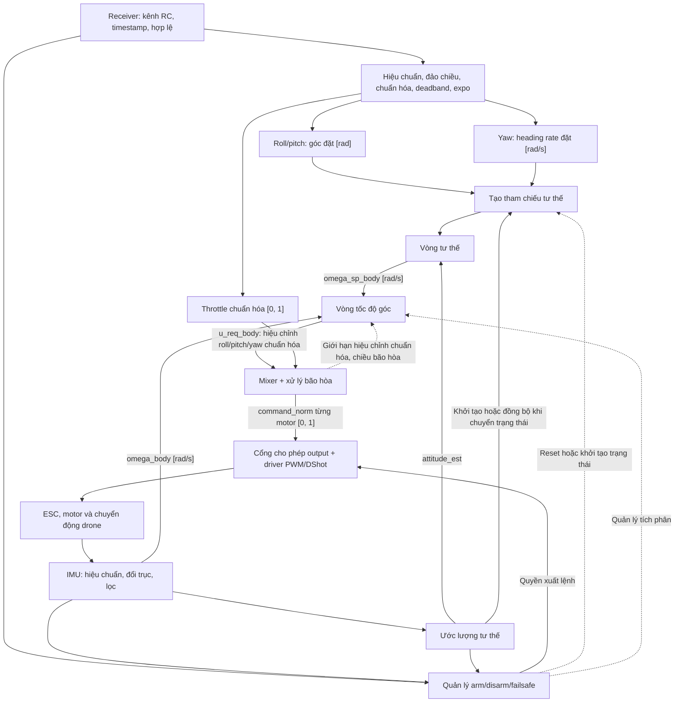

# Kiến trúc firmware drone

## Quyết định và phạm vi

Firmware tổ chức theo các lớp `Core → App → BSP → Drivers`; `App` gọi
thư viện nội bộ `Control/` qua API độc lập HAL để thực hiện tính toán.
Phạm vi là điều khiển tư thế và tốc độ góc cho quadrotor dùng STM32.
Kiểm chứng bằng kiểm thử nhỏ trên máy tính và đo trên board/bộ gá.
Mô phỏng vòng kín, SITL, đo điện áp pin và đo lực đẩy motor nằm ngoài phạm vi.
Chuỗi điều khiển dùng lệnh chuẩn hóa và mixer; không yêu cầu mô hình
lực–lệnh–điện áp của motor.

Tài liệu này xác định kiến trúc đích, trách nhiệm module, hợp đồng dữ liệu
và nguyên tắc thực thi. Khả năng vận hành và hướng dẫn sử dụng thuộc README;
tiến độ thuộc kế hoạch hoặc issue; kết quả đo thuộc `experiments/`.

| Thành phần                     | Trách nhiệm                                                                           |
| ------------------------------ | ------------------------------------------------------------------------------------- |
| `Core/`                        | HAL, clock, khởi tạo ngoại vi và vector ngắt do CubeMX quản lý                        |
| `App/app.c`                    | Điều phối khởi tạo, lịch thực thi và trạng thái ứng dụng                              |
| `App/app_imu`                  | Lấy mẫu IMU, đổi sang SI, theo dõi kết quả đọc và tuổi dữ liệu                        |
| `App/app_receiver`, `App/crsf` | Giải mã CRSF, kiểm tra tuổi khung và cung cấp dữ liệu RC                              |
| `App/app_motor`                | Áp dụng quyền output, kiểm tra và chuyển lệnh chuẩn hóa sang giao thức ESC, xử lý lỗi |
| `Control/`                     | Lọc, toán quaternion, estimator, PID và mixer; độc lập HAL                            |
| `BSP/`                         | Ánh xạ board, tích hợp driver, nhận dữ liệu ngoại vi và phát tín hiệu ESC             |
| `Drivers/`                     | Bosch Sensor API, STM32 HAL và CMSIS                                                  |

## Điểm gọi ứng dụng và ranh giới module

`main()` giữ thứ tự khởi tạo HAL, clock, peripheral rồi gọi `app_init()` một
lần; vòng `while (1)` gọi `app_process()`. Các lời gọi App nằm trong vùng
`USER CODE` để CubeMX giữ lại khi generate. `main()` và `Error_Handler()`
vẫn thuộc `Core/`; `app.c` không cần cung cấp bản thay thế.

`app.c` là nơi điều phối, không chứa toàn bộ thuật toán điều khiển. Lớp này
sử dụng lời gọi hàm, không tạo task, hàng đợi hay cấp phát động. Chi phí
gọi hàm cần được đánh giá trong tổng thời gian vòng lặp; polling và truyền
SPI đồng bộ là những phần cần đo trước khi tối ưu lớp điều phối.

Các module tính toán nhận dữ liệu, trạng thái riêng và `dt` qua API, không
truy cập HAL trực tiếp. Kiểu mẫu IMU dùng chung được khai báo trong header
độc lập App/BSP/HAL/Bosch. Controller và estimator nhận dữ liệu đo với đơn vị,
hệ trục, timestamp và trạng thái hợp lệ được xác định trong hợp đồng API.

### Tổ chức mã

```text
firmware/drone/
├── Core/             # CubeMX, main và khởi tạo ngoại vi
├── App/              # Điều phối, trạng thái, RC, hiệu chuẩn và output
├── Control/          # Thuật toán độc lập phần cứng
│   ├── Inc/          # API, kiểu dữ liệu chung và API theo nhóm
│   │   ├── filters/      # Lọc tín hiệu
│   │   ├── estimator/    # Ước lượng trạng thái
│   │   └── controller/   # Điều khiển
│   └── Src/          # Triển khai tương ứng với Inc/
│       ├── filters/
│       ├── estimator/
│       └── controller/
├── BSP/              # Ánh xạ board và tích hợp ngoại vi
├── Drivers/          # HAL, CMSIS và driver bên ngoài
└── tests/            # Kiểm thử nhỏ trên máy tính
```

`Control/Inc/` và `Control/Src/` chia nhóm tương ứng theo trách nhiệm.
`filters/` chứa bộ lọc tín hiệu như low-pass, notch và phép tính hệ số lọc.
Các thuật toán ước lượng tư thế như complementary filter, Mahony hoặc EKF
thuộc `estimator/`, dù tên thuật toán có chữ “filter”. `controller/` chứa
các vòng điều khiển. Toán quaternion, hiệu chuẩn và mixer
có API riêng; chỉ tách thêm nhóm khi cần. Không tạo thư mục hoặc module rỗng.
Cập nhật source/include trong CMake khi thêm mã.

App cung cấp cấu hình, mẫu và `dt`, quản lý thời điểm gọi và reset bộ lọc.
Mỗi đường tín hiệu có trạng thái lọc riêng; API bộ lọc không tự đọc sensor
hoặc clock. `app.c` giữ thứ tự gọi; trạng thái từng khối được sở hữu bởi
module App tương ứng, tránh dồn mọi hành vi vào một tệp.

| Công việc  | App                                                          | Control                               | BSP                                   |
| ---------- | ------------------------------------------------------------ | ------------------------------------- | ------------------------------------- |
| IMU        | Lấy mẫu, đổi SI, kiểm tra tuổi dữ liệu, điều phối hiệu chuẩn | Tính/áp dụng bias, đổi trục và lọc    | Giao tiếp và cấu hình BMI270          |
| Tư thế     | Cung cấp mẫu/`dt`, quản lý khởi tạo và sức khỏe              | Toán quaternion và estimator          | Không tính tư thế                     |
| Điều khiển | RC, tham chiếu, lịch chạy và chuyển trạng thái               | PID rate/attitude và mixer            | Không tính lệnh điều khiển bay        |
| Motor      | Chế độ thử, quyền output và xử lý lỗi                        | Trộn lệnh và xử lý giới hạn chuẩn hóa | Phát PWM hoặc DShot theo cấu hình ESC |

Trạng thái bộ lọc, estimator và PID được truyền vào API; thuật toán không tự
đọc sensor, clock hay quyết định quyền arm. Header kiểu dữ liệu chung đặt
trong `Control/Inc/`, không include App/BSP/HAL/Bosch. Cấu hình board và tham
số tính toán được tách riêng dù cùng nằm trong project firmware.

### Hiệu chuẩn, quaternion và cấu hình motor

App quyết định khi nào thu mẫu hiệu chuẩn IMU, kiểm tra đứng yên và nạp/lưu
tham số; Control tính và áp dụng hiệu chỉnh. Sau đổi SI, hiệu chuẩn và đổi
trục sang body, dữ liệu tách sang đường rate và estimator với cấu hình lọc
phù hợp từng nhánh. Bộ lọc tín hiệu và estimator tư thế có trạng thái/API
riêng. Quaternion là biểu diễn tư thế; toán quaternion dùng chung giữa
estimator và vòng attitude.

Cấu hình motor gồm xác nhận thứ tự/chiều quay, dải ESC và hiệu chuẩn
endpoint nếu loại ESC yêu cầu. App điều phối chế độ thử qua cổng output;
BSP phát tín hiệu; Control trộn throttle và lệnh hiệu chỉnh các trục theo
cấu hình quadrotor.

Mỗi motor nhận `command_norm` trong `[0, 1]`, biểu diễn lệnh ESC chuẩn hóa.
Giá trị này không biểu diễn lực đẩy theo N hoặc tỷ lệ lực đẩy thực tế.
Ánh xạ từ lệnh chuẩn hóa sang xung PWM hoặc mã DShot thuộc đường output.
Gain PID được chỉnh và kiểm chứng trên board/bộ gá với cấu hình motor,
cánh quạt và ESC cụ thể. Dữ liệu đo đáp ứng và cấu hình đặt trong
`experiments/`; script phân tích đặt trong `tools/`.

## Chuỗi điều khiển

Phạm vi điều khiển là điều khiển tay với roll/pitch đặt góc, yaw đặt tốc độ thay
đổi heading và throttle đặt mức lệnh chung chuẩn hóa. Giữ vị trí và độ cao nằm ngoài phạm vi.



### Hệ trục, đơn vị và tham chiếu yaw

- Chọn hệ trục body FRD: X tiến, Y phải, Z xuống; hệ thế giới NED.
  Lệnh hiệu chỉnh roll/pitch/yaw mang dấu theo chiều quay dương quanh các
  trục body. Throttle và lệnh từng motor dùng thang chuẩn hóa `[0, 1]`.
  Ghi rõ thứ tự thành phần quaternion và chiều phép quay trong API trước khi
  triển khai estimator/controller; dùng cùng quy ước trong test và phép đo.
- Mẫu thô theo hệ trục package BMI270; dữ liệu đưa vào vòng rate và estimator
  phải được hiệu chuẩn bias và chuyển sang hệ trục body.
- `psi_dot_cmd` là đạo hàm heading Euler, không mặc định bằng tốc độ quay
  quanh Z body khi drone nghiêng. Tích phân heading rate thành heading đặt,
  kết hợp với roll/pitch để tạo tư thế đặt; nếu dùng feedforward, phải biến đổi
  đúng sang body và tránh tính hai lần cùng thành phần.
- Khởi tạo heading đặt từ tư thế hiện tại khi arm hoặc chuyển chế độ. Chỉ
  đồng bộ lại theo chính sách rõ ràng, không ghi đè heading đặt bằng heading
  đo ở mỗi chu kỳ. BMI270 đơn lẻ không cung cấp tham chiếu heading tuyệt đối;
  heading hold vẫn chịu trôi yaw.
- Dữ liệu chung cần có thời điểm mẫu, trạng thái hợp lệ và quy tắc quá hạn.
  Bộ đếm thời gian BMI270 là 24-bit; cần xử lý tràn và xác định quan hệ với thời
  gian MCU trước khi dùng để tính `dt` hoặc kiểm tra tuổi mẫu.

### Mixer, giới hạn và anti-windup

Mixer dùng cấu hình quadrotor, thứ tự motor, dấu đóng góp roll/pitch và
chiều quay cho yaw để kết hợp throttle với lệnh hiệu chỉnh từ vòng rate.
Đầu ra PID rate là lệnh hiệu chỉnh chuẩn hóa có dấu, không mang đơn vị N·m.
Hợp đồng mixer phải ghi rõ hệ số, thang lệnh và giới hạn của từng trục.

Chốt chính sách dịch mức throttle, giảm lệnh hiệu chỉnh và ưu tiên các trục
khi lệnh motor vượt giới hạn. Không chỉ cắt từng motor độc lập mà bỏ qua
ảnh hưởng đến các trục điều khiển. Kiểm tra dấu trục, thứ tự motor và các
trường hợp bão hòa bằng kiểm thử nhỏ trên máy tính.

Mixer phản hồi chiều bão hòa hoặc phần hiệu chỉnh không đáp ứng được trong
miền lệnh chuẩn hóa để vòng rate chống tích lũy tích phân. Phản hồi này mô tả
giới hạn lệnh, không phải mô-men hoặc lực thực tế. Có thể dùng kết quả chu kỳ
trước để cập nhật tích phân, hoặc tách bước tính lệnh và cập nhật anti-windup;
phải chọn rõ thứ tự thực thi.

Giới hạn output như idle, biên lệnh và tốc độ thay đổi lệnh phải được phản
ánh vào phản hồi anti-windup. Gain PID gắn với thang lệnh chuẩn hóa và cần
được chỉnh lại khi thay đổi thang lệnh hoặc cấu hình mixer. Không giả định
lệnh chuẩn hóa tuyến tính với lực đẩy; đáp ứng có thể thay đổi theo điện áp
pin và tải motor, cần được đánh giá khi kiểm chứng bộ điều khiển.

### Quản lý trạng thái và lỗi

Tầng App quản lý tối thiểu `DISARMED`, `ARMED`, `FAILSAFE`; xác định điều kiện
arm, hành vi mất RC, IMU quá hạn, estimator không hợp lệ và lỗi output. Trạng
thái hợp lệ phải được đánh giá cùng tuổi dữ liệu, không chỉ dựa vào lần đọc
thành công gần nhất. Kiểm tra giá trị không hữu hạn trước khi phát lệnh motor.

Quyền xuất lệnh được áp dụng tại output. Khi đổi trạng thái, quản lý cả tích
phân PID và tham chiếu để tránh dùng trạng thái cũ. App theo dõi sức khỏe
module, thu hồi quyền output khi dữ liệu quá hạn hoặc lỗi và chỉ cho phép
phục hồi theo điều kiện chuyển trạng thái đã xác định.

Hợp đồng output phân biệt lệnh chuẩn hóa bằng không, mức idle khi armed và
ngừng phát tín hiệu ESC. Chính sách cho từng trạng thái phải chỉ rõ hành vi
đầu ra, cách xử lý lệnh bị từ chối và lỗi driver; không mặc định ngừng PWM
có cùng tác dụng với phát xung tối thiểu.

## Định thời và kiểm chứng

Dùng vòng lặp foreground có lịch chạy rõ ràng, không tổ chức mỗi khối thành
một task riêng. ISR thu nhận sự kiện/dữ liệu ngắn gọn; tính toán và SPI
đồng bộ chạy trong foreground. Nếu dùng dữ liệu chung với ISR, phải
quy định quyền sở hữu bộ đệm và cách lấy snapshot nhất quán.

| Khối                           | Lịch thực thi                                                         |
| ------------------------------ | --------------------------------------------------------------------- |
| IMU, lọc, estimator, vòng rate | Theo mẫu IMU mới hợp lệ, với ODR được cấu hình                        |
| Vòng attitude                  | Cùng hoặc thấp hơn tần số rate, theo cấu hình chia chu kỳ             |
| RC và tham chiếu               | Nhận frame RC khi có; tiến triển tham chiếu theo thời gian điều khiển |
| Mixer và xử lý giới hạn        | Sau mỗi lần cập nhật rate                                             |
| Output                         | Cập nhật lệnh mới; phát tín hiệu theo định thời giao thức ESC         |
| Trạng thái và giám sát         | Kiểm tra tuổi dữ liệu, lỗi và deadline thường xuyên                   |

ODR, tần số vòng điều khiển và tần số phát tín hiệu ESC là các tham số riêng;
lựa chọn theo yêu cầu điều khiển và kết quả đo. Dùng thời gian mẫu để tính
`dt`, phát hiện mất mẫu và tránh tích phân
qua khoảng gián đoạn lớn. Đo thời gian thực thi, jitter, độ trễ từ mẫu đến
output và thời gian chờ SPI khi lỗi. Băng thông vòng kín và tần số thực thi
là hai đại lượng khác nhau; chọn gain và tần số theo yêu cầu điều khiển và kết quả đo đáp ứng.

Kiểm chứng được phân theo trách nhiệm:

- Thuật toán: kiểm thử độc lập bộ lọc, quaternion, estimator, PID và mixer;
  kiểm tra dấu trục, thứ tự motor và bão hòa. Estimator có
  thể dùng dữ liệu tổng hợp và replay log.
- Tích hợp: kiểm tra chuyển trạng thái, dữ liệu quá hạn, quyền output và
  hành vi khi đọc cảm biến hoặc xuất lệnh thất bại.
- Phần cứng: đối chiếu wiring với cấu hình BSP, đo IMU, delay và tín hiệu ESC;
  xác minh output khi tháo cánh và đo đáp ứng điều khiển trên
  bộ gá phù hợp.
- Định thời: đo thời gian thực thi, jitter và độ trễ toàn chuỗi cả khi lỗi;
  telemetry chạy nền, không chặn điều khiển.

Kiểm thử HAL mô phỏng trên máy tính không thay thế phép đo nối dây,
định thời và đáp ứng trên board/bộ gá. Giữ dữ liệu đo và cấu hình thí nghiệm
để tái lập kết quả.

## Quyết định thiết kế cần chốt

- Thứ tự thành phần quaternion và chiều phép quay giữa body và NED.
- Nguồn thời gian mẫu, quan hệ giữa clock sensor và MCU, giới hạn `dt` và
  ngưỡng quá hạn của từng loại dữ liệu.
- Điều kiện chuyển trạng thái arm/disarm/failsafe, chính sách phục hồi và
  hành vi tín hiệu ESC tương ứng.
- Hệ số và thang lệnh mixer, ưu tiên các trục khi bão hòa và thứ tự cập nhật
  anti-windup.

## Tài liệu liên quan

- [Quy trình và kiến trúc PX4, ArduPilot](../../docs/research/PX4_ARDUPILOT_ENGINEERING.md):
  đối chiếu các bản sao cục bộ và đề xuất quy ước phát triển phù hợp với đồ án.
- [IMU và kiểm thử](README.md).
- [Cấu hình board, build và debug](../README.md).
- [Khảo sát các vòng điều khiển](../../docs/research/control/01_CHI_TIET_CAC_VONG_DIEU_KHIEN_INPUT_OUTPUT.md).
- [Giao diện SI và chuẩn hóa khi chuyển lực sang PWM/DShot](../../docs/research/HAI_CACH_CHUYEN_LUC_SANG_PWM_DSHOT.md).
- [PX4 Controller Diagrams](https://docs.px4.io/main/en/flight_stack/controller_diagrams):
  tham khảo phân tách đường gyro, vòng tư thế/rate và xử lý tích phân.
