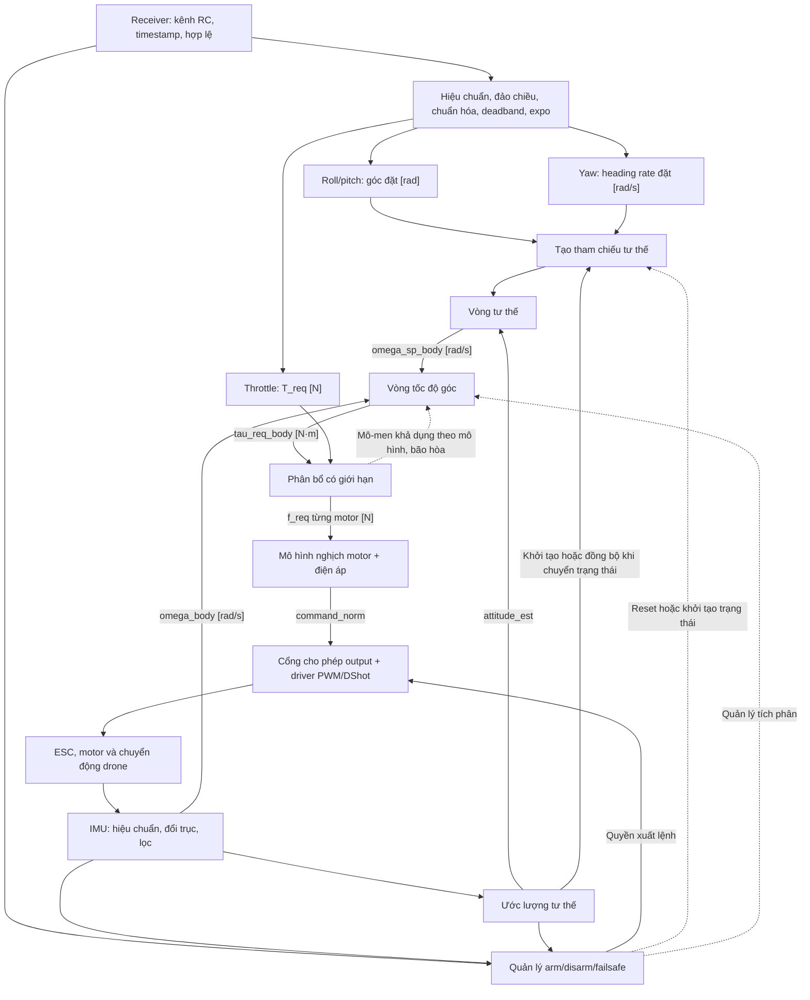

# Kiến trúc firmware drone

## Quyết định và phạm vi

Giữ cấu trúc `Core → App → BSP → Drivers` của khung tích hợp IMU hiện tại.
Đây là nền tảng để phát triển
điều khiển tư thế và tốc độ góc; chưa phải firmware điều khiển bay hoàn chỉnh.
Tài liệu này ghi quyết định tổ chức mã và hướng triển khai tiếp theo, không
xác nhận các module dự kiến đã được cài đặt hoặc kiểm chứng trên board.

| Thành phần                                                               | Trách nhiệm                                               | Trạng thái                              |
| ------------------------------------------------------------------------ | --------------------------------------------------------- | --------------------------------------- |
| `Core/`                                                                  | HAL, clock, peripheral và vector ngắt do CubeMX quản lý   | Có; khởi tạo GPIO, SPI1, USART1 và TIM4 |
| `App/app.c`                                                              | Sở hữu trạng thái ứng dụng và điều phối module            | Có `app_init()` và `app_process()`      |
| `App/app_imu`                                                            | Poll IMU, đổi dữ liệu thô sang SI, ghi trạng thái đọc     | Có                                      |
| `BSP/`                                                                   | Gắn board với driver: SPI, CS, delay và cấu hình cảm biến | Có; SPI1, CS PA4 và delay DWT đã gắn    |
| `Drivers/`                                                               | Bosch Sensor API, STM32 HAL và CMSIS                      | Có                                      |
| RC, estimator, controller, allocator, motor output, quản lý arm/failsafe | Chuỗi điều khiển dự kiến bên dưới                         | Chưa triển khai                         |

## Điểm gọi ứng dụng và ranh giới module

`main()` giữ thứ tự khởi tạo HAL, clock, peripheral rồi gọi `app_init()` một
lần; vòng `while (1)` gọi `app_process()`. Các lời gọi App nằm trong vùng
`USER CODE` để CubeMX giữ lại khi generate. `main()` và `Error_Handler()`
vẫn thuộc `Core/`; `app.c` không cần cung cấp bản thay thế.

`app.c` là nơi điều phối, không chứa toàn bộ thuật toán điều khiển. Hiện lớp
này chỉ thêm lời gọi hàm, không tạo task, hàng đợi hay cấp phát động. Chi phí
gọi hàm cần được đánh giá trong tổng thời gian vòng lặp; polling và truyền
SPI đồng bộ là những phần cần đo trước khi tối ưu lớp điều phối.

Các module tính toán nhận dữ liệu, trạng thái riêng và `dt` qua API, không
truy cập HAL trực tiếp. Khi thêm controller, tách kiểu mẫu IMU dùng chung khỏi
`app_imu.h`: header hiện kéo theo kiểu BSP, Bosch và STM32 HAL. Controller và
estimator chỉ cần dữ liệu đo, đơn vị, hệ trục, timestamp và trạng thái hợp lệ.
Không cần tạo trước thư mục hoặc module rỗng cho toàn bộ sơ đồ.

## Quy ước phát triển

### Quyền quản lý cấu hình và tài nguyên

| Thành phần                                             | Nơi quản lý                                | Quy tắc thay đổi                                                                                        |
| ------------------------------------------------------ | ------------------------------------------ | ------------------------------------------------------------------------------------------------------- |
| Clock, pin mux, GPIO mode, SPI mode/clock, DMA và NVIC | `drone.ioc` và phần `Core/` do CubeMX sinh | Chỉnh `.ioc`, generate rồi kiểm tra diff; mã tự viết trong file sinh tự động nằm trong vùng `USER CODE` |
| Ánh xạ cảm biến với SPI handle và chân CS              | `BSP/Src/bsp_board.c`                      | Tham chiếu handle và tên chân do CubeMX sinh; không khởi tạo lại SPI hoặc pin mux                       |
| Giao dịch cảm biến                                     | `BSP/Src/bsp_bmi270.c`                     | Gắn callback Bosch, quản lý CS theo giao dịch, gọi HAL và trả trạng thái                                |
| Delay micro giây                                       | `BSP/Src/bsp_time.c`                       | Quản lý DWT; khởi tạo sau clock, trước khi sử dụng; không tự đổi system clock                           |
| Cấu hình thanh ghi BMI270                              | `bsp_bmi270_init()`                        | Đổi ODR/range cùng hằng số mô tả và hệ số chuyển đổi liên quan; cập nhật test                           |
| Trạng thái ứng dụng và sử dụng mẫu đo                  | `App/`                                     | Điều phối, đổi đơn vị, xử lý trạng thái; không cấu hình lại ngoại vi MCU                                |
| Source và include của module tự viết                   | `CMakeLists.txt` cấp project               | Đăng ký tại đây; để CubeMX quản lý `cmake/stm32cubemx/`                                                 |

CubeMX cấu hình CS là GPIO output có mức ban đầu high; BSP kéo CS low/high
trong từng giao dịch. CubeMX khởi tạo SPI; BSP sử dụng handle đã sẵn sàng.
Đây là hai giai đoạn khác nhau của cùng tài nguyên. Không tạo thêm một hàm
khởi tạo SPI riêng trong BSP cho bus đã do CubeMX quản lý.

SPI HAL hiện do CubeMX quản lý trong `stm32f1xx_hal_conf.h` và
`cmake/stm32cubemx/CMakeLists.txt`; không đăng ký thêm macro/source SPI HAL ở
CMake cấp project. BSP gắn `hspi1` với `IMU_CS` (PA4) và bật delay DWT trước
khi trả cấu hình. `main()` đã init clock, GPIO và SPI trước khi gọi App.
Việc gắn board đã có trong code, nhưng chưa xác nhận cảm biến trên phần cứng.

Mỗi tài nguyên dùng chung phải có nơi sở hữu và quy tắc truy cập: SPI bus,
timer, DMA channel, bộ đệm và trạng thái module. Hiện BSP/App IMU chỉ chạy
trong một foreground context; caller phải tuần tự hóa bus SPI nếu có thêm
thiết bị dùng chung. Khi thêm DMA hoặc ISR, ghi rõ bên ghi, bên đọc và thời
điểm chuyển quyền dùng buffer trước khi triển khai.

### Đặt module và hướng phụ thuộc

- `Core/`: mã do CubeMX quản lý và các điểm gọi App trong vùng `USER CODE`.
- `App/Inc`, `App/Src`: điều phối và xử lý ứng dụng. `app.c` sở hữu trạng thái
  và gọi các module; tránh dồn mọi thuật toán vào file này.
- `BSP/Inc`, `BSP/Src`: mã phụ thuộc board, cổng giao tiếp driver và timing.
  Dùng tiền tố `bsp_`; không đưa thuật toán điều khiển bay vào BSP.
- `Drivers/`: driver bên thứ ba, HAL và CMSIS. Giữ nguyên mã upstream;
  nếu bắt buộc vá, ghi nguồn/phiên bản, lý do và nội dung bản vá trong tài liệu
  đi kèm driver. Đặt phần tích hợp STM32 trong BSP khi có thể.
- `tests/`: kiểm thử trên máy tính; tách HAL mô phỏng khỏi source firmware.
  Thêm thư mục theo module khi có test thực tế, không tạo trước các khung rỗng.

Luồng tích hợp IMU hiện tại là App → BSP → driver Bosch → callback BSP → HAL.
Driver Bosch không phụ thuộc App; BSP không gọi ngược App. Khi thêm estimator
hoặc controller, dùng kiểu dữ liệu đo chung không kéo theo HAL/Bosch; API tính
toán nhận mẫu, trạng thái và `dt` rõ ràng.

### Hợp đồng API và Doxygen

Viết Doxygen bằng tiếng Anh cho API công khai và các kiểu có ràng buộc sử dụng
trong header tự viết. README và tài liệu kiến trúc dùng tiếng Việt như hiện tại.
Comment trong `.c` giải thích lý do, giới hạn hoặc trình tự bắt buộc; không
lặp lại từng câu lệnh và không sao chép hợp đồng API từ header sang source.

Tùy API, mô tả các mục có ảnh hưởng tới cách gọi:

- `@brief`: hành vi của hàm; `@param[in]`, `@param[out]`, `@param[in,out]`:
  hướng dữ liệu, đơn vị, phạm vi hợp lệ và trường hợp chấp nhận `NULL`.
- `@pre`: thứ tự khởi tạo và trạng thái tài nguyên cần có trước khi gọi.
- `@return` hoặc `@retval`: trạng thái thành công, chưa có dữ liệu và lỗi;
  dữ liệu đầu ra có được giữ nguyên khi thất bại hay không.
- `@note`: foreground/ISR, blocking, quyền sở hữu con trỏ/buffer, thời gian
  tồn tại, địa chỉ cố định và yêu cầu tuần tự hóa truy cập.
- Với mẫu đo: ghi đơn vị, thứ tự trục, hệ trục, nguồn timestamp và quy tắc tràn.
  Phân biệt mẫu mới hợp lệ với mẫu còn đủ mới để điều khiển.

Sửa tài liệu cùng commit khi thay đổi hành vi API. Chưa cần sinh website
Doxygen; hợp đồng phải đọc được trực tiếp trong header và editor.

### Kiểm tra trước khi commit

1. Khi thay đổi ngoại vi, cập nhật `.ioc`, generate và xem diff để phát hiện
   thay đổi ngoài ý muốn; kiểm tra thứ tự init trước khi gọi App.
2. Đăng ký source/include nếu thêm module. Format mã tự viết theo cấu hình repo;
   không format lại `Core/`, driver upstream hoặc các file generator quản lý.
3. Chạy build firmware khi đổi C/header, cấu hình phần cứng hoặc build. Chạy
   bộ test liên quan khi đổi logic BSP/App; lệnh nằm trong
   [README](README.md#build-và-kiểm-thử). Thay đổi chỉ có comment/tài liệu cần
   kiểm tra format, link và tính khớp với code.
4. Với thay đổi giao tiếp hoặc timing, ghi rõ phần đã test bằng HAL mô phỏng
   và phần đã kiểm tra trên board. Kết quả mô phỏng không xác nhận wiring,
   tần số SPI, delay thực tế hoặc jitter.
5. Cập nhật README khi đổi thao tác/trạng thái hỗ trợ, ARCHITECTURE khi đổi
   ranh giới hoặc quyết định thiết kế. Không commit build output, compile
   database, cache hoặc đường dẫn công cụ cá nhân.

## Chuỗi điều khiển dự kiến

Phạm vi ban đầu là điều khiển tay với roll/pitch đặt góc, yaw đặt tốc độ thay
đổi heading và throttle đặt tổng lực đẩy. Chưa bao gồm giữ vị trí hoặc độ cao.

### Hệ trục, đơn vị và tham chiếu yaw

- Chọn hệ trục body FRD: X tiến, Y phải, Z xuống; hệ thế giới NED. Tổng lực
  đẩy `T_req` là độ lớn không âm, lực tác dụng theo hướng `-Z_body`.
  Ghi rõ thứ tự thành phần quaternion và chiều phép quay trong API trước khi
  triển khai estimator/controller; dùng cùng quy ước trong mô phỏng và test.
- Chuyển trục sensor sang body trước khi đưa gyro vào vòng rate. Mẫu hiện tại
  vẫn theo package BMI270, chưa hiệu chuẩn bias hay đổi trục.
- `psi_dot_cmd` là đạo hàm heading Euler, không mặc định bằng tốc độ quay
  quanh Z body khi drone nghiêng. Tích phân heading rate thành heading đặt,
  kết hợp với roll/pitch để tạo tư thế đặt; nếu dùng feedforward, phải biến đổi
  đúng sang body và tránh tính hai lần cùng thành phần.
- Khởi tạo heading đặt từ tư thế hiện tại khi arm hoặc chuyển chế độ. Chỉ
  đồng bộ lại theo chính sách rõ ràng, không ghi đè heading đặt bằng heading
  đo ở mỗi chu kỳ. BMI270 đơn lẻ không cung cấp tham chiếu heading tuyệt đối;
  heading hold vẫn chịu trôi yaw.
- Dữ liệu chung cần có thời điểm mẫu, trạng thái hợp lệ và quy tắc quá hạn.
  Bộ đếm sensor hiện là 24-bit; cần xử lý tràn và xác định quan hệ với thời
  gian MCU trước khi dùng để tính `dt` hoặc kiểm tra tuổi mẫu.

### Giới hạn, mô hình motor và anti-windup

Allocator cần biết vị trí motor, chiều quay, mô-men phản lực và giới hạn lực
của từng motor. Trước khi cài đặt, chốt thứ tự ưu tiên khi không thể đáp ứng
đồng thời thrust và các trục mô-men; kiểm tra bằng các trường hợp bão hòa.

Phản hồi về vòng rate gồm mô-men khả dụng theo mô hình sau phân bổ, phần
không đáp ứng và chiều bão hòa để chống tích lũy tích phân. Đây không phải
mô-men thực đo. Có thể dùng kết quả chu kỳ trước để cập nhật tích phân, hoặc
tách bước tính lệnh và bước cập nhật anti-windup; phải chọn rõ thứ tự thực thi.

Nếu motor model hoặc output còn giới hạn biên, idle hay tốc độ thay đổi lệnh,
các giới hạn đó phải được phản ánh vào phân bổ và phản hồi anti-windup.
Mô hình SI cần tham số lực–lệnh–điện áp và mô-men phản lực phù hợp phần cứng;
ghi rõ tham số nào đã đo, tham số nào chỉ là ước lượng. Không đổi từ tín hiệu
chuẩn hóa sang N/N·m chỉ bằng cách đổi tên biến hoặc giữ nguyên gain PID.

### Quản lý trạng thái và lỗi

Tầng App quản lý tối thiểu `DISARMED`, `ARMED`, `FAILSAFE`; xác định điều kiện
arm, hành vi mất RC, IMU quá hạn, estimator không hợp lệ và lỗi output. Trạng
thái hợp lệ phải được đánh giá cùng tuổi dữ liệu, không chỉ dựa vào lần đọc
thành công gần nhất. Kiểm tra giá trị không hữu hạn trước khi phát lệnh motor.

Quyền xuất lệnh được áp dụng tại output. Khi đổi trạng thái, quản lý cả tích
phân PID và tham chiếu để tránh dùng trạng thái cũ. Mã hiện tại chưa có cơ chế
này: `app_init()`/`app_process()` trả `void`, chưa xử lý kết quả IMU ở tầng
điều phối. Cần bổ sung trạng thái sức khỏe và chính sách phục hồi trước khi
nối chuỗi điều khiển vào motor.

## Định thời và thứ tự triển khai

Ban đầu dùng vòng lặp foreground có lịch chạy rõ ràng, chưa cần RTOS hoặc
mỗi khối một task. ISR thu nhận sự kiện/dữ liệu ngắn gọn; tính toán và SPI
đồng bộ hiện có chạy trong foreground. Nếu dùng dữ liệu chung với ISR, phải
quy định quyền sở hữu bộ đệm và cách lấy snapshot nhất quán.

| Khối                           | Lịch thực thi ban đầu để đo thử                                       |
| ------------------------------ | --------------------------------------------------------------------- |
| IMU, lọc, estimator, vòng rate | Theo mẫu IMU mới hợp lệ; ODR hiện cấu hình 400 Hz                     |
| Vòng attitude                  | Cùng hoặc thấp hơn tần số rate, theo cấu hình chia chu kỳ             |
| RC và tham chiếu               | Nhận frame RC khi có; tiến triển tham chiếu theo thời gian điều khiển |
| Allocation và motor model      | Sau mỗi lần cập nhật rate                                             |
| Output                         | Cập nhật lệnh mới; phát tín hiệu theo định thời giao thức ESC         |
| Trạng thái và giám sát         | Kiểm tra tuổi dữ liệu, lỗi và deadline thường xuyên                   |

400 Hz là cấu hình bring-up hiện tại, chưa phải tần số đã xác nhận phù hợp
cho bay. Dùng thời gian mẫu để tính `dt`, phát hiện mất mẫu và tránh tích phân
qua khoảng gián đoạn lớn. Đo thời gian thực thi, jitter, độ trễ từ mẫu đến
output và thời gian chờ SPI khi lỗi. Băng thông vòng kín và tần số thực thi
là hai đại lượng khác nhau; chọn gain và tần số theo mô hình và kết quả đo.

Thứ tự hoàn thiện:

1. Đối chiếu wiring với SPI1/CS PA4 đã gắn trong BSP; xác nhận IMU và delay trên board.
2. Hoàn thiện timestamp, đổi trục, hiệu chuẩn, lọc và kiểm tra quá hạn.
3. Xây dựng quản lý trạng thái, RC và output; kiểm tra hành vi lỗi trước khi
   cho phép xuất lệnh điều khiển.
4. Kiểm thử vòng rate, allocator và motor model trong mô phỏng và trên bộ
   gá thử phù hợp, sau đó thêm estimator và vòng attitude.
5. Đo deadline và độ trễ toàn chuỗi; telemetry chạy nền, không chặn điều khiển.

Các module tính toán cần kiểm thử độc lập, đặc biệt dấu trục, thứ tự motor,
bão hòa, chuyển trạng thái và dữ liệu quá hạn. Bộ test IMU hiện chỉ mô phỏng
HAL với driver Bosch thật, không xác nhận nối dây hoặc định thời trên board.

## Tài liệu liên quan

- [Quy trình và kiến trúc PX4, ArduPilot](../../docs/research/PX4_ARDUPILOT_ENGINEERING.md):
  đối chiếu các bản sao cục bộ và đề xuất quy ước phát triển phù hợp với đồ án.
- [Build, cấu hình board và kiểm thử IMU](README.md).
- [Hướng dẫn firmware chung](../README.md).
- [Khảo sát các vòng điều khiển](../../docs/research/control/01_CHI_TIET_CAC_VONG_DIEU_KHIEN_INPUT_OUTPUT.md).
- [Giao diện SI và chuẩn hóa khi chuyển lực sang PWM/DShot](../../docs/research/HAI_CACH_CHUYEN_LUC_SANG_PWM_DSHOT.md).
- [PX4 Controller Diagrams](https://docs.px4.io/main/en/flight_stack/controller_diagrams):
  tham khảo phân tách đường gyro, vòng tư thế/rate và xử lý tích phân.
